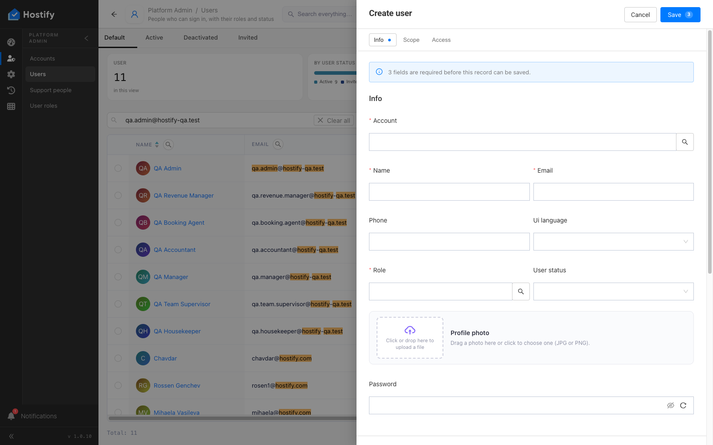
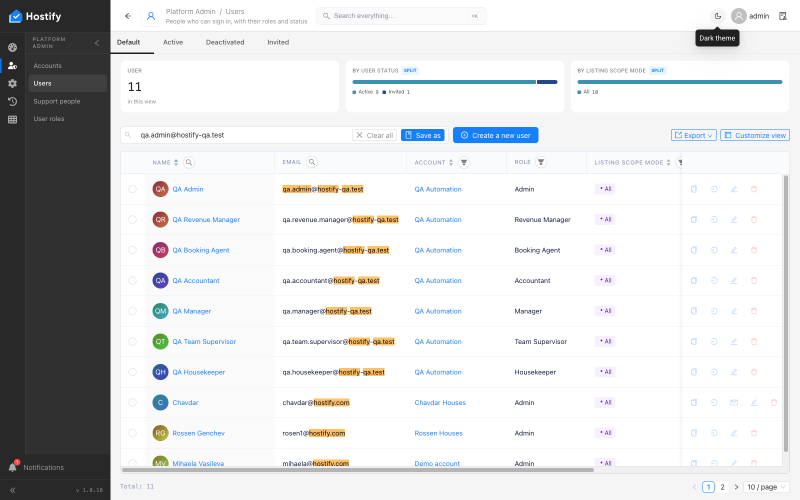

# 006-platform-admin-users — Platform Admin › Users — формата „Create user“ на супер администратора: всяко поле, всеки таб, валидацията

- Пуск: 2026-11-09_12-13-55 · Приложение: https://hostify.bioseek.eu · Версия: 1.0.10
- Спек: `tests/e2e/006-platform-admin-users.spec.ts`
- Казуси: 1 от 1 проверки

## Казус 1: the Create user form opens, every tab is presentable, an empty Save is refused

_Нов в този пуск._

**Какво се обърка**

```
Error: The page reported 1 error(s) — API answers, failed requests, console errors:
- [console.error] [dashboard] decorator load failed TypeError: Failed to fetch @ https://hostify.bioseek.eu/app/static/js/main.2463612a.js
```
- конзола: [dashboard] decorator load failed TypeError: Failed to fetch — `/app/static/js/main.2463612a.js`

**Как да се възпроизведе**

1. Влез в https://hostify.bioseek.eu/app/ като суперадминистратор (alarm@mail.bg).
2. Страница: https://hostify.bioseek.eu/app/platformAdmin/users
3. Спек `tests/e2e/006-platform-admin-users.spec.ts`, проверка „the Create user form opens, every tab is presentable, an empty Save is refused“.
4. Developer tools › Console показва грешките по-горе.

**Скрийншоти**





**Предупреждения в конзолата**

- [AlertsMenuCount] TypeError: Failed to fetch

---

Какво проверява спекът: 006 — Platform Admin › Users: the super administrator's Create user form behaves and follows its layout.
