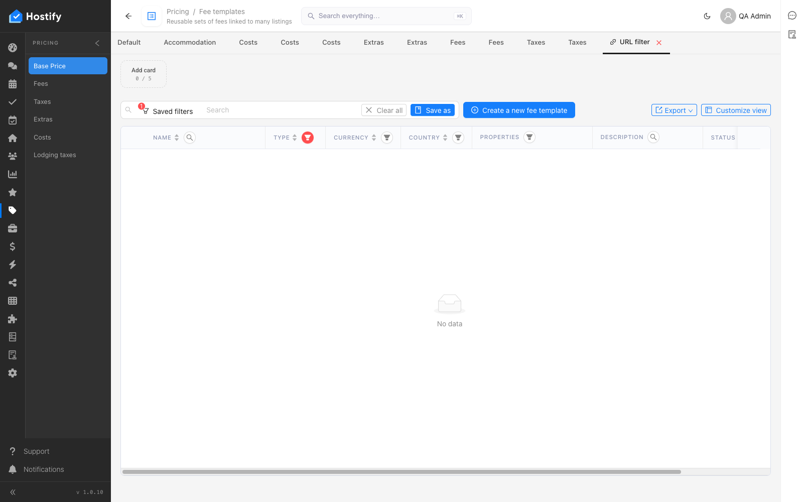

# 010-account-pages — проверка на навбар менютата на акаунта (всяка страница се отваря и се оглежда)

- Пуск: 2026-11-09_13-37-22 · Приложение: https://hostify.bioseek.eu · Версия: 1.0.10
- Спек: `tests/e2e/010-account-pages.spec.ts`
- Казуси: 1 от 1 проверки

## Казус 1: pricingBasePrice opens (/app/pricing/pricingBasePrice)

_Известен от пуска 2026-11-09 13:36 (същата версия) — не е отстранен._

**Какво се обърка**

```
Error: the URL of "pricingBasePrice"

expect(page).toHaveURL(expected) failed

Expected pattern: /\/app\/pricing\/pricingBasePrice(\/|\?|$)/
Received string:  "https://hostify.bioseek.eu/app/pricing/feeTemplates?feeItemType=_or&feeItemType=accommodation"
Timeout: 45000ms

Call log:
  - the URL of "pricingBasePrice" with timeout 45000ms
    47 × unexpected value "https://hostify.bioseek.eu/app/pricing/feeTemplates?feeItemType=_or&feeItemType=accommodation"

```

**Как да се възпроизведе**

1. Влез в https://hostify.bioseek.eu/app/ като администратор на акаунта (qa.admin@hostify-qa.test).
2. Меню: PRICING › Base Price — https://hostify.bioseek.eu/app/pricing/pricingBasePrice
3. Спек `tests/e2e/010-account-pages.spec.ts`, проверка „pricingBasePrice opens (/app/pricing/pricingBasePrice)“.

**Скрийншоти**




---

Какво проверява спекът: 010 — every page of the ACCOUNT menu opens for the account administrator of the QA account.
