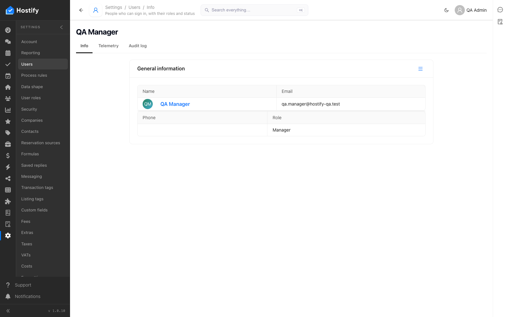
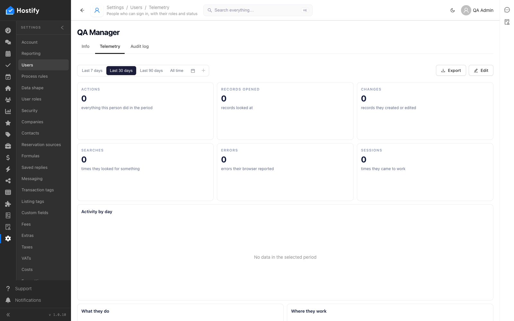
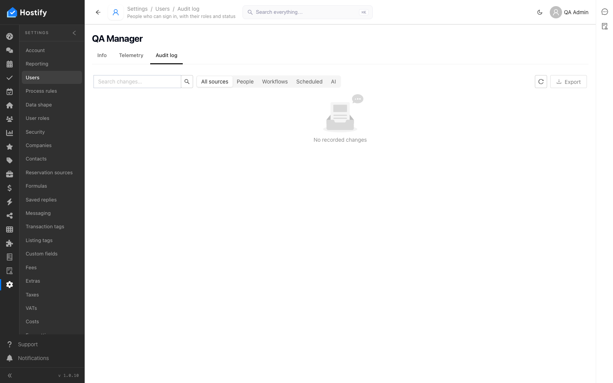
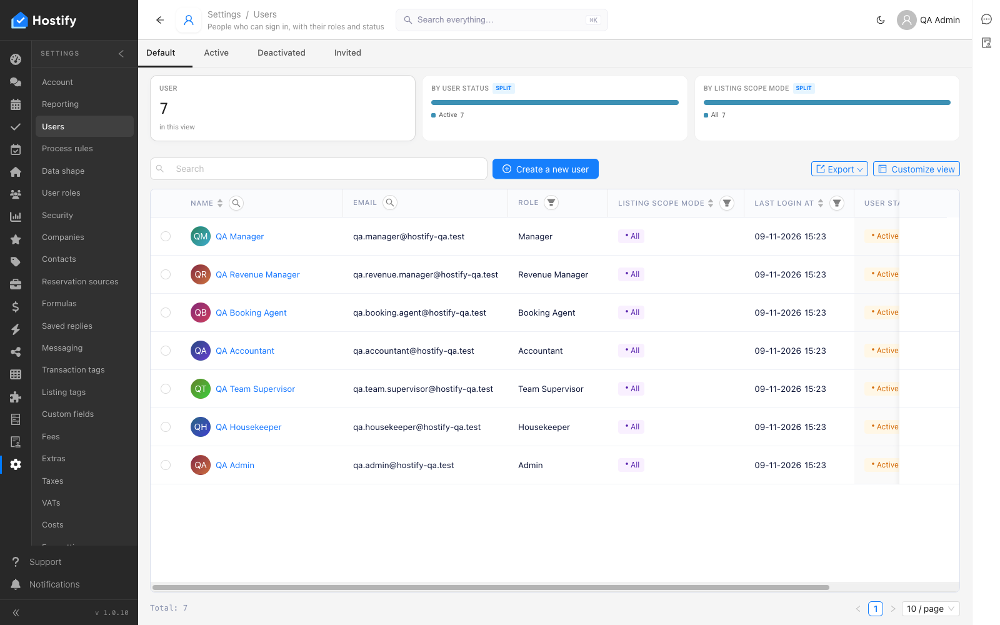

# 100-settings-users — Settings › Users — по един потребител на роля през формата; всеки влиза с известната парола

- Пуск: 2026-11-09_15-22-34 · Приложение: https://hostify.bioseek.eu · Версия: 1.0.10
- Спек: `tests/e2e/100-settings-users.spec.ts`
- Казуси: 1 от 4 проверки

## Казус 1: every column sorts and filters; the item page of a user opens with its tabs

_Нов в този пуск._

**Какво се обърка**

```
Error: rows after filtering "Email" by "supervisor" (a value of the first row)

expect(received).toBeGreaterThan(expected)

Expected: > 0
Received:   0
```

**Как да се възпроизведе**

1. Влез в https://hostify.bioseek.eu/app/ като администратор на акаунта (qa.admin@hostify-qa.test).
2. Страница: https://hostify.bioseek.eu/app/settings/users
3. Спек `tests/e2e/100-settings-users.spec.ts`, проверка „every column sorts and filters; the item page of a user opens with its tabs“ — стъпките:
4. sort the column "Name" ascending (click its header)
5. sort the column "Name" descending (click its header)
6. filter the column "Name" by "Supervisor" (its filter icon), then Clear all
7. filter the column "Email" by "supervisor" (its filter icon), then Clear all
8. filter the column "Role" by "Supervisor" (its filter icon), then Clear all
9. sort the column "Listing scope mode" ascending (click its header)
10. sort the column "Listing scope mode" descending (click its header)
11. filter the column "Listing scope mode" by "All" (its filter icon), then Clear all
12. sort the column "Last login at" ascending (click its header)
13. sort the column "Last login at" descending (click its header)
14. sort the column "User status" ascending (click its header)
15. sort the column "User status" descending (click its header)
16. filter the column "User status" by "Active" (its filter icon), then Clear all
17. open the first record of the row (its link) — the item page
18. open the tab "info" of the item page
19. open the tab "telemetry" of the item page
20. open the tab "auditLog" of the item page

**Скрийншоти**








**Предупреждения в конзолата**

- [ReviewsMenuChannels] TypeError: Failed to fetch
- [hydraPartner] navbarExtensionLoader failed TypeError: Failed to fetch
- [InboxMenuCount] TypeError: Failed to fetch
- [demoData] the demo data status could not be read — no welcome modal TypeError: Failed to fetch
- [AlertsMenuCount] TypeError: Failed to fetch
- [hydraPartner] the plugin surfaces were not read TypeError: Failed to fetch

---

Какво проверява спекът: 100 — Settings › Users: the people of the QA account, one per role, through the Users form.
