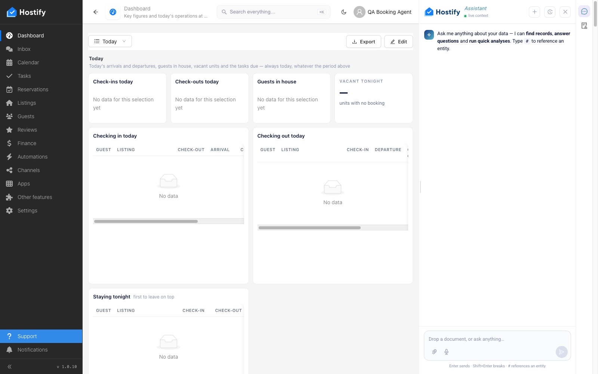
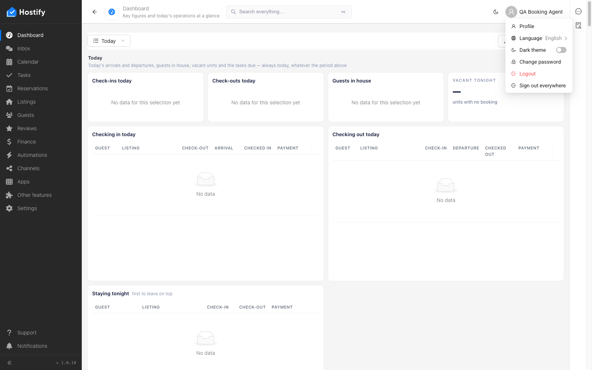

# 101-navbar-support-assistant — Support в лявото меню отваря асистента (не стария месинджър) — за администратора и за booking agent

- Пуск: 2026-11-09_15-54-06 · Приложение: https://hostify.bioseek.eu · Версия: 1.0.10
- Спек: `tests/e2e/101-navbar-support-assistant.spec.ts`
- Казуси: 1 от 2 проверки

## Казус 1: a booking agent: „Support“ opens the assistant

_Нов в този пуск._

**Какво се обърка**

```
Error: The page reported 1 error(s) — API answers, failed requests, console errors:
- [api.status] GET 403 @ https://hostify.bioseek.eu/api/partnerEnabled/search?tenant=f2b3ad65-0d9a-4992-929c-3abe4823df98&active=true&size=100
```
- сървърът отговори: GET 403 — `/api/partnerEnabled/search?tenant=f2b3ad65-0d9a-4992-929c-3abe4823df98&active=true&size=100`

**Как да се възпроизведе**

1. Влез в https://hostify.bioseek.eu/app/ като bookingAgent на акаунта (qa.booking.agent@hostify-qa.test).
2. Страница: https://hostify.bioseek.eu/app/dashboards/
3. Спек `tests/e2e/101-navbar-support-assistant.spec.ts`, проверка „a booking agent: „Support“ opens the assistant“.
4. Developer tools › Network: заявките по-горе отговарят така.

**Скрийншоти**





**Предупреждения в конзолата**

- [InboxMenuCount] TypeError: Failed to fetch
- [ReviewsMenuChannels] TypeError: Failed to fetch
- [hydraPartner] navbarExtensionLoader failed TypeError: Failed to fetch
- [demoData] the demo data status could not be read — no welcome modal TypeError: Failed to fetch
- [AlertsMenuCount] TypeError: Failed to fetch
- [hydraPartner] the plugin surfaces were not read TypeError: Failed to fetch
- [hydraPartner] navbarExtensionLoader failed Response
- [hydraPartner] the plugin surfaces were not read Response

---

Какво проверява спекът: 101 — „Support“ of the left menu opens the assistant (1.0.7: the separate support messenger is gone).
