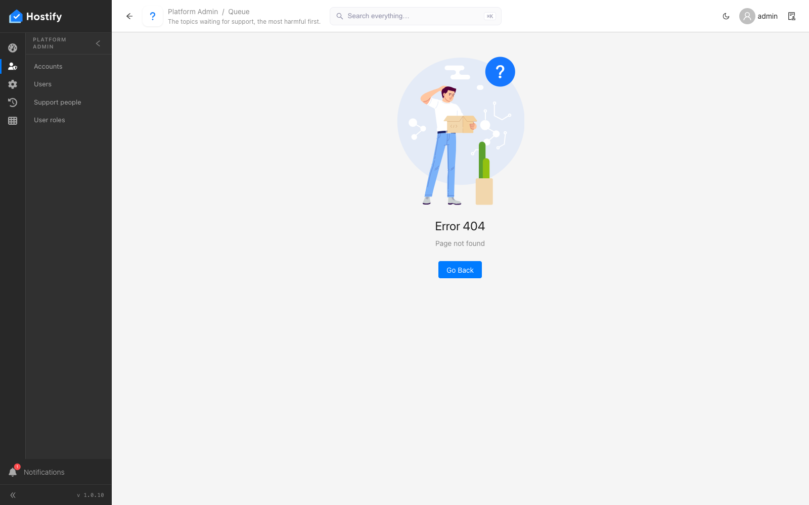
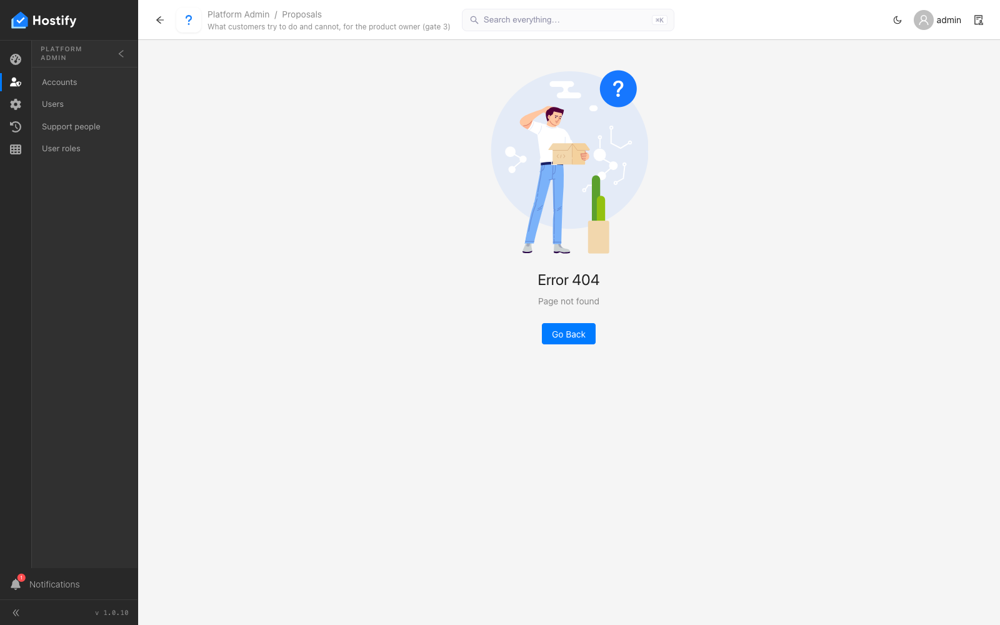

# 007-platform-support-pages — поддръжката в платформената конзола — Support people, Queue и Proposals се отварят и се оглеждат

- Пуск: 2026-11-09_16-01-42 · Приложение: https://hostify.bioseek.eu · Версия: 1.0.10
- Спек: `tests/e2e/007-platform-support-pages.spec.ts`
- Казуси: 2 от 3 проверки

## Казус 1: Queue opens (/app/platformAdmin/supportQueue)

_Нов в този пуск._

**Какво се обърка**

```
Error: Queue shows its content, not "Page not found" — QUESTION for the developers: is the page meant only for the people of Support people? The super administrator is not one of them

expect(locator).toBeHidden() failed

Locator:  locator('.ant-result-404').or(getByText(/^Page not found$/)).first()
Expected: hidden
Received: visible
Timeout:  15000ms

Call log:
  - Queue shows its content, not "Page not found" — QUESTION for the developers: is the page meant only for the people of Support people? The super administrator is not one of them with timeout 15000ms
  - waiting for locator('.ant-result-404').or(getByText(/^Page not found$/)).first()
```
- конзола: [dashboard] definition load failed TypeError: Failed to fetch — `/app/static/js/main.2463612a.js`

**Как да се възпроизведе**

1. Влез в https://hostify.bioseek.eu/app/ като суперадминистратор (alarm@mail.bg).
2. Страница: https://hostify.bioseek.eu/app/platformAdmin/supportQueue
3. Спек `tests/e2e/007-platform-support-pages.spec.ts`, проверка „Queue opens (/app/platformAdmin/supportQueue)“.
4. Developer tools › Console показва грешките по-горе.

**Скрийншоти**




**Предупреждения в конзолата**

- [AlertsMenuCount] TypeError: Failed to fetch

## Казус 2: Proposals opens (/app/platformAdmin/supportProposals)

_Нов в този пуск._

**Какво се обърка**

```
Error: Proposals shows its content, not "Page not found" — QUESTION for the developers: is the page meant only for the people of Support people? The super administrator is not one of them

expect(locator).toBeHidden() failed

Locator:  locator('.ant-result-404').or(getByText(/^Page not found$/)).first()
Expected: hidden
Received: visible
Timeout:  15000ms

Call log:
  - Proposals shows its content, not "Page not found" — QUESTION for the developers: is the page meant only for the people of Support people? The super administrator is not one of them with timeout 15000ms
  - waiting for locator('.ant-result-404').or(getByText(/^Page not found$/)).first()
```
- конзола: [dashboard] definition load failed TypeError: Failed to fetch — `/app/static/js/main.2463612a.js`

**Как да се възпроизведе**

1. Влез в https://hostify.bioseek.eu/app/ като суперадминистратор (alarm@mail.bg).
2. Страница: https://hostify.bioseek.eu/app/platformAdmin/supportProposals
3. Спек `tests/e2e/007-platform-support-pages.spec.ts`, проверка „Proposals opens (/app/platformAdmin/supportProposals)“.
4. Developer tools › Console показва грешките по-горе.

**Скрийншоти**




**Предупреждения в конзолата**

- [AlertsMenuCount] TypeError: Failed to fetch

---

Какво проверява спекът: 007 — the support pages of the platform console open for the super administrator (1.0.7 – 1.0.10).
