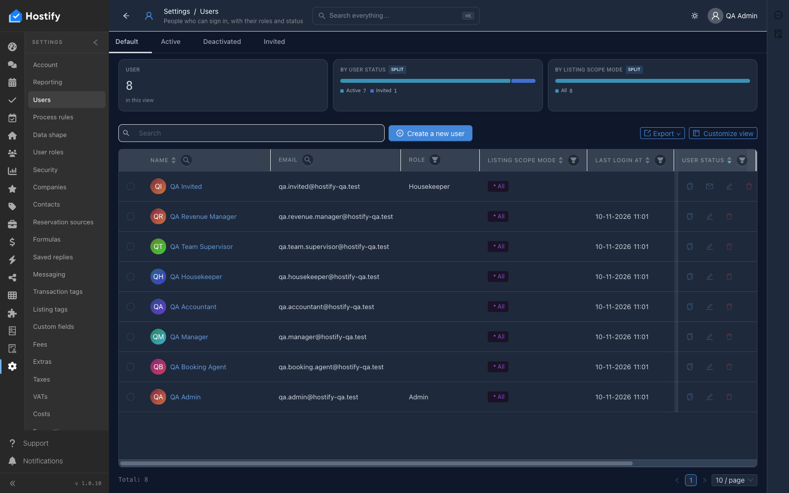

# 100-settings-users — Settings › Users — по един потребител на роля през формата; всеки влиза с известната парола

- Пуск: 2026-11-10_11-00-25 · Приложение: https://hostify.bioseek.eu · Версия: 1.0.10
- Спек: `tests/e2e/100-settings-users.spec.ts`
- Казуси: 1 от 5 проверки

## Казус 1: a user of every role exists — created through the form when missing — and signs in

_Известен от пуска 2026-11-10 10:52 (същата версия) — не е отстранен._

**Какво се обърка**

```
Error: The page reported 1 error(s) — API answers, failed requests, console errors:
- [console.error] [dashboard] definition load failed TypeError: Failed to fetch @ https://hostify.bioseek.eu/app/static/js/main.2463612a.js
```
- конзола: [dashboard] definition load failed TypeError: Failed to fetch — `/app/static/js/main.2463612a.js`

**Как да се възпроизведе**

1. Влез в https://hostify.bioseek.eu/app/ като администратор на акаунта (qa.admin@hostify-qa.test).
2. Страница: https://hostify.bioseek.eu/app/settings/users
3. Спек `tests/e2e/100-settings-users.spec.ts`, проверка „a user of every role exists — created through the form when missing — and signs in“ — стъпките:
4. Manager: qa.manager@hostify-qa.test
5. Revenue Manager: qa.revenue.manager@hostify-qa.test
6. Booking Agent: qa.booking.agent@hostify-qa.test
7. Accountant: qa.accountant@hostify-qa.test
8. Team Supervisor: qa.team.supervisor@hostify-qa.test
9. Housekeeper: qa.housekeeper@hostify-qa.test
10. the invited person: qa.invited@hostify-qa.test (status Invited, no password)
11. Developer tools › Console показва грешките по-горе.

**Скрийншоти**




**Предупреждения в конзолата**

- [hydraPartner] navbarExtensionLoader failed TypeError: Failed to fetch
- [InboxMenuCount] TypeError: Failed to fetch
- [ReviewsMenuChannels] TypeError: Failed to fetch
- [hydraPartner] the plugin surfaces were not read TypeError: Failed to fetch
- [AlertsMenuCount] Response

---

Какво проверява спекът: 100 — Settings › Users: the people of the QA account, one per role, through the Users form.
