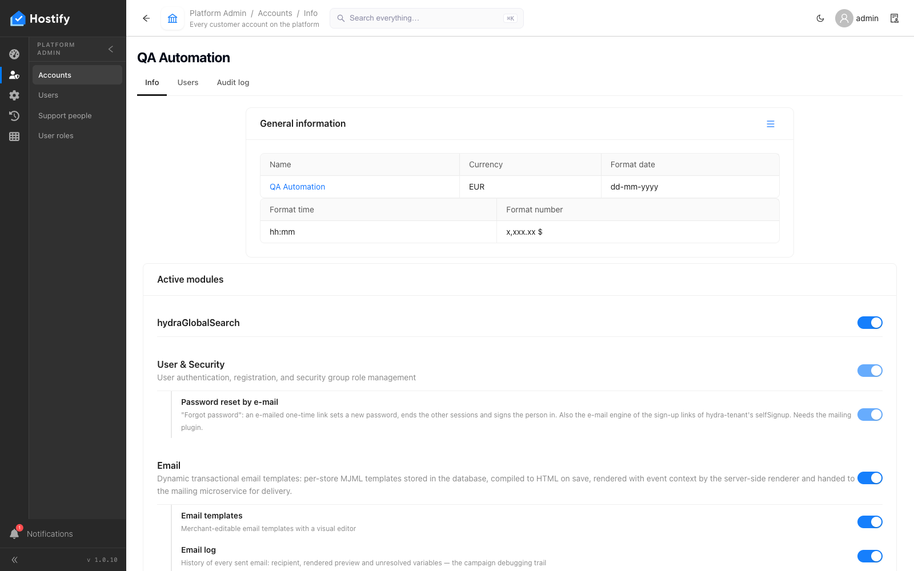
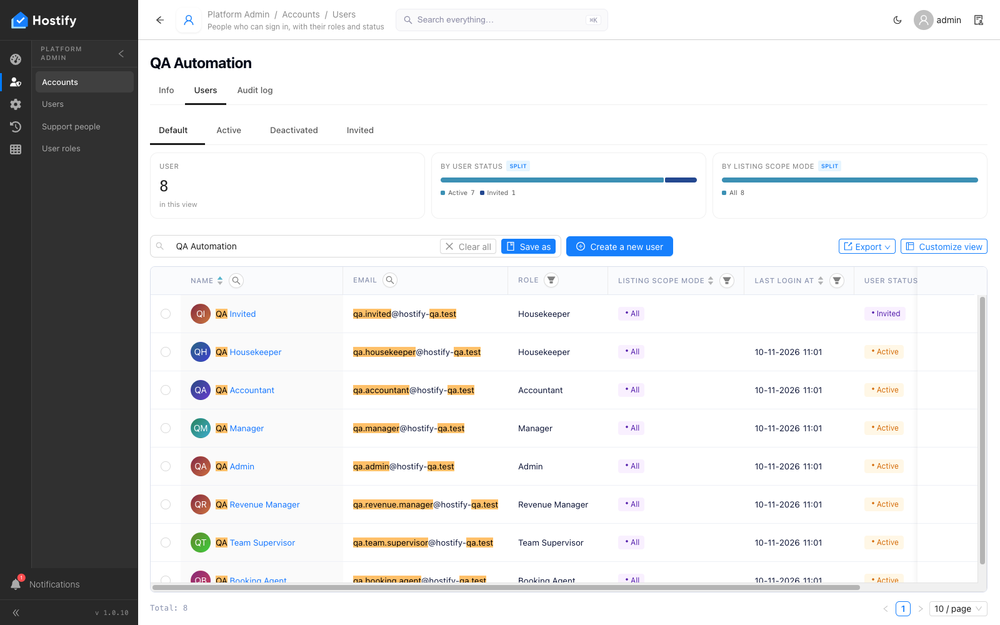
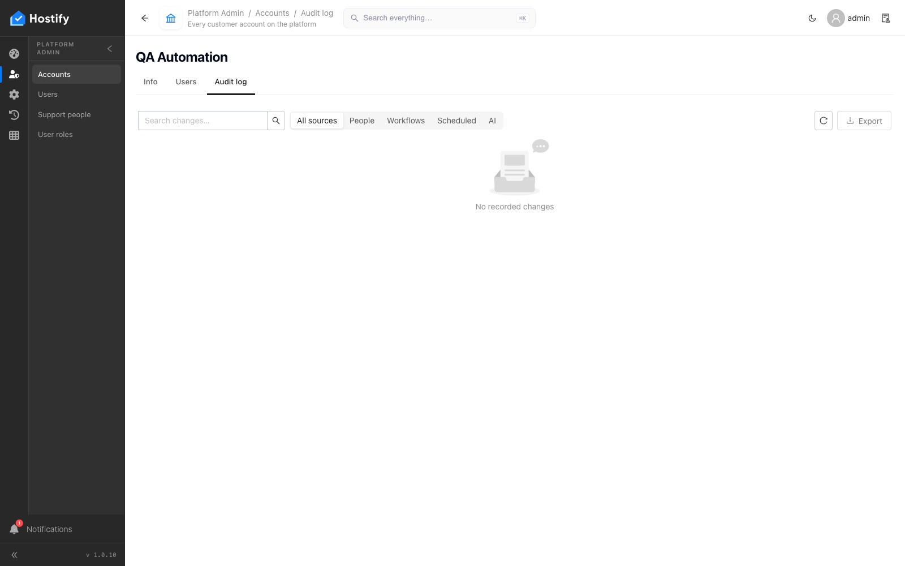

# 105-platform-account-users — Platform Admin › Accounts › QA Automation — табът Users показва точно хората на акаунта

- Пуск: 2026-11-10_11-01-40 · Приложение: https://hostify.bioseek.eu · Версия: 1.0.10
- Спек: `tests/e2e/105-platform-account-users.spec.ts`
- Казуси: 1 от 1 проверки

## Казус 1: the QA account's record page has a Users tab with exactly its people

_Известен от пуска 2026-11-10 10:53 (същата версия) — не е отстранен._

**Какво се обърка**

```
TimeoutError: page.waitForResponse: Timeout 45000ms exceeded while waiting for event "response"
```

**Как да се възпроизведе**

1. Влез в https://hostify.bioseek.eu/app/ като суперадминистратор (alarm@mail.bg).
2. Страница: https://hostify.bioseek.eu/app/platformAdmin/tenants
3. Спек `tests/e2e/105-platform-account-users.spec.ts`, проверка „the QA account's record page has a Users tab with exactly its people“ — стъпките:
4. open the first record of the row (its link) — the item page
5. the record page looks like a record page: head, white page, the tabs of the grid
6. open the tab "info" of the item page
7. open the tab "users" of the item page
8. open the tab "auditLog" of the item page

**Скрийншоти**





_(снимката е махната от QA: на нея се виждаха данни на други акаунти)_


**Предупреждения в конзолата**

- [AlertsMenuCount] TypeError: Failed to fetch

---

Какво проверява спекът: 105 — Platform Admin › Accounts › QA Automation › Users: the account's people (1.0.7).
