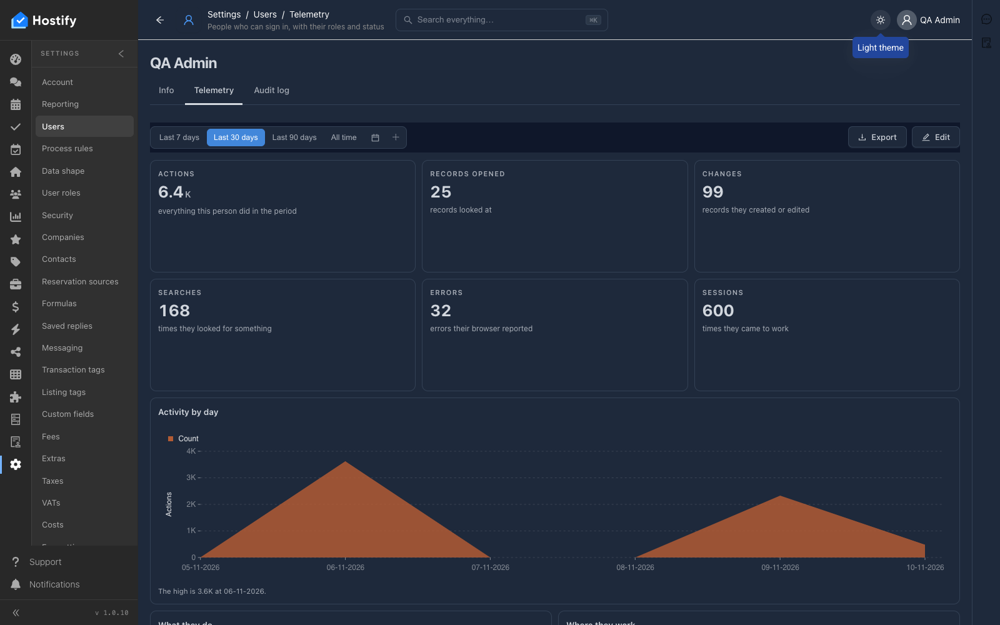
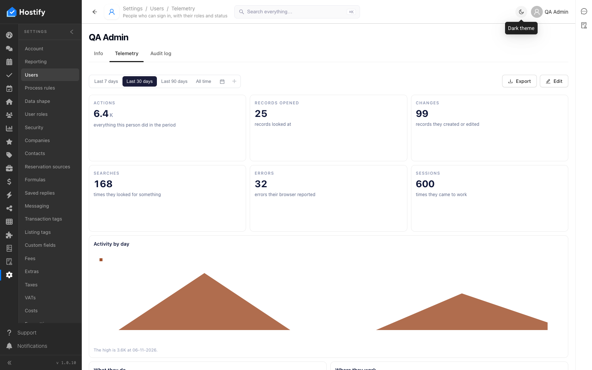
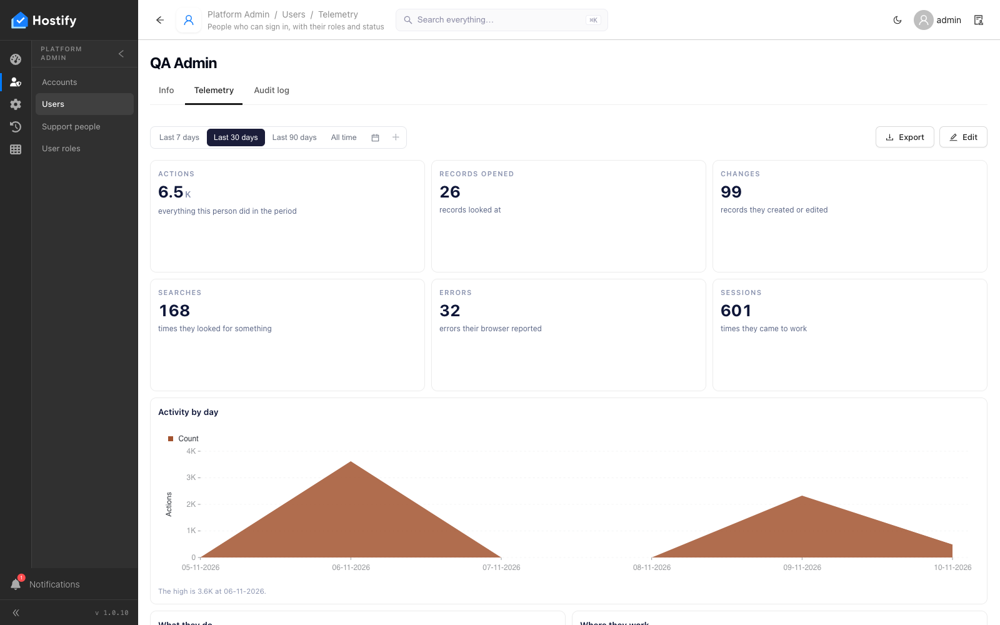

# 111-user-telemetry — Telemetry на човек — какво е направил (таговете на 110), часът на устройството му, тъмната тема

- Пуск: 2026-11-10_11-01-40 · Приложение: https://hostify.bioseek.eu · Версия: 1.0.10
- Спек: `tests/e2e/111-user-telemetry.spec.ts`
- Казуси: 2 от 4 проверки

## Казус 1: in the dark theme the Changes card and table are dark and readable; the theme goes back to light

_Известен от пуска 2026-11-10 10:53 (същата версия) — не е отстранен._

**Какво се обърка**

```
TimeoutError: page.waitForResponse: Timeout 30000ms exceeded while waiting for event "response"
```

**Как да се възпроизведе**

1. Влез в https://hostify.bioseek.eu/app/ като администратор на акаунта (qa.admin@hostify-qa.test).
2. Страница: https://hostify.bioseek.eu/app/settings/users/614d3d67-77d4-4351-abf8-90443678862d/telemetry
3. Спек `tests/e2e/111-user-telemetry.spec.ts`, проверка „in the dark theme the Changes card and table are dark and readable; the theme goes back to light“.

**Скрийншоти**





**Предупреждения в конзолата**

- [hydraPartner] navbarExtensionLoader failed TypeError: Failed to fetch
- [InboxMenuCount] TypeError: Failed to fetch
- [ReviewsMenuChannels] TypeError: Failed to fetch
- [AlertsMenuCount] TypeError: Failed to fetch
- [demoData] the demo data status could not be read — no welcome modal TypeError: Failed to fetch
- [hydraPartner] the plugin surfaces were not read TypeError: Failed to fetch

## Казус 2: Users

_Известен от пуска 2026-11-10 10:53 (същата версия) — не е отстранен._

**Какво се обърка**

```
Error: The page reported 1 error(s) — API answers, failed requests, console errors:
- [console.error] [dashboard] decorator load failed TypeError: Failed to fetch @ https://hostify.bioseek.eu/app/static/js/main.2463612a.js
```
- конзола: [dashboard] decorator load failed TypeError: Failed to fetch — `/app/static/js/main.2463612a.js`

**Как да се възпроизведе**

1. Влез в https://hostify.bioseek.eu/app/ като суперадминистратор (alarm@mail.bg).
2. Страница: https://hostify.bioseek.eu/app/platformAdmin/users
3. Спек `tests/e2e/111-user-telemetry.spec.ts`, проверка „Users“.
4. Developer tools › Console показва грешките по-горе.

**Скрийншоти**


_(снимката е махната от QA: на нея се виждаха данни на други акаунти)_


**Предупреждения в конзолата**

- [AlertsMenuCount] TypeError: Failed to fetch

---

Какво проверява спекът: 111 — a person's Telemetry: what the person did, the time on the person's own device, the dark theme (1.0.7–1.0.10).
