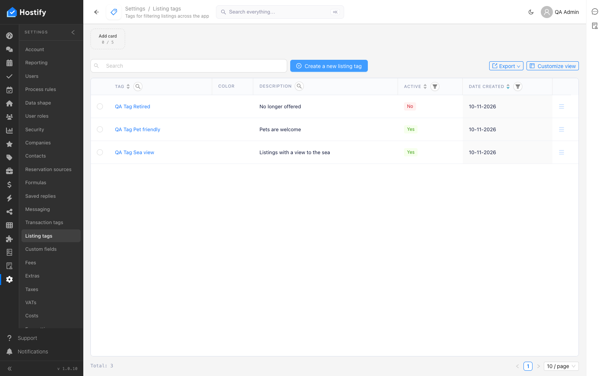

# 110-settings-listing-tags — Settings › Listing tags: форма, записи през формата, сортиране и филтър по колони, табове, броене

- Пуск: 2026-11-10_11-11-55 · Приложение: https://hostify.bioseek.eu · Версия: 1.0.10
- Спек: `tests/e2e/110-settings-listing-tags.spec.ts`
- Казуси: 1 от 6 проверки

## Казус 1: every column sorts and filters; the item page opens with its tabs

_Нов в този пуск._

**Какво се обърка**

```
Error: the grid shows its view tabs (Default …)

expect(locator).toBeVisible() failed

Locator: locator('.ant-tabs.ant-tabs-editable:visible').first()
Expected: visible
Timeout: 15000ms
Error: element(s) not found

Call log:
  - the grid shows its view tabs (Default …) with timeout 15000ms
  - waiting for locator('.ant-tabs.ant-tabs-editable:visible').first()
```

**Как да се възпроизведе**

1. Влез в https://hostify.bioseek.eu/app/ като администратор на акаунта (qa.admin@hostify-qa.test).
2. Страница: https://hostify.bioseek.eu/app/settings/listingTags
3. Спек `tests/e2e/110-settings-listing-tags.spec.ts`, проверка „every column sorts and filters; the item page opens with its tabs“ — стъпките:
4. every column has a header and the actions column is the last one
5. sort the column "Tag" ascending (click its header)
6. sort the column "Tag" descending (click its header)
7. filter the column "Tag" by "view" (its filter icon), then Clear all
8. filter the column "Description" by "Listings" (its filter icon), then Clear all
9. sort the column "Active" ascending (click its header)
10. sort the column "Active" descending (click its header)
11. filter the column "Active" by "Yes" (its filter icon), then Clear all
12. sort the column "Date created" ascending (click its header)
13. sort the column "Date created" descending (click its header)
14. filter the column "Date created" by "2026" (its filter icon), then Clear all

**Скрийншоти**




**Предупреждения в конзолата**

- [InboxMenuCount] TypeError: Failed to fetch
- [ReviewsMenuChannels] TypeError: Failed to fetch
- [hydraPartner] navbarExtensionLoader failed TypeError: Failed to fetch
- [AlertsMenuCount] TypeError: Failed to fetch
- [demoData] the demo data status could not be read — no welcome modal TypeError: Failed to fetch
- [hydraPartner] the plugin surfaces were not read TypeError: Failed to fetch

---

Какво проверява спекът: 110 — Settings › Listing tags: the first master-data page, and the TEMPLATE of a page spec.
