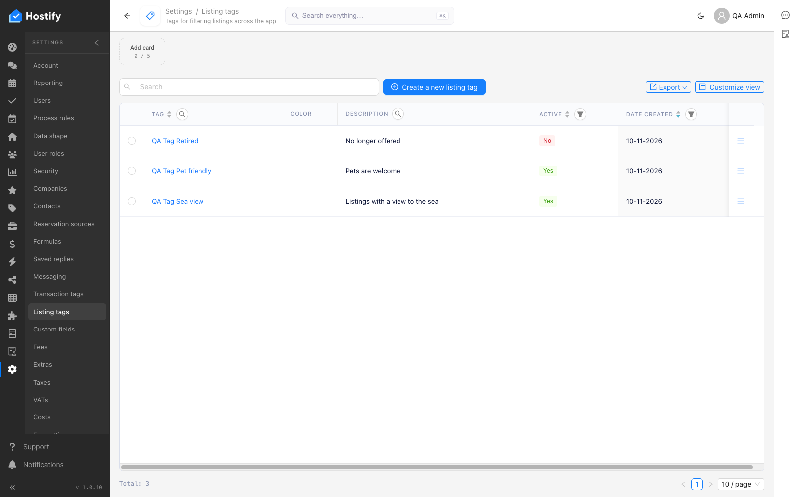

# 110-settings-listing-tags — Settings › Listing tags: форма, записи през формата, сортиране и филтър по колони, табове, броене

- Пуск: 2026-11-10_11-33-45 · Приложение: https://hostify.bioseek.eu · Версия: 1.0.10
- Спек: `tests/e2e/110-settings-listing-tags.spec.ts`
- Казуси: 1 от 6 проверки

## Казус 1: three tags are created through the form and appear in the grid

_Известен от пуска 2026-11-09 12:15 (същата версия) — не е отстранен._

**Какво се обърка**

```
Error: The page reported 1 error(s) — API answers, failed requests, console errors:
- [console.error] [dashboard] definition load failed TypeError: Failed to fetch @ https://hostify.bioseek.eu/app/static/js/main.2463612a.js
```
- конзола: [dashboard] definition load failed TypeError: Failed to fetch — `/app/static/js/main.2463612a.js`

**Как да се възпроизведе**

1. Влез в https://hostify.bioseek.eu/app/ като администратор на акаунта (qa.admin@hostify-qa.test).
2. Страница: https://hostify.bioseek.eu/app/settings/listingTags
3. Спек `tests/e2e/110-settings-listing-tags.spec.ts`, проверка „three tags are created through the form and appear in the grid“ — стъпките:
4. create "QA Tag Sea view"
5. create "QA Tag Pet friendly"
6. create "QA Tag Retired"
7. Developer tools › Console показва грешките по-горе.

**Скрийншоти**





**Предупреждения в конзолата**

- [ReviewsMenuChannels] TypeError: Failed to fetch
- [hydraPartner] navbarExtensionLoader failed TypeError: Failed to fetch
- [InboxMenuCount] TypeError: Failed to fetch
- [demoData] the demo data status could not be read — no welcome modal TypeError: Failed to fetch
- [AlertsMenuCount] TypeError: Failed to fetch
- [hydraPartner] the plugin surfaces were not read TypeError: Failed to fetch

---

Какво проверява спекът: 110 — Settings › Listing tags: the first master-data page, and the TEMPLATE of a page spec.
