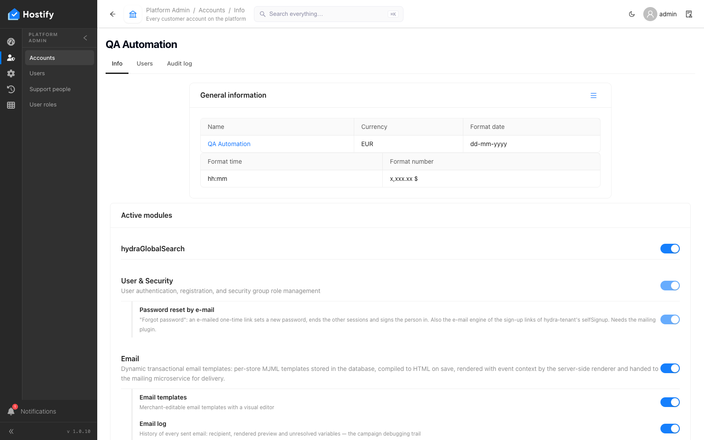
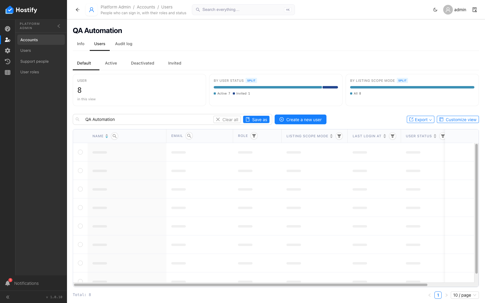
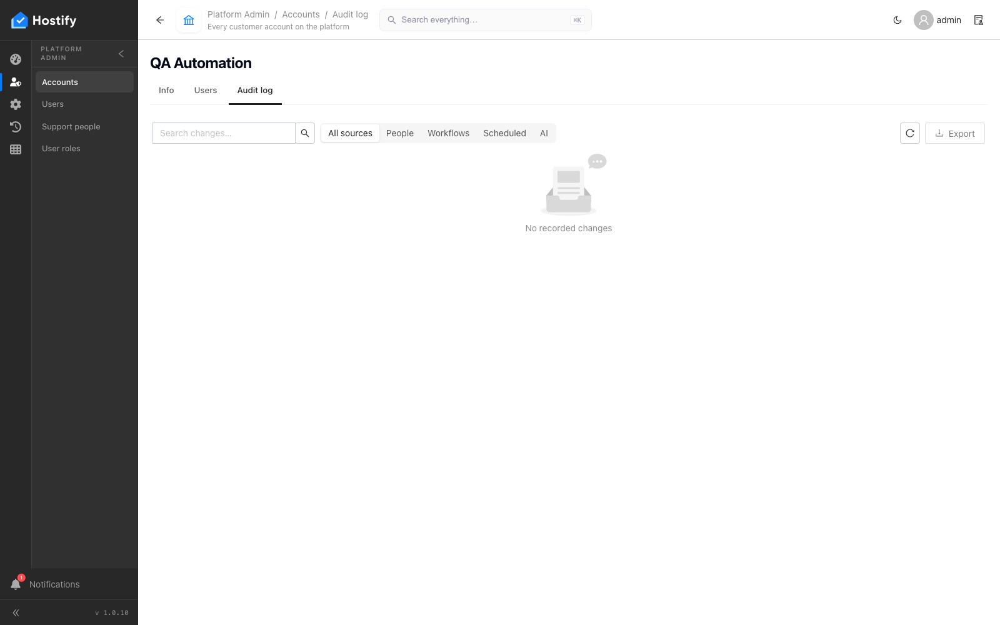
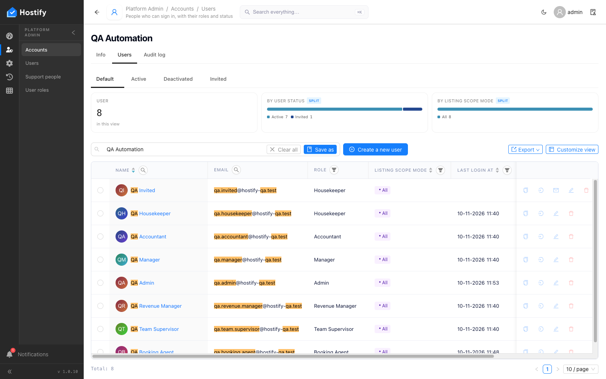
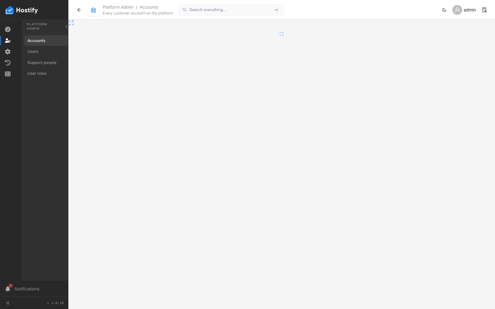

# 105-platform-account-users — Platform Admin › Accounts › QA Automation — табът Users показва точно хората на акаунта

- Пуск: 2026-11-10_11-53-41 · Приложение: https://hostify.bioseek.eu · Версия: 1.0.10
- Спек: `tests/e2e/105-platform-account-users.spec.ts`
- Казуси: 1 от 1 проверки

## Казус 1: the QA account's record page has a Users tab with exactly its people

_Известен от пуска 2026-11-10 11:52 (същата версия) — не е отстранен._

**Какво се обърка**

```
Error: the tab sorts by name ascend — the order: QIQA Invited / QHQA Housekeeper / QAQA Accountant / QMQA Manager / QAQA Admin / QRQA Revenue Manager / QTQA Team Supervisor / QBQA Booking Agent

expect(received).not.toThrow()

Error name:    "Error"
Error message: "column \"name\" is not sorted ascend: \"QIQA Invited\" before \"QHQA Housekeeper\" (rows 1, 2)"

      339 |             const c = cmp(keys[i - 1], keys[i]);
      340 |             const ok = direction === 'ascend' ? c <= 0 : c >= 0;
    > 341 |             if (!ok) throw new Error(`column "${column}" is not sorted ${direction}: "${filled[i - 1]}" before "${filled[i]}" (rows ${i}, ${i + 1})`);
          |                            ^
      342 |         }
```

**Как да се възпроизведе**

1. Влез в https://hostify.bioseek.eu/app/ като суперадминистратор (alarm@mail.bg).
2. Страница: https://hostify.bioseek.eu/app/platformAdmin/tenants/f2b3ad65-0d9a-4992-929c-3abe4823df98/info
3. Спек `tests/e2e/105-platform-account-users.spec.ts`, проверка „the QA account's record page has a Users tab with exactly its people“ — стъпките:
4. open the first record of the row (its link) — the item page
5. the record page looks like a record page: head, white page, the tabs of the grid
6. open the tab "info" of the item page
7. open the tab "users" of the item page
8. open the tab "auditLog" of the item page
9. every column has a header and the actions column is the last one
10. sort by name ascend
11. sort by name descend
12. sort by email ascend

**Скрийншоти**









**Предупреждения в конзолата**

- [AlertsMenuCount] TypeError: Failed to fetch

---

Какво проверява спекът: 105 — Platform Admin › Accounts › QA Automation › Users: the account's people (1.0.7).
