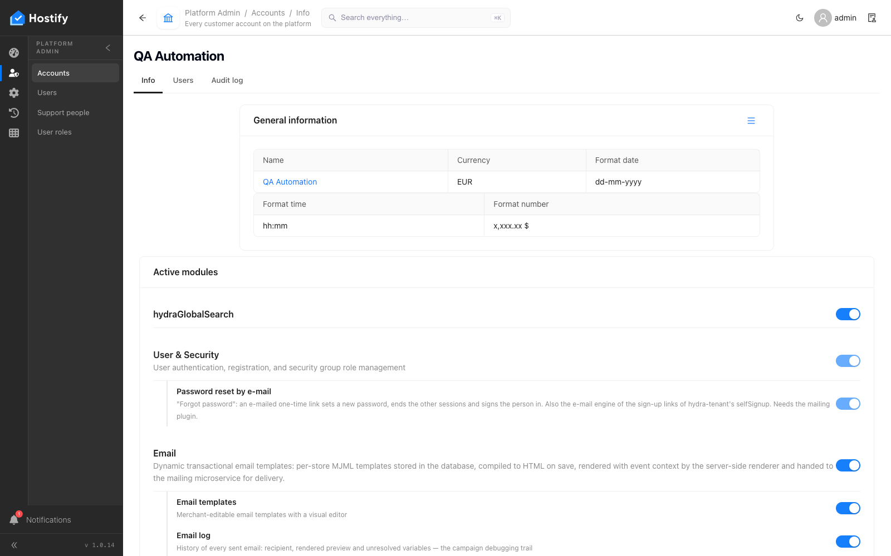
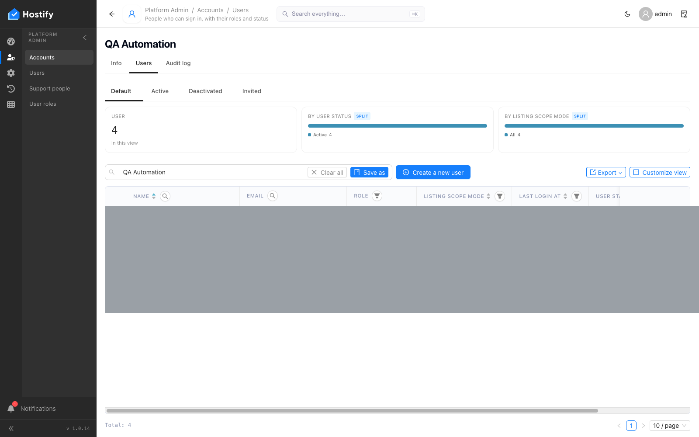
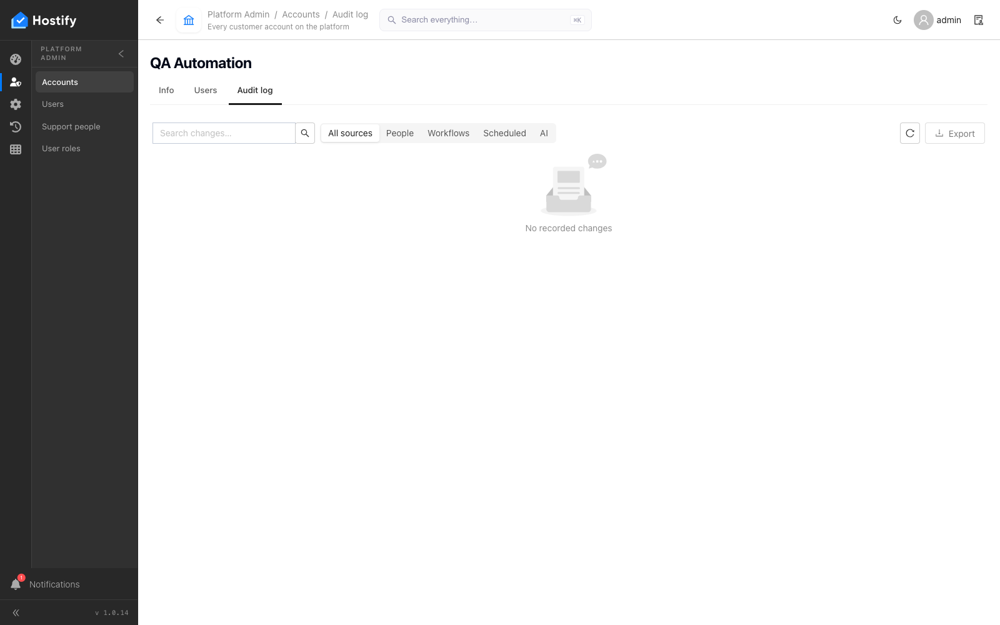
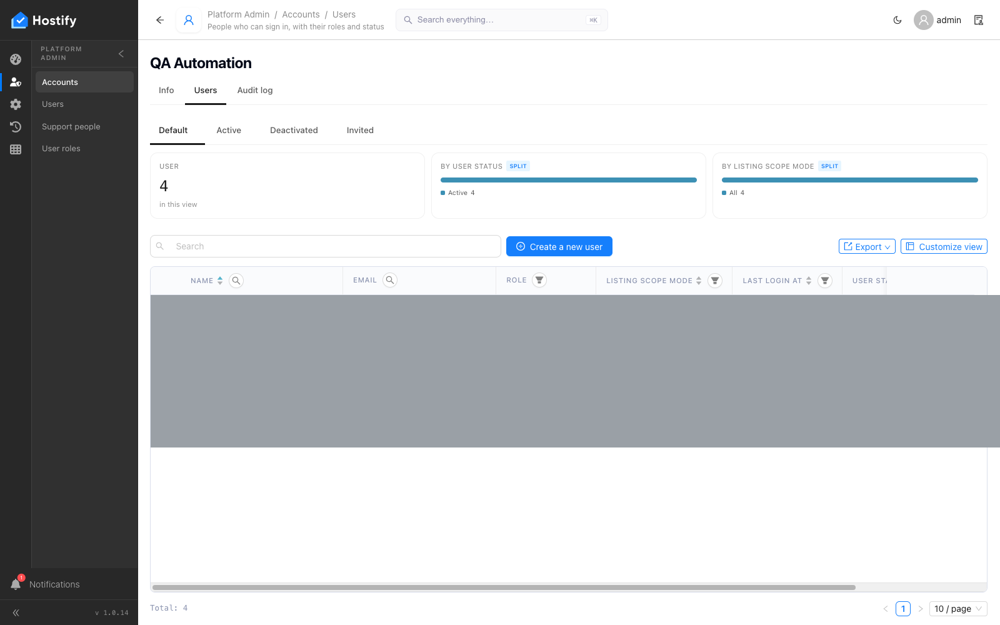
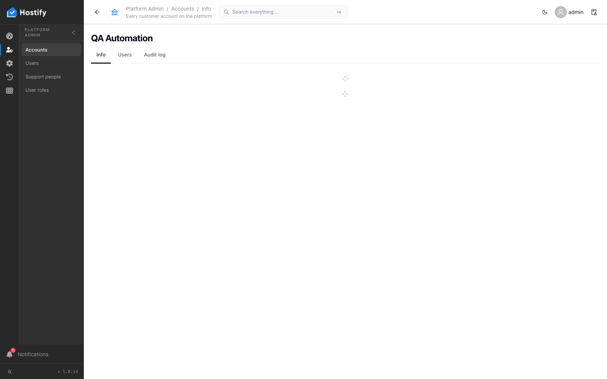

# 105-platform-account-users — Platform Admin › Accounts › QA Automation — табът Users показва точно хората на акаунта

- Пуск: 2026-11-12_10-58-26 · Приложение: https://hostify.bioseek.eu · Версия: 1.0.14
- Спек: `tests/e2e/105-platform-account-users.spec.ts`
- Казуси: 1 от 1 проверки

## Казус 1: the QA account's record page has a Users tab with exactly its people

_Нов в този пуск._

**Какво се обърка**

```
Error: the tab holds exactly the administrator, the six people of 100 and the invited one

expect(received).toEqual(expected) // deep equality

- Expected  - 4
+ Received  + 0

  Array [
-   "qa.accountant@hostify-qa.test",
    "qa.admin@hostify-qa.test",
    "qa.booking.agent@hostify-qa.test",
    "qa.housekeeper@hostify-qa.test",
```

**Как да се възпроизведе**

1. Влез в https://hostify.bioseek.eu/app/ като суперадминистратор (alarm@mail.bg).
2. Страница: https://hostify.bioseek.eu/app/platformAdmin/tenants/f2b3ad65-0d9a-4992-929c-3abe4823df98/info
3. Спек `tests/e2e/105-platform-account-users.spec.ts`, проверка „the QA account's record page has a Users tab with exactly its people“ — стъпките:
4. open the first record of the row (its link) — the item page
5. the record page looks like a record page: head, white page, the tabs of the grid
6. open the tab "info" of the item page
7. open the tab "users" of the item page
8. open the tab "auditLog" of the item page
9. every column has a header and the actions column is the last one

**Скрийншоти**









**Предупреждения в конзолата**

- [AlertsMenuCount] TypeError: Failed to fetch

---

Какво проверява спекът: 105 — Platform Admin › Accounts › QA Automation › Users: the account's people (1.0.7).
