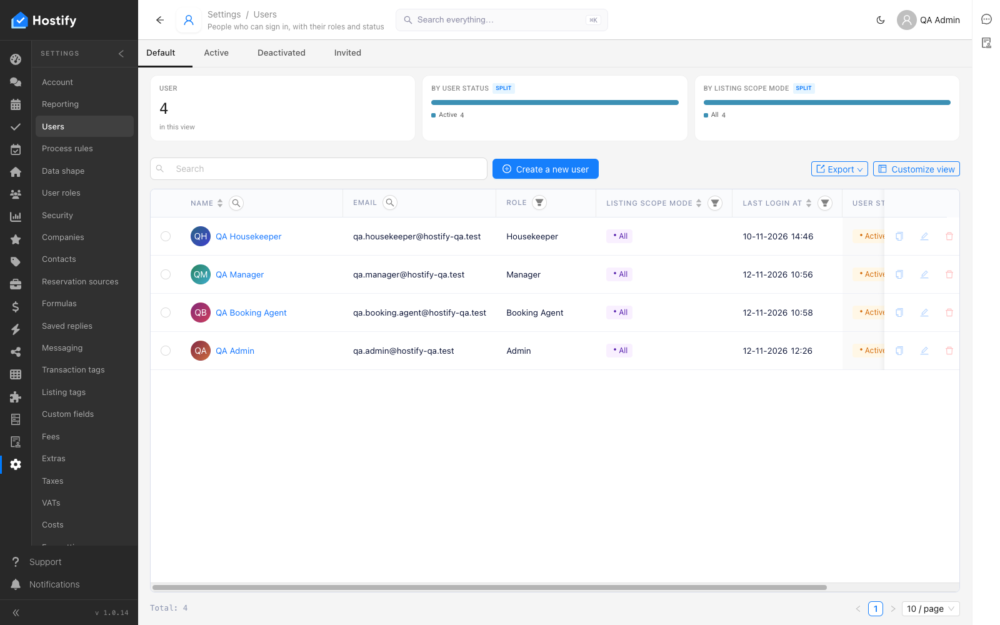
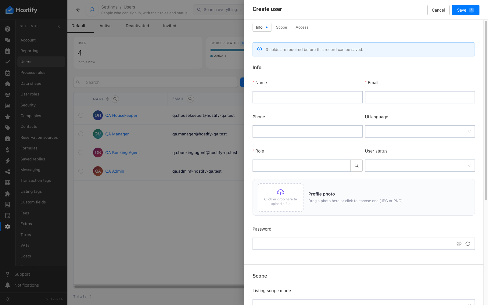
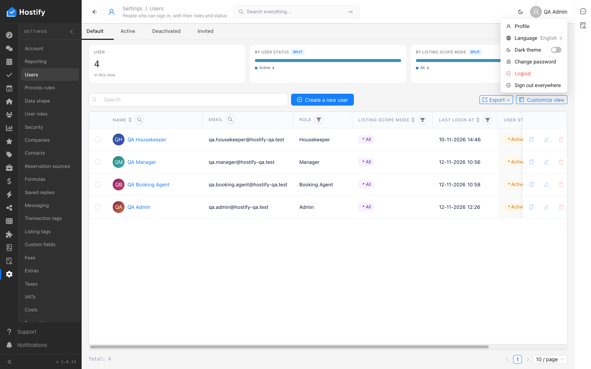

# 100-settings-users — Settings › Users — по един потребител на роля през формата; всеки влиза с известната парола

- Пуск: 2026-11-12_11-44-47 · Приложение: https://hostify.bioseek.eu · Версия: 1.0.14
- Спек: `tests/e2e/100-settings-users.spec.ts`
- Казуси: 1 от 5 проверки

## Казус 1: the Users page opens through the menu and the Create form behaves

_Известен от пуска 2026-11-12 10:58 (същата версия) — не е отстранен._

**Какво се обърка**

```
Error: The page reported 77 error(s) — API answers, failed requests, console errors:
- [request.failed] net::ERR_BLOCKED_BY_ORB @ https://hostify-apps.bioseek.eu/plugins/chekin/logo.svg
- [request.failed] net::ERR_BLOCKED_BY_ORB @ https://hostify-apps.bioseek.eu/plugins/duve/logo.png
- [request.failed] net::ERR_BLOCKED_BY_ORB @ https://hostify-apps.bioseek.eu/plugins/stripe/logo.png
- [request.failed] net::ERR_BLOCKED_BY_ORB @ https://hostify-apps.bioseek.eu/plugins/paypal/logo.png
- [request.failed] net::ERR_BLOCKED_BY_ORB @ https://hostify-apps.bioseek.eu/plugins/superhog/logo.png
- [request.failed] net::ERR_BLOCKED_BY_ORB @ https://hostify-apps.bioseek.eu/plugins/breezeway/logo.png
- [request.failed] net::ERR_BLOCKED_BY_ORB @ https://hostify-apps.bioseek.eu/plugins/beyond/logo.jpg
- [request.failed] net::ERR_BLOCKED_BY_ORB @ https://hostify-apps.bioseek.eu/plugins/cardcom/logo.png
- [request.failed] net::ERR_BLOCKED_BY_ORB @ https://hostify-apps.bioseek.eu/plugins/pricelabs/logo.svg
- [request.failed] net::ERR_BLOCKED_BY_ORB @ https://hostify-apps.bioseek.eu/plugins/akiles/logo.svg
```
- неуспешна заявка: net::ERR_BLOCKED_BY_ORB — `https://hostify-apps.bioseek.eu/plugins/chekin/logo.svg`
- неуспешна заявка: net::ERR_BLOCKED_BY_ORB — `https://hostify-apps.bioseek.eu/plugins/duve/logo.png`
- неуспешна заявка: net::ERR_BLOCKED_BY_ORB — `https://hostify-apps.bioseek.eu/plugins/stripe/logo.png`
- неуспешна заявка: net::ERR_BLOCKED_BY_ORB — `https://hostify-apps.bioseek.eu/plugins/paypal/logo.png`
- неуспешна заявка: net::ERR_BLOCKED_BY_ORB — `https://hostify-apps.bioseek.eu/plugins/superhog/logo.png`
- неуспешна заявка: net::ERR_BLOCKED_BY_ORB — `https://hostify-apps.bioseek.eu/plugins/breezeway/logo.png`
- неуспешна заявка: net::ERR_BLOCKED_BY_ORB — `https://hostify-apps.bioseek.eu/plugins/beyond/logo.jpg`
- неуспешна заявка: net::ERR_BLOCKED_BY_ORB — `https://hostify-apps.bioseek.eu/plugins/cardcom/logo.png`
- неуспешна заявка: net::ERR_BLOCKED_BY_ORB — `https://hostify-apps.bioseek.eu/plugins/pricelabs/logo.svg`
- неуспешна заявка: net::ERR_BLOCKED_BY_ORB — `https://hostify-apps.bioseek.eu/plugins/akiles/logo.svg`

**Как да се възпроизведе**

1. Влез в https://hostify.bioseek.eu/app/ като администратор на акаунта (qa.admin@hostify-qa.test).
2. Страница: https://hostify.bioseek.eu/app/settings/users
3. Спек `tests/e2e/100-settings-users.spec.ts`, проверка „the Users page opens through the menu and the Create form behaves“.
4. Developer tools › Network: заявките по-горе отговарят така.

**Скрийншоти**






**Предупреждения в конзолата**

- [InboxMenuCount] TypeError: Failed to fetch
- [hydraPartner] navbarExtensionLoader failed TypeError: Failed to fetch
- [ReviewsMenuChannels] TypeError: Failed to fetch
- [AlertsMenuCount] TypeError: Failed to fetch
- [demoData] the demo data status could not be read — no welcome modal TypeError: Failed to fetch
- [hydraPartner] the plugin surfaces were not read TypeError: Failed to fetch

---

Какво проверява спекът: 100 — Settings › Users: the people of the QA account, one per role, through the Users form.
