# 010-account-pages — проверка на навбар менютата на акаунта (всяка страница се отваря и се оглежда)

- Пуск: 2026-11-12_12-28-31 · Приложение: https://hostify.bioseek.eu · Версия: 1.0.14
- Спек: `tests/e2e/010-account-pages.spec.ts`
- Казуси: 48 от 177 проверки

## Казус 1: bookingOptimizer opens (/app/reporting/bookingOptimizer)

_Известен от пуска 2026-11-12 10:12 (същата версия) — не е отстранен._

**Какво се обърка**

```
Error: submenu node "bookingOptimizer"

expect(locator).toBeVisible() failed

Locator: locator('.cc-submenu-slide-panel').locator('[data-test="bookingOptimizer"]')
Expected: visible
Timeout: 30000ms
Error: element(s) not found

Call log:
  - submenu node "bookingOptimizer" with timeout 30000ms
  - waiting for locator('.cc-submenu-slide-panel').locator('[data-test="bookingOptimizer"]')
```

**Как да се възпроизведе**

1. Страница: https://hostify.bioseek.eu/app/reporting/reportingOverview
2. Спек `tests/e2e/010-account-pages.spec.ts`, проверка „bookingOptimizer opens (/app/reporting/bookingOptimizer)“.

**Скрийншоти**

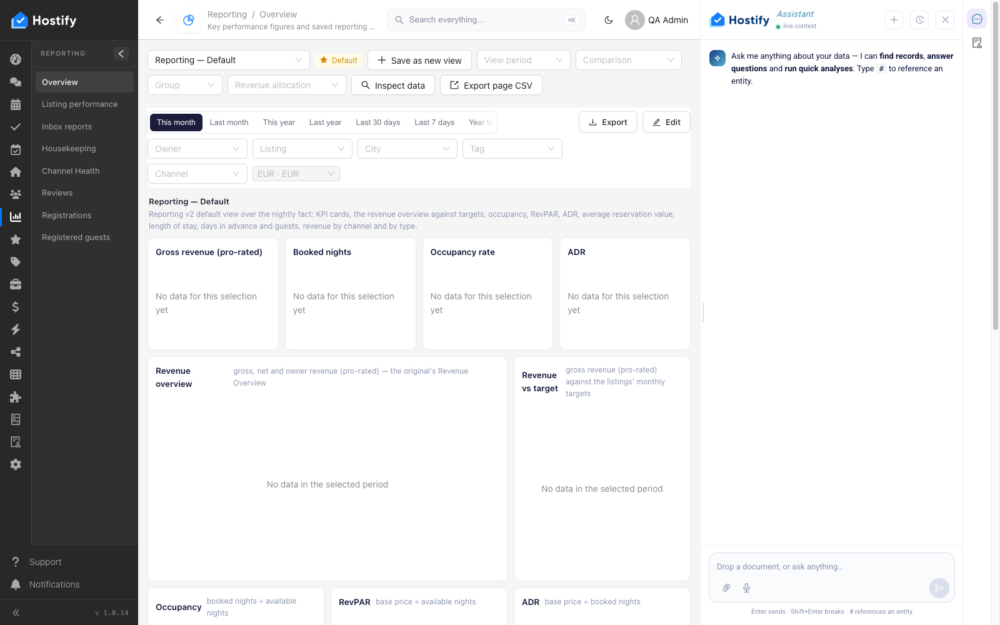


## Казус 2: airbnbReviewsDashboard opens (/app/reviewsMenu/airbnbReviewsMenu/airbnbReviewsDashboard)

_Известен от пуска 2026-11-12 10:12 (същата версия) — не е отстранен._

**Какво се обърка**

```
Error: submenu node "airbnbReviewsMenu"

expect(locator).toBeVisible() failed

Locator: locator('.cc-submenu-slide-panel').locator('[data-test="airbnbReviewsMenu"]')
Expected: visible
Timeout: 30000ms
Error: element(s) not found

Call log:
  - submenu node "airbnbReviewsMenu" with timeout 30000ms
  - waiting for locator('.cc-submenu-slide-panel').locator('[data-test="airbnbReviewsMenu"]')
```

**Как да се възпроизведе**

1. Страница: https://hostify.bioseek.eu/app/reviewsMenu/internalReviewsMenu/internalReviewsDashboard
2. Спек `tests/e2e/010-account-pages.spec.ts`, проверка „airbnbReviewsDashboard opens (/app/reviewsMenu/airbnbReviewsMenu/airbnbReviewsDashboard)“.

**Скрийншоти**


## Казус 3: airbnbReviews opens (/app/reviewsMenu/airbnbReviewsMenu/airbnbReviews)

_Известен от пуска 2026-11-12 10:12 (същата версия) — не е отстранен._

**Какво се обърка**

```
Error: submenu node "airbnbReviewsMenu"

expect(locator).toBeVisible() failed

Locator: locator('.cc-submenu-slide-panel').locator('[data-test="airbnbReviewsMenu"]')
Expected: visible
Timeout: 30000ms
Error: element(s) not found

Call log:
  - submenu node "airbnbReviewsMenu" with timeout 30000ms
  - waiting for locator('.cc-submenu-slide-panel').locator('[data-test="airbnbReviewsMenu"]')
```

**Как да се възпроизведе**

1. Страница: https://hostify.bioseek.eu/app/reviewsMenu/internalReviewsMenu/internalReviewsDashboard
2. Спек `tests/e2e/010-account-pages.spec.ts`, проверка „airbnbReviews opens (/app/reviewsMenu/airbnbReviewsMenu/airbnbReviews)“.

**Скрийншоти**


## Казус 4: airbnbReviewListings opens (/app/reviewsMenu/airbnbReviewsMenu/airbnbReviewListings)

_Известен от пуска 2026-11-12 10:12 (същата версия) — не е отстранен._

**Какво се обърка**

```
Error: submenu node "airbnbReviewsMenu"

expect(locator).toBeVisible() failed

Locator: locator('.cc-submenu-slide-panel').locator('[data-test="airbnbReviewsMenu"]')
Expected: visible
Timeout: 30000ms
Error: element(s) not found

Call log:
  - submenu node "airbnbReviewsMenu" with timeout 30000ms
  - waiting for locator('.cc-submenu-slide-panel').locator('[data-test="airbnbReviewsMenu"]')
```

**Как да се възпроизведе**

1. Страница: https://hostify.bioseek.eu/app/reviewsMenu/internalReviewsMenu/internalReviewsDashboard
2. Спек `tests/e2e/010-account-pages.spec.ts`, проверка „airbnbReviewListings opens (/app/reviewsMenu/airbnbReviewsMenu/airbnbReviewListings)“.

**Скрийншоти**

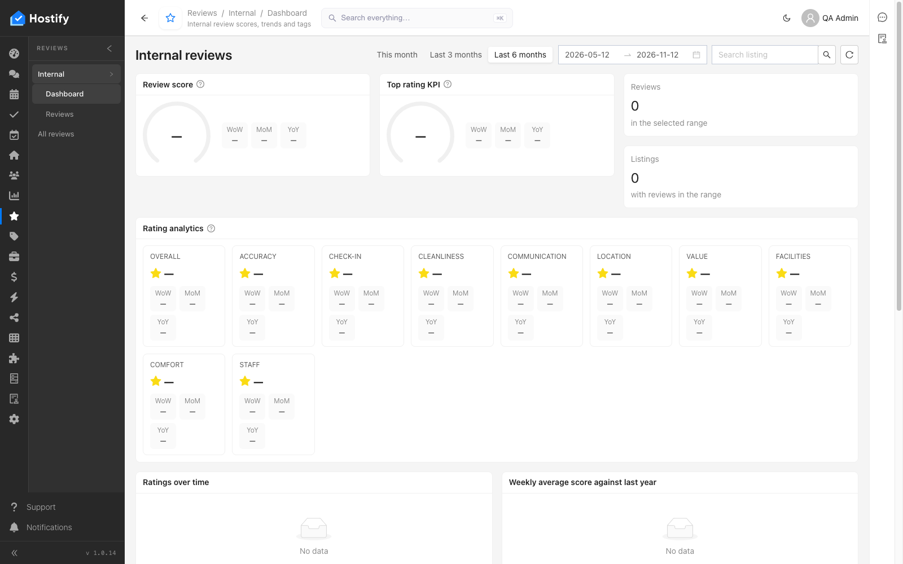


## Казус 5: airbnbTripIssues opens (/app/reviewsMenu/airbnbReviewsMenu/airbnbTripIssues)

_Известен от пуска 2026-11-12 10:12 (същата версия) — не е отстранен._

**Какво се обърка**

```
Error: submenu node "airbnbReviewsMenu"

expect(locator).toBeVisible() failed

Locator: locator('.cc-submenu-slide-panel').locator('[data-test="airbnbReviewsMenu"]')
Expected: visible
Timeout: 30000ms
Error: element(s) not found

Call log:
  - submenu node "airbnbReviewsMenu" with timeout 30000ms
  - waiting for locator('.cc-submenu-slide-panel').locator('[data-test="airbnbReviewsMenu"]')
```

**Как да се възпроизведе**

1. Страница: https://hostify.bioseek.eu/app/reviewsMenu/internalReviewsMenu/internalReviewsDashboard
2. Спек `tests/e2e/010-account-pages.spec.ts`, проверка „airbnbTripIssues opens (/app/reviewsMenu/airbnbReviewsMenu/airbnbTripIssues)“.

**Скрийншоти**


## Казус 6: bookingComReviewsDashboard opens (/app/reviewsMenu/bookingComReviewsMenu/bookingComReviewsDashboard)

_Известен от пуска 2026-11-12 10:12 (същата версия) — не е отстранен._

**Какво се обърка**

```
Error: submenu node "bookingComReviewsMenu"

expect(locator).toBeVisible() failed

Locator: locator('.cc-submenu-slide-panel').locator('[data-test="bookingComReviewsMenu"]')
Expected: visible
Timeout: 30000ms
Error: element(s) not found

Call log:
  - submenu node "bookingComReviewsMenu" with timeout 30000ms
  - waiting for locator('.cc-submenu-slide-panel').locator('[data-test="bookingComReviewsMenu"]')
```

**Как да се възпроизведе**

1. Страница: https://hostify.bioseek.eu/app/reviewsMenu/internalReviewsMenu/internalReviewsDashboard
2. Спек `tests/e2e/010-account-pages.spec.ts`, проверка „bookingComReviewsDashboard opens (/app/reviewsMenu/bookingComReviewsMenu/bookingComReviewsDashboard)“.

**Скрийншоти**


## Казус 7: bookingComReviews opens (/app/reviewsMenu/bookingComReviewsMenu/bookingComReviews)

_Известен от пуска 2026-11-12 10:12 (същата версия) — не е отстранен._

**Какво се обърка**

```
Error: submenu node "bookingComReviewsMenu"

expect(locator).toBeVisible() failed

Locator: locator('.cc-submenu-slide-panel').locator('[data-test="bookingComReviewsMenu"]')
Expected: visible
Timeout: 30000ms
Error: element(s) not found

Call log:
  - submenu node "bookingComReviewsMenu" with timeout 30000ms
  - waiting for locator('.cc-submenu-slide-panel').locator('[data-test="bookingComReviewsMenu"]')
```

**Как да се възпроизведе**

1. Страница: https://hostify.bioseek.eu/app/reviewsMenu/internalReviewsMenu/internalReviewsDashboard
2. Спек `tests/e2e/010-account-pages.spec.ts`, проверка „bookingComReviews opens (/app/reviewsMenu/bookingComReviewsMenu/bookingComReviews)“.

**Скрийншоти**

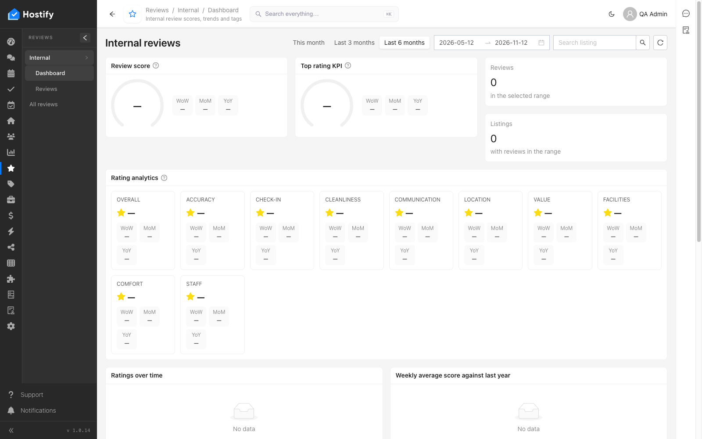


## Казус 8: bookingComReviewListings opens (/app/reviewsMenu/bookingComReviewsMenu/bookingComReviewListings)

_Известен от пуска 2026-11-12 10:12 (същата версия) — не е отстранен._

**Какво се обърка**

```
Error: submenu node "bookingComReviewsMenu"

expect(locator).toBeVisible() failed

Locator: locator('.cc-submenu-slide-panel').locator('[data-test="bookingComReviewsMenu"]')
Expected: visible
Timeout: 30000ms
Error: element(s) not found

Call log:
  - submenu node "bookingComReviewsMenu" with timeout 30000ms
  - waiting for locator('.cc-submenu-slide-panel').locator('[data-test="bookingComReviewsMenu"]')
```

**Как да се възпроизведе**

1. Страница: https://hostify.bioseek.eu/app/reviewsMenu/internalReviewsMenu/internalReviewsDashboard
2. Спек `tests/e2e/010-account-pages.spec.ts`, проверка „bookingComReviewListings opens (/app/reviewsMenu/bookingComReviewsMenu/bookingComReviewListings)“.

**Скрийншоти**


## Казус 9: vrboReviewsDashboard opens (/app/reviewsMenu/vrboReviewsMenu/vrboReviewsDashboard)

_Известен от пуска 2026-11-12 10:12 (същата версия) — не е отстранен._

**Какво се обърка**

```
Error: submenu node "vrboReviewsMenu"

expect(locator).toBeVisible() failed

Locator: locator('.cc-submenu-slide-panel').locator('[data-test="vrboReviewsMenu"]')
Expected: visible
Timeout: 30000ms
Error: element(s) not found

Call log:
  - submenu node "vrboReviewsMenu" with timeout 30000ms
  - waiting for locator('.cc-submenu-slide-panel').locator('[data-test="vrboReviewsMenu"]')
```

**Как да се възпроизведе**

1. Страница: https://hostify.bioseek.eu/app/reviewsMenu/internalReviewsMenu/internalReviewsDashboard
2. Спек `tests/e2e/010-account-pages.spec.ts`, проверка „vrboReviewsDashboard opens (/app/reviewsMenu/vrboReviewsMenu/vrboReviewsDashboard)“.

**Скрийншоти**


## Казус 10: vrboReviews opens (/app/reviewsMenu/vrboReviewsMenu/vrboReviews)

_Известен от пуска 2026-11-12 10:12 (същата версия) — не е отстранен._

**Какво се обърка**

```
Error: submenu node "vrboReviewsMenu"

expect(locator).toBeVisible() failed

Locator: locator('.cc-submenu-slide-panel').locator('[data-test="vrboReviewsMenu"]')
Expected: visible
Timeout: 30000ms
Error: element(s) not found

Call log:
  - submenu node "vrboReviewsMenu" with timeout 30000ms
  - waiting for locator('.cc-submenu-slide-panel').locator('[data-test="vrboReviewsMenu"]')
```

**Как да се възпроизведе**

1. Страница: https://hostify.bioseek.eu/app/reviewsMenu/internalReviewsMenu/internalReviewsDashboard
2. Спек `tests/e2e/010-account-pages.spec.ts`, проверка „vrboReviews opens (/app/reviewsMenu/vrboReviewsMenu/vrboReviews)“.

**Скрийншоти**


## Казус 11: vrboReviewListings opens (/app/reviewsMenu/vrboReviewsMenu/vrboReviewListings)

_Известен от пуска 2026-11-12 10:12 (същата версия) — не е отстранен._

**Какво се обърка**

```
Error: submenu node "vrboReviewsMenu"

expect(locator).toBeVisible() failed

Locator: locator('.cc-submenu-slide-panel').locator('[data-test="vrboReviewsMenu"]')
Expected: visible
Timeout: 30000ms
Error: element(s) not found

Call log:
  - submenu node "vrboReviewsMenu" with timeout 30000ms
  - waiting for locator('.cc-submenu-slide-panel').locator('[data-test="vrboReviewsMenu"]')
```

**Как да се възпроизведе**

1. Страница: https://hostify.bioseek.eu/app/reviewsMenu/internalReviewsMenu/internalReviewsDashboard
2. Спек `tests/e2e/010-account-pages.spec.ts`, проверка „vrboReviewListings opens (/app/reviewsMenu/vrboReviewsMenu/vrboReviewListings)“.

**Скрийншоти**


## Казус 12: pricingPromotions opens (/app/pricing/pricingPromotions)

_Известен от пуска 2026-11-12 10:12 (същата версия) — не е отстранен._

**Какво се обърка**

```
Error: submenu node "pricingPromotions"

expect(locator).toBeVisible() failed

Locator: locator('.cc-submenu-slide-panel').locator('[data-test="pricingPromotions"]')
Expected: visible
Timeout: 30000ms
Error: element(s) not found

Call log:
  - submenu node "pricingPromotions" with timeout 30000ms
  - waiting for locator('.cc-submenu-slide-panel').locator('[data-test="pricingPromotions"]')
```

**Как да се възпроизведе**

1. Страница: https://hostify.bioseek.eu/app/pricing/feeTemplates?feeItemType=_or&feeItemType=accommodation
2. Спек `tests/e2e/010-account-pages.spec.ts`, проверка „pricingPromotions opens (/app/pricing/pricingPromotions)“.

**Скрийншоти**

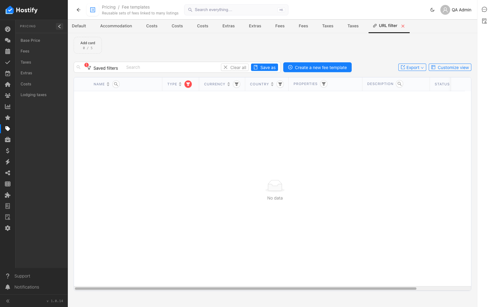


## Казус 13: appCenter opens (/app/apps/appCenter)

_Известен от пуска 2026-11-12 10:12 (същата версия) — не е отстранен._

**Какво се обърка**

```
Error: The page reported 18 error(s) — API answers, failed requests, console errors:
- [request.failed] net::ERR_BLOCKED_BY_ORB @ https://hostify-apps.bioseek.eu/plugins/doinn/logo.png
- [request.failed] net::ERR_BLOCKED_BY_ORB @ https://hostify-apps.bioseek.eu/plugins/akiles/logo.svg
- [request.failed] net::ERR_BLOCKED_BY_ORB @ https://hostify-apps.bioseek.eu/plugins/minut/logo.svg
- [request.failed] net::ERR_BLOCKED_BY_ORB @ https://hostify-apps.bioseek.eu/plugins/beyond/logo.jpg
- [request.failed] net::ERR_BLOCKED_BY_ORB @ https://hostify-apps.bioseek.eu/plugins/remotelock/logo.png
- [request.failed] net::ERR_BLOCKED_BY_ORB @ https://hostify-apps.bioseek.eu/plugins/breezeway/logo.png
- [request.failed] net::ERR_BLOCKED_BY_ORB @ https://hostify-apps.bioseek.eu/plugins/pricelabs/logo.svg
- [request.failed] net::ERR_BLOCKED_BY_ORB @ https://hostify-apps.bioseek.eu/plugins/turbosuite/logo.png
- [request.failed] net::ERR_BLOCKED_BY_ORB @ https://hostify-apps.bioseek.eu/plugins/cardcom/logo.png
- [request.failed] net::ERR_BLOCKED_BY_ORB @ https://hostify-apps.bioseek.eu/plugins/safely/logo.png
```
- неуспешна заявка: net::ERR_BLOCKED_BY_ORB — `https://hostify-apps.bioseek.eu/plugins/doinn/logo.png`
- неуспешна заявка: net::ERR_BLOCKED_BY_ORB — `https://hostify-apps.bioseek.eu/plugins/akiles/logo.svg`
- неуспешна заявка: net::ERR_BLOCKED_BY_ORB — `https://hostify-apps.bioseek.eu/plugins/minut/logo.svg`
- неуспешна заявка: net::ERR_BLOCKED_BY_ORB — `https://hostify-apps.bioseek.eu/plugins/beyond/logo.jpg`
- неуспешна заявка: net::ERR_BLOCKED_BY_ORB — `https://hostify-apps.bioseek.eu/plugins/remotelock/logo.png`
- неуспешна заявка: net::ERR_BLOCKED_BY_ORB — `https://hostify-apps.bioseek.eu/plugins/breezeway/logo.png`
- неуспешна заявка: net::ERR_BLOCKED_BY_ORB — `https://hostify-apps.bioseek.eu/plugins/pricelabs/logo.svg`
- неуспешна заявка: net::ERR_BLOCKED_BY_ORB — `https://hostify-apps.bioseek.eu/plugins/turbosuite/logo.png`
- неуспешна заявка: net::ERR_BLOCKED_BY_ORB — `https://hostify-apps.bioseek.eu/plugins/cardcom/logo.png`
- неуспешна заявка: net::ERR_BLOCKED_BY_ORB — `https://hostify-apps.bioseek.eu/plugins/safely/logo.png`

**Как да се възпроизведе**

1. Влез в https://hostify.bioseek.eu/app/ като администратор на акаунта (qa.admin@hostify-qa.test).
2. Меню: APPS › App Center — https://hostify.bioseek.eu/app/apps/appCenter
3. Спек `tests/e2e/010-account-pages.spec.ts`, проверка „appCenter opens (/app/apps/appCenter)“.
4. Developer tools › Network: заявките по-горе отговарят така.

**Скрийншоти**

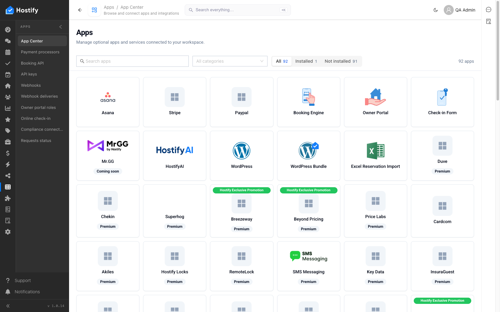


## Казус 14: paymentProcessorAccounts opens (/app/apps/paymentProcessorAccounts)

_Известен от пуска 2026-11-12 10:12 (същата версия) — не е отстранен._

**Какво се обърка**

```
Error: The page reported 48 error(s) — API answers, failed requests, console errors:
- [request.failed] net::ERR_BLOCKED_BY_ORB @ https://hostify-apps.bioseek.eu/plugins/stripe/logo.png
- [request.failed] net::ERR_BLOCKED_BY_ORB @ https://hostify-apps.bioseek.eu/plugins/paypal/logo.png
- [request.failed] net::ERR_BLOCKED_BY_ORB @ https://hostify-apps.bioseek.eu/plugins/chekin/logo.svg
- [request.failed] net::ERR_BLOCKED_BY_ORB @ https://hostify-apps.bioseek.eu/plugins/duve/logo.png
- [request.failed] net::ERR_BLOCKED_BY_ORB @ https://hostify-apps.bioseek.eu/plugins/superhog/logo.png
- [request.failed] net::ERR_BLOCKED_BY_ORB @ https://hostify-apps.bioseek.eu/plugins/breezeway/logo.png
- [request.failed] net::ERR_BLOCKED_BY_ORB @ https://hostify-apps.bioseek.eu/plugins/beyond/logo.jpg
- [request.failed] net::ERR_BLOCKED_BY_ORB @ https://hostify-apps.bioseek.eu/plugins/akiles/logo.svg
- [request.failed] net::ERR_BLOCKED_BY_ORB @ https://hostify-apps.bioseek.eu/plugins/cardcom/logo.png
- [request.failed] net::ERR_BLOCKED_BY_ORB @ https://hostify-apps.bioseek.eu/plugins/pricelabs/logo.svg
```
- неуспешна заявка: net::ERR_BLOCKED_BY_ORB — `https://hostify-apps.bioseek.eu/plugins/stripe/logo.png`
- неуспешна заявка: net::ERR_BLOCKED_BY_ORB — `https://hostify-apps.bioseek.eu/plugins/paypal/logo.png`
- неуспешна заявка: net::ERR_BLOCKED_BY_ORB — `https://hostify-apps.bioseek.eu/plugins/chekin/logo.svg`
- неуспешна заявка: net::ERR_BLOCKED_BY_ORB — `https://hostify-apps.bioseek.eu/plugins/duve/logo.png`
- неуспешна заявка: net::ERR_BLOCKED_BY_ORB — `https://hostify-apps.bioseek.eu/plugins/superhog/logo.png`
- неуспешна заявка: net::ERR_BLOCKED_BY_ORB — `https://hostify-apps.bioseek.eu/plugins/breezeway/logo.png`
- неуспешна заявка: net::ERR_BLOCKED_BY_ORB — `https://hostify-apps.bioseek.eu/plugins/beyond/logo.jpg`
- неуспешна заявка: net::ERR_BLOCKED_BY_ORB — `https://hostify-apps.bioseek.eu/plugins/akiles/logo.svg`
- неуспешна заявка: net::ERR_BLOCKED_BY_ORB — `https://hostify-apps.bioseek.eu/plugins/cardcom/logo.png`
- неуспешна заявка: net::ERR_BLOCKED_BY_ORB — `https://hostify-apps.bioseek.eu/plugins/pricelabs/logo.svg`

**Как да се възпроизведе**

1. Влез в https://hostify.bioseek.eu/app/ като администратор на акаунта (qa.admin@hostify-qa.test).
2. Меню: APPS › Payment processors — https://hostify.bioseek.eu/app/apps/paymentProcessorAccounts
3. Спек `tests/e2e/010-account-pages.spec.ts`, проверка „paymentProcessorAccounts opens (/app/apps/paymentProcessorAccounts)“.
4. Developer tools › Network: заявките по-горе отговарят така.

**Скрийншоти**

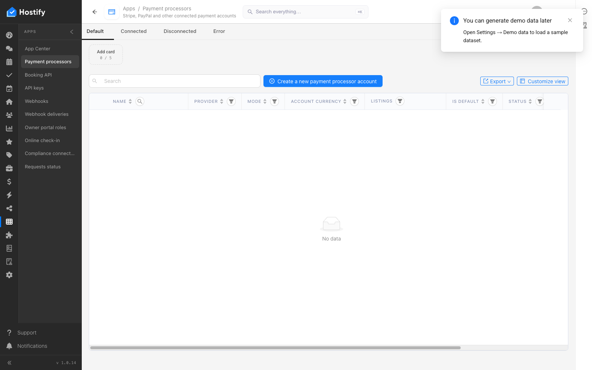


## Казус 15: bookingApiClients opens (/app/apps/bookingApiClients)

_Известен от пуска 2026-11-12 10:58 (същата версия) — не е отстранен._

**Какво се обърка**

```
Error: The page reported 48 error(s) — API answers, failed requests, console errors:
- [request.failed] net::ERR_BLOCKED_BY_ORB @ https://hostify-apps.bioseek.eu/plugins/paypal/logo.png
- [request.failed] net::ERR_BLOCKED_BY_ORB @ https://hostify-apps.bioseek.eu/plugins/safely/logo.png
- [request.failed] net::ERR_BLOCKED_BY_ORB @ https://hostify-apps.bioseek.eu/plugins/minut/logo.svg
- [request.failed] net::ERR_BLOCKED_BY_ORB @ https://hostify-apps.bioseek.eu/plugins/stripe/logo.png
- [request.failed] net::ERR_BLOCKED_BY_ORB @ https://hostify-apps.bioseek.eu/plugins/remotelock/logo.png
- [request.failed] net::ERR_BLOCKED_BY_ORB @ https://hostify-apps.bioseek.eu/plugins/key-data/logo.png
- [request.failed] net::ERR_BLOCKED_BY_ORB @ https://hostify-apps.bioseek.eu/plugins/doinn/logo.png
- [request.failed] net::ERR_BLOCKED_BY_ORB @ https://hostify-apps.bioseek.eu/plugins/turbosuite/logo.png
- [request.failed] net::ERR_BLOCKED_BY_ORB @ https://hostify-apps.bioseek.eu/plugins/turnoverbnb/logo.png
- [request.failed] net::ERR_BLOCKED_BY_ORB @ https://hostify-apps.bioseek.eu/plugins/cardcom/logo.png
```
- неуспешна заявка: net::ERR_BLOCKED_BY_ORB — `https://hostify-apps.bioseek.eu/plugins/paypal/logo.png`
- неуспешна заявка: net::ERR_BLOCKED_BY_ORB — `https://hostify-apps.bioseek.eu/plugins/safely/logo.png`
- неуспешна заявка: net::ERR_BLOCKED_BY_ORB — `https://hostify-apps.bioseek.eu/plugins/minut/logo.svg`
- неуспешна заявка: net::ERR_BLOCKED_BY_ORB — `https://hostify-apps.bioseek.eu/plugins/stripe/logo.png`
- неуспешна заявка: net::ERR_BLOCKED_BY_ORB — `https://hostify-apps.bioseek.eu/plugins/remotelock/logo.png`
- неуспешна заявка: net::ERR_BLOCKED_BY_ORB — `https://hostify-apps.bioseek.eu/plugins/key-data/logo.png`
- неуспешна заявка: net::ERR_BLOCKED_BY_ORB — `https://hostify-apps.bioseek.eu/plugins/doinn/logo.png`
- неуспешна заявка: net::ERR_BLOCKED_BY_ORB — `https://hostify-apps.bioseek.eu/plugins/turbosuite/logo.png`
- неуспешна заявка: net::ERR_BLOCKED_BY_ORB — `https://hostify-apps.bioseek.eu/plugins/turnoverbnb/logo.png`
- неуспешна заявка: net::ERR_BLOCKED_BY_ORB — `https://hostify-apps.bioseek.eu/plugins/cardcom/logo.png`

**Как да се възпроизведе**

1. Влез в https://hostify.bioseek.eu/app/ като администратор на акаунта (qa.admin@hostify-qa.test).
2. Меню: APPS › Booking API — https://hostify.bioseek.eu/app/apps/bookingApiClients
3. Спек `tests/e2e/010-account-pages.spec.ts`, проверка „bookingApiClients opens (/app/apps/bookingApiClients)“.
4. Developer tools › Network: заявките по-горе отговарят така.

**Скрийншоти**


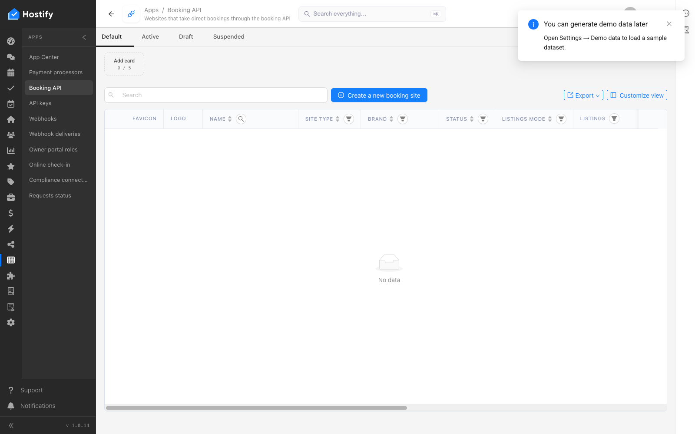


## Казус 16: webhookSubscriptions opens (/app/apps/webhookSubscriptions)

_Известен от пуска 2026-11-12 10:12 (същата версия) — не е отстранен._

**Какво се обърка**

```
Error: The page reported 48 error(s) — API answers, failed requests, console errors:
- [request.failed] net::ERR_BLOCKED_BY_ORB @ https://hostify-apps.bioseek.eu/plugins/paypal/logo.png
- [request.failed] net::ERR_BLOCKED_BY_ORB @ https://hostify-apps.bioseek.eu/plugins/stripe/logo.png
- [request.failed] net::ERR_BLOCKED_BY_ORB @ https://hostify-apps.bioseek.eu/plugins/duve/logo.png
- [request.failed] net::ERR_BLOCKED_BY_ORB @ https://hostify-apps.bioseek.eu/plugins/chekin/logo.svg
- [request.failed] net::ERR_BLOCKED_BY_ORB @ https://hostify-apps.bioseek.eu/plugins/turnoverbnb/logo.png
- [request.failed] net::ERR_BLOCKED_BY_ORB @ https://hostify-apps.bioseek.eu/plugins/pricelabs/logo.svg
- [request.failed] net::ERR_BLOCKED_BY_ORB @ https://hostify-apps.bioseek.eu/plugins/doinn/logo.png
- [request.failed] net::ERR_BLOCKED_BY_ORB @ https://hostify-apps.bioseek.eu/plugins/akiles/logo.svg
- [request.failed] net::ERR_BLOCKED_BY_ORB @ https://hostify-apps.bioseek.eu/plugins/turbosuite/logo.png
- [request.failed] net::ERR_BLOCKED_BY_ORB @ https://hostify-apps.bioseek.eu/plugins/key-data/logo.png
```
- неуспешна заявка: net::ERR_BLOCKED_BY_ORB — `https://hostify-apps.bioseek.eu/plugins/paypal/logo.png`
- неуспешна заявка: net::ERR_BLOCKED_BY_ORB — `https://hostify-apps.bioseek.eu/plugins/stripe/logo.png`
- неуспешна заявка: net::ERR_BLOCKED_BY_ORB — `https://hostify-apps.bioseek.eu/plugins/duve/logo.png`
- неуспешна заявка: net::ERR_BLOCKED_BY_ORB — `https://hostify-apps.bioseek.eu/plugins/chekin/logo.svg`
- неуспешна заявка: net::ERR_BLOCKED_BY_ORB — `https://hostify-apps.bioseek.eu/plugins/turnoverbnb/logo.png`
- неуспешна заявка: net::ERR_BLOCKED_BY_ORB — `https://hostify-apps.bioseek.eu/plugins/pricelabs/logo.svg`
- неуспешна заявка: net::ERR_BLOCKED_BY_ORB — `https://hostify-apps.bioseek.eu/plugins/doinn/logo.png`
- неуспешна заявка: net::ERR_BLOCKED_BY_ORB — `https://hostify-apps.bioseek.eu/plugins/akiles/logo.svg`
- неуспешна заявка: net::ERR_BLOCKED_BY_ORB — `https://hostify-apps.bioseek.eu/plugins/turbosuite/logo.png`
- неуспешна заявка: net::ERR_BLOCKED_BY_ORB — `https://hostify-apps.bioseek.eu/plugins/key-data/logo.png`

**Как да се възпроизведе**

1. Влез в https://hostify.bioseek.eu/app/ като администратор на акаунта (qa.admin@hostify-qa.test).
2. Меню: APPS › Webhooks — https://hostify.bioseek.eu/app/apps/webhookSubscriptions
3. Спек `tests/e2e/010-account-pages.spec.ts`, проверка „webhookSubscriptions opens (/app/apps/webhookSubscriptions)“.
4. Developer tools › Network: заявките по-горе отговарят така.

**Скрийншоти**

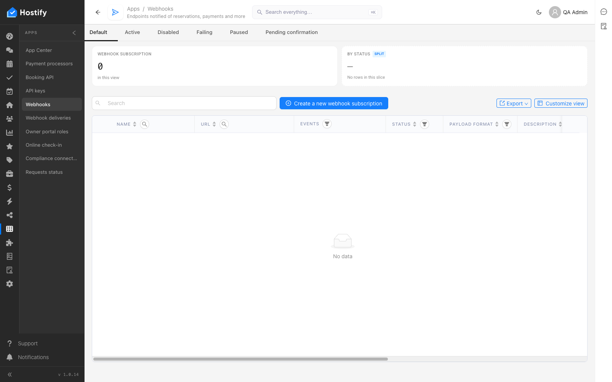


## Казус 17: checkinFormTemplates opens (/app/apps/checkinFormTemplates)

_Известен от пуска 2026-11-12 10:58 (същата версия) — не е отстранен._

**Какво се обърка**

```
Error: The page reported 48 error(s) — API answers, failed requests, console errors:
- [request.failed] net::ERR_BLOCKED_BY_ORB @ https://hostify-apps.bioseek.eu/plugins/cardcom/logo.png
- [request.failed] net::ERR_BLOCKED_BY_ORB @ https://hostify-apps.bioseek.eu/plugins/akiles/logo.svg
- [request.failed] net::ERR_BLOCKED_BY_ORB @ https://hostify-apps.bioseek.eu/plugins/pricelabs/logo.svg
- [request.failed] net::ERR_BLOCKED_BY_ORB @ https://hostify-apps.bioseek.eu/plugins/remotelock/logo.png
- [request.failed] net::ERR_BLOCKED_BY_ORB @ https://hostify-apps.bioseek.eu/plugins/doinn/logo.png
- [request.failed] net::ERR_BLOCKED_BY_ORB @ https://hostify-apps.bioseek.eu/plugins/beyond/logo.jpg
- [request.failed] net::ERR_BLOCKED_BY_ORB @ https://hostify-apps.bioseek.eu/plugins/key-data/logo.png
- [request.failed] net::ERR_BLOCKED_BY_ORB @ https://hostify-apps.bioseek.eu/plugins/safely/logo.png
- [request.failed] net::ERR_BLOCKED_BY_ORB @ https://hostify-apps.bioseek.eu/plugins/breezeway/logo.png
- [request.failed] net::ERR_BLOCKED_BY_ORB @ https://hostify-apps.bioseek.eu/plugins/turbosuite/logo.png
```
- неуспешна заявка: net::ERR_BLOCKED_BY_ORB — `https://hostify-apps.bioseek.eu/plugins/cardcom/logo.png`
- неуспешна заявка: net::ERR_BLOCKED_BY_ORB — `https://hostify-apps.bioseek.eu/plugins/akiles/logo.svg`
- неуспешна заявка: net::ERR_BLOCKED_BY_ORB — `https://hostify-apps.bioseek.eu/plugins/pricelabs/logo.svg`
- неуспешна заявка: net::ERR_BLOCKED_BY_ORB — `https://hostify-apps.bioseek.eu/plugins/remotelock/logo.png`
- неуспешна заявка: net::ERR_BLOCKED_BY_ORB — `https://hostify-apps.bioseek.eu/plugins/doinn/logo.png`
- неуспешна заявка: net::ERR_BLOCKED_BY_ORB — `https://hostify-apps.bioseek.eu/plugins/beyond/logo.jpg`
- неуспешна заявка: net::ERR_BLOCKED_BY_ORB — `https://hostify-apps.bioseek.eu/plugins/key-data/logo.png`
- неуспешна заявка: net::ERR_BLOCKED_BY_ORB — `https://hostify-apps.bioseek.eu/plugins/safely/logo.png`
- неуспешна заявка: net::ERR_BLOCKED_BY_ORB — `https://hostify-apps.bioseek.eu/plugins/breezeway/logo.png`
- неуспешна заявка: net::ERR_BLOCKED_BY_ORB — `https://hostify-apps.bioseek.eu/plugins/turbosuite/logo.png`

**Как да се възпроизведе**

1. Влез в https://hostify.bioseek.eu/app/ като администратор на акаунта (qa.admin@hostify-qa.test).
2. Меню: APPS › Online check-in — https://hostify.bioseek.eu/app/apps/checkinFormTemplates
3. Спек `tests/e2e/010-account-pages.spec.ts`, проверка „checkinFormTemplates opens (/app/apps/checkinFormTemplates)“.
4. Developer tools › Network: заявките по-горе отговарят така.

**Скрийншоти**

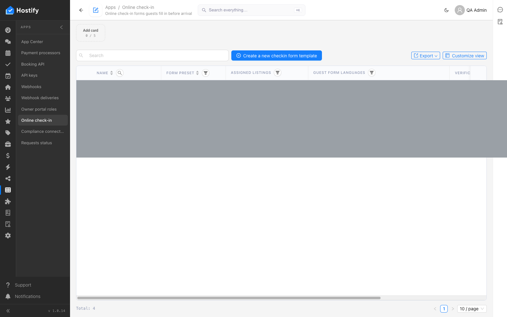


## Казус 18: complianceConnections opens (/app/apps/complianceConnections)

_Известен от пуска 2026-11-12 10:12 (същата версия) — не е отстранен._

**Какво се обърка**

```
Error: The page reported 48 error(s) — API answers, failed requests, console errors:
- [request.failed] net::ERR_BLOCKED_BY_ORB @ https://hostify-apps.bioseek.eu/plugins/stripe/logo.png
- [request.failed] net::ERR_BLOCKED_BY_ORB @ https://hostify-apps.bioseek.eu/plugins/duve/logo.png
- [request.failed] net::ERR_BLOCKED_BY_ORB @ https://hostify-apps.bioseek.eu/plugins/paypal/logo.png
- [request.failed] net::ERR_BLOCKED_BY_ORB @ https://hostify-apps.bioseek.eu/plugins/chekin/logo.svg
- [request.failed] net::ERR_BLOCKED_BY_ORB @ https://hostify-apps.bioseek.eu/plugins/superhog/logo.png
- [request.failed] net::ERR_BLOCKED_BY_ORB @ https://hostify-apps.bioseek.eu/plugins/breezeway/logo.png
- [request.failed] net::ERR_BLOCKED_BY_ORB @ https://hostify-apps.bioseek.eu/plugins/beyond/logo.jpg
- [request.failed] net::ERR_BLOCKED_BY_ORB @ https://hostify-apps.bioseek.eu/plugins/pricelabs/logo.svg
- [request.failed] net::ERR_BLOCKED_BY_ORB @ https://hostify-apps.bioseek.eu/plugins/akiles/logo.svg
- [request.failed] net::ERR_BLOCKED_BY_ORB @ https://hostify-apps.bioseek.eu/plugins/cardcom/logo.png
```
- неуспешна заявка: net::ERR_BLOCKED_BY_ORB — `https://hostify-apps.bioseek.eu/plugins/stripe/logo.png`
- неуспешна заявка: net::ERR_BLOCKED_BY_ORB — `https://hostify-apps.bioseek.eu/plugins/duve/logo.png`
- неуспешна заявка: net::ERR_BLOCKED_BY_ORB — `https://hostify-apps.bioseek.eu/plugins/paypal/logo.png`
- неуспешна заявка: net::ERR_BLOCKED_BY_ORB — `https://hostify-apps.bioseek.eu/plugins/chekin/logo.svg`
- неуспешна заявка: net::ERR_BLOCKED_BY_ORB — `https://hostify-apps.bioseek.eu/plugins/superhog/logo.png`
- неуспешна заявка: net::ERR_BLOCKED_BY_ORB — `https://hostify-apps.bioseek.eu/plugins/breezeway/logo.png`
- неуспешна заявка: net::ERR_BLOCKED_BY_ORB — `https://hostify-apps.bioseek.eu/plugins/beyond/logo.jpg`
- неуспешна заявка: net::ERR_BLOCKED_BY_ORB — `https://hostify-apps.bioseek.eu/plugins/pricelabs/logo.svg`
- неуспешна заявка: net::ERR_BLOCKED_BY_ORB — `https://hostify-apps.bioseek.eu/plugins/akiles/logo.svg`
- неуспешна заявка: net::ERR_BLOCKED_BY_ORB — `https://hostify-apps.bioseek.eu/plugins/cardcom/logo.png`

**Как да се възпроизведе**

1. Влез в https://hostify.bioseek.eu/app/ като администратор на акаунта (qa.admin@hostify-qa.test).
2. Меню: APPS › Compliance connections — https://hostify.bioseek.eu/app/apps/complianceConnections
3. Спек `tests/e2e/010-account-pages.spec.ts`, проверка „complianceConnections opens (/app/apps/complianceConnections)“.
4. Developer tools › Network: заявките по-горе отговарят така.

**Скрийншоти**


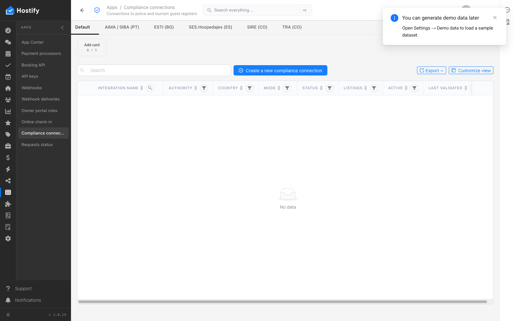


## Казус 19: complianceSubmissions opens (/app/apps/complianceSubmissions)

_Известен от пуска 2026-11-12 10:58 (същата версия) — не е отстранен._

**Какво се обърка**

```
Error: The page reported 48 error(s) — API answers, failed requests, console errors:
- [request.failed] net::ERR_BLOCKED_BY_ORB @ https://hostify-apps.bioseek.eu/plugins/safely/logo.png
- [request.failed] net::ERR_BLOCKED_BY_ORB @ https://hostify-apps.bioseek.eu/plugins/doinn/logo.png
- [request.failed] net::ERR_BLOCKED_BY_ORB @ https://hostify-apps.bioseek.eu/plugins/akiles/logo.svg
- [request.failed] net::ERR_BLOCKED_BY_ORB @ https://hostify-apps.bioseek.eu/plugins/key-data/logo.png
- [request.failed] net::ERR_BLOCKED_BY_ORB @ https://hostify-apps.bioseek.eu/plugins/breezeway/logo.png
- [request.failed] net::ERR_BLOCKED_BY_ORB @ https://hostify-apps.bioseek.eu/plugins/turbosuite/logo.png
- [request.failed] net::ERR_BLOCKED_BY_ORB @ https://hostify-apps.bioseek.eu/plugins/hostify-locks/logo.svg
- [request.failed] net::ERR_BLOCKED_BY_ORB @ https://hostify-apps.bioseek.eu/plugins/insuraguest/logo.png
- [request.failed] net::ERR_BLOCKED_BY_ORB @ https://hostify-apps.bioseek.eu/plugins/beyond/logo.jpg
- [request.failed] net::ERR_BLOCKED_BY_ORB @ https://hostify-apps.bioseek.eu/plugins/remotelock/logo.png
```
- неуспешна заявка: net::ERR_BLOCKED_BY_ORB — `https://hostify-apps.bioseek.eu/plugins/safely/logo.png`
- неуспешна заявка: net::ERR_BLOCKED_BY_ORB — `https://hostify-apps.bioseek.eu/plugins/doinn/logo.png`
- неуспешна заявка: net::ERR_BLOCKED_BY_ORB — `https://hostify-apps.bioseek.eu/plugins/akiles/logo.svg`
- неуспешна заявка: net::ERR_BLOCKED_BY_ORB — `https://hostify-apps.bioseek.eu/plugins/key-data/logo.png`
- неуспешна заявка: net::ERR_BLOCKED_BY_ORB — `https://hostify-apps.bioseek.eu/plugins/breezeway/logo.png`
- неуспешна заявка: net::ERR_BLOCKED_BY_ORB — `https://hostify-apps.bioseek.eu/plugins/turbosuite/logo.png`
- неуспешна заявка: net::ERR_BLOCKED_BY_ORB — `https://hostify-apps.bioseek.eu/plugins/hostify-locks/logo.svg`
- неуспешна заявка: net::ERR_BLOCKED_BY_ORB — `https://hostify-apps.bioseek.eu/plugins/insuraguest/logo.png`
- неуспешна заявка: net::ERR_BLOCKED_BY_ORB — `https://hostify-apps.bioseek.eu/plugins/beyond/logo.jpg`
- неуспешна заявка: net::ERR_BLOCKED_BY_ORB — `https://hostify-apps.bioseek.eu/plugins/remotelock/logo.png`

**Как да се възпроизведе**

1. Влез в https://hostify.bioseek.eu/app/ като администратор на акаунта (qa.admin@hostify-qa.test).
2. Меню: APPS › Requests status — https://hostify.bioseek.eu/app/apps/complianceSubmissions
3. Спек `tests/e2e/010-account-pages.spec.ts`, проверка „complianceSubmissions opens (/app/apps/complianceSubmissions)“.
4. Developer tools › Network: заявките по-горе отговарят така.

**Скрийншоти**

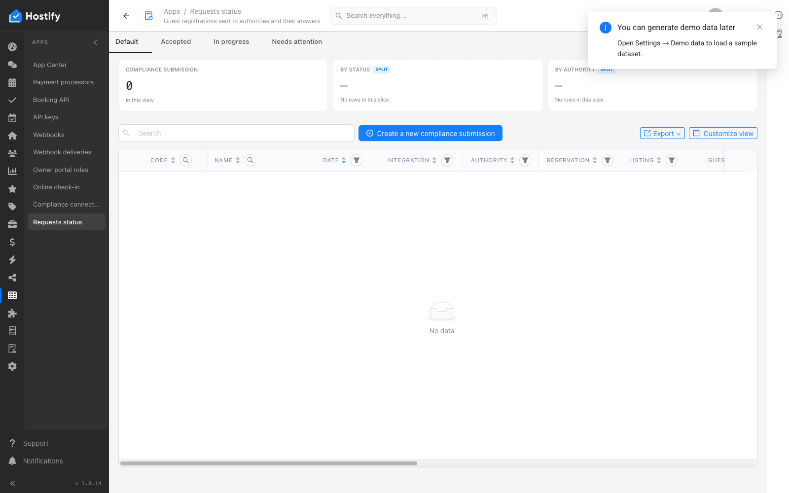


## Казус 20: accountProfile opens (/app/settings/accountProfile)

_Нов в този пуск._

**Какво се обърка**

```
Error: accountProfile: the screen is not presentable (3):
- [error/broken-image] https://hostify-apps.bioseek.eu/plugins/shelly/logo.png
- [error/broken-image] https://hostify-apps.bioseek.eu/plugins/siampay/logo.png
- [error/broken-image] https://hostify-apps.bioseek.eu/plugins/strly/logo.png
```
- неуспешна заявка: net::ERR_BLOCKED_BY_ORB — `https://hostify-apps.bioseek.eu/plugins/paypal/logo.png`
- неуспешна заявка: net::ERR_BLOCKED_BY_ORB — `https://hostify-apps.bioseek.eu/plugins/duve/logo.png`
- неуспешна заявка: net::ERR_BLOCKED_BY_ORB — `https://hostify-apps.bioseek.eu/plugins/chekin/logo.svg`
- неуспешна заявка: net::ERR_BLOCKED_BY_ORB — `https://hostify-apps.bioseek.eu/plugins/stripe/logo.png`
- неуспешна заявка: net::ERR_BLOCKED_BY_ORB — `https://hostify-apps.bioseek.eu/plugins/superhog/logo.png`
- неуспешна заявка: net::ERR_BLOCKED_BY_ORB — `https://hostify-apps.bioseek.eu/plugins/beyond/logo.jpg`
- неуспешна заявка: net::ERR_BLOCKED_BY_ORB — `https://hostify-apps.bioseek.eu/plugins/breezeway/logo.png`
- неуспешна заявка: net::ERR_BLOCKED_BY_ORB — `https://hostify-apps.bioseek.eu/plugins/pricelabs/logo.svg`
- неуспешна заявка: net::ERR_BLOCKED_BY_ORB — `https://hostify-apps.bioseek.eu/plugins/cardcom/logo.png`
- неуспешна заявка: net::ERR_BLOCKED_BY_ORB — `https://hostify-apps.bioseek.eu/plugins/akiles/logo.svg`
- на екрана (accountProfile): https://hostify-apps.bioseek.eu/plugins/shelly/logo.png
- на екрана (accountProfile): https://hostify-apps.bioseek.eu/plugins/siampay/logo.png
- на екрана (accountProfile): https://hostify-apps.bioseek.eu/plugins/strly/logo.png

**Как да се възпроизведе**

1. Влез в https://hostify.bioseek.eu/app/ като администратор на акаунта (qa.admin@hostify-qa.test).
2. Меню: SETTINGS › Account — https://hostify.bioseek.eu/app/settings/accountProfile
3. Спек `tests/e2e/010-account-pages.spec.ts`, проверка „accountProfile opens (/app/settings/accountProfile)“.
4. Developer tools › Network: заявките по-горе отговарят така.

**Скрийншоти**

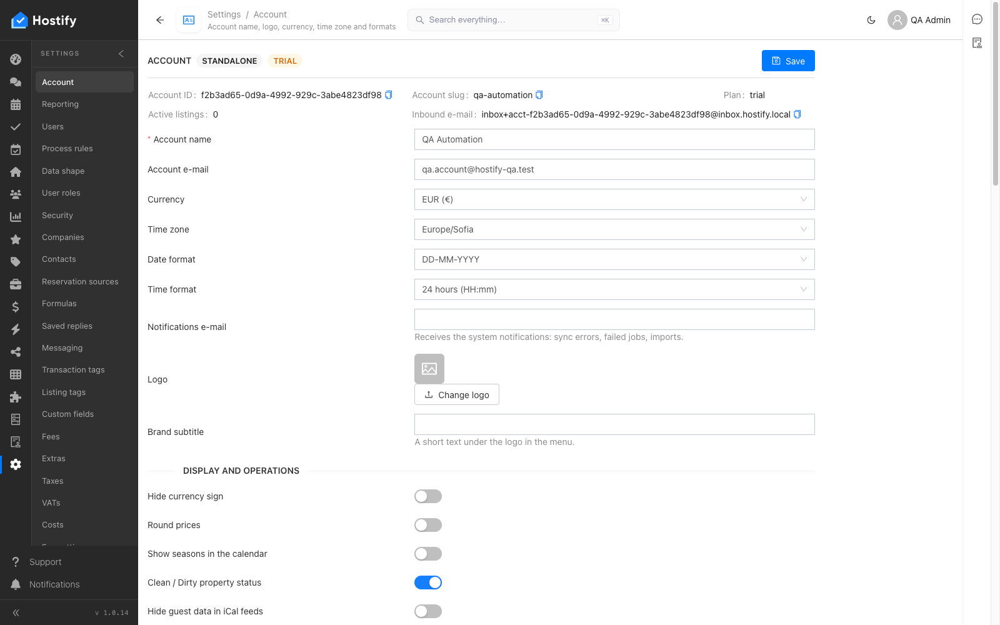


## Казус 21: reportingSettingsList opens (/app/settings/reportingSettingsList)

_Известен от пуска 2026-11-12 10:12 (същата версия) — не е отстранен._

**Какво се обърка**

```
Error: The page reported 78 error(s) — API answers, failed requests, console errors:
- [request.failed] net::ERR_BLOCKED_BY_ORB @ https://hostify-apps.bioseek.eu/plugins/chekin/logo.svg
- [request.failed] net::ERR_BLOCKED_BY_ORB @ https://hostify-apps.bioseek.eu/plugins/stripe/logo.png
- [request.failed] net::ERR_BLOCKED_BY_ORB @ https://hostify-apps.bioseek.eu/plugins/paypal/logo.png
- [request.failed] net::ERR_BLOCKED_BY_ORB @ https://hostify-apps.bioseek.eu/plugins/duve/logo.png
- [request.failed] net::ERR_BLOCKED_BY_ORB @ https://hostify-apps.bioseek.eu/plugins/superhog/logo.png
- [request.failed] net::ERR_BLOCKED_BY_ORB @ https://hostify-apps.bioseek.eu/plugins/beyond/logo.jpg
- [request.failed] net::ERR_BLOCKED_BY_ORB @ https://hostify-apps.bioseek.eu/plugins/pricelabs/logo.svg
- [request.failed] net::ERR_BLOCKED_BY_ORB @ https://hostify-apps.bioseek.eu/plugins/breezeway/logo.png
- [request.failed] net::ERR_BLOCKED_BY_ORB @ https://hostify-apps.bioseek.eu/plugins/cardcom/logo.png
- [request.failed] net::ERR_BLOCKED_BY_ORB @ https://hostify-apps.bioseek.eu/plugins/akiles/logo.svg
```
- неуспешна заявка: net::ERR_BLOCKED_BY_ORB — `https://hostify-apps.bioseek.eu/plugins/chekin/logo.svg`
- неуспешна заявка: net::ERR_BLOCKED_BY_ORB — `https://hostify-apps.bioseek.eu/plugins/stripe/logo.png`
- неуспешна заявка: net::ERR_BLOCKED_BY_ORB — `https://hostify-apps.bioseek.eu/plugins/paypal/logo.png`
- неуспешна заявка: net::ERR_BLOCKED_BY_ORB — `https://hostify-apps.bioseek.eu/plugins/duve/logo.png`
- неуспешна заявка: net::ERR_BLOCKED_BY_ORB — `https://hostify-apps.bioseek.eu/plugins/superhog/logo.png`
- неуспешна заявка: net::ERR_BLOCKED_BY_ORB — `https://hostify-apps.bioseek.eu/plugins/beyond/logo.jpg`
- неуспешна заявка: net::ERR_BLOCKED_BY_ORB — `https://hostify-apps.bioseek.eu/plugins/pricelabs/logo.svg`
- неуспешна заявка: net::ERR_BLOCKED_BY_ORB — `https://hostify-apps.bioseek.eu/plugins/breezeway/logo.png`
- неуспешна заявка: net::ERR_BLOCKED_BY_ORB — `https://hostify-apps.bioseek.eu/plugins/cardcom/logo.png`
- неуспешна заявка: net::ERR_BLOCKED_BY_ORB — `https://hostify-apps.bioseek.eu/plugins/akiles/logo.svg`

**Как да се възпроизведе**

1. Влез в https://hostify.bioseek.eu/app/ като администратор на акаунта (qa.admin@hostify-qa.test).
2. Меню: SETTINGS › Reporting — https://hostify.bioseek.eu/app/settings/reportingSettingsList
3. Спек `tests/e2e/010-account-pages.spec.ts`, проверка „reportingSettingsList opens (/app/settings/reportingSettingsList)“.
4. Developer tools › Network: заявките по-горе отговарят така.

**Скрийншоти**

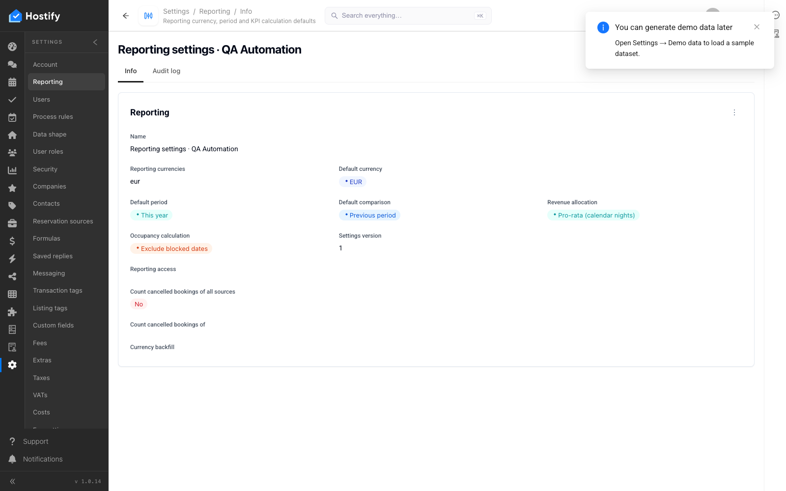
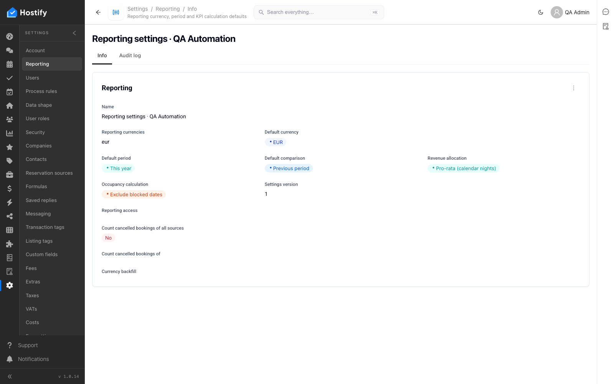


## Казус 22: users opens (/app/settings/users)

_Известен от пуска 2026-11-12 10:12 (същата версия) — не е отстранен._

**Какво се обърка**

```
Error: The page reported 78 error(s) — API answers, failed requests, console errors:
- [request.failed] net::ERR_BLOCKED_BY_ORB @ https://hostify-apps.bioseek.eu/plugins/chekin/logo.svg
- [request.failed] net::ERR_BLOCKED_BY_ORB @ https://hostify-apps.bioseek.eu/plugins/duve/logo.png
- [request.failed] net::ERR_BLOCKED_BY_ORB @ https://hostify-apps.bioseek.eu/plugins/stripe/logo.png
- [request.failed] net::ERR_BLOCKED_BY_ORB @ https://hostify-apps.bioseek.eu/plugins/paypal/logo.png
- [request.failed] net::ERR_BLOCKED_BY_ORB @ https://hostify-apps.bioseek.eu/plugins/superhog/logo.png
- [request.failed] net::ERR_BLOCKED_BY_ORB @ https://hostify-apps.bioseek.eu/plugins/breezeway/logo.png
- [request.failed] net::ERR_BLOCKED_BY_ORB @ https://hostify-apps.bioseek.eu/plugins/beyond/logo.jpg
- [request.failed] net::ERR_BLOCKED_BY_ORB @ https://hostify-apps.bioseek.eu/plugins/pricelabs/logo.svg
- [request.failed] net::ERR_BLOCKED_BY_ORB @ https://hostify-apps.bioseek.eu/plugins/cardcom/logo.png
- [request.failed] net::ERR_BLOCKED_BY_ORB @ https://hostify-apps.bioseek.eu/plugins/akiles/logo.svg
```
- неуспешна заявка: net::ERR_BLOCKED_BY_ORB — `https://hostify-apps.bioseek.eu/plugins/chekin/logo.svg`
- неуспешна заявка: net::ERR_BLOCKED_BY_ORB — `https://hostify-apps.bioseek.eu/plugins/duve/logo.png`
- неуспешна заявка: net::ERR_BLOCKED_BY_ORB — `https://hostify-apps.bioseek.eu/plugins/stripe/logo.png`
- неуспешна заявка: net::ERR_BLOCKED_BY_ORB — `https://hostify-apps.bioseek.eu/plugins/paypal/logo.png`
- неуспешна заявка: net::ERR_BLOCKED_BY_ORB — `https://hostify-apps.bioseek.eu/plugins/superhog/logo.png`
- неуспешна заявка: net::ERR_BLOCKED_BY_ORB — `https://hostify-apps.bioseek.eu/plugins/breezeway/logo.png`
- неуспешна заявка: net::ERR_BLOCKED_BY_ORB — `https://hostify-apps.bioseek.eu/plugins/beyond/logo.jpg`
- неуспешна заявка: net::ERR_BLOCKED_BY_ORB — `https://hostify-apps.bioseek.eu/plugins/pricelabs/logo.svg`
- неуспешна заявка: net::ERR_BLOCKED_BY_ORB — `https://hostify-apps.bioseek.eu/plugins/cardcom/logo.png`
- неуспешна заявка: net::ERR_BLOCKED_BY_ORB — `https://hostify-apps.bioseek.eu/plugins/akiles/logo.svg`

**Как да се възпроизведе**

1. Влез в https://hostify.bioseek.eu/app/ като администратор на акаунта (qa.admin@hostify-qa.test).
2. Меню: SETTINGS › Users — https://hostify.bioseek.eu/app/settings/users
3. Спек `tests/e2e/010-account-pages.spec.ts`, проверка „users opens (/app/settings/users)“.
4. Developer tools › Network: заявките по-горе отговарят така.

**Скрийншоти**

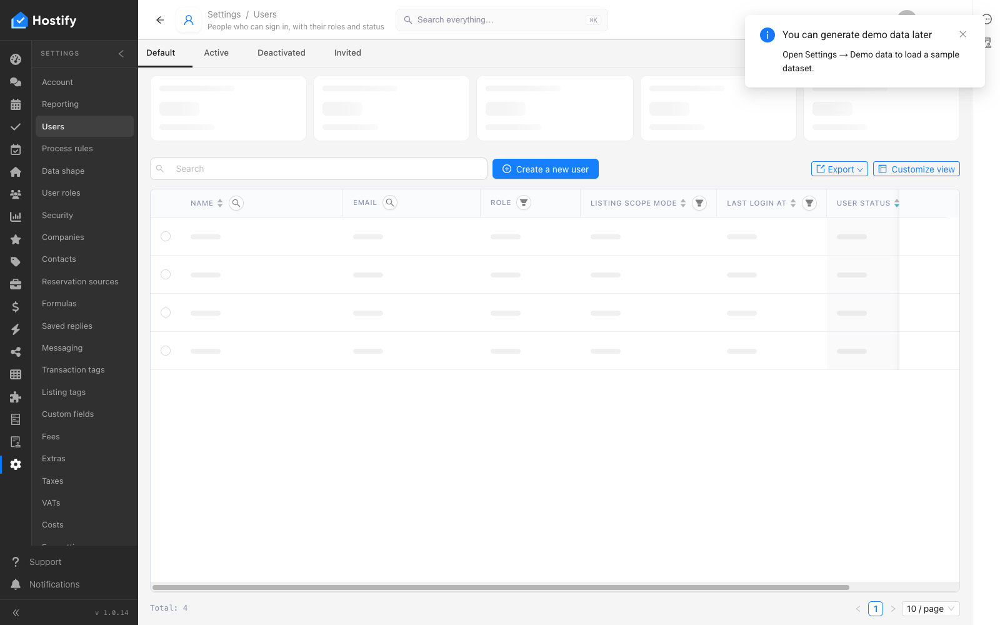
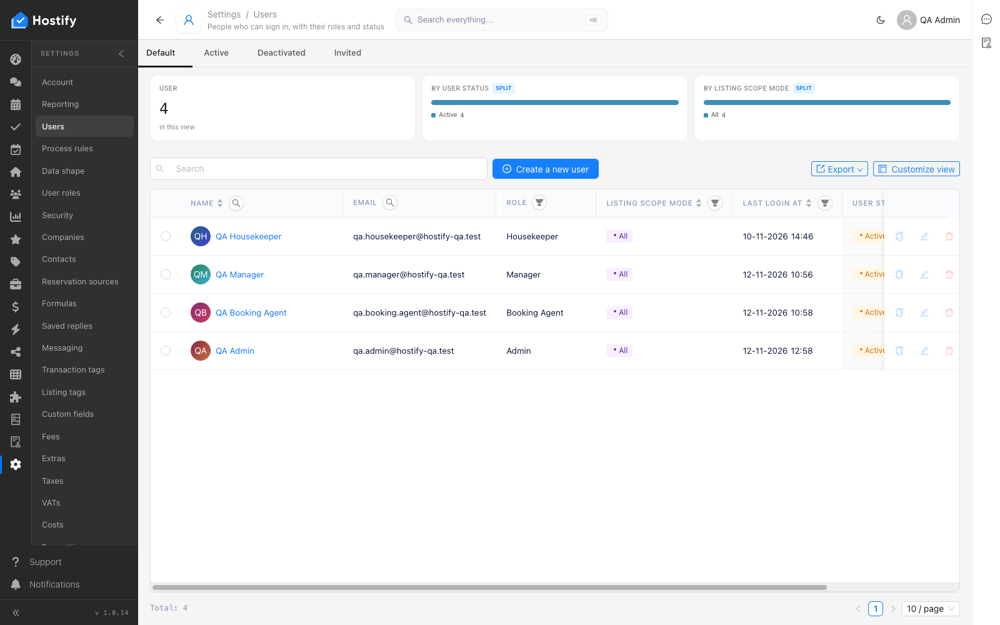


## Казус 23: workflowDefinitions opens (/app/settings/workflowDefinitions)

_Известен от пуска 2026-11-12 10:12 (същата версия) — не е отстранен._

**Какво се обърка**

```
Error: The page reported 78 error(s) — API answers, failed requests, console errors:
- [request.failed] net::ERR_BLOCKED_BY_ORB @ https://hostify-apps.bioseek.eu/plugins/chekin/logo.svg
- [request.failed] net::ERR_BLOCKED_BY_ORB @ https://hostify-apps.bioseek.eu/plugins/stripe/logo.png
- [request.failed] net::ERR_BLOCKED_BY_ORB @ https://hostify-apps.bioseek.eu/plugins/duve/logo.png
- [request.failed] net::ERR_BLOCKED_BY_ORB @ https://hostify-apps.bioseek.eu/plugins/paypal/logo.png
- [request.failed] net::ERR_BLOCKED_BY_ORB @ https://hostify-apps.bioseek.eu/plugins/superhog/logo.png
- [request.failed] net::ERR_BLOCKED_BY_ORB @ https://hostify-apps.bioseek.eu/plugins/breezeway/logo.png
- [request.failed] net::ERR_BLOCKED_BY_ORB @ https://hostify-apps.bioseek.eu/plugins/beyond/logo.jpg
- [request.failed] net::ERR_BLOCKED_BY_ORB @ https://hostify-apps.bioseek.eu/plugins/pricelabs/logo.svg
- [request.failed] net::ERR_BLOCKED_BY_ORB @ https://hostify-apps.bioseek.eu/plugins/cardcom/logo.png
- [request.failed] net::ERR_BLOCKED_BY_ORB @ https://hostify-apps.bioseek.eu/plugins/akiles/logo.svg
```
- неуспешна заявка: net::ERR_BLOCKED_BY_ORB — `https://hostify-apps.bioseek.eu/plugins/chekin/logo.svg`
- неуспешна заявка: net::ERR_BLOCKED_BY_ORB — `https://hostify-apps.bioseek.eu/plugins/stripe/logo.png`
- неуспешна заявка: net::ERR_BLOCKED_BY_ORB — `https://hostify-apps.bioseek.eu/plugins/duve/logo.png`
- неуспешна заявка: net::ERR_BLOCKED_BY_ORB — `https://hostify-apps.bioseek.eu/plugins/paypal/logo.png`
- неуспешна заявка: net::ERR_BLOCKED_BY_ORB — `https://hostify-apps.bioseek.eu/plugins/superhog/logo.png`
- неуспешна заявка: net::ERR_BLOCKED_BY_ORB — `https://hostify-apps.bioseek.eu/plugins/breezeway/logo.png`
- неуспешна заявка: net::ERR_BLOCKED_BY_ORB — `https://hostify-apps.bioseek.eu/plugins/beyond/logo.jpg`
- неуспешна заявка: net::ERR_BLOCKED_BY_ORB — `https://hostify-apps.bioseek.eu/plugins/pricelabs/logo.svg`
- неуспешна заявка: net::ERR_BLOCKED_BY_ORB — `https://hostify-apps.bioseek.eu/plugins/cardcom/logo.png`
- неуспешна заявка: net::ERR_BLOCKED_BY_ORB — `https://hostify-apps.bioseek.eu/plugins/akiles/logo.svg`

**Как да се възпроизведе**

1. Влез в https://hostify.bioseek.eu/app/ като администратор на акаунта (qa.admin@hostify-qa.test).
2. Меню: SETTINGS › Process rules — https://hostify.bioseek.eu/app/settings/workflowDefinitions
3. Спек `tests/e2e/010-account-pages.spec.ts`, проверка „workflowDefinitions opens (/app/settings/workflowDefinitions)“.
4. Developer tools › Network: заявките по-горе отговарят така.

**Скрийншоти**


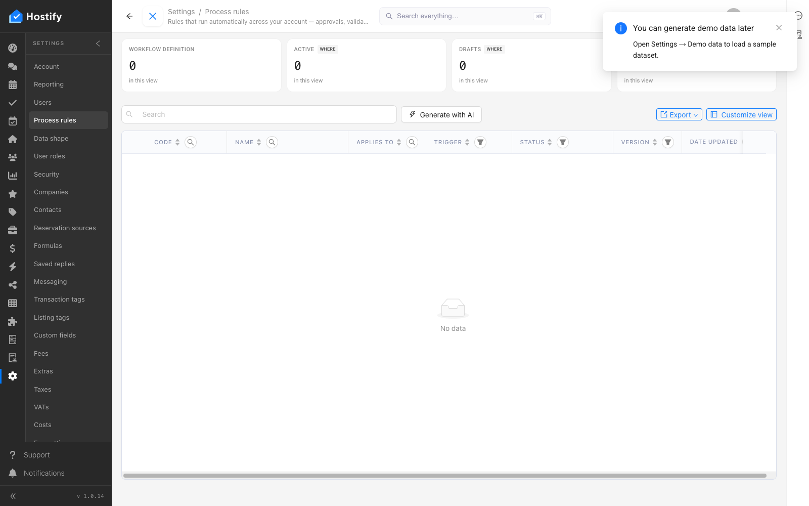


## Казус 24: dataShape opens (/app/settings/dataShape)

_Известен от пуска 2026-11-12 10:12 (същата версия) — не е отстранен._

**Какво се обърка**

```
Error: The page reported 78 error(s) — API answers, failed requests, console errors:
- [request.failed] net::ERR_BLOCKED_BY_ORB @ https://hostify-apps.bioseek.eu/plugins/paypal/logo.png
- [request.failed] net::ERR_BLOCKED_BY_ORB @ https://hostify-apps.bioseek.eu/plugins/chekin/logo.svg
- [request.failed] net::ERR_BLOCKED_BY_ORB @ https://hostify-apps.bioseek.eu/plugins/duve/logo.png
- [request.failed] net::ERR_BLOCKED_BY_ORB @ https://hostify-apps.bioseek.eu/plugins/stripe/logo.png
- [request.failed] net::ERR_BLOCKED_BY_ORB @ https://hostify-apps.bioseek.eu/plugins/superhog/logo.png
- [request.failed] net::ERR_BLOCKED_BY_ORB @ https://hostify-apps.bioseek.eu/plugins/breezeway/logo.png
- [request.failed] net::ERR_BLOCKED_BY_ORB @ https://hostify-apps.bioseek.eu/plugins/pricelabs/logo.svg
- [request.failed] net::ERR_BLOCKED_BY_ORB @ https://hostify-apps.bioseek.eu/plugins/cardcom/logo.png
- [request.failed] net::ERR_BLOCKED_BY_ORB @ https://hostify-apps.bioseek.eu/plugins/beyond/logo.jpg
- [request.failed] net::ERR_BLOCKED_BY_ORB @ https://hostify-apps.bioseek.eu/plugins/akiles/logo.svg
```
- неуспешна заявка: net::ERR_BLOCKED_BY_ORB — `https://hostify-apps.bioseek.eu/plugins/paypal/logo.png`
- неуспешна заявка: net::ERR_BLOCKED_BY_ORB — `https://hostify-apps.bioseek.eu/plugins/chekin/logo.svg`
- неуспешна заявка: net::ERR_BLOCKED_BY_ORB — `https://hostify-apps.bioseek.eu/plugins/duve/logo.png`
- неуспешна заявка: net::ERR_BLOCKED_BY_ORB — `https://hostify-apps.bioseek.eu/plugins/stripe/logo.png`
- неуспешна заявка: net::ERR_BLOCKED_BY_ORB — `https://hostify-apps.bioseek.eu/plugins/superhog/logo.png`
- неуспешна заявка: net::ERR_BLOCKED_BY_ORB — `https://hostify-apps.bioseek.eu/plugins/breezeway/logo.png`
- неуспешна заявка: net::ERR_BLOCKED_BY_ORB — `https://hostify-apps.bioseek.eu/plugins/pricelabs/logo.svg`
- неуспешна заявка: net::ERR_BLOCKED_BY_ORB — `https://hostify-apps.bioseek.eu/plugins/cardcom/logo.png`
- неуспешна заявка: net::ERR_BLOCKED_BY_ORB — `https://hostify-apps.bioseek.eu/plugins/beyond/logo.jpg`
- неуспешна заявка: net::ERR_BLOCKED_BY_ORB — `https://hostify-apps.bioseek.eu/plugins/akiles/logo.svg`

**Как да се възпроизведе**

1. Влез в https://hostify.bioseek.eu/app/ като администратор на акаунта (qa.admin@hostify-qa.test).
2. Меню: SETTINGS › Data shape — https://hostify.bioseek.eu/app/settings/dataShape
3. Спек `tests/e2e/010-account-pages.spec.ts`, проверка „dataShape opens (/app/settings/dataShape)“.
4. Developer tools › Network: заявките по-горе отговарят така.

**Скрийншоти**

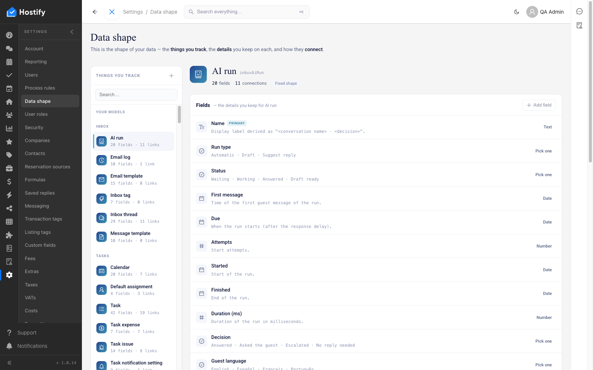


## Казус 25: securityGroups opens (/app/settings/securityGroups)

_Известен от пуска 2026-11-12 10:12 (същата версия) — не е отстранен._

**Какво се обърка**

```
Error: The page reported 78 error(s) — API answers, failed requests, console errors:
- [request.failed] net::ERR_BLOCKED_BY_ORB @ https://hostify-apps.bioseek.eu/plugins/duve/logo.png
- [request.failed] net::ERR_BLOCKED_BY_ORB @ https://hostify-apps.bioseek.eu/plugins/stripe/logo.png
- [request.failed] net::ERR_BLOCKED_BY_ORB @ https://hostify-apps.bioseek.eu/plugins/paypal/logo.png
- [request.failed] net::ERR_BLOCKED_BY_ORB @ https://hostify-apps.bioseek.eu/plugins/chekin/logo.svg
- [request.failed] net::ERR_BLOCKED_BY_ORB @ https://hostify-apps.bioseek.eu/plugins/superhog/logo.png
- [request.failed] net::ERR_BLOCKED_BY_ORB @ https://hostify-apps.bioseek.eu/plugins/breezeway/logo.png
- [request.failed] net::ERR_BLOCKED_BY_ORB @ https://hostify-apps.bioseek.eu/plugins/beyond/logo.jpg
- [request.failed] net::ERR_BLOCKED_BY_ORB @ https://hostify-apps.bioseek.eu/plugins/pricelabs/logo.svg
- [request.failed] net::ERR_BLOCKED_BY_ORB @ https://hostify-apps.bioseek.eu/plugins/cardcom/logo.png
- [request.failed] net::ERR_BLOCKED_BY_ORB @ https://hostify-apps.bioseek.eu/plugins/akiles/logo.svg
```
- неуспешна заявка: net::ERR_BLOCKED_BY_ORB — `https://hostify-apps.bioseek.eu/plugins/duve/logo.png`
- неуспешна заявка: net::ERR_BLOCKED_BY_ORB — `https://hostify-apps.bioseek.eu/plugins/stripe/logo.png`
- неуспешна заявка: net::ERR_BLOCKED_BY_ORB — `https://hostify-apps.bioseek.eu/plugins/paypal/logo.png`
- неуспешна заявка: net::ERR_BLOCKED_BY_ORB — `https://hostify-apps.bioseek.eu/plugins/chekin/logo.svg`
- неуспешна заявка: net::ERR_BLOCKED_BY_ORB — `https://hostify-apps.bioseek.eu/plugins/superhog/logo.png`
- неуспешна заявка: net::ERR_BLOCKED_BY_ORB — `https://hostify-apps.bioseek.eu/plugins/breezeway/logo.png`
- неуспешна заявка: net::ERR_BLOCKED_BY_ORB — `https://hostify-apps.bioseek.eu/plugins/beyond/logo.jpg`
- неуспешна заявка: net::ERR_BLOCKED_BY_ORB — `https://hostify-apps.bioseek.eu/plugins/pricelabs/logo.svg`
- неуспешна заявка: net::ERR_BLOCKED_BY_ORB — `https://hostify-apps.bioseek.eu/plugins/cardcom/logo.png`
- неуспешна заявка: net::ERR_BLOCKED_BY_ORB — `https://hostify-apps.bioseek.eu/plugins/akiles/logo.svg`

**Как да се възпроизведе**

1. Влез в https://hostify.bioseek.eu/app/ като администратор на акаунта (qa.admin@hostify-qa.test).
2. Меню: SETTINGS › User roles — https://hostify.bioseek.eu/app/settings/securityGroups
3. Спек `tests/e2e/010-account-pages.spec.ts`, проверка „securityGroups opens (/app/settings/securityGroups)“.
4. Developer tools › Network: заявките по-горе отговарят така.

**Скрийншоти**

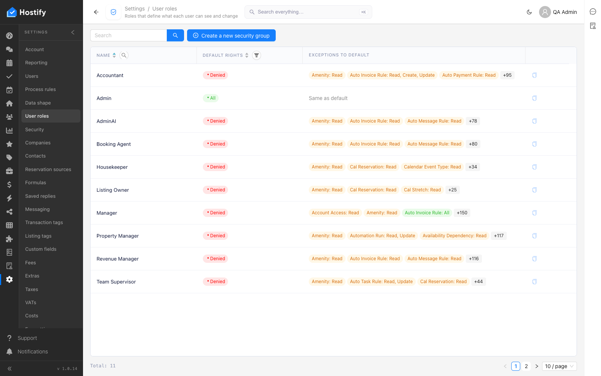


## Казус 26: securitySettings opens (/app/settings/securitySettings)

_Известен от пуска 2026-11-12 10:12 (същата версия) — не е отстранен._

**Какво се обърка**

```
Error: The page reported 78 error(s) — API answers, failed requests, console errors:
- [request.failed] net::ERR_BLOCKED_BY_ORB @ https://hostify-apps.bioseek.eu/plugins/stripe/logo.png
- [request.failed] net::ERR_BLOCKED_BY_ORB @ https://hostify-apps.bioseek.eu/plugins/chekin/logo.svg
- [request.failed] net::ERR_BLOCKED_BY_ORB @ https://hostify-apps.bioseek.eu/plugins/duve/logo.png
- [request.failed] net::ERR_BLOCKED_BY_ORB @ https://hostify-apps.bioseek.eu/plugins/paypal/logo.png
- [request.failed] net::ERR_BLOCKED_BY_ORB @ https://hostify-apps.bioseek.eu/plugins/superhog/logo.png
- [request.failed] net::ERR_BLOCKED_BY_ORB @ https://hostify-apps.bioseek.eu/plugins/breezeway/logo.png
- [request.failed] net::ERR_BLOCKED_BY_ORB @ https://hostify-apps.bioseek.eu/plugins/beyond/logo.jpg
- [request.failed] net::ERR_BLOCKED_BY_ORB @ https://hostify-apps.bioseek.eu/plugins/pricelabs/logo.svg
- [request.failed] net::ERR_BLOCKED_BY_ORB @ https://hostify-apps.bioseek.eu/plugins/cardcom/logo.png
- [request.failed] net::ERR_BLOCKED_BY_ORB @ https://hostify-apps.bioseek.eu/plugins/akiles/logo.svg
```
- неуспешна заявка: net::ERR_BLOCKED_BY_ORB — `https://hostify-apps.bioseek.eu/plugins/stripe/logo.png`
- неуспешна заявка: net::ERR_BLOCKED_BY_ORB — `https://hostify-apps.bioseek.eu/plugins/chekin/logo.svg`
- неуспешна заявка: net::ERR_BLOCKED_BY_ORB — `https://hostify-apps.bioseek.eu/plugins/duve/logo.png`
- неуспешна заявка: net::ERR_BLOCKED_BY_ORB — `https://hostify-apps.bioseek.eu/plugins/paypal/logo.png`
- неуспешна заявка: net::ERR_BLOCKED_BY_ORB — `https://hostify-apps.bioseek.eu/plugins/superhog/logo.png`
- неуспешна заявка: net::ERR_BLOCKED_BY_ORB — `https://hostify-apps.bioseek.eu/plugins/breezeway/logo.png`
- неуспешна заявка: net::ERR_BLOCKED_BY_ORB — `https://hostify-apps.bioseek.eu/plugins/beyond/logo.jpg`
- неуспешна заявка: net::ERR_BLOCKED_BY_ORB — `https://hostify-apps.bioseek.eu/plugins/pricelabs/logo.svg`
- неуспешна заявка: net::ERR_BLOCKED_BY_ORB — `https://hostify-apps.bioseek.eu/plugins/cardcom/logo.png`
- неуспешна заявка: net::ERR_BLOCKED_BY_ORB — `https://hostify-apps.bioseek.eu/plugins/akiles/logo.svg`

**Как да се възпроизведе**

1. Влез в https://hostify.bioseek.eu/app/ като администратор на акаунта (qa.admin@hostify-qa.test).
2. Меню: SETTINGS › Security — https://hostify.bioseek.eu/app/settings/securitySettings
3. Спек `tests/e2e/010-account-pages.spec.ts`, проверка „securitySettings opens (/app/settings/securitySettings)“.
4. Developer tools › Network: заявките по-горе отговарят така.

**Скрийншоти**

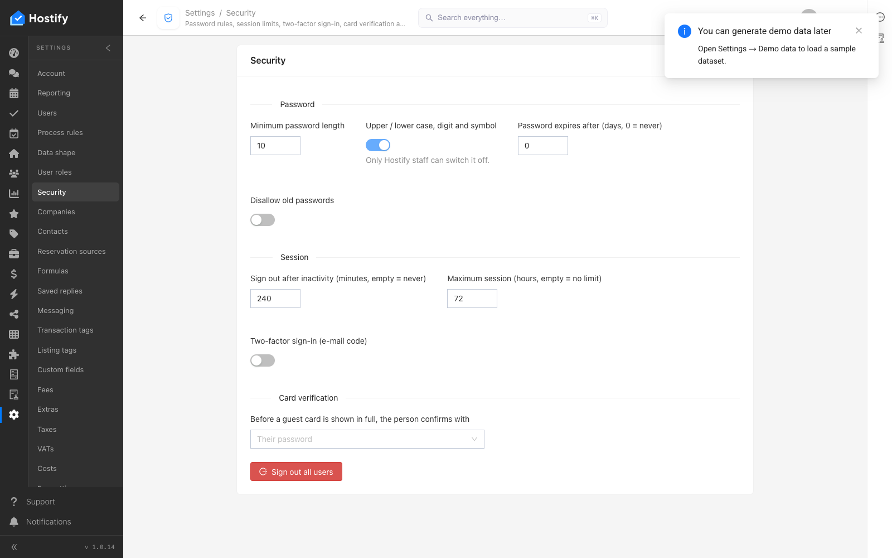


## Казус 27: contacts opens (/app/settings/contacts)

_Известен от пуска 2026-11-12 10:12 (същата версия) — не е отстранен._

**Какво се обърка**

```
Error: The page reported 78 error(s) — API answers, failed requests, console errors:
- [request.failed] net::ERR_BLOCKED_BY_ORB @ https://hostify-apps.bioseek.eu/plugins/stripe/logo.png
- [request.failed] net::ERR_BLOCKED_BY_ORB @ https://hostify-apps.bioseek.eu/plugins/paypal/logo.png
- [request.failed] net::ERR_BLOCKED_BY_ORB @ https://hostify-apps.bioseek.eu/plugins/chekin/logo.svg
- [request.failed] net::ERR_BLOCKED_BY_ORB @ https://hostify-apps.bioseek.eu/plugins/duve/logo.png
- [request.failed] net::ERR_BLOCKED_BY_ORB @ https://hostify-apps.bioseek.eu/plugins/superhog/logo.png
- [request.failed] net::ERR_BLOCKED_BY_ORB @ https://hostify-apps.bioseek.eu/plugins/breezeway/logo.png
- [request.failed] net::ERR_BLOCKED_BY_ORB @ https://hostify-apps.bioseek.eu/plugins/beyond/logo.jpg
- [request.failed] net::ERR_BLOCKED_BY_ORB @ https://hostify-apps.bioseek.eu/plugins/pricelabs/logo.svg
- [request.failed] net::ERR_BLOCKED_BY_ORB @ https://hostify-apps.bioseek.eu/plugins/cardcom/logo.png
- [request.failed] net::ERR_BLOCKED_BY_ORB @ https://hostify-apps.bioseek.eu/plugins/akiles/logo.svg
```
- неуспешна заявка: net::ERR_BLOCKED_BY_ORB — `https://hostify-apps.bioseek.eu/plugins/stripe/logo.png`
- неуспешна заявка: net::ERR_BLOCKED_BY_ORB — `https://hostify-apps.bioseek.eu/plugins/paypal/logo.png`
- неуспешна заявка: net::ERR_BLOCKED_BY_ORB — `https://hostify-apps.bioseek.eu/plugins/chekin/logo.svg`
- неуспешна заявка: net::ERR_BLOCKED_BY_ORB — `https://hostify-apps.bioseek.eu/plugins/duve/logo.png`
- неуспешна заявка: net::ERR_BLOCKED_BY_ORB — `https://hostify-apps.bioseek.eu/plugins/superhog/logo.png`
- неуспешна заявка: net::ERR_BLOCKED_BY_ORB — `https://hostify-apps.bioseek.eu/plugins/breezeway/logo.png`
- неуспешна заявка: net::ERR_BLOCKED_BY_ORB — `https://hostify-apps.bioseek.eu/plugins/beyond/logo.jpg`
- неуспешна заявка: net::ERR_BLOCKED_BY_ORB — `https://hostify-apps.bioseek.eu/plugins/pricelabs/logo.svg`
- неуспешна заявка: net::ERR_BLOCKED_BY_ORB — `https://hostify-apps.bioseek.eu/plugins/cardcom/logo.png`
- неуспешна заявка: net::ERR_BLOCKED_BY_ORB — `https://hostify-apps.bioseek.eu/plugins/akiles/logo.svg`

**Как да се възпроизведе**

1. Влез в https://hostify.bioseek.eu/app/ като администратор на акаунта (qa.admin@hostify-qa.test).
2. Меню: SETTINGS › Contacts — https://hostify.bioseek.eu/app/settings/contacts
3. Спек `tests/e2e/010-account-pages.spec.ts`, проверка „contacts opens (/app/settings/contacts)“.
4. Developer tools › Network: заявките по-горе отговарят така.

**Скрийншоти**


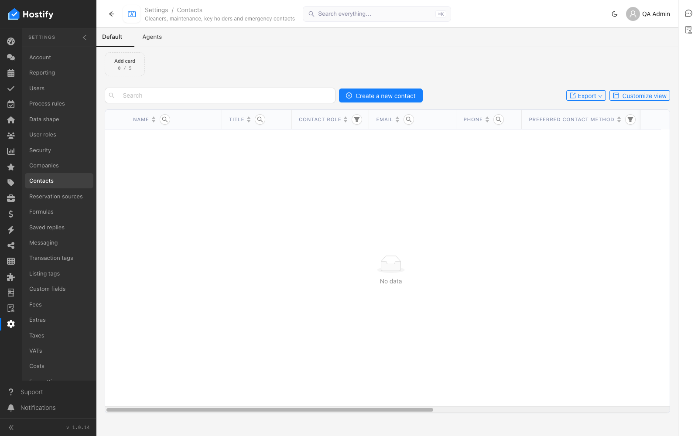


## Казус 28: reservationSources opens (/app/settings/reservationSources)

_Известен от пуска 2026-11-12 10:12 (същата версия) — не е отстранен._

**Какво се обърка**

```
Error: The page reported 78 error(s) — API answers, failed requests, console errors:
- [request.failed] net::ERR_BLOCKED_BY_ORB @ https://hostify-apps.bioseek.eu/plugins/paypal/logo.png
- [request.failed] net::ERR_BLOCKED_BY_ORB @ https://hostify-apps.bioseek.eu/plugins/duve/logo.png
- [request.failed] net::ERR_BLOCKED_BY_ORB @ https://hostify-apps.bioseek.eu/plugins/stripe/logo.png
- [request.failed] net::ERR_BLOCKED_BY_ORB @ https://hostify-apps.bioseek.eu/plugins/chekin/logo.svg
- [request.failed] net::ERR_BLOCKED_BY_ORB @ https://hostify-apps.bioseek.eu/plugins/superhog/logo.png
- [request.failed] net::ERR_BLOCKED_BY_ORB @ https://hostify-apps.bioseek.eu/plugins/breezeway/logo.png
- [request.failed] net::ERR_BLOCKED_BY_ORB @ https://hostify-apps.bioseek.eu/plugins/beyond/logo.jpg
- [request.failed] net::ERR_BLOCKED_BY_ORB @ https://hostify-apps.bioseek.eu/plugins/pricelabs/logo.svg
- [request.failed] net::ERR_BLOCKED_BY_ORB @ https://hostify-apps.bioseek.eu/plugins/cardcom/logo.png
- [request.failed] net::ERR_BLOCKED_BY_ORB @ https://hostify-apps.bioseek.eu/plugins/akiles/logo.svg
```
- неуспешна заявка: net::ERR_BLOCKED_BY_ORB — `https://hostify-apps.bioseek.eu/plugins/paypal/logo.png`
- неуспешна заявка: net::ERR_BLOCKED_BY_ORB — `https://hostify-apps.bioseek.eu/plugins/duve/logo.png`
- неуспешна заявка: net::ERR_BLOCKED_BY_ORB — `https://hostify-apps.bioseek.eu/plugins/stripe/logo.png`
- неуспешна заявка: net::ERR_BLOCKED_BY_ORB — `https://hostify-apps.bioseek.eu/plugins/chekin/logo.svg`
- неуспешна заявка: net::ERR_BLOCKED_BY_ORB — `https://hostify-apps.bioseek.eu/plugins/superhog/logo.png`
- неуспешна заявка: net::ERR_BLOCKED_BY_ORB — `https://hostify-apps.bioseek.eu/plugins/breezeway/logo.png`
- неуспешна заявка: net::ERR_BLOCKED_BY_ORB — `https://hostify-apps.bioseek.eu/plugins/beyond/logo.jpg`
- неуспешна заявка: net::ERR_BLOCKED_BY_ORB — `https://hostify-apps.bioseek.eu/plugins/pricelabs/logo.svg`
- неуспешна заявка: net::ERR_BLOCKED_BY_ORB — `https://hostify-apps.bioseek.eu/plugins/cardcom/logo.png`
- неуспешна заявка: net::ERR_BLOCKED_BY_ORB — `https://hostify-apps.bioseek.eu/plugins/akiles/logo.svg`

**Как да се възпроизведе**

1. Влез в https://hostify.bioseek.eu/app/ като администратор на акаунта (qa.admin@hostify-qa.test).
2. Меню: SETTINGS › Reservation sources — https://hostify.bioseek.eu/app/settings/reservationSources
3. Спек `tests/e2e/010-account-pages.spec.ts`, проверка „reservationSources opens (/app/settings/reservationSources)“.
4. Developer tools › Network: заявките по-горе отговарят така.

**Скрийншоти**


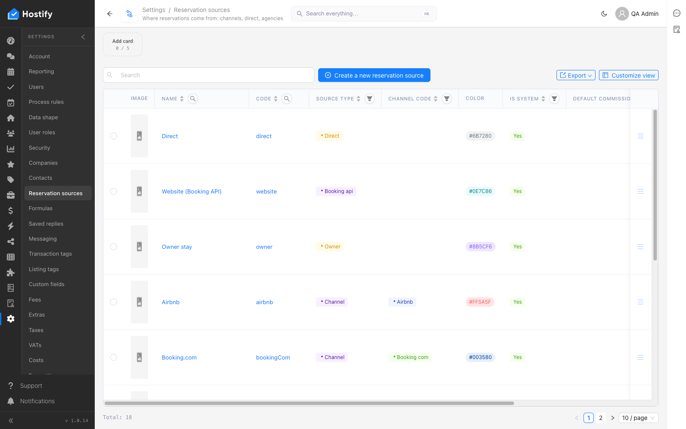


## Казус 29: settingsFormulas opens (/app/settings/settingsFormulas)

_Известен от пуска 2026-11-12 10:12 (същата версия) — не е отстранен._

**Какво се обърка**

```
Error: The page reported 67 error(s) — API answers, failed requests, console errors:
- [request.failed] net::ERR_BLOCKED_BY_ORB @ https://hostify-apps.bioseek.eu/plugins/chekin/logo.svg
- [request.failed] net::ERR_BLOCKED_BY_ORB @ https://hostify-apps.bioseek.eu/plugins/duve/logo.png
- [request.failed] net::ERR_BLOCKED_BY_ORB @ https://hostify-apps.bioseek.eu/plugins/stripe/logo.png
- [request.failed] net::ERR_BLOCKED_BY_ORB @ https://hostify-apps.bioseek.eu/plugins/paypal/logo.png
- [request.failed] net::ERR_BLOCKED_BY_ORB @ https://hostify-apps.bioseek.eu/plugins/superhog/logo.png
- [request.failed] net::ERR_BLOCKED_BY_ORB @ https://hostify-apps.bioseek.eu/plugins/breezeway/logo.png
- [request.failed] net::ERR_BLOCKED_BY_ORB @ https://hostify-apps.bioseek.eu/plugins/beyond/logo.jpg
- [request.failed] net::ERR_BLOCKED_BY_ORB @ https://hostify-apps.bioseek.eu/plugins/pricelabs/logo.svg
- [request.failed] net::ERR_BLOCKED_BY_ORB @ https://hostify-apps.bioseek.eu/plugins/cardcom/logo.png
- [request.failed] net::ERR_BLOCKED_BY_ORB @ https://hostify-apps.bioseek.eu/plugins/akiles/logo.svg
```
- неуспешна заявка: net::ERR_BLOCKED_BY_ORB — `https://hostify-apps.bioseek.eu/plugins/chekin/logo.svg`
- неуспешна заявка: net::ERR_BLOCKED_BY_ORB — `https://hostify-apps.bioseek.eu/plugins/duve/logo.png`
- неуспешна заявка: net::ERR_BLOCKED_BY_ORB — `https://hostify-apps.bioseek.eu/plugins/stripe/logo.png`
- неуспешна заявка: net::ERR_BLOCKED_BY_ORB — `https://hostify-apps.bioseek.eu/plugins/paypal/logo.png`
- неуспешна заявка: net::ERR_BLOCKED_BY_ORB — `https://hostify-apps.bioseek.eu/plugins/superhog/logo.png`
- неуспешна заявка: net::ERR_BLOCKED_BY_ORB — `https://hostify-apps.bioseek.eu/plugins/breezeway/logo.png`
- неуспешна заявка: net::ERR_BLOCKED_BY_ORB — `https://hostify-apps.bioseek.eu/plugins/beyond/logo.jpg`
- неуспешна заявка: net::ERR_BLOCKED_BY_ORB — `https://hostify-apps.bioseek.eu/plugins/pricelabs/logo.svg`
- неуспешна заявка: net::ERR_BLOCKED_BY_ORB — `https://hostify-apps.bioseek.eu/plugins/cardcom/logo.png`
- неуспешна заявка: net::ERR_BLOCKED_BY_ORB — `https://hostify-apps.bioseek.eu/plugins/akiles/logo.svg`

**Как да се възпроизведе**

1. Влез в https://hostify.bioseek.eu/app/ като администратор на акаунта (qa.admin@hostify-qa.test).
2. Меню: SETTINGS › Formulas — https://hostify.bioseek.eu/app/settings/settingsFormulas
3. Спек `tests/e2e/010-account-pages.spec.ts`, проверка „settingsFormulas opens (/app/settings/settingsFormulas)“.
4. Developer tools › Network: заявките по-горе отговарят така.

**Скрийншоти**

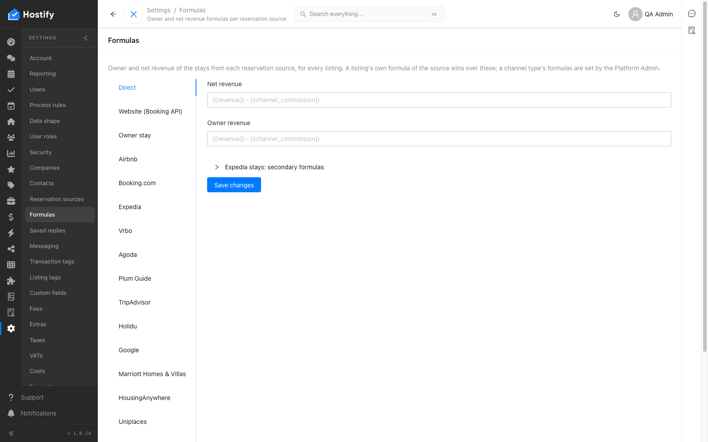


## Казус 30: savedReplies opens (/app/settings/savedReplies)

_Известен от пуска 2026-11-12 10:12 (същата версия) — не е отстранен._

**Какво се обърка**

```
Error: The page reported 78 error(s) — API answers, failed requests, console errors:
- [request.failed] net::ERR_BLOCKED_BY_ORB @ https://hostify-apps.bioseek.eu/plugins/stripe/logo.png
- [request.failed] net::ERR_BLOCKED_BY_ORB @ https://hostify-apps.bioseek.eu/plugins/paypal/logo.png
- [request.failed] net::ERR_BLOCKED_BY_ORB @ https://hostify-apps.bioseek.eu/plugins/duve/logo.png
- [request.failed] net::ERR_BLOCKED_BY_ORB @ https://hostify-apps.bioseek.eu/plugins/chekin/logo.svg
- [request.failed] net::ERR_BLOCKED_BY_ORB @ https://hostify-apps.bioseek.eu/plugins/superhog/logo.png
- [request.failed] net::ERR_BLOCKED_BY_ORB @ https://hostify-apps.bioseek.eu/plugins/beyond/logo.jpg
- [request.failed] net::ERR_BLOCKED_BY_ORB @ https://hostify-apps.bioseek.eu/plugins/breezeway/logo.png
- [request.failed] net::ERR_BLOCKED_BY_ORB @ https://hostify-apps.bioseek.eu/plugins/pricelabs/logo.svg
- [request.failed] net::ERR_BLOCKED_BY_ORB @ https://hostify-apps.bioseek.eu/plugins/cardcom/logo.png
- [request.failed] net::ERR_BLOCKED_BY_ORB @ https://hostify-apps.bioseek.eu/plugins/akiles/logo.svg
```
- неуспешна заявка: net::ERR_BLOCKED_BY_ORB — `https://hostify-apps.bioseek.eu/plugins/stripe/logo.png`
- неуспешна заявка: net::ERR_BLOCKED_BY_ORB — `https://hostify-apps.bioseek.eu/plugins/paypal/logo.png`
- неуспешна заявка: net::ERR_BLOCKED_BY_ORB — `https://hostify-apps.bioseek.eu/plugins/duve/logo.png`
- неуспешна заявка: net::ERR_BLOCKED_BY_ORB — `https://hostify-apps.bioseek.eu/plugins/chekin/logo.svg`
- неуспешна заявка: net::ERR_BLOCKED_BY_ORB — `https://hostify-apps.bioseek.eu/plugins/superhog/logo.png`
- неуспешна заявка: net::ERR_BLOCKED_BY_ORB — `https://hostify-apps.bioseek.eu/plugins/beyond/logo.jpg`
- неуспешна заявка: net::ERR_BLOCKED_BY_ORB — `https://hostify-apps.bioseek.eu/plugins/breezeway/logo.png`
- неуспешна заявка: net::ERR_BLOCKED_BY_ORB — `https://hostify-apps.bioseek.eu/plugins/pricelabs/logo.svg`
- неуспешна заявка: net::ERR_BLOCKED_BY_ORB — `https://hostify-apps.bioseek.eu/plugins/cardcom/logo.png`
- неуспешна заявка: net::ERR_BLOCKED_BY_ORB — `https://hostify-apps.bioseek.eu/plugins/akiles/logo.svg`

**Как да се възпроизведе**

1. Влез в https://hostify.bioseek.eu/app/ като администратор на акаунта (qa.admin@hostify-qa.test).
2. Меню: SETTINGS › Saved replies — https://hostify.bioseek.eu/app/settings/savedReplies
3. Спек `tests/e2e/010-account-pages.spec.ts`, проверка „savedReplies opens (/app/settings/savedReplies)“.
4. Developer tools › Network: заявките по-горе отговарят така.

**Скрийншоти**


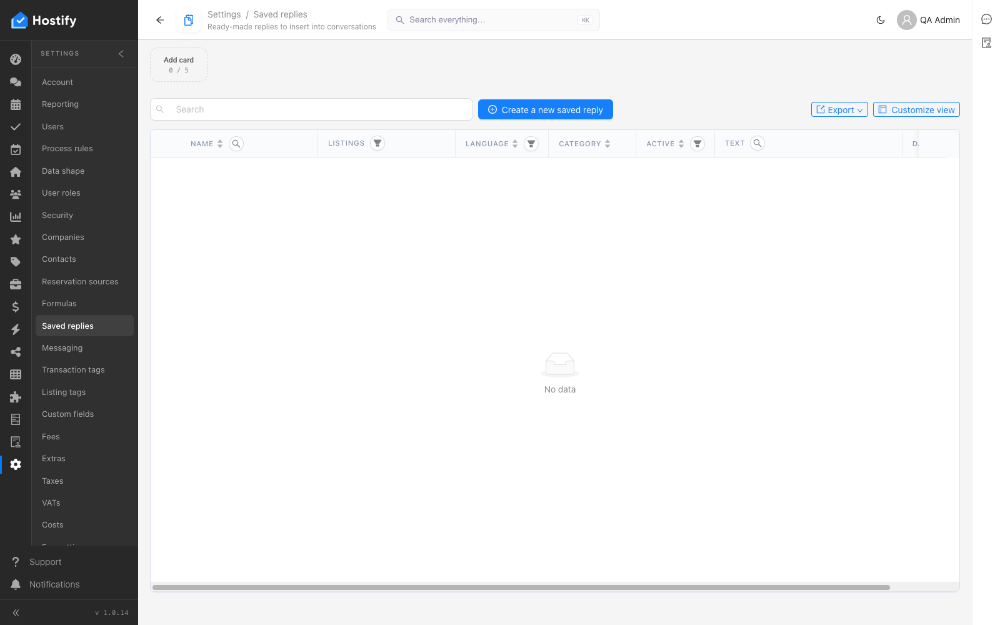


## Казус 31: transactionTags opens (/app/settings/transactionTags)

_Известен от пуска 2026-11-12 10:58 (същата версия) — не е отстранен._

**Какво се обърка**

```
Error: The page reported 78 error(s) — API answers, failed requests, console errors:
- [request.failed] net::ERR_BLOCKED_BY_ORB @ https://hostify-apps.bioseek.eu/plugins/chekin/logo.svg
- [request.failed] net::ERR_BLOCKED_BY_ORB @ https://hostify-apps.bioseek.eu/plugins/duve/logo.png
- [request.failed] net::ERR_BLOCKED_BY_ORB @ https://hostify-apps.bioseek.eu/plugins/stripe/logo.png
- [request.failed] net::ERR_BLOCKED_BY_ORB @ https://hostify-apps.bioseek.eu/plugins/paypal/logo.png
- [request.failed] net::ERR_BLOCKED_BY_ORB @ https://hostify-apps.bioseek.eu/plugins/breezeway/logo.png
- [request.failed] net::ERR_BLOCKED_BY_ORB @ https://hostify-apps.bioseek.eu/plugins/superhog/logo.png
- [request.failed] net::ERR_BLOCKED_BY_ORB @ https://hostify-apps.bioseek.eu/plugins/beyond/logo.jpg
- [request.failed] net::ERR_BLOCKED_BY_ORB @ https://hostify-apps.bioseek.eu/plugins/pricelabs/logo.svg
- [request.failed] net::ERR_BLOCKED_BY_ORB @ https://hostify-apps.bioseek.eu/plugins/cardcom/logo.png
- [request.failed] net::ERR_BLOCKED_BY_ORB @ https://hostify-apps.bioseek.eu/plugins/akiles/logo.svg
```
- неуспешна заявка: net::ERR_BLOCKED_BY_ORB — `https://hostify-apps.bioseek.eu/plugins/chekin/logo.svg`
- неуспешна заявка: net::ERR_BLOCKED_BY_ORB — `https://hostify-apps.bioseek.eu/plugins/duve/logo.png`
- неуспешна заявка: net::ERR_BLOCKED_BY_ORB — `https://hostify-apps.bioseek.eu/plugins/stripe/logo.png`
- неуспешна заявка: net::ERR_BLOCKED_BY_ORB — `https://hostify-apps.bioseek.eu/plugins/paypal/logo.png`
- неуспешна заявка: net::ERR_BLOCKED_BY_ORB — `https://hostify-apps.bioseek.eu/plugins/breezeway/logo.png`
- неуспешна заявка: net::ERR_BLOCKED_BY_ORB — `https://hostify-apps.bioseek.eu/plugins/superhog/logo.png`
- неуспешна заявка: net::ERR_BLOCKED_BY_ORB — `https://hostify-apps.bioseek.eu/plugins/beyond/logo.jpg`
- неуспешна заявка: net::ERR_BLOCKED_BY_ORB — `https://hostify-apps.bioseek.eu/plugins/pricelabs/logo.svg`
- неуспешна заявка: net::ERR_BLOCKED_BY_ORB — `https://hostify-apps.bioseek.eu/plugins/cardcom/logo.png`
- неуспешна заявка: net::ERR_BLOCKED_BY_ORB — `https://hostify-apps.bioseek.eu/plugins/akiles/logo.svg`

**Как да се възпроизведе**

1. Влез в https://hostify.bioseek.eu/app/ като администратор на акаунта (qa.admin@hostify-qa.test).
2. Меню: SETTINGS › Transaction tags — https://hostify.bioseek.eu/app/settings/transactionTags
3. Спек `tests/e2e/010-account-pages.spec.ts`, проверка „transactionTags opens (/app/settings/transactionTags)“.
4. Developer tools › Network: заявките по-горе отговарят така.

**Скрийншоти**


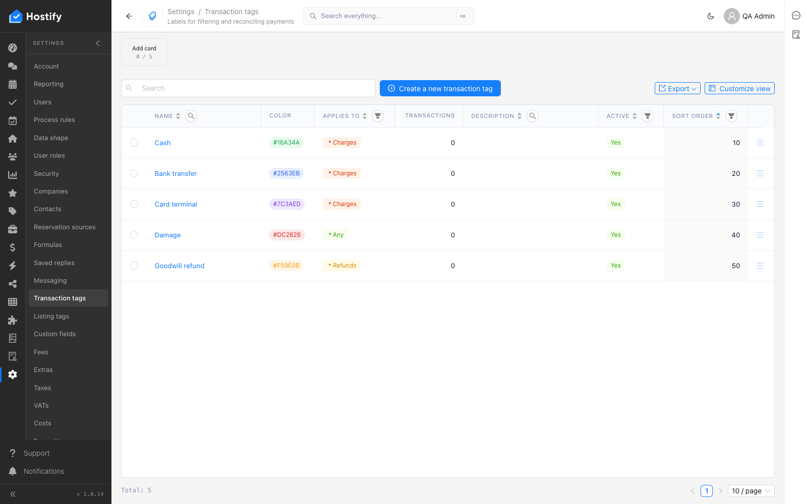


## Казус 32: listingTags opens (/app/settings/listingTags)

_Известен от пуска 2026-11-12 10:12 (същата версия) — не е отстранен._

**Какво се обърка**

```
Error: The page reported 78 error(s) — API answers, failed requests, console errors:
- [request.failed] net::ERR_BLOCKED_BY_ORB @ https://hostify-apps.bioseek.eu/plugins/stripe/logo.png
- [request.failed] net::ERR_BLOCKED_BY_ORB @ https://hostify-apps.bioseek.eu/plugins/paypal/logo.png
- [request.failed] net::ERR_BLOCKED_BY_ORB @ https://hostify-apps.bioseek.eu/plugins/duve/logo.png
- [request.failed] net::ERR_BLOCKED_BY_ORB @ https://hostify-apps.bioseek.eu/plugins/chekin/logo.svg
- [request.failed] net::ERR_BLOCKED_BY_ORB @ https://hostify-apps.bioseek.eu/plugins/superhog/logo.png
- [request.failed] net::ERR_BLOCKED_BY_ORB @ https://hostify-apps.bioseek.eu/plugins/breezeway/logo.png
- [request.failed] net::ERR_BLOCKED_BY_ORB @ https://hostify-apps.bioseek.eu/plugins/beyond/logo.jpg
- [request.failed] net::ERR_BLOCKED_BY_ORB @ https://hostify-apps.bioseek.eu/plugins/pricelabs/logo.svg
- [request.failed] net::ERR_BLOCKED_BY_ORB @ https://hostify-apps.bioseek.eu/plugins/cardcom/logo.png
- [request.failed] net::ERR_BLOCKED_BY_ORB @ https://hostify-apps.bioseek.eu/plugins/akiles/logo.svg
```
- неуспешна заявка: net::ERR_BLOCKED_BY_ORB — `https://hostify-apps.bioseek.eu/plugins/stripe/logo.png`
- неуспешна заявка: net::ERR_BLOCKED_BY_ORB — `https://hostify-apps.bioseek.eu/plugins/paypal/logo.png`
- неуспешна заявка: net::ERR_BLOCKED_BY_ORB — `https://hostify-apps.bioseek.eu/plugins/duve/logo.png`
- неуспешна заявка: net::ERR_BLOCKED_BY_ORB — `https://hostify-apps.bioseek.eu/plugins/chekin/logo.svg`
- неуспешна заявка: net::ERR_BLOCKED_BY_ORB — `https://hostify-apps.bioseek.eu/plugins/superhog/logo.png`
- неуспешна заявка: net::ERR_BLOCKED_BY_ORB — `https://hostify-apps.bioseek.eu/plugins/breezeway/logo.png`
- неуспешна заявка: net::ERR_BLOCKED_BY_ORB — `https://hostify-apps.bioseek.eu/plugins/beyond/logo.jpg`
- неуспешна заявка: net::ERR_BLOCKED_BY_ORB — `https://hostify-apps.bioseek.eu/plugins/pricelabs/logo.svg`
- неуспешна заявка: net::ERR_BLOCKED_BY_ORB — `https://hostify-apps.bioseek.eu/plugins/cardcom/logo.png`
- неуспешна заявка: net::ERR_BLOCKED_BY_ORB — `https://hostify-apps.bioseek.eu/plugins/akiles/logo.svg`

**Как да се възпроизведе**

1. Влез в https://hostify.bioseek.eu/app/ като администратор на акаунта (qa.admin@hostify-qa.test).
2. Меню: SETTINGS › Listing tags — https://hostify.bioseek.eu/app/settings/listingTags
3. Спек `tests/e2e/010-account-pages.spec.ts`, проверка „listingTags opens (/app/settings/listingTags)“.
4. Developer tools › Network: заявките по-горе отговарят така.

**Скрийншоти**

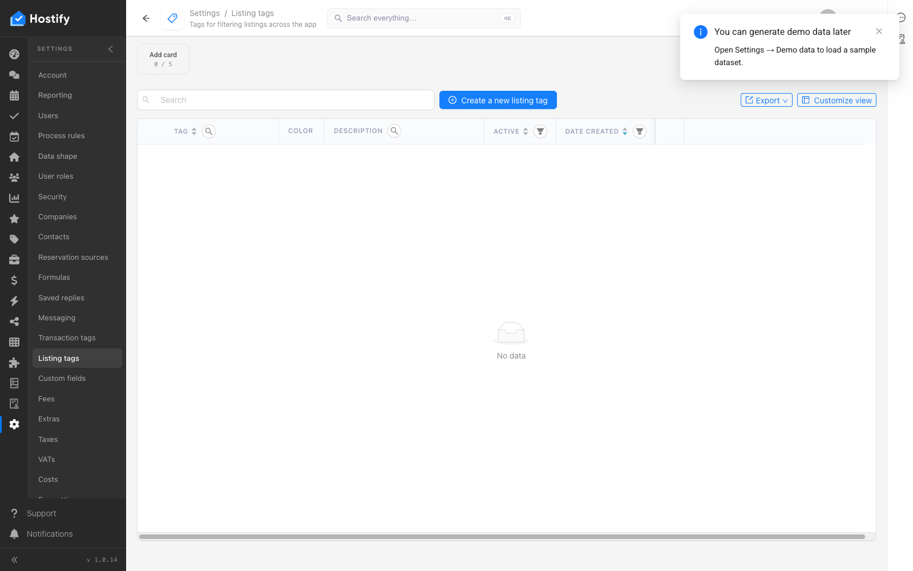


## Казус 33: customFields opens (/app/settings/customFields)

_Известен от пуска 2026-11-12 10:12 (същата версия) — не е отстранен._

**Какво се обърка**

```
Error: The page reported 78 error(s) — API answers, failed requests, console errors:
- [request.failed] net::ERR_BLOCKED_BY_ORB @ https://hostify-apps.bioseek.eu/plugins/paypal/logo.png
- [request.failed] net::ERR_BLOCKED_BY_ORB @ https://hostify-apps.bioseek.eu/plugins/duve/logo.png
- [request.failed] net::ERR_BLOCKED_BY_ORB @ https://hostify-apps.bioseek.eu/plugins/chekin/logo.svg
- [request.failed] net::ERR_BLOCKED_BY_ORB @ https://hostify-apps.bioseek.eu/plugins/stripe/logo.png
- [request.failed] net::ERR_BLOCKED_BY_ORB @ https://hostify-apps.bioseek.eu/plugins/superhog/logo.png
- [request.failed] net::ERR_BLOCKED_BY_ORB @ https://hostify-apps.bioseek.eu/plugins/beyond/logo.jpg
- [request.failed] net::ERR_BLOCKED_BY_ORB @ https://hostify-apps.bioseek.eu/plugins/breezeway/logo.png
- [request.failed] net::ERR_BLOCKED_BY_ORB @ https://hostify-apps.bioseek.eu/plugins/pricelabs/logo.svg
- [request.failed] net::ERR_BLOCKED_BY_ORB @ https://hostify-apps.bioseek.eu/plugins/cardcom/logo.png
- [request.failed] net::ERR_BLOCKED_BY_ORB @ https://hostify-apps.bioseek.eu/plugins/akiles/logo.svg
```
- неуспешна заявка: net::ERR_BLOCKED_BY_ORB — `https://hostify-apps.bioseek.eu/plugins/paypal/logo.png`
- неуспешна заявка: net::ERR_BLOCKED_BY_ORB — `https://hostify-apps.bioseek.eu/plugins/duve/logo.png`
- неуспешна заявка: net::ERR_BLOCKED_BY_ORB — `https://hostify-apps.bioseek.eu/plugins/chekin/logo.svg`
- неуспешна заявка: net::ERR_BLOCKED_BY_ORB — `https://hostify-apps.bioseek.eu/plugins/stripe/logo.png`
- неуспешна заявка: net::ERR_BLOCKED_BY_ORB — `https://hostify-apps.bioseek.eu/plugins/superhog/logo.png`
- неуспешна заявка: net::ERR_BLOCKED_BY_ORB — `https://hostify-apps.bioseek.eu/plugins/beyond/logo.jpg`
- неуспешна заявка: net::ERR_BLOCKED_BY_ORB — `https://hostify-apps.bioseek.eu/plugins/breezeway/logo.png`
- неуспешна заявка: net::ERR_BLOCKED_BY_ORB — `https://hostify-apps.bioseek.eu/plugins/pricelabs/logo.svg`
- неуспешна заявка: net::ERR_BLOCKED_BY_ORB — `https://hostify-apps.bioseek.eu/plugins/cardcom/logo.png`
- неуспешна заявка: net::ERR_BLOCKED_BY_ORB — `https://hostify-apps.bioseek.eu/plugins/akiles/logo.svg`

**Как да се възпроизведе**

1. Влез в https://hostify.bioseek.eu/app/ като администратор на акаунта (qa.admin@hostify-qa.test).
2. Меню: SETTINGS › Custom fields — https://hostify.bioseek.eu/app/settings/customFields
3. Спек `tests/e2e/010-account-pages.spec.ts`, проверка „customFields opens (/app/settings/customFields)“.
4. Developer tools › Network: заявките по-горе отговарят така.

**Скрийншоти**


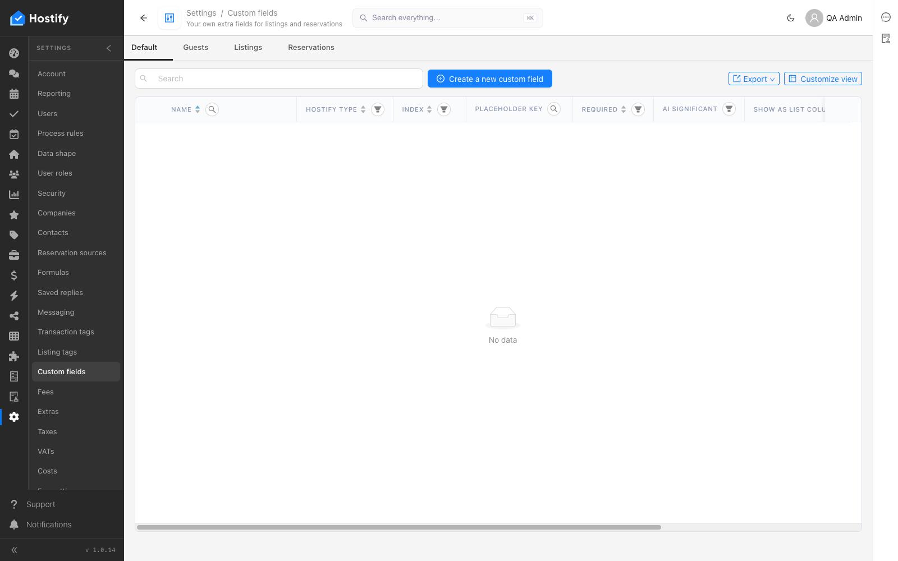


## Казус 34: settingsFees opens (/app/settings/settingsFees)

_Известен от пуска 2026-11-12 10:12 (същата версия) — не е отстранен._

**Какво се обърка**

```
Error: The page reported 78 error(s) — API answers, failed requests, console errors:
- [request.failed] net::ERR_BLOCKED_BY_ORB @ https://hostify-apps.bioseek.eu/plugins/stripe/logo.png
- [request.failed] net::ERR_BLOCKED_BY_ORB @ https://hostify-apps.bioseek.eu/plugins/chekin/logo.svg
- [request.failed] net::ERR_BLOCKED_BY_ORB @ https://hostify-apps.bioseek.eu/plugins/duve/logo.png
- [request.failed] net::ERR_BLOCKED_BY_ORB @ https://hostify-apps.bioseek.eu/plugins/paypal/logo.png
- [request.failed] net::ERR_BLOCKED_BY_ORB @ https://hostify-apps.bioseek.eu/plugins/superhog/logo.png
- [request.failed] net::ERR_BLOCKED_BY_ORB @ https://hostify-apps.bioseek.eu/plugins/breezeway/logo.png
- [request.failed] net::ERR_BLOCKED_BY_ORB @ https://hostify-apps.bioseek.eu/plugins/pricelabs/logo.svg
- [request.failed] net::ERR_BLOCKED_BY_ORB @ https://hostify-apps.bioseek.eu/plugins/beyond/logo.jpg
- [request.failed] net::ERR_BLOCKED_BY_ORB @ https://hostify-apps.bioseek.eu/plugins/cardcom/logo.png
- [request.failed] net::ERR_BLOCKED_BY_ORB @ https://hostify-apps.bioseek.eu/plugins/akiles/logo.svg
```
- неуспешна заявка: net::ERR_BLOCKED_BY_ORB — `https://hostify-apps.bioseek.eu/plugins/stripe/logo.png`
- неуспешна заявка: net::ERR_BLOCKED_BY_ORB — `https://hostify-apps.bioseek.eu/plugins/chekin/logo.svg`
- неуспешна заявка: net::ERR_BLOCKED_BY_ORB — `https://hostify-apps.bioseek.eu/plugins/duve/logo.png`
- неуспешна заявка: net::ERR_BLOCKED_BY_ORB — `https://hostify-apps.bioseek.eu/plugins/paypal/logo.png`
- неуспешна заявка: net::ERR_BLOCKED_BY_ORB — `https://hostify-apps.bioseek.eu/plugins/superhog/logo.png`
- неуспешна заявка: net::ERR_BLOCKED_BY_ORB — `https://hostify-apps.bioseek.eu/plugins/breezeway/logo.png`
- неуспешна заявка: net::ERR_BLOCKED_BY_ORB — `https://hostify-apps.bioseek.eu/plugins/pricelabs/logo.svg`
- неуспешна заявка: net::ERR_BLOCKED_BY_ORB — `https://hostify-apps.bioseek.eu/plugins/beyond/logo.jpg`
- неуспешна заявка: net::ERR_BLOCKED_BY_ORB — `https://hostify-apps.bioseek.eu/plugins/cardcom/logo.png`
- неуспешна заявка: net::ERR_BLOCKED_BY_ORB — `https://hostify-apps.bioseek.eu/plugins/akiles/logo.svg`

**Как да се възпроизведе**

1. Влез в https://hostify.bioseek.eu/app/ като администратор на акаунта (qa.admin@hostify-qa.test).
2. Меню: SETTINGS › Fees — https://hostify.bioseek.eu/app/settings/settingsFees
3. Спек `tests/e2e/010-account-pages.spec.ts`, проверка „settingsFees opens (/app/settings/settingsFees)“.
4. Developer tools › Network: заявките по-горе отговарят така.

**Скрийншоти**

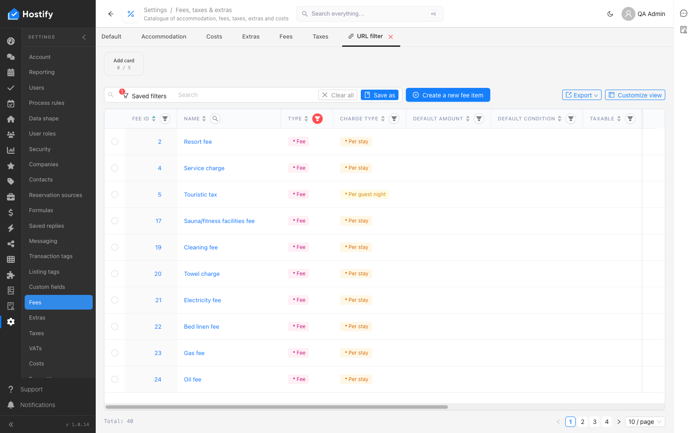


## Казус 35: settingsExtras opens (/app/settings/settingsExtras)

_Известен от пуска 2026-11-12 10:12 (същата версия) — не е отстранен._

**Какво се обърка**

```
Error: The page reported 78 error(s) — API answers, failed requests, console errors:
- [request.failed] net::ERR_BLOCKED_BY_ORB @ https://hostify-apps.bioseek.eu/plugins/paypal/logo.png
- [request.failed] net::ERR_BLOCKED_BY_ORB @ https://hostify-apps.bioseek.eu/plugins/stripe/logo.png
- [request.failed] net::ERR_BLOCKED_BY_ORB @ https://hostify-apps.bioseek.eu/plugins/duve/logo.png
- [request.failed] net::ERR_BLOCKED_BY_ORB @ https://hostify-apps.bioseek.eu/plugins/chekin/logo.svg
- [request.failed] net::ERR_BLOCKED_BY_ORB @ https://hostify-apps.bioseek.eu/plugins/breezeway/logo.png
- [request.failed] net::ERR_BLOCKED_BY_ORB @ https://hostify-apps.bioseek.eu/plugins/beyond/logo.jpg
- [request.failed] net::ERR_BLOCKED_BY_ORB @ https://hostify-apps.bioseek.eu/plugins/superhog/logo.png
- [request.failed] net::ERR_BLOCKED_BY_ORB @ https://hostify-apps.bioseek.eu/plugins/pricelabs/logo.svg
- [request.failed] net::ERR_BLOCKED_BY_ORB @ https://hostify-apps.bioseek.eu/plugins/cardcom/logo.png
- [request.failed] net::ERR_BLOCKED_BY_ORB @ https://hostify-apps.bioseek.eu/plugins/akiles/logo.svg
```
- неуспешна заявка: net::ERR_BLOCKED_BY_ORB — `https://hostify-apps.bioseek.eu/plugins/paypal/logo.png`
- неуспешна заявка: net::ERR_BLOCKED_BY_ORB — `https://hostify-apps.bioseek.eu/plugins/stripe/logo.png`
- неуспешна заявка: net::ERR_BLOCKED_BY_ORB — `https://hostify-apps.bioseek.eu/plugins/duve/logo.png`
- неуспешна заявка: net::ERR_BLOCKED_BY_ORB — `https://hostify-apps.bioseek.eu/plugins/chekin/logo.svg`
- неуспешна заявка: net::ERR_BLOCKED_BY_ORB — `https://hostify-apps.bioseek.eu/plugins/breezeway/logo.png`
- неуспешна заявка: net::ERR_BLOCKED_BY_ORB — `https://hostify-apps.bioseek.eu/plugins/beyond/logo.jpg`
- неуспешна заявка: net::ERR_BLOCKED_BY_ORB — `https://hostify-apps.bioseek.eu/plugins/superhog/logo.png`
- неуспешна заявка: net::ERR_BLOCKED_BY_ORB — `https://hostify-apps.bioseek.eu/plugins/pricelabs/logo.svg`
- неуспешна заявка: net::ERR_BLOCKED_BY_ORB — `https://hostify-apps.bioseek.eu/plugins/cardcom/logo.png`
- неуспешна заявка: net::ERR_BLOCKED_BY_ORB — `https://hostify-apps.bioseek.eu/plugins/akiles/logo.svg`

**Как да се възпроизведе**

1. Влез в https://hostify.bioseek.eu/app/ като администратор на акаунта (qa.admin@hostify-qa.test).
2. Меню: SETTINGS › Extras — https://hostify.bioseek.eu/app/settings/settingsExtras
3. Спек `tests/e2e/010-account-pages.spec.ts`, проверка „settingsExtras opens (/app/settings/settingsExtras)“.
4. Developer tools › Network: заявките по-горе отговарят така.

**Скрийншоти**

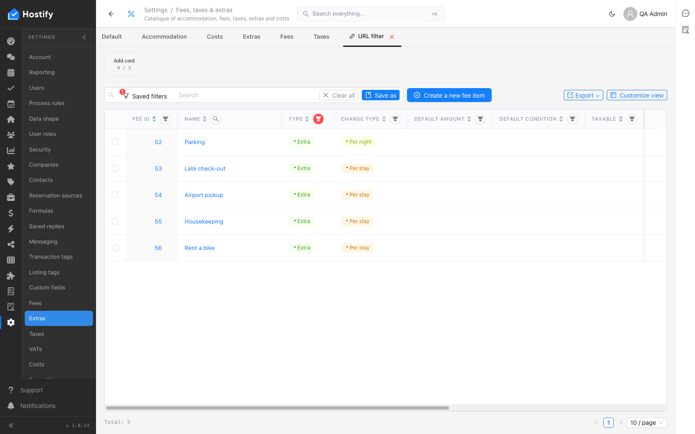


## Казус 36: settingsTaxes opens (/app/settings/settingsTaxes)

_Известен от пуска 2026-11-12 10:12 (същата версия) — не е отстранен._

**Какво се обърка**

```
Error: The page reported 78 error(s) — API answers, failed requests, console errors:
- [request.failed] net::ERR_BLOCKED_BY_ORB @ https://hostify-apps.bioseek.eu/plugins/duve/logo.png
- [request.failed] net::ERR_BLOCKED_BY_ORB @ https://hostify-apps.bioseek.eu/plugins/paypal/logo.png
- [request.failed] net::ERR_BLOCKED_BY_ORB @ https://hostify-apps.bioseek.eu/plugins/stripe/logo.png
- [request.failed] net::ERR_BLOCKED_BY_ORB @ https://hostify-apps.bioseek.eu/plugins/chekin/logo.svg
- [request.failed] net::ERR_BLOCKED_BY_ORB @ https://hostify-apps.bioseek.eu/plugins/superhog/logo.png
- [request.failed] net::ERR_BLOCKED_BY_ORB @ https://hostify-apps.bioseek.eu/plugins/breezeway/logo.png
- [request.failed] net::ERR_BLOCKED_BY_ORB @ https://hostify-apps.bioseek.eu/plugins/beyond/logo.jpg
- [request.failed] net::ERR_BLOCKED_BY_ORB @ https://hostify-apps.bioseek.eu/plugins/pricelabs/logo.svg
- [request.failed] net::ERR_BLOCKED_BY_ORB @ https://hostify-apps.bioseek.eu/plugins/cardcom/logo.png
- [request.failed] net::ERR_BLOCKED_BY_ORB @ https://hostify-apps.bioseek.eu/plugins/akiles/logo.svg
```
- неуспешна заявка: net::ERR_BLOCKED_BY_ORB — `https://hostify-apps.bioseek.eu/plugins/duve/logo.png`
- неуспешна заявка: net::ERR_BLOCKED_BY_ORB — `https://hostify-apps.bioseek.eu/plugins/paypal/logo.png`
- неуспешна заявка: net::ERR_BLOCKED_BY_ORB — `https://hostify-apps.bioseek.eu/plugins/stripe/logo.png`
- неуспешна заявка: net::ERR_BLOCKED_BY_ORB — `https://hostify-apps.bioseek.eu/plugins/chekin/logo.svg`
- неуспешна заявка: net::ERR_BLOCKED_BY_ORB — `https://hostify-apps.bioseek.eu/plugins/superhog/logo.png`
- неуспешна заявка: net::ERR_BLOCKED_BY_ORB — `https://hostify-apps.bioseek.eu/plugins/breezeway/logo.png`
- неуспешна заявка: net::ERR_BLOCKED_BY_ORB — `https://hostify-apps.bioseek.eu/plugins/beyond/logo.jpg`
- неуспешна заявка: net::ERR_BLOCKED_BY_ORB — `https://hostify-apps.bioseek.eu/plugins/pricelabs/logo.svg`
- неуспешна заявка: net::ERR_BLOCKED_BY_ORB — `https://hostify-apps.bioseek.eu/plugins/cardcom/logo.png`
- неуспешна заявка: net::ERR_BLOCKED_BY_ORB — `https://hostify-apps.bioseek.eu/plugins/akiles/logo.svg`

**Как да се възпроизведе**

1. Влез в https://hostify.bioseek.eu/app/ като администратор на акаунта (qa.admin@hostify-qa.test).
2. Меню: SETTINGS › Taxes — https://hostify.bioseek.eu/app/settings/settingsTaxes
3. Спек `tests/e2e/010-account-pages.spec.ts`, проверка „settingsTaxes opens (/app/settings/settingsTaxes)“.
4. Developer tools › Network: заявките по-горе отговарят така.

**Скрийншоти**


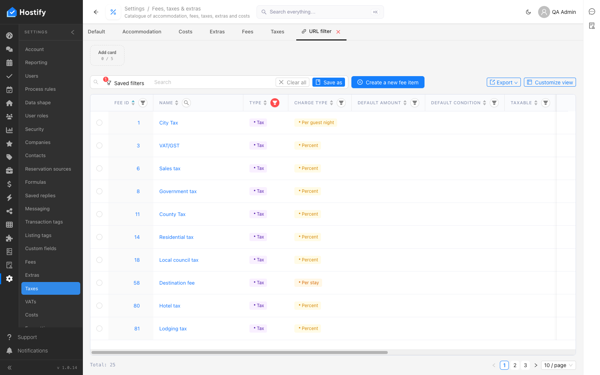


## Казус 37: vatRates opens (/app/settings/vatRates)

_Известен от пуска 2026-11-12 10:12 (същата версия) — не е отстранен._

**Какво се обърка**

```
Error: The page reported 78 error(s) — API answers, failed requests, console errors:
- [request.failed] net::ERR_BLOCKED_BY_ORB @ https://hostify-apps.bioseek.eu/plugins/stripe/logo.png
- [request.failed] net::ERR_BLOCKED_BY_ORB @ https://hostify-apps.bioseek.eu/plugins/paypal/logo.png
- [request.failed] net::ERR_BLOCKED_BY_ORB @ https://hostify-apps.bioseek.eu/plugins/duve/logo.png
- [request.failed] net::ERR_BLOCKED_BY_ORB @ https://hostify-apps.bioseek.eu/plugins/chekin/logo.svg
- [request.failed] net::ERR_BLOCKED_BY_ORB @ https://hostify-apps.bioseek.eu/plugins/superhog/logo.png
- [request.failed] net::ERR_BLOCKED_BY_ORB @ https://hostify-apps.bioseek.eu/plugins/breezeway/logo.png
- [request.failed] net::ERR_BLOCKED_BY_ORB @ https://hostify-apps.bioseek.eu/plugins/beyond/logo.jpg
- [request.failed] net::ERR_BLOCKED_BY_ORB @ https://hostify-apps.bioseek.eu/plugins/cardcom/logo.png
- [request.failed] net::ERR_BLOCKED_BY_ORB @ https://hostify-apps.bioseek.eu/plugins/pricelabs/logo.svg
- [request.failed] net::ERR_BLOCKED_BY_ORB @ https://hostify-apps.bioseek.eu/plugins/akiles/logo.svg
```
- неуспешна заявка: net::ERR_BLOCKED_BY_ORB — `https://hostify-apps.bioseek.eu/plugins/stripe/logo.png`
- неуспешна заявка: net::ERR_BLOCKED_BY_ORB — `https://hostify-apps.bioseek.eu/plugins/paypal/logo.png`
- неуспешна заявка: net::ERR_BLOCKED_BY_ORB — `https://hostify-apps.bioseek.eu/plugins/duve/logo.png`
- неуспешна заявка: net::ERR_BLOCKED_BY_ORB — `https://hostify-apps.bioseek.eu/plugins/chekin/logo.svg`
- неуспешна заявка: net::ERR_BLOCKED_BY_ORB — `https://hostify-apps.bioseek.eu/plugins/superhog/logo.png`
- неуспешна заявка: net::ERR_BLOCKED_BY_ORB — `https://hostify-apps.bioseek.eu/plugins/breezeway/logo.png`
- неуспешна заявка: net::ERR_BLOCKED_BY_ORB — `https://hostify-apps.bioseek.eu/plugins/beyond/logo.jpg`
- неуспешна заявка: net::ERR_BLOCKED_BY_ORB — `https://hostify-apps.bioseek.eu/plugins/cardcom/logo.png`
- неуспешна заявка: net::ERR_BLOCKED_BY_ORB — `https://hostify-apps.bioseek.eu/plugins/pricelabs/logo.svg`
- неуспешна заявка: net::ERR_BLOCKED_BY_ORB — `https://hostify-apps.bioseek.eu/plugins/akiles/logo.svg`

**Как да се възпроизведе**

1. Влез в https://hostify.bioseek.eu/app/ като администратор на акаунта (qa.admin@hostify-qa.test).
2. Меню: SETTINGS › VATs — https://hostify.bioseek.eu/app/settings/vatRates
3. Спек `tests/e2e/010-account-pages.spec.ts`, проверка „vatRates opens (/app/settings/vatRates)“.
4. Developer tools › Network: заявките по-горе отговарят така.

**Скрийншоти**


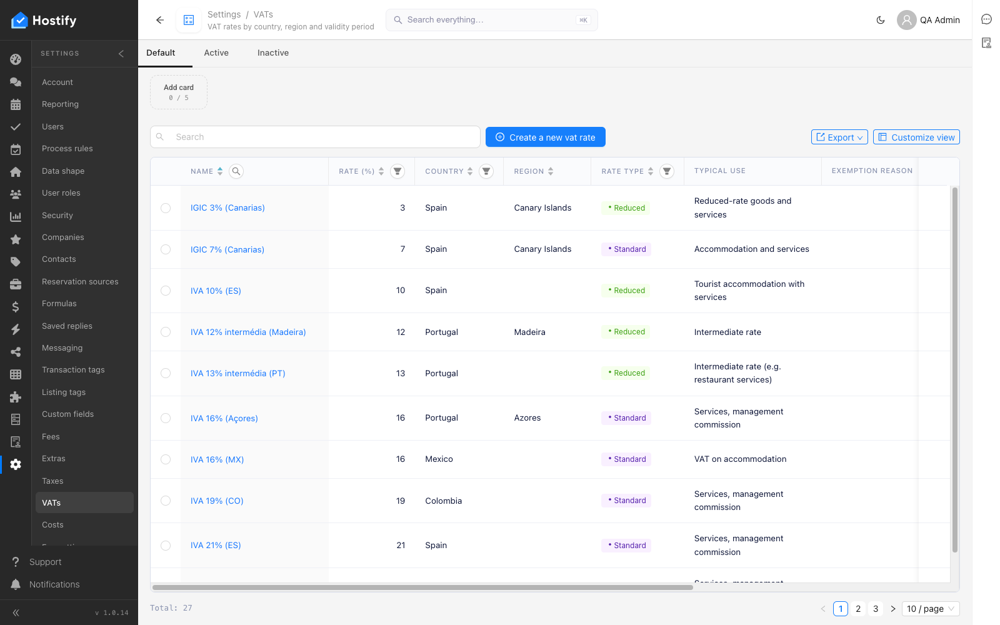


## Казус 38: settingsCosts opens (/app/settings/settingsCosts)

_Известен от пуска 2026-11-12 10:12 (същата версия) — не е отстранен._

**Какво се обърка**

```
Error: The page reported 78 error(s) — API answers, failed requests, console errors:
- [request.failed] net::ERR_BLOCKED_BY_ORB @ https://hostify-apps.bioseek.eu/plugins/chekin/logo.svg
- [request.failed] net::ERR_BLOCKED_BY_ORB @ https://hostify-apps.bioseek.eu/plugins/duve/logo.png
- [request.failed] net::ERR_BLOCKED_BY_ORB @ https://hostify-apps.bioseek.eu/plugins/stripe/logo.png
- [request.failed] net::ERR_BLOCKED_BY_ORB @ https://hostify-apps.bioseek.eu/plugins/paypal/logo.png
- [request.failed] net::ERR_BLOCKED_BY_ORB @ https://hostify-apps.bioseek.eu/plugins/superhog/logo.png
- [request.failed] net::ERR_BLOCKED_BY_ORB @ https://hostify-apps.bioseek.eu/plugins/breezeway/logo.png
- [request.failed] net::ERR_BLOCKED_BY_ORB @ https://hostify-apps.bioseek.eu/plugins/beyond/logo.jpg
- [request.failed] net::ERR_BLOCKED_BY_ORB @ https://hostify-apps.bioseek.eu/plugins/pricelabs/logo.svg
- [request.failed] net::ERR_BLOCKED_BY_ORB @ https://hostify-apps.bioseek.eu/plugins/cardcom/logo.png
- [request.failed] net::ERR_BLOCKED_BY_ORB @ https://hostify-apps.bioseek.eu/plugins/akiles/logo.svg
```
- неуспешна заявка: net::ERR_BLOCKED_BY_ORB — `https://hostify-apps.bioseek.eu/plugins/chekin/logo.svg`
- неуспешна заявка: net::ERR_BLOCKED_BY_ORB — `https://hostify-apps.bioseek.eu/plugins/duve/logo.png`
- неуспешна заявка: net::ERR_BLOCKED_BY_ORB — `https://hostify-apps.bioseek.eu/plugins/stripe/logo.png`
- неуспешна заявка: net::ERR_BLOCKED_BY_ORB — `https://hostify-apps.bioseek.eu/plugins/paypal/logo.png`
- неуспешна заявка: net::ERR_BLOCKED_BY_ORB — `https://hostify-apps.bioseek.eu/plugins/superhog/logo.png`
- неуспешна заявка: net::ERR_BLOCKED_BY_ORB — `https://hostify-apps.bioseek.eu/plugins/breezeway/logo.png`
- неуспешна заявка: net::ERR_BLOCKED_BY_ORB — `https://hostify-apps.bioseek.eu/plugins/beyond/logo.jpg`
- неуспешна заявка: net::ERR_BLOCKED_BY_ORB — `https://hostify-apps.bioseek.eu/plugins/pricelabs/logo.svg`
- неуспешна заявка: net::ERR_BLOCKED_BY_ORB — `https://hostify-apps.bioseek.eu/plugins/cardcom/logo.png`
- неуспешна заявка: net::ERR_BLOCKED_BY_ORB — `https://hostify-apps.bioseek.eu/plugins/akiles/logo.svg`

**Как да се възпроизведе**

1. Влез в https://hostify.bioseek.eu/app/ като администратор на акаунта (qa.admin@hostify-qa.test).
2. Меню: SETTINGS › Costs — https://hostify.bioseek.eu/app/settings/settingsCosts
3. Спек `tests/e2e/010-account-pages.spec.ts`, проверка „settingsCosts opens (/app/settings/settingsCosts)“.
4. Developer tools › Network: заявките по-горе отговарят така.

**Скрийншоти**


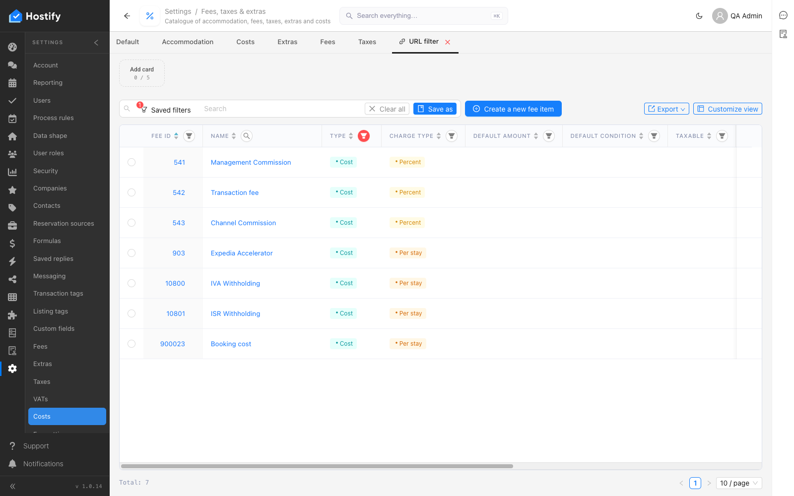


## Казус 39: feeItemSettings opens (/app/settings/feeItemSettings)

_Известен от пуска 2026-11-12 10:12 (същата версия) — не е отстранен._

**Какво се обърка**

```
Error: The page reported 78 error(s) — API answers, failed requests, console errors:
- [request.failed] net::ERR_BLOCKED_BY_ORB @ https://hostify-apps.bioseek.eu/plugins/paypal/logo.png
- [request.failed] net::ERR_BLOCKED_BY_ORB @ https://hostify-apps.bioseek.eu/plugins/chekin/logo.svg
- [request.failed] net::ERR_BLOCKED_BY_ORB @ https://hostify-apps.bioseek.eu/plugins/stripe/logo.png
- [request.failed] net::ERR_BLOCKED_BY_ORB @ https://hostify-apps.bioseek.eu/plugins/duve/logo.png
- [request.failed] net::ERR_BLOCKED_BY_ORB @ https://hostify-apps.bioseek.eu/plugins/superhog/logo.png
- [request.failed] net::ERR_BLOCKED_BY_ORB @ https://hostify-apps.bioseek.eu/plugins/breezeway/logo.png
- [request.failed] net::ERR_BLOCKED_BY_ORB @ https://hostify-apps.bioseek.eu/plugins/beyond/logo.jpg
- [request.failed] net::ERR_BLOCKED_BY_ORB @ https://hostify-apps.bioseek.eu/plugins/pricelabs/logo.svg
- [request.failed] net::ERR_BLOCKED_BY_ORB @ https://hostify-apps.bioseek.eu/plugins/cardcom/logo.png
- [request.failed] net::ERR_BLOCKED_BY_ORB @ https://hostify-apps.bioseek.eu/plugins/akiles/logo.svg
```
- неуспешна заявка: net::ERR_BLOCKED_BY_ORB — `https://hostify-apps.bioseek.eu/plugins/paypal/logo.png`
- неуспешна заявка: net::ERR_BLOCKED_BY_ORB — `https://hostify-apps.bioseek.eu/plugins/chekin/logo.svg`
- неуспешна заявка: net::ERR_BLOCKED_BY_ORB — `https://hostify-apps.bioseek.eu/plugins/stripe/logo.png`
- неуспешна заявка: net::ERR_BLOCKED_BY_ORB — `https://hostify-apps.bioseek.eu/plugins/duve/logo.png`
- неуспешна заявка: net::ERR_BLOCKED_BY_ORB — `https://hostify-apps.bioseek.eu/plugins/superhog/logo.png`
- неуспешна заявка: net::ERR_BLOCKED_BY_ORB — `https://hostify-apps.bioseek.eu/plugins/breezeway/logo.png`
- неуспешна заявка: net::ERR_BLOCKED_BY_ORB — `https://hostify-apps.bioseek.eu/plugins/beyond/logo.jpg`
- неуспешна заявка: net::ERR_BLOCKED_BY_ORB — `https://hostify-apps.bioseek.eu/plugins/pricelabs/logo.svg`
- неуспешна заявка: net::ERR_BLOCKED_BY_ORB — `https://hostify-apps.bioseek.eu/plugins/cardcom/logo.png`
- неуспешна заявка: net::ERR_BLOCKED_BY_ORB — `https://hostify-apps.bioseek.eu/plugins/akiles/logo.svg`

**Как да се възпроизведе**

1. Влез в https://hostify.bioseek.eu/app/ като администратор на акаунта (qa.admin@hostify-qa.test).
2. Меню: SETTINGS › Fee settings — https://hostify.bioseek.eu/app/settings/feeItemSettings
3. Спек `tests/e2e/010-account-pages.spec.ts`, проверка „feeItemSettings opens (/app/settings/feeItemSettings)“.
4. Developer tools › Network: заявките по-горе отговарят така.

**Скрийншоти**


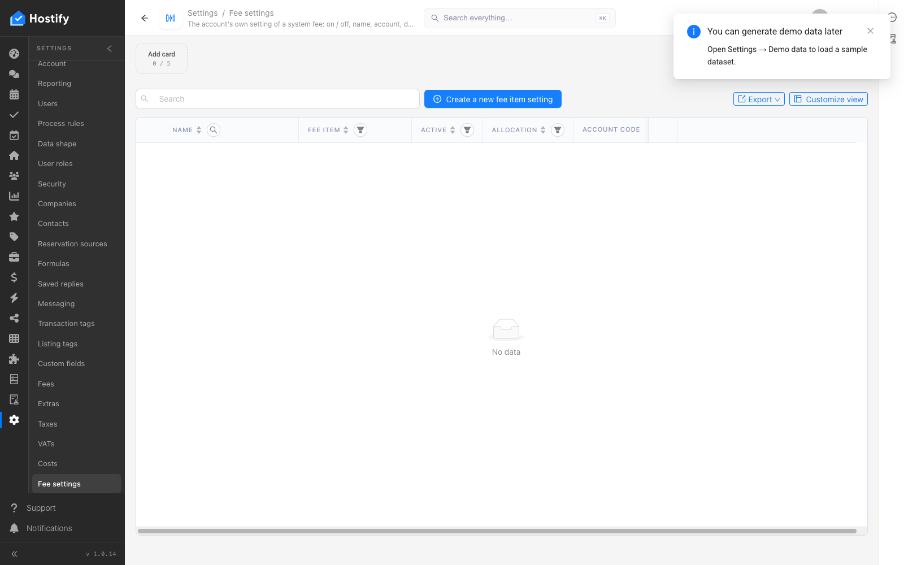


## Казус 40: vatRateSettings opens (/app/settings/vatRateSettings)

_Известен от пуска 2026-11-12 10:12 (същата версия) — не е отстранен._

**Какво се обърка**

```
Error: The page reported 78 error(s) — API answers, failed requests, console errors:
- [request.failed] net::ERR_BLOCKED_BY_ORB @ https://hostify-apps.bioseek.eu/plugins/chekin/logo.svg
- [request.failed] net::ERR_BLOCKED_BY_ORB @ https://hostify-apps.bioseek.eu/plugins/duve/logo.png
- [request.failed] net::ERR_BLOCKED_BY_ORB @ https://hostify-apps.bioseek.eu/plugins/stripe/logo.png
- [request.failed] net::ERR_BLOCKED_BY_ORB @ https://hostify-apps.bioseek.eu/plugins/paypal/logo.png
- [request.failed] net::ERR_BLOCKED_BY_ORB @ https://hostify-apps.bioseek.eu/plugins/superhog/logo.png
- [request.failed] net::ERR_BLOCKED_BY_ORB @ https://hostify-apps.bioseek.eu/plugins/breezeway/logo.png
- [request.failed] net::ERR_BLOCKED_BY_ORB @ https://hostify-apps.bioseek.eu/plugins/pricelabs/logo.svg
- [request.failed] net::ERR_BLOCKED_BY_ORB @ https://hostify-apps.bioseek.eu/plugins/beyond/logo.jpg
- [request.failed] net::ERR_BLOCKED_BY_ORB @ https://hostify-apps.bioseek.eu/plugins/cardcom/logo.png
- [request.failed] net::ERR_BLOCKED_BY_ORB @ https://hostify-apps.bioseek.eu/plugins/akiles/logo.svg
```
- неуспешна заявка: net::ERR_BLOCKED_BY_ORB — `https://hostify-apps.bioseek.eu/plugins/chekin/logo.svg`
- неуспешна заявка: net::ERR_BLOCKED_BY_ORB — `https://hostify-apps.bioseek.eu/plugins/duve/logo.png`
- неуспешна заявка: net::ERR_BLOCKED_BY_ORB — `https://hostify-apps.bioseek.eu/plugins/stripe/logo.png`
- неуспешна заявка: net::ERR_BLOCKED_BY_ORB — `https://hostify-apps.bioseek.eu/plugins/paypal/logo.png`
- неуспешна заявка: net::ERR_BLOCKED_BY_ORB — `https://hostify-apps.bioseek.eu/plugins/superhog/logo.png`
- неуспешна заявка: net::ERR_BLOCKED_BY_ORB — `https://hostify-apps.bioseek.eu/plugins/breezeway/logo.png`
- неуспешна заявка: net::ERR_BLOCKED_BY_ORB — `https://hostify-apps.bioseek.eu/plugins/pricelabs/logo.svg`
- неуспешна заявка: net::ERR_BLOCKED_BY_ORB — `https://hostify-apps.bioseek.eu/plugins/beyond/logo.jpg`
- неуспешна заявка: net::ERR_BLOCKED_BY_ORB — `https://hostify-apps.bioseek.eu/plugins/cardcom/logo.png`
- неуспешна заявка: net::ERR_BLOCKED_BY_ORB — `https://hostify-apps.bioseek.eu/plugins/akiles/logo.svg`

**Как да се възпроизведе**

1. Влез в https://hostify.bioseek.eu/app/ като администратор на акаунта (qa.admin@hostify-qa.test).
2. Меню: SETTINGS › VAT rate settings — https://hostify.bioseek.eu/app/settings/vatRateSettings
3. Спек `tests/e2e/010-account-pages.spec.ts`, проверка „vatRateSettings opens (/app/settings/vatRateSettings)“.
4. Developer tools › Network: заявките по-горе отговарят така.

**Скрийншоти**


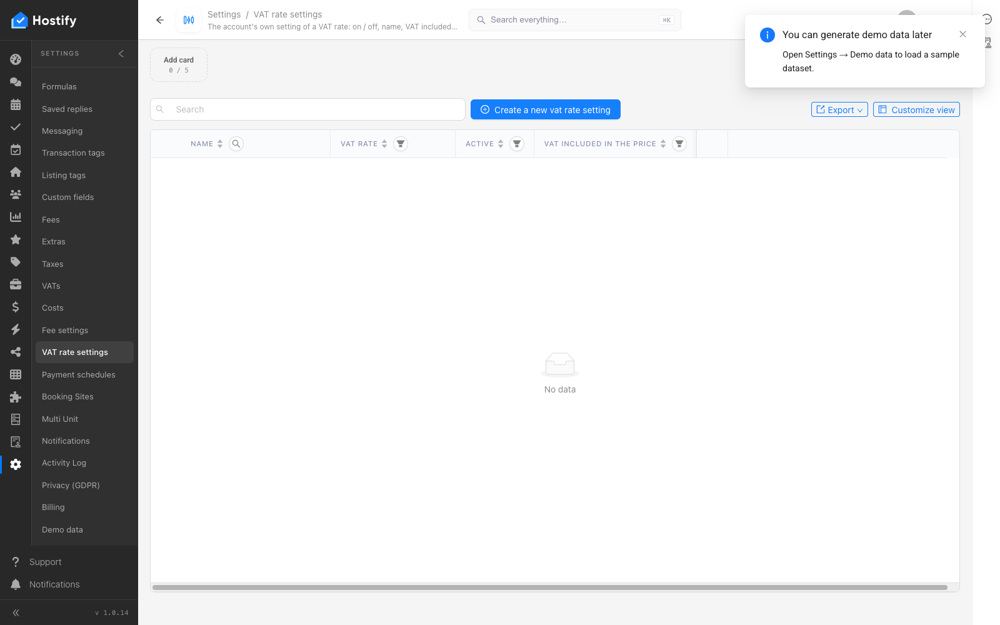


## Казус 41: paymentSchedules opens (/app/settings/paymentSchedules)

_Известен от пуска 2026-11-12 10:12 (същата версия) — не е отстранен._

**Какво се обърка**

```
Error: The page reported 74 error(s) — API answers, failed requests, console errors:
- [request.failed] net::ERR_BLOCKED_BY_ORB @ https://hostify-apps.bioseek.eu/plugins/stripe/logo.png
- [request.failed] net::ERR_BLOCKED_BY_ORB @ https://hostify-apps.bioseek.eu/plugins/paypal/logo.png
- [request.failed] net::ERR_BLOCKED_BY_ORB @ https://hostify-apps.bioseek.eu/plugins/duve/logo.png
- [request.failed] net::ERR_BLOCKED_BY_ORB @ https://hostify-apps.bioseek.eu/plugins/chekin/logo.svg
- [request.failed] net::ERR_BLOCKED_BY_ORB @ https://hostify-apps.bioseek.eu/plugins/superhog/logo.png
- [request.failed] net::ERR_BLOCKED_BY_ORB @ https://hostify-apps.bioseek.eu/plugins/breezeway/logo.png
- [request.failed] net::ERR_BLOCKED_BY_ORB @ https://hostify-apps.bioseek.eu/plugins/beyond/logo.jpg
- [request.failed] net::ERR_BLOCKED_BY_ORB @ https://hostify-apps.bioseek.eu/plugins/pricelabs/logo.svg
- [request.failed] net::ERR_BLOCKED_BY_ORB @ https://hostify-apps.bioseek.eu/plugins/akiles/logo.svg
- [request.failed] net::ERR_BLOCKED_BY_ORB @ https://hostify-apps.bioseek.eu/plugins/cardcom/logo.png
```
- неуспешна заявка: net::ERR_BLOCKED_BY_ORB — `https://hostify-apps.bioseek.eu/plugins/stripe/logo.png`
- неуспешна заявка: net::ERR_BLOCKED_BY_ORB — `https://hostify-apps.bioseek.eu/plugins/paypal/logo.png`
- неуспешна заявка: net::ERR_BLOCKED_BY_ORB — `https://hostify-apps.bioseek.eu/plugins/duve/logo.png`
- неуспешна заявка: net::ERR_BLOCKED_BY_ORB — `https://hostify-apps.bioseek.eu/plugins/chekin/logo.svg`
- неуспешна заявка: net::ERR_BLOCKED_BY_ORB — `https://hostify-apps.bioseek.eu/plugins/superhog/logo.png`
- неуспешна заявка: net::ERR_BLOCKED_BY_ORB — `https://hostify-apps.bioseek.eu/plugins/breezeway/logo.png`
- неуспешна заявка: net::ERR_BLOCKED_BY_ORB — `https://hostify-apps.bioseek.eu/plugins/beyond/logo.jpg`
- неуспешна заявка: net::ERR_BLOCKED_BY_ORB — `https://hostify-apps.bioseek.eu/plugins/pricelabs/logo.svg`
- неуспешна заявка: net::ERR_BLOCKED_BY_ORB — `https://hostify-apps.bioseek.eu/plugins/akiles/logo.svg`
- неуспешна заявка: net::ERR_BLOCKED_BY_ORB — `https://hostify-apps.bioseek.eu/plugins/cardcom/logo.png`

**Как да се възпроизведе**

1. Влез в https://hostify.bioseek.eu/app/ като администратор на акаунта (qa.admin@hostify-qa.test).
2. Меню: SETTINGS › Payment schedules — https://hostify.bioseek.eu/app/settings/paymentSchedules
3. Спек `tests/e2e/010-account-pages.spec.ts`, проверка „paymentSchedules opens (/app/settings/paymentSchedules)“.
4. Developer tools › Network: заявките по-горе отговарят така.

**Скрийншоти**


## Казус 42: bookingSites opens (/app/settings/bookingSites)

_Известен от пуска 2026-11-12 10:12 (същата версия) — не е отстранен._

**Какво се обърка**

```
Error: The page reported 78 error(s) — API answers, failed requests, console errors:
- [request.failed] net::ERR_BLOCKED_BY_ORB @ https://hostify-apps.bioseek.eu/plugins/chekin/logo.svg
- [request.failed] net::ERR_BLOCKED_BY_ORB @ https://hostify-apps.bioseek.eu/plugins/duve/logo.png
- [request.failed] net::ERR_BLOCKED_BY_ORB @ https://hostify-apps.bioseek.eu/plugins/stripe/logo.png
- [request.failed] net::ERR_BLOCKED_BY_ORB @ https://hostify-apps.bioseek.eu/plugins/paypal/logo.png
- [request.failed] net::ERR_BLOCKED_BY_ORB @ https://hostify-apps.bioseek.eu/plugins/superhog/logo.png
- [request.failed] net::ERR_BLOCKED_BY_ORB @ https://hostify-apps.bioseek.eu/plugins/breezeway/logo.png
- [request.failed] net::ERR_BLOCKED_BY_ORB @ https://hostify-apps.bioseek.eu/plugins/beyond/logo.jpg
- [request.failed] net::ERR_BLOCKED_BY_ORB @ https://hostify-apps.bioseek.eu/plugins/cardcom/logo.png
- [request.failed] net::ERR_BLOCKED_BY_ORB @ https://hostify-apps.bioseek.eu/plugins/pricelabs/logo.svg
- [request.failed] net::ERR_BLOCKED_BY_ORB @ https://hostify-apps.bioseek.eu/plugins/akiles/logo.svg
```
- неуспешна заявка: net::ERR_BLOCKED_BY_ORB — `https://hostify-apps.bioseek.eu/plugins/chekin/logo.svg`
- неуспешна заявка: net::ERR_BLOCKED_BY_ORB — `https://hostify-apps.bioseek.eu/plugins/duve/logo.png`
- неуспешна заявка: net::ERR_BLOCKED_BY_ORB — `https://hostify-apps.bioseek.eu/plugins/stripe/logo.png`
- неуспешна заявка: net::ERR_BLOCKED_BY_ORB — `https://hostify-apps.bioseek.eu/plugins/paypal/logo.png`
- неуспешна заявка: net::ERR_BLOCKED_BY_ORB — `https://hostify-apps.bioseek.eu/plugins/superhog/logo.png`
- неуспешна заявка: net::ERR_BLOCKED_BY_ORB — `https://hostify-apps.bioseek.eu/plugins/breezeway/logo.png`
- неуспешна заявка: net::ERR_BLOCKED_BY_ORB — `https://hostify-apps.bioseek.eu/plugins/beyond/logo.jpg`
- неуспешна заявка: net::ERR_BLOCKED_BY_ORB — `https://hostify-apps.bioseek.eu/plugins/cardcom/logo.png`
- неуспешна заявка: net::ERR_BLOCKED_BY_ORB — `https://hostify-apps.bioseek.eu/plugins/pricelabs/logo.svg`
- неуспешна заявка: net::ERR_BLOCKED_BY_ORB — `https://hostify-apps.bioseek.eu/plugins/akiles/logo.svg`

**Как да се възпроизведе**

1. Влез в https://hostify.bioseek.eu/app/ като администратор на акаунта (qa.admin@hostify-qa.test).
2. Меню: SETTINGS › Booking Sites — https://hostify.bioseek.eu/app/settings/bookingSites
3. Спек `tests/e2e/010-account-pages.spec.ts`, проверка „bookingSites opens (/app/settings/bookingSites)“.
4. Developer tools › Network: заявките по-горе отговарят така.

**Скрийншоти**

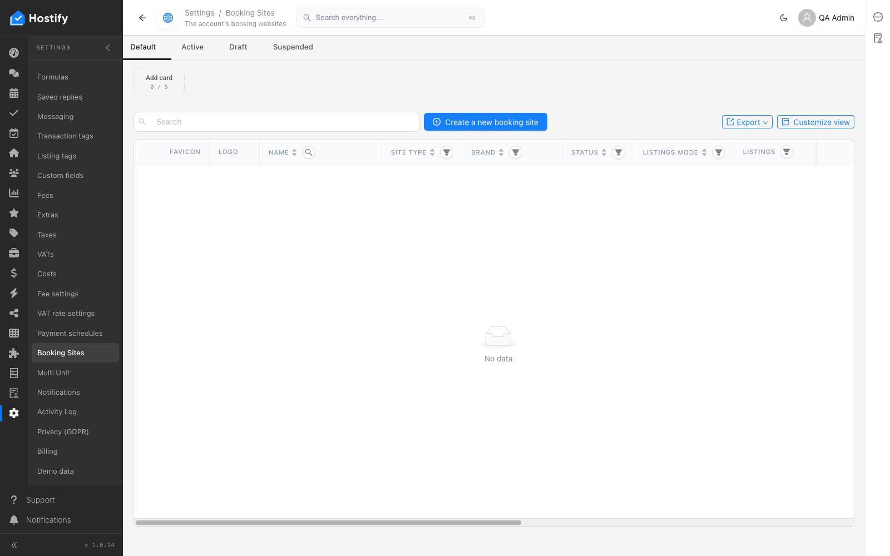


## Казус 43: listingGroups opens (/app/settings/listingGroups)

_Известен от пуска 2026-11-12 10:58 (същата версия) — не е отстранен._

**Какво се обърка**

```
Error: The page reported 78 error(s) — API answers, failed requests, console errors:
- [request.failed] net::ERR_BLOCKED_BY_ORB @ https://hostify-apps.bioseek.eu/plugins/duve/logo.png
- [request.failed] net::ERR_BLOCKED_BY_ORB @ https://hostify-apps.bioseek.eu/plugins/stripe/logo.png
- [request.failed] net::ERR_BLOCKED_BY_ORB @ https://hostify-apps.bioseek.eu/plugins/chekin/logo.svg
- [request.failed] net::ERR_BLOCKED_BY_ORB @ https://hostify-apps.bioseek.eu/plugins/paypal/logo.png
- [request.failed] net::ERR_BLOCKED_BY_ORB @ https://hostify-apps.bioseek.eu/plugins/superhog/logo.png
- [request.failed] net::ERR_BLOCKED_BY_ORB @ https://hostify-apps.bioseek.eu/plugins/beyond/logo.jpg
- [request.failed] net::ERR_BLOCKED_BY_ORB @ https://hostify-apps.bioseek.eu/plugins/breezeway/logo.png
- [request.failed] net::ERR_BLOCKED_BY_ORB @ https://hostify-apps.bioseek.eu/plugins/cardcom/logo.png
- [request.failed] net::ERR_BLOCKED_BY_ORB @ https://hostify-apps.bioseek.eu/plugins/pricelabs/logo.svg
- [request.failed] net::ERR_BLOCKED_BY_ORB @ https://hostify-apps.bioseek.eu/plugins/akiles/logo.svg
```
- неуспешна заявка: net::ERR_BLOCKED_BY_ORB — `https://hostify-apps.bioseek.eu/plugins/duve/logo.png`
- неуспешна заявка: net::ERR_BLOCKED_BY_ORB — `https://hostify-apps.bioseek.eu/plugins/stripe/logo.png`
- неуспешна заявка: net::ERR_BLOCKED_BY_ORB — `https://hostify-apps.bioseek.eu/plugins/chekin/logo.svg`
- неуспешна заявка: net::ERR_BLOCKED_BY_ORB — `https://hostify-apps.bioseek.eu/plugins/paypal/logo.png`
- неуспешна заявка: net::ERR_BLOCKED_BY_ORB — `https://hostify-apps.bioseek.eu/plugins/superhog/logo.png`
- неуспешна заявка: net::ERR_BLOCKED_BY_ORB — `https://hostify-apps.bioseek.eu/plugins/beyond/logo.jpg`
- неуспешна заявка: net::ERR_BLOCKED_BY_ORB — `https://hostify-apps.bioseek.eu/plugins/breezeway/logo.png`
- неуспешна заявка: net::ERR_BLOCKED_BY_ORB — `https://hostify-apps.bioseek.eu/plugins/cardcom/logo.png`
- неуспешна заявка: net::ERR_BLOCKED_BY_ORB — `https://hostify-apps.bioseek.eu/plugins/pricelabs/logo.svg`
- неуспешна заявка: net::ERR_BLOCKED_BY_ORB — `https://hostify-apps.bioseek.eu/plugins/akiles/logo.svg`

**Как да се възпроизведе**

1. Влез в https://hostify.bioseek.eu/app/ като администратор на акаунта (qa.admin@hostify-qa.test).
2. Меню: SETTINGS › Multi Unit — https://hostify.bioseek.eu/app/settings/listingGroups
3. Спек `tests/e2e/010-account-pages.spec.ts`, проверка „listingGroups opens (/app/settings/listingGroups)“.
4. Developer tools › Network: заявките по-горе отговарят така.

**Скрийншоти**

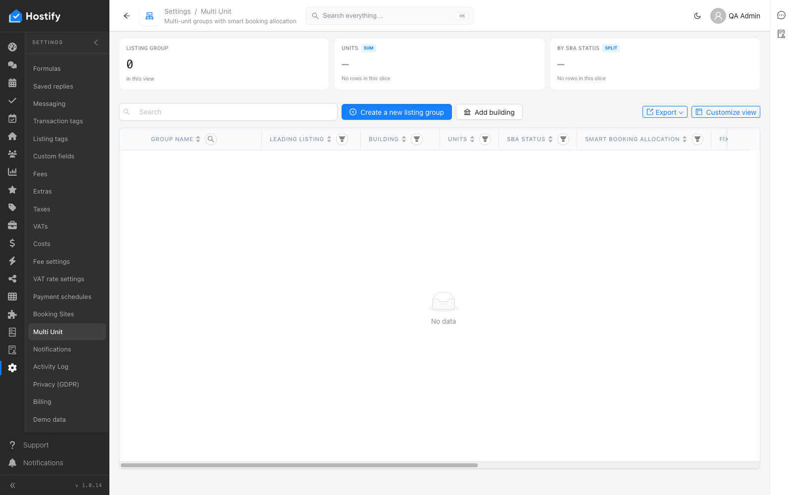


## Казус 44: notificationSettings opens (/app/settings/notificationSettings)

_Известен от пуска 2026-11-12 10:58 (същата версия) — не е отстранен._

**Какво се обърка**

```
Error: The page reported 47 error(s) — API answers, failed requests, console errors:
- [request.failed] net::ERR_BLOCKED_BY_ORB @ https://hostify-apps.bioseek.eu/plugins/chekin/logo.svg
- [request.failed] net::ERR_BLOCKED_BY_ORB @ https://hostify-apps.bioseek.eu/plugins/stripe/logo.png
- [request.failed] net::ERR_BLOCKED_BY_ORB @ https://hostify-apps.bioseek.eu/plugins/paypal/logo.png
- [request.failed] net::ERR_BLOCKED_BY_ORB @ https://hostify-apps.bioseek.eu/plugins/duve/logo.png
- [request.failed] net::ERR_BLOCKED_BY_ORB @ https://hostify-apps.bioseek.eu/plugins/superhog/logo.png
- [request.failed] net::ERR_BLOCKED_BY_ORB @ https://hostify-apps.bioseek.eu/plugins/beyond/logo.jpg
- [request.failed] net::ERR_BLOCKED_BY_ORB @ https://hostify-apps.bioseek.eu/plugins/pricelabs/logo.svg
- [request.failed] net::ERR_BLOCKED_BY_ORB @ https://hostify-apps.bioseek.eu/plugins/breezeway/logo.png
- [request.failed] net::ERR_BLOCKED_BY_ORB @ https://hostify-apps.bioseek.eu/plugins/cardcom/logo.png
- [request.failed] net::ERR_BLOCKED_BY_ORB @ https://hostify-apps.bioseek.eu/plugins/akiles/logo.svg
```
- неуспешна заявка: net::ERR_BLOCKED_BY_ORB — `https://hostify-apps.bioseek.eu/plugins/chekin/logo.svg`
- неуспешна заявка: net::ERR_BLOCKED_BY_ORB — `https://hostify-apps.bioseek.eu/plugins/stripe/logo.png`
- неуспешна заявка: net::ERR_BLOCKED_BY_ORB — `https://hostify-apps.bioseek.eu/plugins/paypal/logo.png`
- неуспешна заявка: net::ERR_BLOCKED_BY_ORB — `https://hostify-apps.bioseek.eu/plugins/duve/logo.png`
- неуспешна заявка: net::ERR_BLOCKED_BY_ORB — `https://hostify-apps.bioseek.eu/plugins/superhog/logo.png`
- неуспешна заявка: net::ERR_BLOCKED_BY_ORB — `https://hostify-apps.bioseek.eu/plugins/beyond/logo.jpg`
- неуспешна заявка: net::ERR_BLOCKED_BY_ORB — `https://hostify-apps.bioseek.eu/plugins/pricelabs/logo.svg`
- неуспешна заявка: net::ERR_BLOCKED_BY_ORB — `https://hostify-apps.bioseek.eu/plugins/breezeway/logo.png`
- неуспешна заявка: net::ERR_BLOCKED_BY_ORB — `https://hostify-apps.bioseek.eu/plugins/cardcom/logo.png`
- неуспешна заявка: net::ERR_BLOCKED_BY_ORB — `https://hostify-apps.bioseek.eu/plugins/akiles/logo.svg`

**Как да се възпроизведе**

1. Влез в https://hostify.bioseek.eu/app/ като администратор на акаунта (qa.admin@hostify-qa.test).
2. Меню: SETTINGS › Notifications — https://hostify.bioseek.eu/app/settings/notificationSettings
3. Спек `tests/e2e/010-account-pages.spec.ts`, проверка „notificationSettings opens (/app/settings/notificationSettings)“.
4. Developer tools › Network: заявките по-горе отговарят така.

**Скрийншоти**

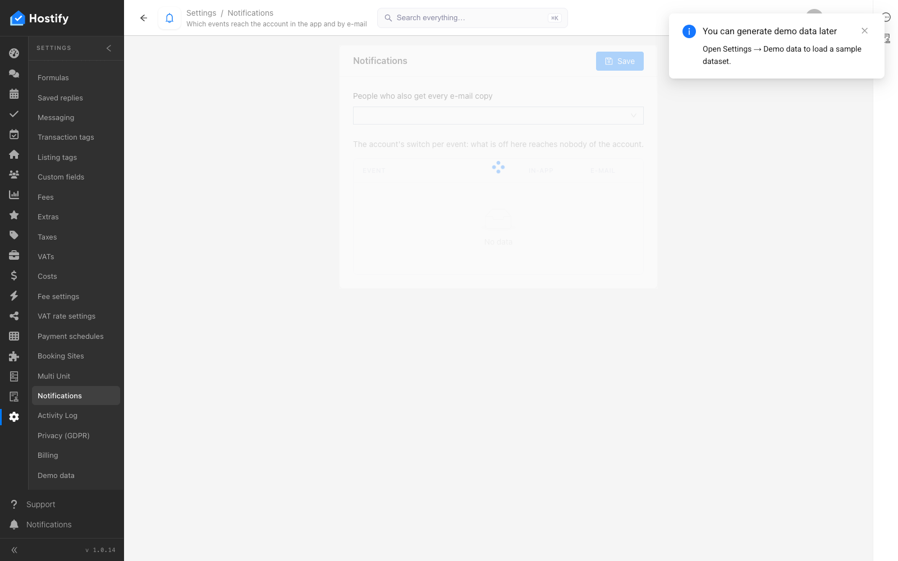
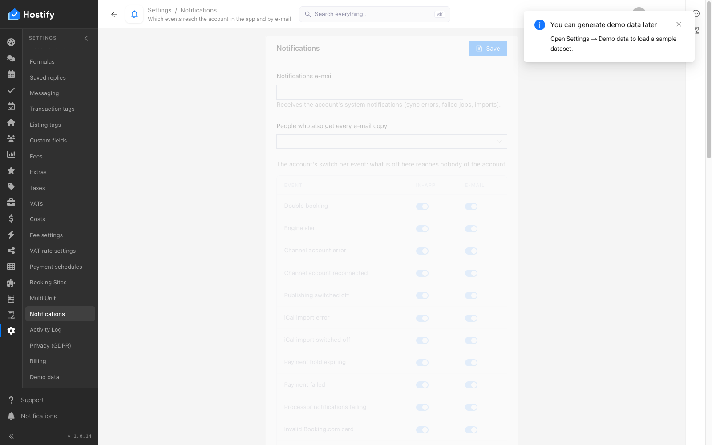


## Казус 45: syncActivities opens (/app/settings/syncActivities)

_Известен от пуска 2026-11-12 10:58 (същата версия) — не е отстранен._

**Какво се обърка**

```
Error: The page reported 78 error(s) — API answers, failed requests, console errors:
- [request.failed] net::ERR_BLOCKED_BY_ORB @ https://hostify-apps.bioseek.eu/plugins/paypal/logo.png
- [request.failed] net::ERR_BLOCKED_BY_ORB @ https://hostify-apps.bioseek.eu/plugins/duve/logo.png
- [request.failed] net::ERR_BLOCKED_BY_ORB @ https://hostify-apps.bioseek.eu/plugins/stripe/logo.png
- [request.failed] net::ERR_BLOCKED_BY_ORB @ https://hostify-apps.bioseek.eu/plugins/chekin/logo.svg
- [request.failed] net::ERR_BLOCKED_BY_ORB @ https://hostify-apps.bioseek.eu/plugins/superhog/logo.png
- [request.failed] net::ERR_BLOCKED_BY_ORB @ https://hostify-apps.bioseek.eu/plugins/breezeway/logo.png
- [request.failed] net::ERR_BLOCKED_BY_ORB @ https://hostify-apps.bioseek.eu/plugins/beyond/logo.jpg
- [request.failed] net::ERR_BLOCKED_BY_ORB @ https://hostify-apps.bioseek.eu/plugins/pricelabs/logo.svg
- [request.failed] net::ERR_BLOCKED_BY_ORB @ https://hostify-apps.bioseek.eu/plugins/cardcom/logo.png
- [request.failed] net::ERR_BLOCKED_BY_ORB @ https://hostify-apps.bioseek.eu/plugins/akiles/logo.svg
```
- неуспешна заявка: net::ERR_BLOCKED_BY_ORB — `https://hostify-apps.bioseek.eu/plugins/paypal/logo.png`
- неуспешна заявка: net::ERR_BLOCKED_BY_ORB — `https://hostify-apps.bioseek.eu/plugins/duve/logo.png`
- неуспешна заявка: net::ERR_BLOCKED_BY_ORB — `https://hostify-apps.bioseek.eu/plugins/stripe/logo.png`
- неуспешна заявка: net::ERR_BLOCKED_BY_ORB — `https://hostify-apps.bioseek.eu/plugins/chekin/logo.svg`
- неуспешна заявка: net::ERR_BLOCKED_BY_ORB — `https://hostify-apps.bioseek.eu/plugins/superhog/logo.png`
- неуспешна заявка: net::ERR_BLOCKED_BY_ORB — `https://hostify-apps.bioseek.eu/plugins/breezeway/logo.png`
- неуспешна заявка: net::ERR_BLOCKED_BY_ORB — `https://hostify-apps.bioseek.eu/plugins/beyond/logo.jpg`
- неуспешна заявка: net::ERR_BLOCKED_BY_ORB — `https://hostify-apps.bioseek.eu/plugins/pricelabs/logo.svg`
- неуспешна заявка: net::ERR_BLOCKED_BY_ORB — `https://hostify-apps.bioseek.eu/plugins/cardcom/logo.png`
- неуспешна заявка: net::ERR_BLOCKED_BY_ORB — `https://hostify-apps.bioseek.eu/plugins/akiles/logo.svg`

**Как да се възпроизведе**

1. Влез в https://hostify.bioseek.eu/app/ като администратор на акаунта (qa.admin@hostify-qa.test).
2. Меню: SETTINGS › Activity Log — https://hostify.bioseek.eu/app/settings/syncActivities
3. Спек `tests/e2e/010-account-pages.spec.ts`, проверка „syncActivities opens (/app/settings/syncActivities)“.
4. Developer tools › Network: заявките по-горе отговарят така.

**Скрийншоти**


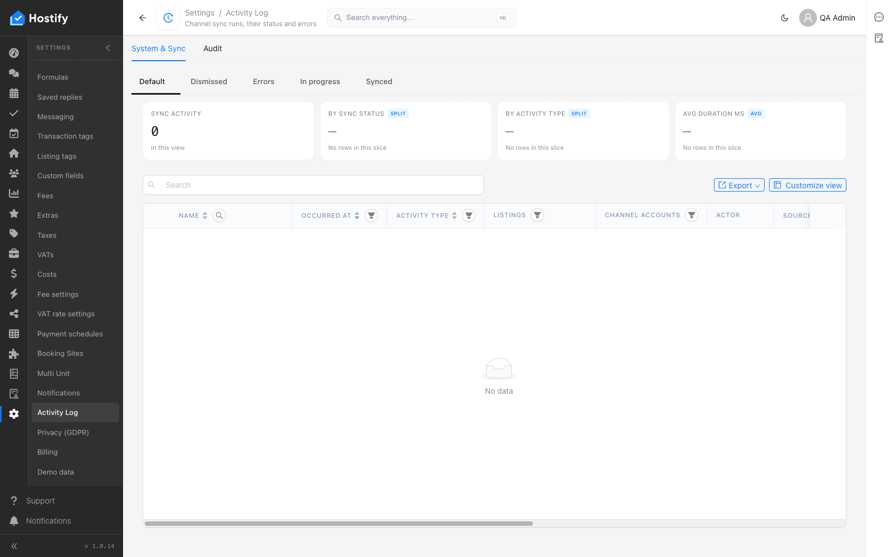


## Казус 46: privacySettings opens (/app/settings/privacySettings)

_Известен от пуска 2026-11-12 10:12 (същата версия) — не е отстранен._

**Какво се обърка**

```
Error: The page reported 66 error(s) — API answers, failed requests, console errors:
- [request.failed] net::ERR_BLOCKED_BY_ORB @ https://hostify-apps.bioseek.eu/plugins/stripe/logo.png
- [request.failed] net::ERR_BLOCKED_BY_ORB @ https://hostify-apps.bioseek.eu/plugins/paypal/logo.png
- [request.failed] net::ERR_BLOCKED_BY_ORB @ https://hostify-apps.bioseek.eu/plugins/chekin/logo.svg
- [request.failed] net::ERR_BLOCKED_BY_ORB @ https://hostify-apps.bioseek.eu/plugins/duve/logo.png
- [request.failed] net::ERR_BLOCKED_BY_ORB @ https://hostify-apps.bioseek.eu/plugins/superhog/logo.png
- [request.failed] net::ERR_BLOCKED_BY_ORB @ https://hostify-apps.bioseek.eu/plugins/beyond/logo.jpg
- [request.failed] net::ERR_BLOCKED_BY_ORB @ https://hostify-apps.bioseek.eu/plugins/breezeway/logo.png
- [request.failed] net::ERR_BLOCKED_BY_ORB @ https://hostify-apps.bioseek.eu/plugins/pricelabs/logo.svg
- [request.failed] net::ERR_BLOCKED_BY_ORB @ https://hostify-apps.bioseek.eu/plugins/akiles/logo.svg
- [request.failed] net::ERR_BLOCKED_BY_ORB @ https://hostify-apps.bioseek.eu/plugins/cardcom/logo.png
```
- неуспешна заявка: net::ERR_BLOCKED_BY_ORB — `https://hostify-apps.bioseek.eu/plugins/stripe/logo.png`
- неуспешна заявка: net::ERR_BLOCKED_BY_ORB — `https://hostify-apps.bioseek.eu/plugins/paypal/logo.png`
- неуспешна заявка: net::ERR_BLOCKED_BY_ORB — `https://hostify-apps.bioseek.eu/plugins/chekin/logo.svg`
- неуспешна заявка: net::ERR_BLOCKED_BY_ORB — `https://hostify-apps.bioseek.eu/plugins/duve/logo.png`
- неуспешна заявка: net::ERR_BLOCKED_BY_ORB — `https://hostify-apps.bioseek.eu/plugins/superhog/logo.png`
- неуспешна заявка: net::ERR_BLOCKED_BY_ORB — `https://hostify-apps.bioseek.eu/plugins/beyond/logo.jpg`
- неуспешна заявка: net::ERR_BLOCKED_BY_ORB — `https://hostify-apps.bioseek.eu/plugins/breezeway/logo.png`
- неуспешна заявка: net::ERR_BLOCKED_BY_ORB — `https://hostify-apps.bioseek.eu/plugins/pricelabs/logo.svg`
- неуспешна заявка: net::ERR_BLOCKED_BY_ORB — `https://hostify-apps.bioseek.eu/plugins/akiles/logo.svg`
- неуспешна заявка: net::ERR_BLOCKED_BY_ORB — `https://hostify-apps.bioseek.eu/plugins/cardcom/logo.png`

**Как да се възпроизведе**

1. Влез в https://hostify.bioseek.eu/app/ като администратор на акаунта (qa.admin@hostify-qa.test).
2. Меню: SETTINGS › Privacy (GDPR) — https://hostify.bioseek.eu/app/settings/privacySettings
3. Спек `tests/e2e/010-account-pages.spec.ts`, проверка „privacySettings opens (/app/settings/privacySettings)“.
4. Developer tools › Network: заявките по-горе отговарят така.

**Скрийншоти**

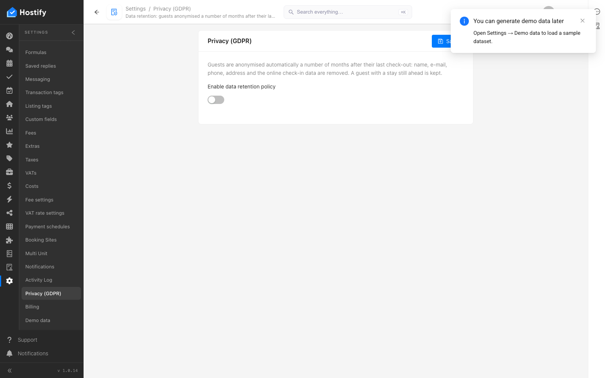


## Казус 47: accountBilling opens (/app/settings/accountBilling)

_Известен от пуска 2026-11-12 11:44 (същата версия) — не е отстранен._

**Какво се обърка**

```
Error: the column "(no key)" has a header — the columns: Number | Period | Date | Due | Amount | Status | (no header: no key)

expect(received).not.toBe(expected) // Object.is equality

Expected: not ""
```
- неуспешна заявка: net::ERR_BLOCKED_BY_ORB — `https://hostify-apps.bioseek.eu/plugins/stripe/logo.png`
- неуспешна заявка: net::ERR_BLOCKED_BY_ORB — `https://hostify-apps.bioseek.eu/plugins/paypal/logo.png`
- неуспешна заявка: net::ERR_BLOCKED_BY_ORB — `https://hostify-apps.bioseek.eu/plugins/duve/logo.png`
- неуспешна заявка: net::ERR_BLOCKED_BY_ORB — `https://hostify-apps.bioseek.eu/plugins/chekin/logo.svg`
- неуспешна заявка: net::ERR_BLOCKED_BY_ORB — `https://hostify-apps.bioseek.eu/plugins/superhog/logo.png`
- неуспешна заявка: net::ERR_BLOCKED_BY_ORB — `https://hostify-apps.bioseek.eu/plugins/breezeway/logo.png`
- неуспешна заявка: net::ERR_BLOCKED_BY_ORB — `https://hostify-apps.bioseek.eu/plugins/beyond/logo.jpg`
- неуспешна заявка: net::ERR_BLOCKED_BY_ORB — `https://hostify-apps.bioseek.eu/plugins/pricelabs/logo.svg`
- неуспешна заявка: net::ERR_BLOCKED_BY_ORB — `https://hostify-apps.bioseek.eu/plugins/akiles/logo.svg`
- неуспешна заявка: net::ERR_BLOCKED_BY_ORB — `https://hostify-apps.bioseek.eu/plugins/cardcom/logo.png`

**Как да се възпроизведе**

1. Влез в https://hostify.bioseek.eu/app/ като администратор на акаунта (qa.admin@hostify-qa.test).
2. Меню: SETTINGS › Billing — https://hostify.bioseek.eu/app/settings/accountBilling
3. Спек `tests/e2e/010-account-pages.spec.ts`, проверка „accountBilling opens (/app/settings/accountBilling)“ — стъпките:
4. every column has a header and the actions column is the last one
5. Developer tools › Network: заявките по-горе отговарят така.

**Скрийншоти**


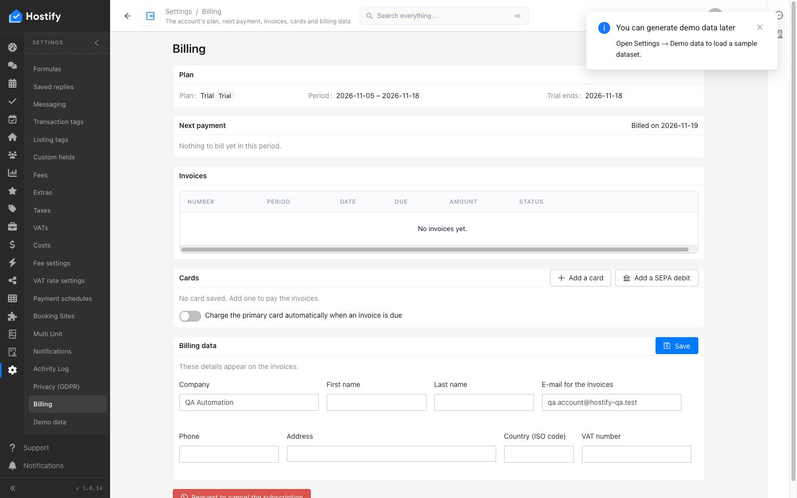


## Казус 48: demoData opens (/app/settings/demoData)

_Известен от пуска 2026-11-12 10:12 (същата версия) — не е отстранен._

**Какво се обърка**

```
Error: The page reported 62 error(s) — API answers, failed requests, console errors:
- [request.failed] net::ERR_BLOCKED_BY_ORB @ https://hostify-apps.bioseek.eu/plugins/paypal/logo.png
- [request.failed] net::ERR_BLOCKED_BY_ORB @ https://hostify-apps.bioseek.eu/plugins/stripe/logo.png
- [request.failed] net::ERR_BLOCKED_BY_ORB @ https://hostify-apps.bioseek.eu/plugins/duve/logo.png
- [request.failed] net::ERR_BLOCKED_BY_ORB @ https://hostify-apps.bioseek.eu/plugins/chekin/logo.svg
- [request.failed] net::ERR_BLOCKED_BY_ORB @ https://hostify-apps.bioseek.eu/plugins/superhog/logo.png
- [request.failed] net::ERR_BLOCKED_BY_ORB @ https://hostify-apps.bioseek.eu/plugins/beyond/logo.jpg
- [request.failed] net::ERR_BLOCKED_BY_ORB @ https://hostify-apps.bioseek.eu/plugins/breezeway/logo.png
- [request.failed] net::ERR_BLOCKED_BY_ORB @ https://hostify-apps.bioseek.eu/plugins/cardcom/logo.png
- [request.failed] net::ERR_BLOCKED_BY_ORB @ https://hostify-apps.bioseek.eu/plugins/pricelabs/logo.svg
- [request.failed] net::ERR_BLOCKED_BY_ORB @ https://hostify-apps.bioseek.eu/plugins/akiles/logo.svg
```
- неуспешна заявка: net::ERR_BLOCKED_BY_ORB — `https://hostify-apps.bioseek.eu/plugins/paypal/logo.png`
- неуспешна заявка: net::ERR_BLOCKED_BY_ORB — `https://hostify-apps.bioseek.eu/plugins/stripe/logo.png`
- неуспешна заявка: net::ERR_BLOCKED_BY_ORB — `https://hostify-apps.bioseek.eu/plugins/duve/logo.png`
- неуспешна заявка: net::ERR_BLOCKED_BY_ORB — `https://hostify-apps.bioseek.eu/plugins/chekin/logo.svg`
- неуспешна заявка: net::ERR_BLOCKED_BY_ORB — `https://hostify-apps.bioseek.eu/plugins/superhog/logo.png`
- неуспешна заявка: net::ERR_BLOCKED_BY_ORB — `https://hostify-apps.bioseek.eu/plugins/beyond/logo.jpg`
- неуспешна заявка: net::ERR_BLOCKED_BY_ORB — `https://hostify-apps.bioseek.eu/plugins/breezeway/logo.png`
- неуспешна заявка: net::ERR_BLOCKED_BY_ORB — `https://hostify-apps.bioseek.eu/plugins/cardcom/logo.png`
- неуспешна заявка: net::ERR_BLOCKED_BY_ORB — `https://hostify-apps.bioseek.eu/plugins/pricelabs/logo.svg`
- неуспешна заявка: net::ERR_BLOCKED_BY_ORB — `https://hostify-apps.bioseek.eu/plugins/akiles/logo.svg`

**Как да се възпроизведе**

1. Влез в https://hostify.bioseek.eu/app/ като администратор на акаунта (qa.admin@hostify-qa.test).
2. Меню: SETTINGS › Demo data — https://hostify.bioseek.eu/app/settings/demoData
3. Спек `tests/e2e/010-account-pages.spec.ts`, проверка „demoData opens (/app/settings/demoData)“.
4. Developer tools › Network: заявките по-горе отговарят така.

**Скрийншоти**


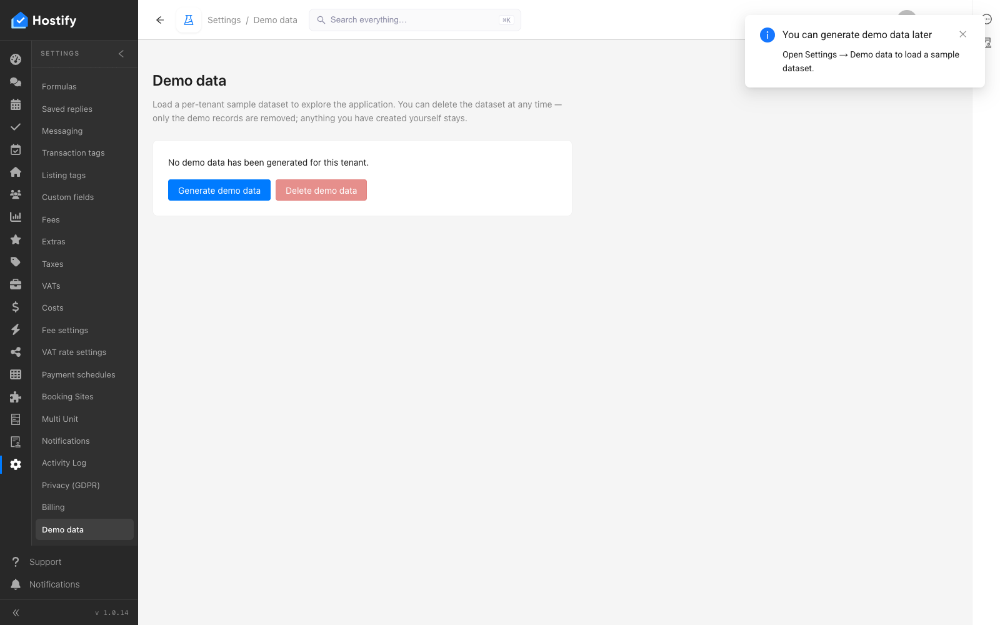


---

Какво проверява спекът: 010 — every page of the ACCOUNT menu opens for the account administrator of the QA account.
