# 008-platform-pages-dark — тъмната тема на платформената конзола — всяка страница се отваря, оглежда се и нищо не остава светло

- Пуск: 2026-11-16_09-29-38 · Приложение: https://hostify.bioseek.eu · Версия: 1.0.15
- Спек: `tests/e2e/008-platform-pages-dark.spec.ts`
- Казуси: 32 от 34 проверки

## Казус 1: tenants in the dark theme (/app/platformAdmin/tenants)

_Нов в този пуск._

**Какво се обърка**

```
Error: tenants: no part of the page stays light in the dark theme

expect(received).toEqual(expected) // deep equality

- Expected  - 1
+ Received  + 3

- Array []
+ Array [
+   "grid header ×12 (rgba(241, 245, 249, 0.04))",
+ ]
```

**Как да се възпроизведе**

1. Влез в https://hostify.bioseek.eu/app/ като суперадминистратор (alarm@mail.bg).
2. Меню: PLATFORM ADMIN › Accounts — https://hostify.bioseek.eu/app/platformAdmin/tenants
3. Спек `tests/e2e/008-platform-pages-dark.spec.ts`, проверка „tenants in the dark theme (/app/platformAdmin/tenants)“ — стъпките:
4. every column has a header and the actions column is the last one

**Скрийншоти**


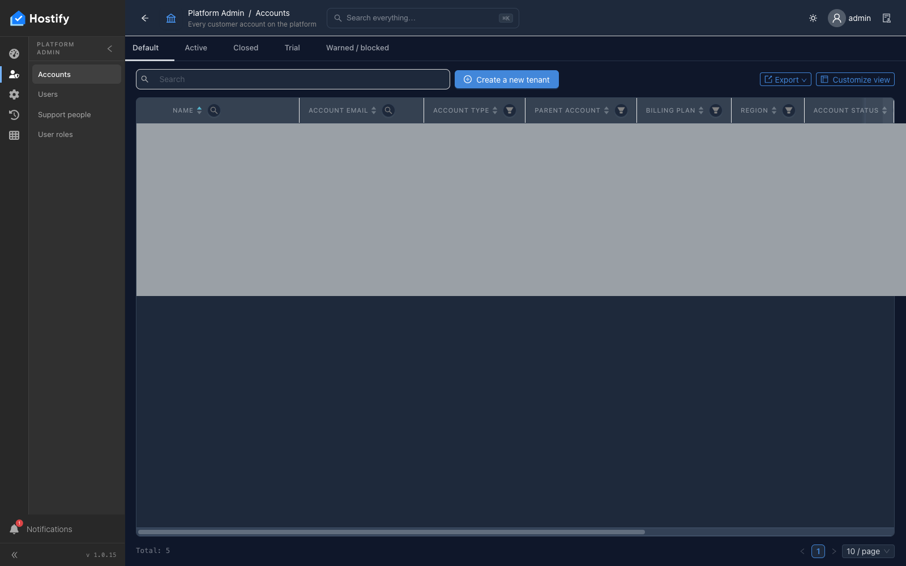


## Казус 2: users in the dark theme (/app/platformAdmin/users)

_Нов в този пуск._

**Какво се обърка**

```
Error: users: no part of the page stays light in the dark theme

expect(received).toEqual(expected) // deep equality

- Expected  - 1
+ Received  + 3

- Array []
+ Array [
+   "grid header ×10 (rgba(241, 245, 249, 0.04))",
+ ]
```

**Как да се възпроизведе**

1. Влез в https://hostify.bioseek.eu/app/ като суперадминистратор (alarm@mail.bg).
2. Меню: PLATFORM ADMIN › Users — https://hostify.bioseek.eu/app/platformAdmin/users
3. Спек `tests/e2e/008-platform-pages-dark.spec.ts`, проверка „users in the dark theme (/app/platformAdmin/users)“.

**Скрийншоти**

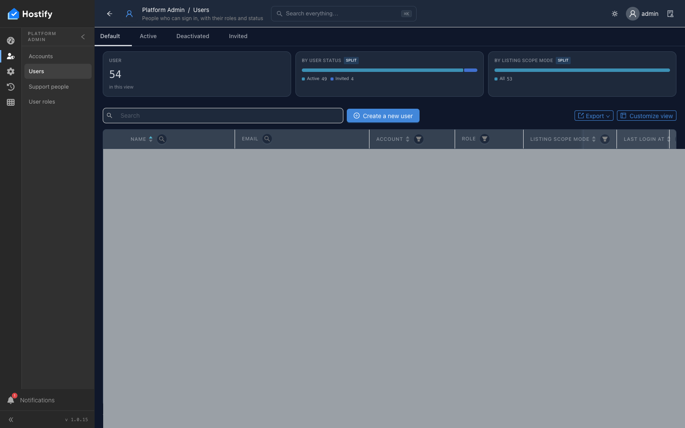


## Казус 3: securityGroups in the dark theme (/app/platformAdmin/securityGroups)

_Нов в този пуск._

**Какво се обърка**

```
Error: securityGroups: no part of the page stays light in the dark theme

expect(received).toEqual(expected) // deep equality

- Expected  - 1
+ Received  + 3

- Array []
+ Array [
+   "grid header ×5 (rgba(241, 245, 249, 0.04))",
+ ]
```

**Как да се възпроизведе**

1. Влез в https://hostify.bioseek.eu/app/ като суперадминистратор (alarm@mail.bg).
2. Меню: PLATFORM ADMIN › User roles — https://hostify.bioseek.eu/app/platformAdmin/securityGroups
3. Спек `tests/e2e/008-platform-pages-dark.spec.ts`, проверка „securityGroups in the dark theme (/app/platformAdmin/securityGroups)“.

**Скрийншоти**

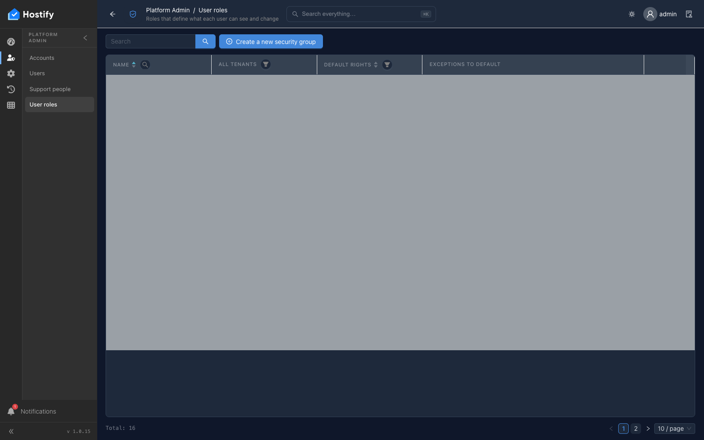


## Казус 4: cityNightsLimits in the dark theme (/app/platformSettings/cityNightsLimits)

_Нов в този пуск._

**Какво се обърка**

```
Error: cityNightsLimits: no part of the page stays light in the dark theme

expect(received).toEqual(expected) // deep equality

- Expected  - 1
+ Received  + 3

- Array []
+ Array [
+   "grid header ×5 (rgba(241, 245, 249, 0.04))",
+ ]
```

**Как да се възпроизведе**

1. Влез в https://hostify.bioseek.eu/app/ като суперадминистратор (alarm@mail.bg).
2. Меню: APP SETTINGS › City nights limits — https://hostify.bioseek.eu/app/platformSettings/cityNightsLimits
3. Спек `tests/e2e/008-platform-pages-dark.spec.ts`, проверка „cityNightsLimits in the dark theme (/app/platformSettings/cityNightsLimits)“ — стъпките:
4. every column has a header and the actions column is the last one

**Скрийншоти**

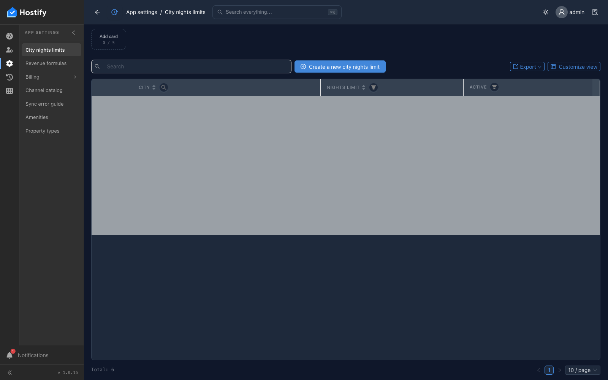


## Казус 5: revenueFormulas in the dark theme (/app/platformSettings/revenueFormulas)

_Нов в този пуск._

**Какво се обърка**

```
Error: revenueFormulas: no part of the page stays light in the dark theme

expect(received).toEqual(expected) // deep equality

- Expected  - 1
+ Received  + 3

- Array []
+ Array [
+   "grid header ×8 (rgba(241, 245, 249, 0.04))",
+ ]
```

**Как да се възпроизведе**

1. Влез в https://hostify.bioseek.eu/app/ като суперадминистратор (alarm@mail.bg).
2. Меню: APP SETTINGS › Revenue formulas — https://hostify.bioseek.eu/app/platformSettings/revenueFormulas
3. Спек `tests/e2e/008-platform-pages-dark.spec.ts`, проверка „revenueFormulas in the dark theme (/app/platformSettings/revenueFormulas)“.

**Скрийншоти**


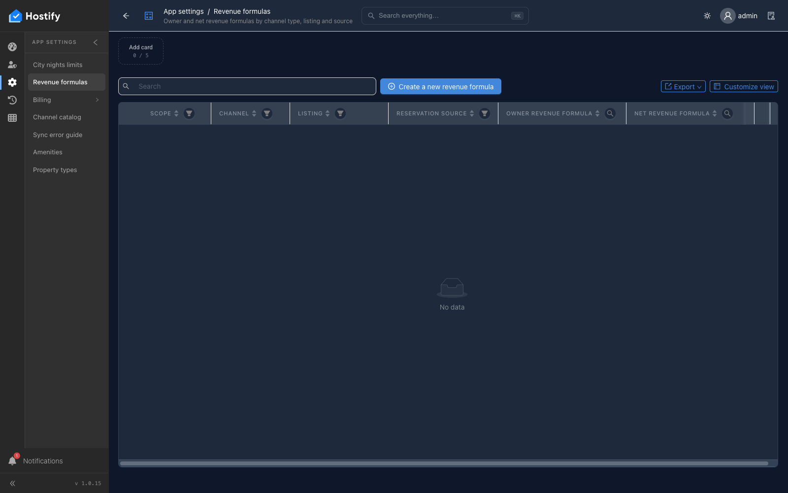


## Казус 6: activeRuListings in the dark theme (/app/platformSettings/platformBilling/activeRuListings)

_Нов в този пуск._

**Какво се обърка**

```
Error: the column "(no key)" has a header — the columns: (no header: no key) | Month | Active listings | Accounts

expect(received).not.toBe(expected) // Object.is equality

Expected: not ""
```

**Как да се възпроизведе**

1. Влез в https://hostify.bioseek.eu/app/ като суперадминистратор (alarm@mail.bg).
2. Меню: APP SETTINGS › Billing › activeRuListings — https://hostify.bioseek.eu/app/platformSettings/platformBilling/activeRuListings
3. Спек `tests/e2e/008-platform-pages-dark.spec.ts`, проверка „activeRuListings in the dark theme (/app/platformSettings/platformBilling/activeRuListings)“ — стъпките:
4. every column has a header and the actions column is the last one

**Скрийншоти**

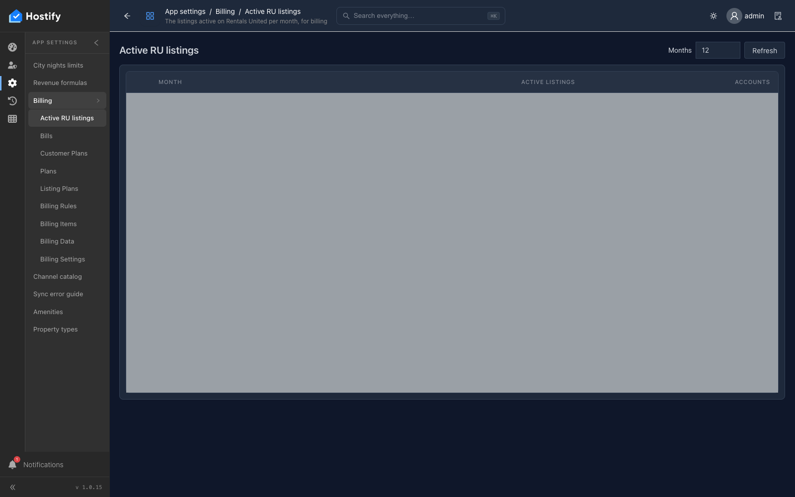


## Казус 7: hostifyBills in the dark theme (/app/platformSettings/platformBilling/hostifyBills)

_Нов в този пуск._

**Какво се обърка**

```
Error: hostifyBills: no part of the page stays light in the dark theme

expect(received).toEqual(expected) // deep equality

- Expected  - 1
+ Received  + 3

- Array []
+ Array [
+   "grid header ×10 (rgba(241, 245, 249, 0.04))",
+ ]
```

**Как да се възпроизведе**

1. Влез в https://hostify.bioseek.eu/app/ като суперадминистратор (alarm@mail.bg).
2. Меню: APP SETTINGS › Billing › hostifyBills — https://hostify.bioseek.eu/app/platformSettings/platformBilling/hostifyBills
3. Спек `tests/e2e/008-platform-pages-dark.spec.ts`, проверка „hostifyBills in the dark theme (/app/platformSettings/platformBilling/hostifyBills)“.

**Скрийншоти**


## Казус 8: hostifyCustomerPlans in the dark theme (/app/platformSettings/platformBilling/hostifyCustomerPlans)

_Нов в този пуск._

**Какво се обърка**

```
Error: hostifyCustomerPlans: no part of the page stays light in the dark theme

expect(received).toEqual(expected) // deep equality

- Expected  - 1
+ Received  + 3

- Array []
+ Array [
+   "grid header ×9 (rgba(241, 245, 249, 0.04))",
+ ]
```

**Как да се възпроизведе**

1. Влез в https://hostify.bioseek.eu/app/ като суперадминистратор (alarm@mail.bg).
2. Меню: APP SETTINGS › Billing › hostifyCustomerPlans — https://hostify.bioseek.eu/app/platformSettings/platformBilling/hostifyCustomerPlans
3. Спек `tests/e2e/008-platform-pages-dark.spec.ts`, проверка „hostifyCustomerPlans in the dark theme (/app/platformSettings/platformBilling/hostifyCustomerPlans)“.

**Скрийншоти**

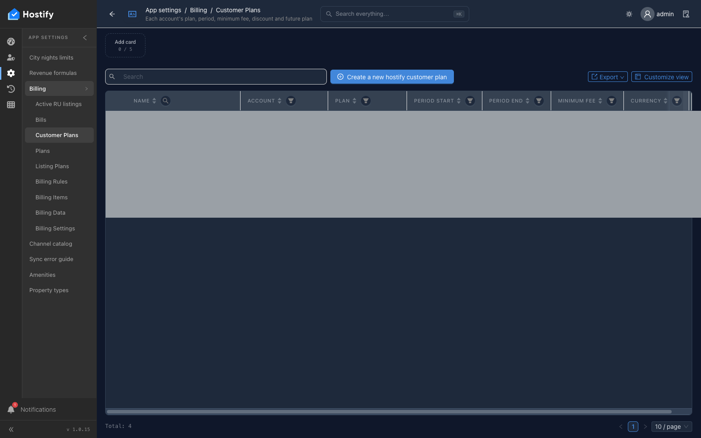


## Казус 9: hostifyPlans in the dark theme (/app/platformSettings/platformBilling/hostifyPlans)

_Нов в този пуск._

**Какво се обърка**

```
Error: hostifyPlans: no part of the page stays light in the dark theme

expect(received).toEqual(expected) // deep equality

- Expected  - 1
+ Received  + 3

- Array []
+ Array [
+   "grid header ×9 (rgba(241, 245, 249, 0.04))",
+ ]
```

**Как да се възпроизведе**

1. Влез в https://hostify.bioseek.eu/app/ като суперадминистратор (alarm@mail.bg).
2. Меню: APP SETTINGS › Billing › hostifyPlans — https://hostify.bioseek.eu/app/platformSettings/platformBilling/hostifyPlans
3. Спек `tests/e2e/008-platform-pages-dark.spec.ts`, проверка „hostifyPlans in the dark theme (/app/platformSettings/platformBilling/hostifyPlans)“.

**Скрийншоти**

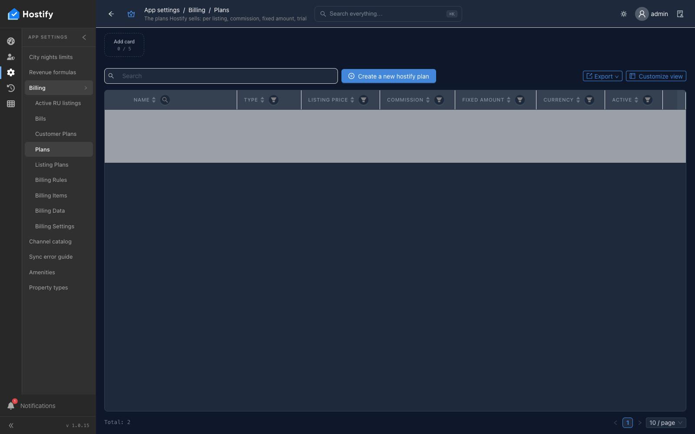


## Казус 10: hostifyListingPlans in the dark theme (/app/platformSettings/platformBilling/hostifyListingPlans)

_Нов в този пуск._

**Какво се обърка**

```
Error: hostifyListingPlans: no part of the page stays light in the dark theme

expect(received).toEqual(expected) // deep equality

- Expected  - 1
+ Received  + 3

- Array []
+ Array [
+   "grid header ×9 (rgba(241, 245, 249, 0.04))",
+ ]
```

**Как да се възпроизведе**

1. Влез в https://hostify.bioseek.eu/app/ като суперадминистратор (alarm@mail.bg).
2. Меню: APP SETTINGS › Billing › hostifyListingPlans — https://hostify.bioseek.eu/app/platformSettings/platformBilling/hostifyListingPlans
3. Спек `tests/e2e/008-platform-pages-dark.spec.ts`, проверка „hostifyListingPlans in the dark theme (/app/platformSettings/platformBilling/hostifyListingPlans)“.

**Скрийншоти**

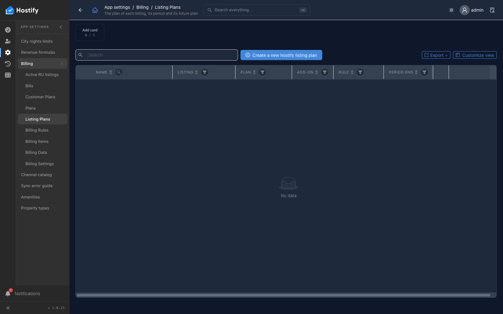


## Казус 11: hostifyBillingRules in the dark theme (/app/platformSettings/platformBilling/hostifyBillingRules)

_Нов в този пуск._

**Какво се обърка**

```
Error: hostifyBillingRules: no part of the page stays light in the dark theme

expect(received).toEqual(expected) // deep equality

- Expected  - 1
+ Received  + 3

- Array []
+ Array [
+   "grid header ×9 (rgba(241, 245, 249, 0.04))",
+ ]
```

**Как да се възпроизведе**

1. Влез в https://hostify.bioseek.eu/app/ като суперадминистратор (alarm@mail.bg).
2. Меню: APP SETTINGS › Billing › hostifyBillingRules — https://hostify.bioseek.eu/app/platformSettings/platformBilling/hostifyBillingRules
3. Спек `tests/e2e/008-platform-pages-dark.spec.ts`, проверка „hostifyBillingRules in the dark theme (/app/platformSettings/platformBilling/hostifyBillingRules)“.

**Скрийншоти**


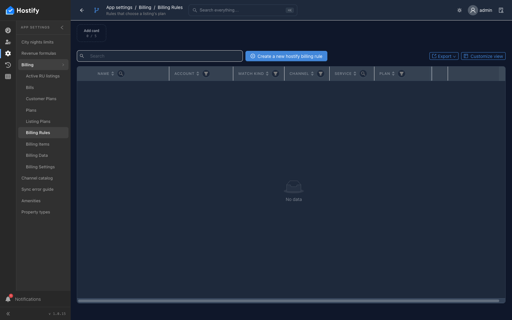


## Казус 12: hostifyBillingItems in the dark theme (/app/platformSettings/platformBilling/hostifyBillingItems)

_Нов в този пуск._

**Какво се обърка**

```
Error: hostifyBillingItems: no part of the page stays light in the dark theme

expect(received).toEqual(expected) // deep equality

- Expected  - 1
+ Received  + 3

- Array []
+ Array [
+   "grid header ×11 (rgba(241, 245, 249, 0.04))",
+ ]
```

**Как да се възпроизведе**

1. Влез в https://hostify.bioseek.eu/app/ като суперадминистратор (alarm@mail.bg).
2. Меню: APP SETTINGS › Billing › hostifyBillingItems — https://hostify.bioseek.eu/app/platformSettings/platformBilling/hostifyBillingItems
3. Спек `tests/e2e/008-platform-pages-dark.spec.ts`, проверка „hostifyBillingItems in the dark theme (/app/platformSettings/platformBilling/hostifyBillingItems)“.

**Скрийншоти**


## Казус 13: hostifyBillingProfiles in the dark theme (/app/platformSettings/platformBilling/hostifyBillingProfiles)

_Нов в този пуск._

**Какво се обърка**

```
Error: hostifyBillingProfiles: no part of the page stays light in the dark theme

expect(received).toEqual(expected) // deep equality

- Expected  - 1
+ Received  + 3

- Array []
+ Array [
+   "grid header ×8 (rgba(241, 245, 249, 0.04))",
+ ]
```

**Как да се възпроизведе**

1. Влез в https://hostify.bioseek.eu/app/ като суперадминистратор (alarm@mail.bg).
2. Меню: APP SETTINGS › Billing › hostifyBillingProfiles — https://hostify.bioseek.eu/app/platformSettings/platformBilling/hostifyBillingProfiles
3. Спек `tests/e2e/008-platform-pages-dark.spec.ts`, проверка „hostifyBillingProfiles in the dark theme (/app/platformSettings/platformBilling/hostifyBillingProfiles)“.

**Скрийншоти**


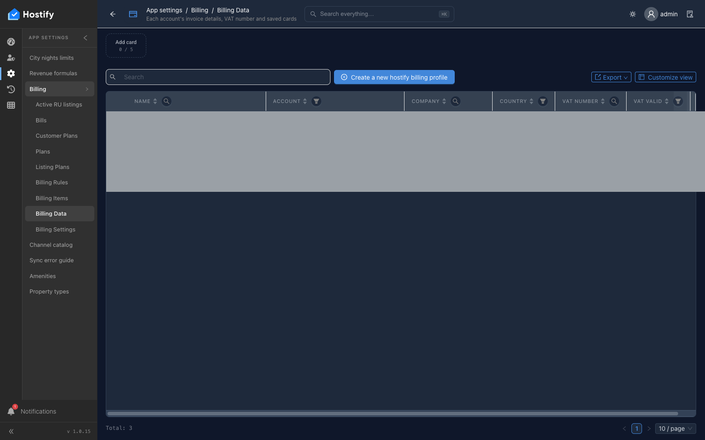


## Казус 14: hostifyBillingSettingsList in the dark theme (/app/platformSettings/platformBilling/hostifyBillingSettingsList)

_Нов в този пуск._

**Какво се обърка**

```
Error: hostifyBillingSettingsList: no part of the page stays light in the dark theme

expect(received).toEqual(expected) // deep equality

- Expected  - 1
+ Received  + 3

- Array []
+ Array [
+   "grid header ×7 (rgba(241, 245, 249, 0.04))",
+ ]
```

**Как да се възпроизведе**

1. Влез в https://hostify.bioseek.eu/app/ като суперадминистратор (alarm@mail.bg).
2. Меню: APP SETTINGS › Billing › hostifyBillingSettingsList — https://hostify.bioseek.eu/app/platformSettings/platformBilling/hostifyBillingSettingsList
3. Спек `tests/e2e/008-platform-pages-dark.spec.ts`, проверка „hostifyBillingSettingsList in the dark theme (/app/platformSettings/platformBilling/hostifyBillingSettingsList)“.

**Скрийншоти**

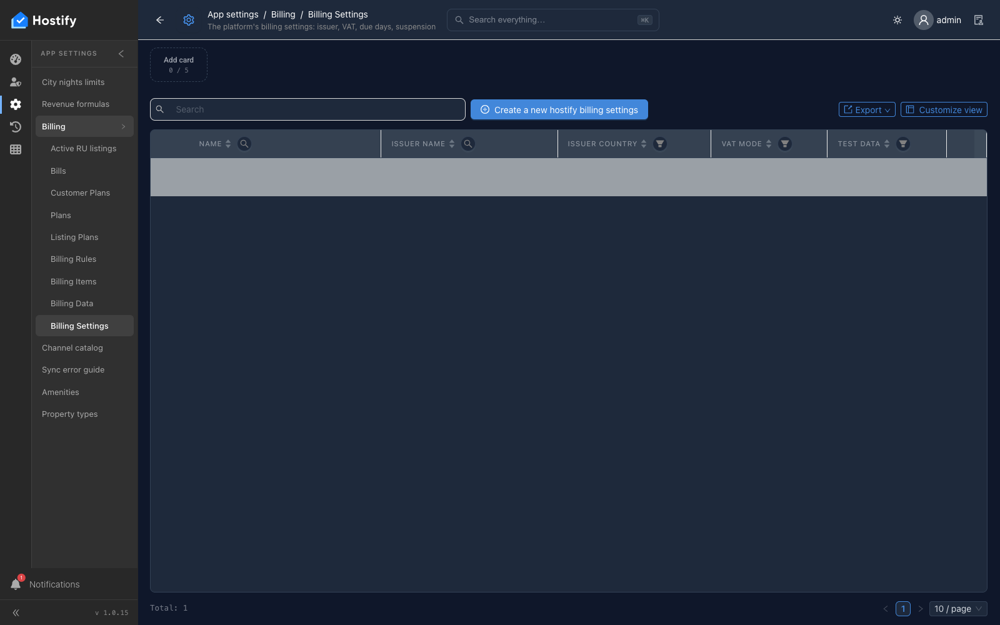


## Казус 15: channels in the dark theme (/app/platformSettings/channels)

_Нов в този пуск._

**Какво се обърка**

```
Error: channels: no part of the page stays light in the dark theme

expect(received).toEqual(expected) // deep equality

- Expected  - 1
+ Received  + 3

- Array []
+ Array [
+   "grid header ×12 (rgba(241, 245, 249, 0.04))",
+ ]
```

**Как да се възпроизведе**

1. Влез в https://hostify.bioseek.eu/app/ като суперадминистратор (alarm@mail.bg).
2. Меню: APP SETTINGS › Channel catalog — https://hostify.bioseek.eu/app/platformSettings/channels
3. Спек `tests/e2e/008-platform-pages-dark.spec.ts`, проверка „channels in the dark theme (/app/platformSettings/channels)“.

**Скрийншоти**

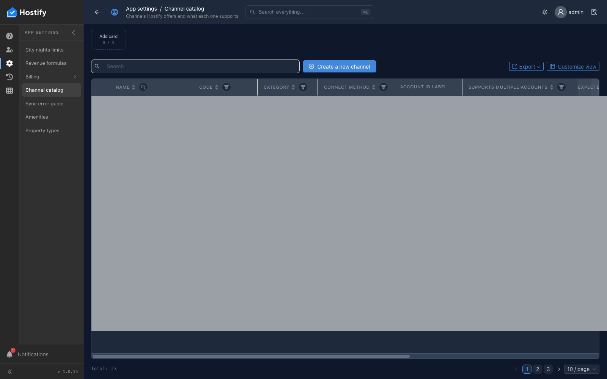


## Казус 16: syncErrorGuides in the dark theme (/app/platformSettings/syncErrorGuides)

_Нов в този пуск._

**Какво се обърка**

```
Error: syncErrorGuides: no part of the page stays light in the dark theme

expect(received).toEqual(expected) // deep equality

- Expected  - 1
+ Received  + 3

- Array []
+ Array [
+   "grid header ×7 (rgba(241, 245, 249, 0.04))",
+ ]
```

**Как да се възпроизведе**

1. Влез в https://hostify.bioseek.eu/app/ като суперадминистратор (alarm@mail.bg).
2. Меню: APP SETTINGS › Sync error guide — https://hostify.bioseek.eu/app/platformSettings/syncErrorGuides
3. Спек `tests/e2e/008-platform-pages-dark.spec.ts`, проверка „syncErrorGuides in the dark theme (/app/platformSettings/syncErrorGuides)“.

**Скрийншоти**


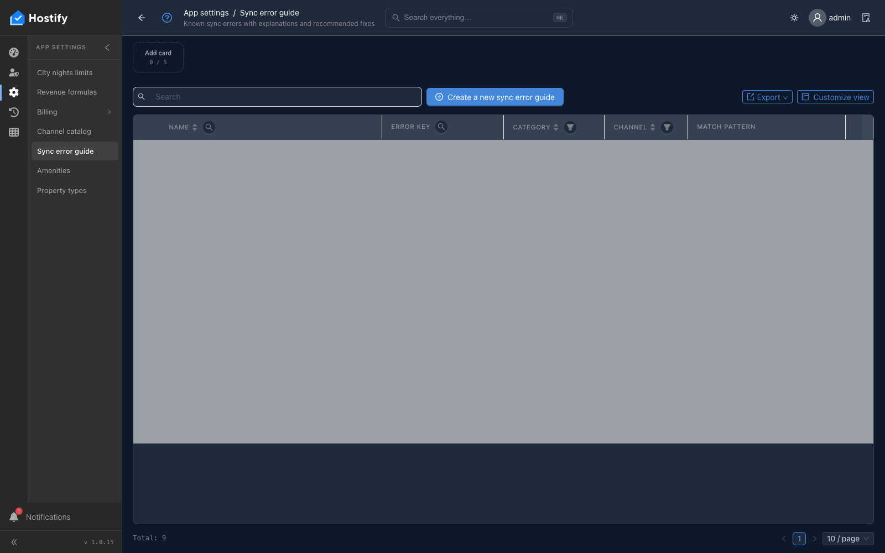


## Казус 17: amenities in the dark theme (/app/platformSettings/amenities)

_Нов в този пуск._

**Какво се обърка**

```
Error: amenities: no part of the page stays light in the dark theme

expect(received).toEqual(expected) // deep equality

- Expected  - 1
+ Received  + 3

- Array []
+ Array [
+   "grid header ×9 (rgba(241, 245, 249, 0.04))",
+ ]
```

**Как да се възпроизведе**

1. Влез в https://hostify.bioseek.eu/app/ като суперадминистратор (alarm@mail.bg).
2. Меню: APP SETTINGS › Amenities — https://hostify.bioseek.eu/app/platformSettings/amenities
3. Спек `tests/e2e/008-platform-pages-dark.spec.ts`, проверка „amenities in the dark theme (/app/platformSettings/amenities)“.

**Скрийншоти**

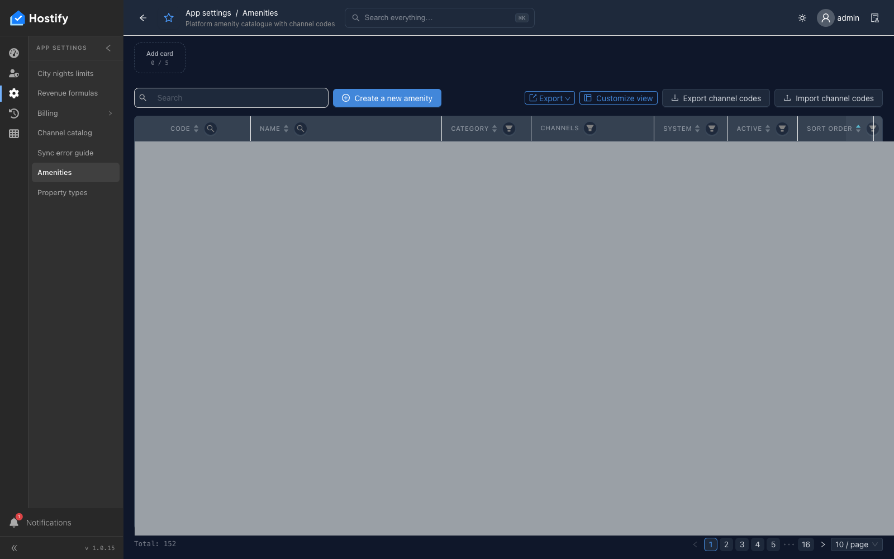


## Казус 18: propertyTypes in the dark theme (/app/platformSettings/propertyTypes)

_Нов в този пуск._

**Какво се обърка**

```
Error: propertyTypes: no part of the page stays light in the dark theme

expect(received).toEqual(expected) // deep equality

- Expected  - 1
+ Received  + 3

- Array []
+ Array [
+   "grid header ×7 (rgba(241, 245, 249, 0.04))",
+ ]
```

**Как да се възпроизведе**

1. Влез в https://hostify.bioseek.eu/app/ като суперадминистратор (alarm@mail.bg).
2. Меню: APP SETTINGS › Property types — https://hostify.bioseek.eu/app/platformSettings/propertyTypes
3. Спек `tests/e2e/008-platform-pages-dark.spec.ts`, проверка „propertyTypes in the dark theme (/app/platformSettings/propertyTypes)“.

**Скрийншоти**

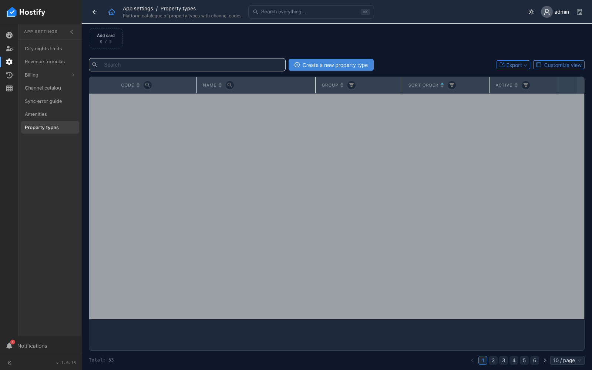


## Казус 19: userActions in the dark theme (/app/platformLogs/userActions)

_Нов в този пуск._

**Какво се обърка**

```
Error: userActions: no part of the page stays light in the dark theme

expect(received).toEqual(expected) // deep equality

- Expected  - 1
+ Received  + 3

- Array []
+ Array [
+   "grid header ×10 (rgba(241, 245, 249, 0.04))",
+ ]
```

**Как да се възпроизведе**

1. Влез в https://hostify.bioseek.eu/app/ като суперадминистратор (alarm@mail.bg).
2. Меню: LOGS › Action log — https://hostify.bioseek.eu/app/platformLogs/userActions
3. Спек `tests/e2e/008-platform-pages-dark.spec.ts`, проверка „userActions in the dark theme (/app/platformLogs/userActions)“ — стъпките:
4. every column has a header and the actions column is the last one

**Скрийншоти**


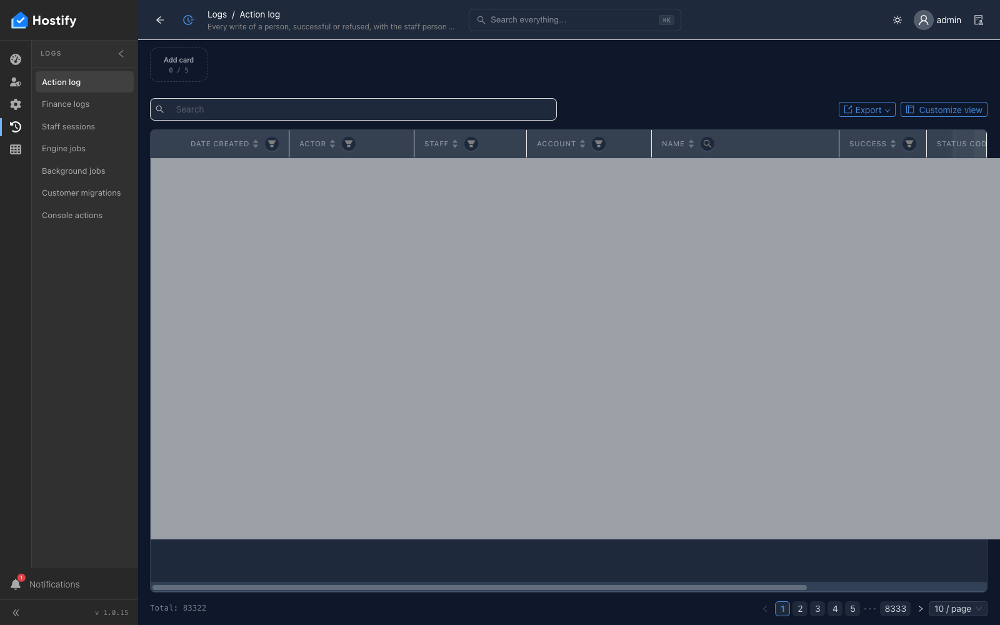


## Казус 20: financeLogs in the dark theme (/app/platformLogs/financeLogs)

_Нов в този пуск._

**Какво се обърка**

```
Error: financeLogs: no part of the page stays light in the dark theme

expect(received).toEqual(expected) // deep equality

- Expected  - 1
+ Received  + 3

- Array []
+ Array [
+   "grid header ×6 (rgba(241, 245, 249, 0.04))",
+ ]
```

**Как да се възпроизведе**

1. Влез в https://hostify.bioseek.eu/app/ като суперадминистратор (alarm@mail.bg).
2. Меню: LOGS › Finance logs — https://hostify.bioseek.eu/app/platformLogs/financeLogs
3. Спек `tests/e2e/008-platform-pages-dark.spec.ts`, проверка „financeLogs in the dark theme (/app/platformLogs/financeLogs)“.

**Скрийншоти**

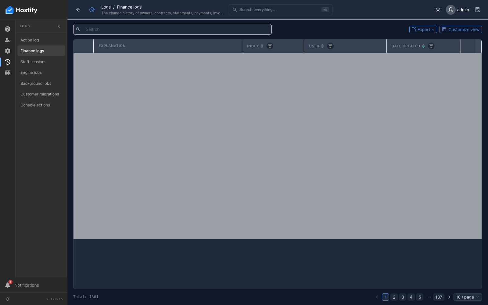


## Казус 21: staffSessions in the dark theme (/app/platformLogs/staffSessions)

_Нов в този пуск._

**Какво се обърка**

```
Error: staffSessions: no part of the page stays light in the dark theme

expect(received).toEqual(expected) // deep equality

- Expected  - 1
+ Received  + 3

- Array []
+ Array [
+   "grid header ×9 (rgba(241, 245, 249, 0.04))",
+ ]
```

**Как да се възпроизведе**

1. Влез в https://hostify.bioseek.eu/app/ като суперадминистратор (alarm@mail.bg).
2. Меню: LOGS › Staff sessions — https://hostify.bioseek.eu/app/platformLogs/staffSessions
3. Спек `tests/e2e/008-platform-pages-dark.spec.ts`, проверка „staffSessions in the dark theme (/app/platformLogs/staffSessions)“.

**Скрийншоти**

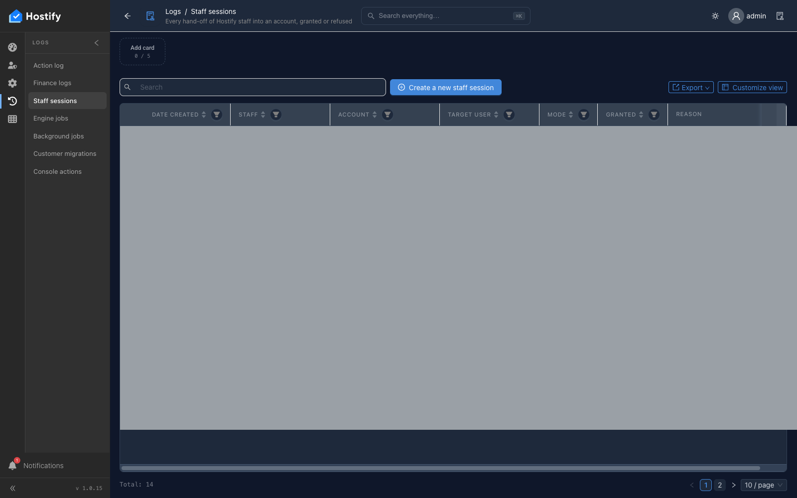


## Казус 22: engineJobRuns in the dark theme (/app/platformLogs/engineJobRuns)

_Нов в този пуск._

**Какво се обърка**

```
Error: engineJobRuns: no part of the page stays light in the dark theme

expect(received).toEqual(expected) // deep equality

- Expected  - 1
+ Received  + 3

- Array []
+ Array [
+   "grid header ×8 (rgba(241, 245, 249, 0.04))",
+ ]
```

**Как да се възпроизведе**

1. Влез в https://hostify.bioseek.eu/app/ като суперадминистратор (alarm@mail.bg).
2. Меню: LOGS › Engine jobs — https://hostify.bioseek.eu/app/platformLogs/engineJobRuns
3. Спек `tests/e2e/008-platform-pages-dark.spec.ts`, проверка „engineJobRuns in the dark theme (/app/platformLogs/engineJobRuns)“.

**Скрийншоти**

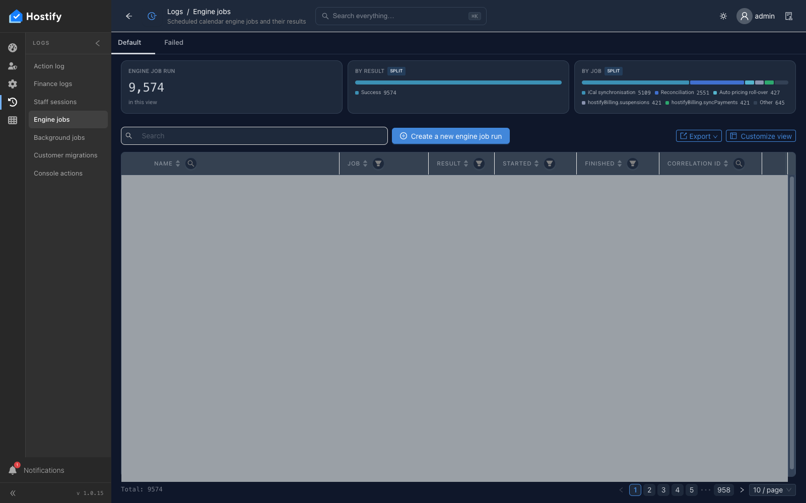


## Казус 23: backgroundJobs in the dark theme (/app/platformLogs/backgroundJobs)

_Нов в този пуск._

**Какво се обърка**

```
Error: backgroundJobs: no part of the page stays light in the dark theme

expect(received).toEqual(expected) // deep equality

- Expected  - 1
+ Received  + 3

- Array []
+ Array [
+   "grid header ×16 (rgba(241, 245, 249, 0.04))",
+ ]
```

**Как да се възпроизведе**

1. Влез в https://hostify.bioseek.eu/app/ като суперадминистратор (alarm@mail.bg).
2. Меню: LOGS › Background jobs — https://hostify.bioseek.eu/app/platformLogs/backgroundJobs
3. Спек `tests/e2e/008-platform-pages-dark.spec.ts`, проверка „backgroundJobs in the dark theme (/app/platformLogs/backgroundJobs)“.

**Скрийншоти**


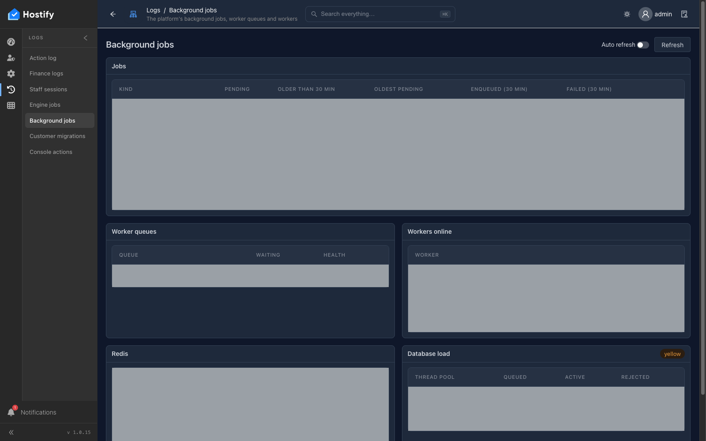


## Казус 24: customerMigrations in the dark theme (/app/platformLogs/customerMigrations)

_Нов в този пуск._

**Какво се обърка**

```
Error: customerMigrations: no part of the page stays light in the dark theme

expect(received).toEqual(expected) // deep equality

- Expected  - 1
+ Received  + 3

- Array []
+ Array [
+   "grid header ×9 (rgba(241, 245, 249, 0.04))",
+ ]
```

**Как да се възпроизведе**

1. Влез в https://hostify.bioseek.eu/app/ като суперадминистратор (alarm@mail.bg).
2. Меню: LOGS › Customer migrations — https://hostify.bioseek.eu/app/platformLogs/customerMigrations
3. Спек `tests/e2e/008-platform-pages-dark.spec.ts`, проверка „customerMigrations in the dark theme (/app/platformLogs/customerMigrations)“.

**Скрийншоти**


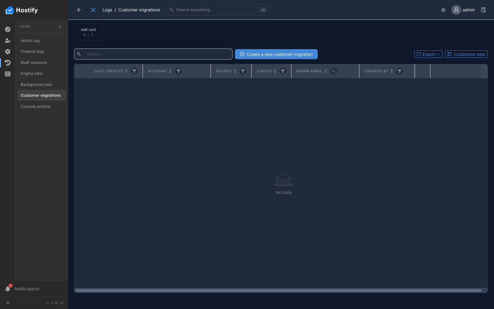


## Казус 25: appCenter in the dark theme (/app/apps/appCenter)

_Нов в този пуск._

**Какво се обърка**

```
Error: The page reported 19 error(s) — API answers, failed requests, console errors:
- [request.failed] net::ERR_BLOCKED_BY_ORB @ https://hostify-apps.bioseek.eu/plugins/akiles/logo.svg
- [request.failed] net::ERR_BLOCKED_BY_ORB @ https://hostify-apps.bioseek.eu/plugins/turnoverbnb/logo.png
- [request.failed] net::ERR_BLOCKED_BY_ORB @ https://hostify-apps.bioseek.eu/plugins/cardcom/logo.png
- [request.failed] net::ERR_BLOCKED_BY_ORB @ https://hostify-apps.bioseek.eu/plugins/insuraguest/logo.png
- [request.failed] net::ERR_BLOCKED_BY_ORB @ https://hostify-apps.bioseek.eu/plugins/hostify-locks/logo.svg
- [request.failed] net::ERR_BLOCKED_BY_ORB @ https://hostify-apps.bioseek.eu/plugins/remotelock/logo.png
- [request.failed] net::ERR_BLOCKED_BY_ORB @ https://hostify-apps.bioseek.eu/plugins/minut/logo.svg
- [request.failed] net::ERR_BLOCKED_BY_ORB @ https://hostify-apps.bioseek.eu/plugins/safely/logo.png
- [request.failed] net::ERR_BLOCKED_BY_ORB @ https://hostify-apps.bioseek.eu/plugins/pricelabs/logo.svg
- [request.failed] net::ERR_BLOCKED_BY_ORB @ https://hostify-apps.bioseek.eu/plugins/doinn/logo.png
```
- неуспешна заявка: net::ERR_BLOCKED_BY_ORB — `https://hostify-apps.bioseek.eu/plugins/akiles/logo.svg`
- неуспешна заявка: net::ERR_BLOCKED_BY_ORB — `https://hostify-apps.bioseek.eu/plugins/turnoverbnb/logo.png`
- неуспешна заявка: net::ERR_BLOCKED_BY_ORB — `https://hostify-apps.bioseek.eu/plugins/cardcom/logo.png`
- неуспешна заявка: net::ERR_BLOCKED_BY_ORB — `https://hostify-apps.bioseek.eu/plugins/insuraguest/logo.png`
- неуспешна заявка: net::ERR_BLOCKED_BY_ORB — `https://hostify-apps.bioseek.eu/plugins/hostify-locks/logo.svg`
- неуспешна заявка: net::ERR_BLOCKED_BY_ORB — `https://hostify-apps.bioseek.eu/plugins/remotelock/logo.png`
- неуспешна заявка: net::ERR_BLOCKED_BY_ORB — `https://hostify-apps.bioseek.eu/plugins/minut/logo.svg`
- неуспешна заявка: net::ERR_BLOCKED_BY_ORB — `https://hostify-apps.bioseek.eu/plugins/safely/logo.png`
- неуспешна заявка: net::ERR_BLOCKED_BY_ORB — `https://hostify-apps.bioseek.eu/plugins/pricelabs/logo.svg`
- неуспешна заявка: net::ERR_BLOCKED_BY_ORB — `https://hostify-apps.bioseek.eu/plugins/doinn/logo.png`

**Как да се възпроизведе**

1. Влез в https://hostify.bioseek.eu/app/ като суперадминистратор (alarm@mail.bg).
2. Меню: APPS › App Center — https://hostify.bioseek.eu/app/apps/appCenter
3. Спек `tests/e2e/008-platform-pages-dark.spec.ts`, проверка „appCenter in the dark theme (/app/apps/appCenter)“.
4. Developer tools › Network: заявките по-горе отговарят така.

**Скрийншоти**

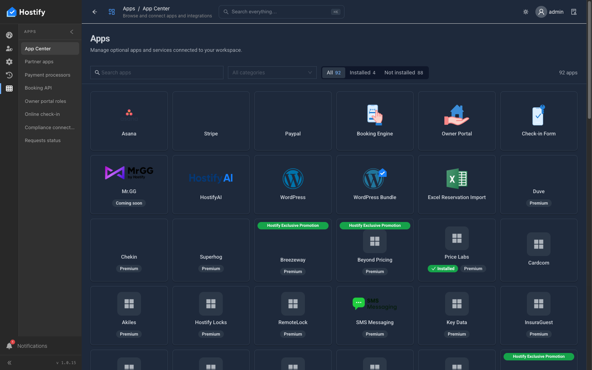
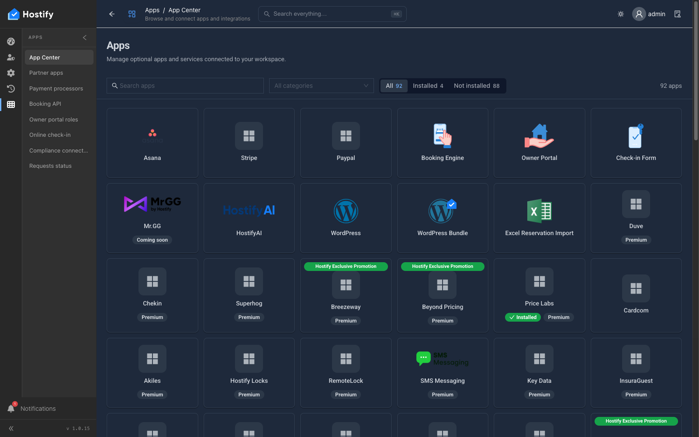


## Казус 26: partners in the dark theme (/app/apps/partners)

_Нов в този пуск._

**Какво се обърка**

```
Error: The page reported 59 error(s) — API answers, failed requests, console errors:
- [request.failed] net::ERR_BLOCKED_BY_ORB @ https://hostify-apps.bioseek.eu/plugins/turbosuite/logo.png
- [request.failed] net::ERR_BLOCKED_BY_ORB @ https://hostify-apps.bioseek.eu/plugins/hostify-locks/logo.svg
- [request.failed] net::ERR_BLOCKED_BY_ORB @ https://hostify-apps.bioseek.eu/plugins/cardcom/logo.png
- [request.failed] net::ERR_BLOCKED_BY_ORB @ https://hostify-apps.bioseek.eu/plugins/safely/logo.png
- [request.failed] net::ERR_BLOCKED_BY_ORB @ https://hostify-apps.bioseek.eu/plugins/pricelabs/logo.svg
- [request.failed] net::ERR_BLOCKED_BY_ORB @ https://hostify-apps.bioseek.eu/plugins/doinn/logo.png
- [request.failed] net::ERR_BLOCKED_BY_ORB @ https://hostify-apps.bioseek.eu/plugins/remotelock/logo.png
- [request.failed] net::ERR_BLOCKED_BY_ORB @ https://hostify-apps.bioseek.eu/plugins/turnoverbnb/logo.png
- [request.failed] net::ERR_BLOCKED_BY_ORB @ https://hostify-apps.bioseek.eu/plugins/key-data/logo.png
- [request.failed] net::ERR_BLOCKED_BY_ORB @ https://hostify-apps.bioseek.eu/plugins/insuraguest/logo.png
```
- неуспешна заявка: net::ERR_BLOCKED_BY_ORB — `https://hostify-apps.bioseek.eu/plugins/turbosuite/logo.png`
- неуспешна заявка: net::ERR_BLOCKED_BY_ORB — `https://hostify-apps.bioseek.eu/plugins/hostify-locks/logo.svg`
- неуспешна заявка: net::ERR_BLOCKED_BY_ORB — `https://hostify-apps.bioseek.eu/plugins/cardcom/logo.png`
- неуспешна заявка: net::ERR_BLOCKED_BY_ORB — `https://hostify-apps.bioseek.eu/plugins/safely/logo.png`
- неуспешна заявка: net::ERR_BLOCKED_BY_ORB — `https://hostify-apps.bioseek.eu/plugins/pricelabs/logo.svg`
- неуспешна заявка: net::ERR_BLOCKED_BY_ORB — `https://hostify-apps.bioseek.eu/plugins/doinn/logo.png`
- неуспешна заявка: net::ERR_BLOCKED_BY_ORB — `https://hostify-apps.bioseek.eu/plugins/remotelock/logo.png`
- неуспешна заявка: net::ERR_BLOCKED_BY_ORB — `https://hostify-apps.bioseek.eu/plugins/turnoverbnb/logo.png`
- неуспешна заявка: net::ERR_BLOCKED_BY_ORB — `https://hostify-apps.bioseek.eu/plugins/key-data/logo.png`
- неуспешна заявка: net::ERR_BLOCKED_BY_ORB — `https://hostify-apps.bioseek.eu/plugins/insuraguest/logo.png`

**Как да се възпроизведе**

1. Влез в https://hostify.bioseek.eu/app/ като суперадминистратор (alarm@mail.bg).
2. Меню: APPS › Partner apps — https://hostify.bioseek.eu/app/apps/partners
3. Спек `tests/e2e/008-platform-pages-dark.spec.ts`, проверка „partners in the dark theme (/app/apps/partners)“.
4. Developer tools › Network: заявките по-горе отговарят така.

**Скрийншоти**

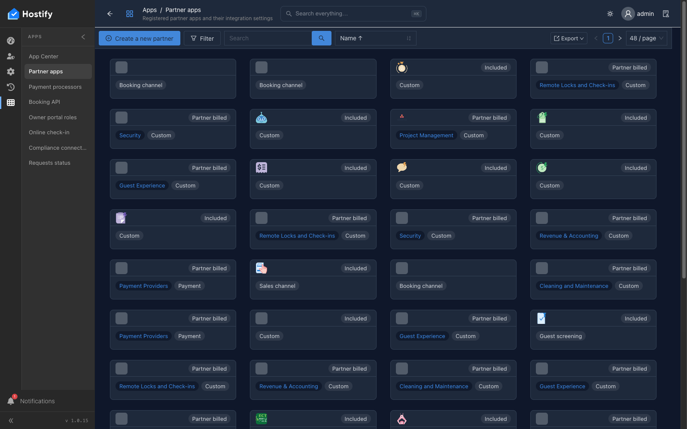


## Казус 27: paymentProcessorAccounts in the dark theme (/app/apps/paymentProcessorAccounts)

_Нов в този пуск._

**Какво се обърка**

```
Error: paymentProcessorAccounts: no part of the page stays light in the dark theme

expect(received).toEqual(expected) // deep equality

- Expected  - 1
+ Received  + 3

- Array []
+ Array [
+   "grid header ×11 (rgba(241, 245, 249, 0.04))",
+ ]
```
- неуспешна заявка: net::ERR_BLOCKED_BY_ORB — `https://hostify-apps.bioseek.eu/plugins/minut/logo.svg`
- неуспешна заявка: net::ERR_BLOCKED_BY_ORB — `https://hostify-apps.bioseek.eu/plugins/akiles/logo.svg`
- неуспешна заявка: net::ERR_BLOCKED_BY_ORB — `https://hostify-apps.bioseek.eu/plugins/insuraguest/logo.png`
- неуспешна заявка: net::ERR_BLOCKED_BY_ORB — `https://hostify-apps.bioseek.eu/plugins/turbosuite/logo.png`
- неуспешна заявка: net::ERR_BLOCKED_BY_ORB — `https://hostify-apps.bioseek.eu/plugins/pricelabs/logo.svg`
- неуспешна заявка: net::ERR_BLOCKED_BY_ORB — `https://hostify-apps.bioseek.eu/plugins/doinn/logo.png`
- неуспешна заявка: net::ERR_BLOCKED_BY_ORB — `https://hostify-apps.bioseek.eu/plugins/key-data/logo.png`
- неуспешна заявка: net::ERR_BLOCKED_BY_ORB — `https://hostify-apps.bioseek.eu/plugins/turnoverbnb/logo.png`
- неуспешна заявка: net::ERR_BLOCKED_BY_ORB — `https://hostify-apps.bioseek.eu/plugins/remotelock/logo.png`
- неуспешна заявка: net::ERR_BLOCKED_BY_ORB — `https://hostify-apps.bioseek.eu/plugins/hostify-locks/logo.svg`

**Как да се възпроизведе**

1. Влез в https://hostify.bioseek.eu/app/ като суперадминистратор (alarm@mail.bg).
2. Меню: APPS › Payment processors — https://hostify.bioseek.eu/app/apps/paymentProcessorAccounts
3. Спек `tests/e2e/008-platform-pages-dark.spec.ts`, проверка „paymentProcessorAccounts in the dark theme (/app/apps/paymentProcessorAccounts)“.
4. Developer tools › Network: заявките по-горе отговарят така.

**Скрийншоти**


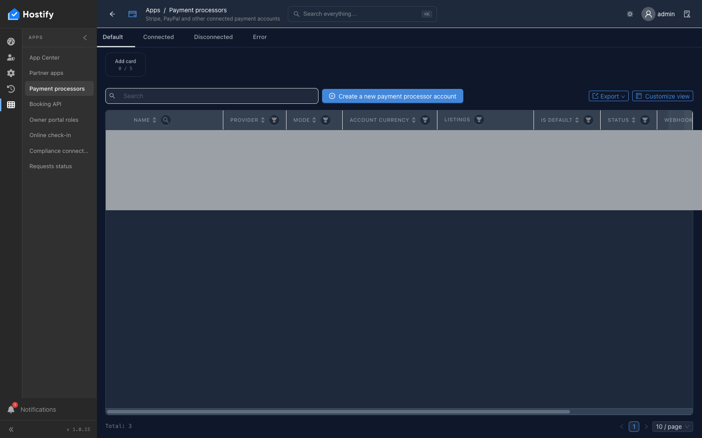


## Казус 28: bookingApiClients in the dark theme (/app/apps/bookingApiClients)

_Нов в този пуск._

**Какво се обърка**

```
Error: bookingApiClients: no part of the page stays light in the dark theme

expect(received).toEqual(expected) // deep equality

- Expected  - 1
+ Received  + 3

- Array []
+ Array [
+   "grid header ×16 (rgba(241, 245, 249, 0.04))",
+ ]
```
- неуспешна заявка: net::ERR_BLOCKED_BY_ORB — `https://hostify-apps.bioseek.eu/plugins/cardcom/logo.png`
- неуспешна заявка: net::ERR_BLOCKED_BY_ORB — `https://hostify-apps.bioseek.eu/plugins/beyond/logo.jpg`
- неуспешна заявка: net::ERR_BLOCKED_BY_ORB — `https://hostify-apps.bioseek.eu/plugins/key-data/logo.png`
- неуспешна заявка: net::ERR_BLOCKED_BY_ORB — `https://hostify-apps.bioseek.eu/plugins/doinn/logo.png`
- неуспешна заявка: net::ERR_BLOCKED_BY_ORB — `https://hostify-apps.bioseek.eu/plugins/turbosuite/logo.png`
- неуспешна заявка: net::ERR_BLOCKED_BY_ORB — `https://hostify-apps.bioseek.eu/plugins/akiles/logo.svg`
- неуспешна заявка: net::ERR_BLOCKED_BY_ORB — `https://hostify-apps.bioseek.eu/plugins/turnoverbnb/logo.png`
- неуспешна заявка: net::ERR_BLOCKED_BY_ORB — `https://hostify-apps.bioseek.eu/plugins/insuraguest/logo.png`
- неуспешна заявка: net::ERR_BLOCKED_BY_ORB — `https://hostify-apps.bioseek.eu/plugins/pricelabs/logo.svg`
- неуспешна заявка: net::ERR_BLOCKED_BY_ORB — `https://hostify-apps.bioseek.eu/plugins/remotelock/logo.png`

**Как да се възпроизведе**

1. Влез в https://hostify.bioseek.eu/app/ като суперадминистратор (alarm@mail.bg).
2. Меню: APPS › Booking API — https://hostify.bioseek.eu/app/apps/bookingApiClients
3. Спек `tests/e2e/008-platform-pages-dark.spec.ts`, проверка „bookingApiClients in the dark theme (/app/apps/bookingApiClients)“.
4. Developer tools › Network: заявките по-горе отговарят така.

**Скрийншоти**

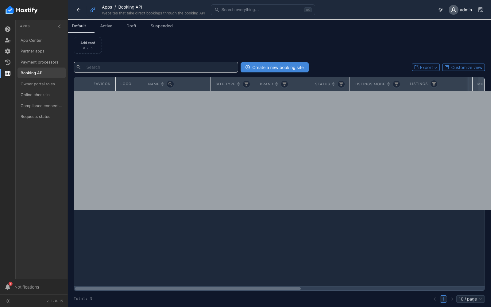


## Казус 29: ownerPortalRoles in the dark theme (/app/apps/ownerPortalRoles)

_Нов в този пуск._

**Какво се обърка**

```
Error: ownerPortalRoles: no part of the page stays light in the dark theme

expect(received).toEqual(expected) // deep equality

- Expected  - 1
+ Received  + 3

- Array []
+ Array [
+   "grid header ×7 (rgba(241, 245, 249, 0.04))",
+ ]
```
- неуспешна заявка: net::ERR_BLOCKED_BY_ORB — `https://hostify-apps.bioseek.eu/plugins/safely/logo.png`
- неуспешна заявка: net::ERR_BLOCKED_BY_ORB — `https://hostify-apps.bioseek.eu/plugins/akiles/logo.svg`
- неуспешна заявка: net::ERR_BLOCKED_BY_ORB — `https://hostify-apps.bioseek.eu/plugins/beyond/logo.jpg`
- неуспешна заявка: net::ERR_BLOCKED_BY_ORB — `https://hostify-apps.bioseek.eu/plugins/minut/logo.svg`
- неуспешна заявка: net::ERR_BLOCKED_BY_ORB — `https://hostify-apps.bioseek.eu/plugins/turbosuite/logo.png`
- неуспешна заявка: net::ERR_BLOCKED_BY_ORB — `https://hostify-apps.bioseek.eu/plugins/key-data/logo.png`
- неуспешна заявка: net::ERR_BLOCKED_BY_ORB — `https://hostify-apps.bioseek.eu/plugins/remotelock/logo.png`
- неуспешна заявка: net::ERR_BLOCKED_BY_ORB — `https://hostify-apps.bioseek.eu/plugins/insuraguest/logo.png`
- неуспешна заявка: net::ERR_BLOCKED_BY_ORB — `https://hostify-apps.bioseek.eu/plugins/hostify-locks/logo.svg`
- неуспешна заявка: net::ERR_BLOCKED_BY_ORB — `https://hostify-apps.bioseek.eu/plugins/doinn/logo.png`

**Как да се възпроизведе**

1. Влез в https://hostify.bioseek.eu/app/ като суперадминистратор (alarm@mail.bg).
2. Меню: APPS › Owner portal roles — https://hostify.bioseek.eu/app/apps/ownerPortalRoles
3. Спек `tests/e2e/008-platform-pages-dark.spec.ts`, проверка „ownerPortalRoles in the dark theme (/app/apps/ownerPortalRoles)“.
4. Developer tools › Network: заявките по-горе отговарят така.

**Скрийншоти**


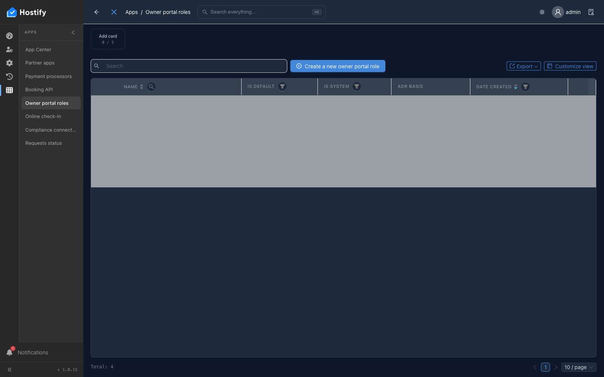


## Казус 30: checkinFormTemplates in the dark theme (/app/apps/checkinFormTemplates)

_Нов в този пуск._

**Какво се обърка**

```
Error: checkinFormTemplates: no part of the page stays light in the dark theme

expect(received).toEqual(expected) // deep equality

- Expected  - 1
+ Received  + 3

- Array []
+ Array [
+   "grid header ×9 (rgba(241, 245, 249, 0.04))",
+ ]
```
- неуспешна заявка: net::ERR_BLOCKED_BY_ORB — `https://hostify-apps.bioseek.eu/plugins/paypal/logo.png`
- неуспешна заявка: net::ERR_BLOCKED_BY_ORB — `https://hostify-apps.bioseek.eu/plugins/stripe/logo.png`
- неуспешна заявка: net::ERR_BLOCKED_BY_ORB — `https://hostify-apps.bioseek.eu/plugins/duve/logo.png`
- неуспешна заявка: net::ERR_BLOCKED_BY_ORB — `https://hostify-apps.bioseek.eu/plugins/chekin/logo.svg`
- неуспешна заявка: net::ERR_BLOCKED_BY_ORB — `https://hostify-apps.bioseek.eu/plugins/pricelabs/logo.svg`
- неуспешна заявка: net::ERR_BLOCKED_BY_ORB — `https://hostify-apps.bioseek.eu/plugins/turbosuite/logo.png`
- неуспешна заявка: net::ERR_BLOCKED_BY_ORB — `https://hostify-apps.bioseek.eu/plugins/doinn/logo.png`
- неуспешна заявка: net::ERR_BLOCKED_BY_ORB — `https://hostify-apps.bioseek.eu/plugins/safely/logo.png`
- неуспешна заявка: net::ERR_BLOCKED_BY_ORB — `https://hostify-apps.bioseek.eu/plugins/key-data/logo.png`
- неуспешна заявка: net::ERR_BLOCKED_BY_ORB — `https://hostify-apps.bioseek.eu/plugins/remotelock/logo.png`

**Как да се възпроизведе**

1. Влез в https://hostify.bioseek.eu/app/ като суперадминистратор (alarm@mail.bg).
2. Меню: APPS › Online check-in — https://hostify.bioseek.eu/app/apps/checkinFormTemplates
3. Спек `tests/e2e/008-platform-pages-dark.spec.ts`, проверка „checkinFormTemplates in the dark theme (/app/apps/checkinFormTemplates)“.
4. Developer tools › Network: заявките по-горе отговарят така.

**Скрийншоти**

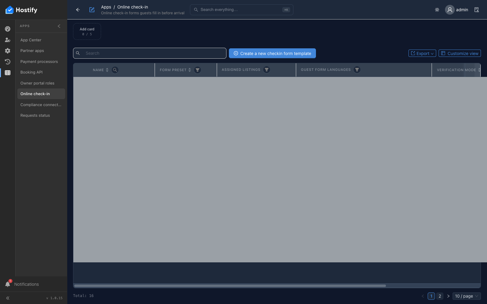


## Казус 31: complianceConnections in the dark theme (/app/apps/complianceConnections)

_Нов в този пуск._

**Какво се обърка**

```
Error: complianceConnections: no part of the page stays light in the dark theme

expect(received).toEqual(expected) // deep equality

- Expected  - 1
+ Received  + 3

- Array []
+ Array [
+   "grid header ×10 (rgba(241, 245, 249, 0.04))",
+ ]
```
- неуспешна заявка: net::ERR_BLOCKED_BY_ORB — `https://hostify-apps.bioseek.eu/plugins/doinn/logo.png`
- неуспешна заявка: net::ERR_BLOCKED_BY_ORB — `https://hostify-apps.bioseek.eu/plugins/key-data/logo.png`
- неуспешна заявка: net::ERR_BLOCKED_BY_ORB — `https://hostify-apps.bioseek.eu/plugins/minut/logo.svg`
- неуспешна заявка: net::ERR_BLOCKED_BY_ORB — `https://hostify-apps.bioseek.eu/plugins/cardcom/logo.png`
- неуспешна заявка: net::ERR_BLOCKED_BY_ORB — `https://hostify-apps.bioseek.eu/plugins/insuraguest/logo.png`
- неуспешна заявка: net::ERR_BLOCKED_BY_ORB — `https://hostify-apps.bioseek.eu/plugins/safely/logo.png`
- неуспешна заявка: net::ERR_BLOCKED_BY_ORB — `https://hostify-apps.bioseek.eu/plugins/pricelabs/logo.svg`
- неуспешна заявка: net::ERR_BLOCKED_BY_ORB — `https://hostify-apps.bioseek.eu/plugins/akiles/logo.svg`
- неуспешна заявка: net::ERR_BLOCKED_BY_ORB — `https://hostify-apps.bioseek.eu/plugins/beyond/logo.jpg`
- неуспешна заявка: net::ERR_BLOCKED_BY_ORB — `https://hostify-apps.bioseek.eu/plugins/turbosuite/logo.png`

**Как да се възпроизведе**

1. Влез в https://hostify.bioseek.eu/app/ като суперадминистратор (alarm@mail.bg).
2. Меню: APPS › Compliance connections — https://hostify.bioseek.eu/app/apps/complianceConnections
3. Спек `tests/e2e/008-platform-pages-dark.spec.ts`, проверка „complianceConnections in the dark theme (/app/apps/complianceConnections)“.
4. Developer tools › Network: заявките по-горе отговарят така.

**Скрийншоти**


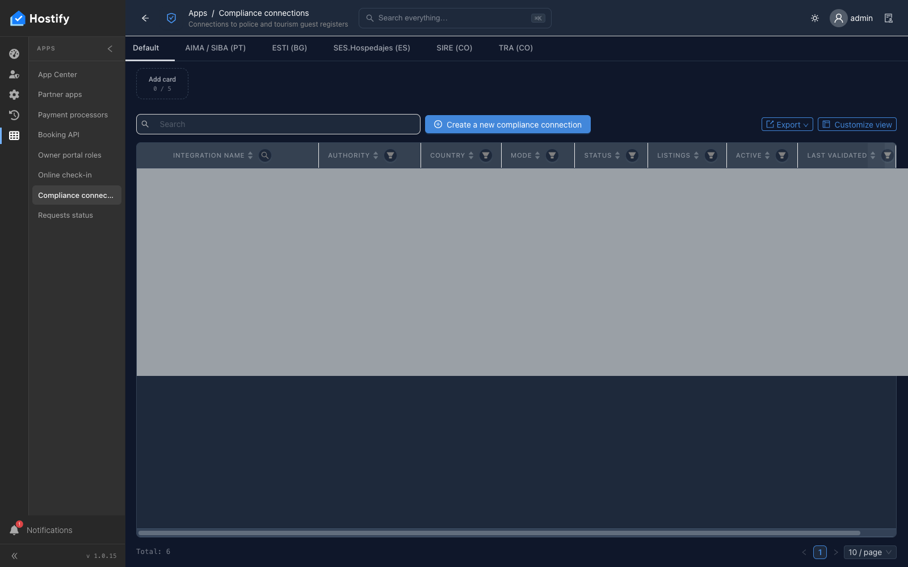


## Казус 32: complianceSubmissions in the dark theme (/app/apps/complianceSubmissions)

_Нов в този пуск._

**Какво се обърка**

```
Error: complianceSubmissions: no part of the page stays light in the dark theme

expect(received).toEqual(expected) // deep equality

- Expected  - 1
+ Received  + 3

- Array []
+ Array [
+   "grid header ×18 (rgba(241, 245, 249, 0.04))",
+ ]
```
- неуспешна заявка: net::ERR_BLOCKED_BY_ORB — `https://hostify-apps.bioseek.eu/plugins/stripe/logo.png`
- неуспешна заявка: net::ERR_BLOCKED_BY_ORB — `https://hostify-apps.bioseek.eu/plugins/superhog/logo.png`
- неуспешна заявка: net::ERR_BLOCKED_BY_ORB — `https://hostify-apps.bioseek.eu/plugins/duve/logo.png`
- неуспешна заявка: net::ERR_BLOCKED_BY_ORB — `https://hostify-apps.bioseek.eu/plugins/paypal/logo.png`
- неуспешна заявка: net::ERR_BLOCKED_BY_ORB — `https://hostify-apps.bioseek.eu/plugins/breezeway/logo.png`
- неуспешна заявка: net::ERR_BLOCKED_BY_ORB — `https://hostify-apps.bioseek.eu/plugins/chekin/logo.svg`
- неуспешна заявка: net::ERR_BLOCKED_BY_ORB — `https://hostify-apps.bioseek.eu/plugins/hostify-locks/logo.svg`
- неуспешна заявка: net::ERR_BLOCKED_BY_ORB — `https://hostify-apps.bioseek.eu/plugins/pricelabs/logo.svg`
- неуспешна заявка: net::ERR_BLOCKED_BY_ORB — `https://hostify-apps.bioseek.eu/plugins/cardcom/logo.png`
- неуспешна заявка: net::ERR_BLOCKED_BY_ORB — `https://hostify-apps.bioseek.eu/plugins/remotelock/logo.png`

**Как да се възпроизведе**

1. Влез в https://hostify.bioseek.eu/app/ като суперадминистратор (alarm@mail.bg).
2. Меню: APPS › Requests status — https://hostify.bioseek.eu/app/apps/complianceSubmissions
3. Спек `tests/e2e/008-platform-pages-dark.spec.ts`, проверка „complianceSubmissions in the dark theme (/app/apps/complianceSubmissions)“ — стъпките:
4. every column has a header and the actions column is the last one
5. Developer tools › Network: заявките по-горе отговарят така.

**Скрийншоти**

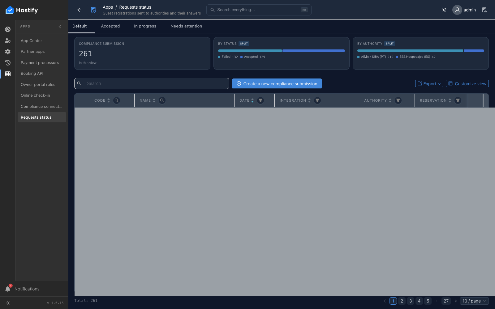


---

Какво проверява спекът: 008 — every page of the PLATFORM console in the DARK theme (the sweep of 005, the theme switched on first).
