# 011-account-pages-dark — тъмната тема на акаунта — всяка страница се отваря, оглежда се и нищо не остава светло

- Пуск: 2026-11-16_09-29-38 · Приложение: https://hostify.bioseek.eu · Версия: 1.0.15
- Спек: `tests/e2e/011-account-pages-dark.spec.ts`
- Казуси: 32 от 162 проверки

## Казус 1: inboxThreads in the dark theme (/app/inbox/inboxThreads)

_Нов в този пуск._

**Какво се обърка**

```
Error: inboxThreads: no part of the page stays light in the dark theme

expect(received).toEqual(expected) // deep equality

- Expected  - 1
+ Received  + 3

- Array []
+ Array [
+   "grid header ×19 (rgba(241, 245, 249, 0.04))",
+ ]
```

**Как да се възпроизведе**

1. Влез в https://hostify.bioseek.eu/app/ като администратор на акаунта (qa.admin@hostify-qa.test).
2. Меню: INBOX › Conversations — https://hostify.bioseek.eu/app/inbox/inboxThreads
3. Спек `tests/e2e/011-account-pages-dark.spec.ts`, проверка „inboxThreads in the dark theme (/app/inbox/inboxThreads)“.

**Скрийншоти**


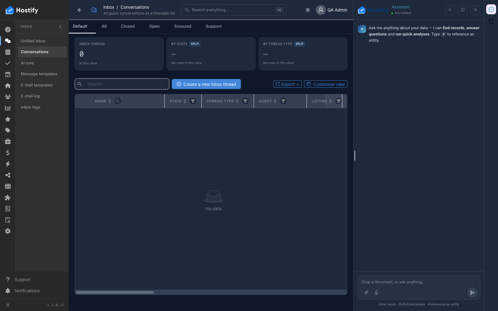


## Казус 2: inboxAiRuns in the dark theme (/app/inbox/inboxAiRuns)

_Нов в този пуск._

**Какво се обърка**

```
Error: inboxAiRuns: no part of the page stays light in the dark theme

expect(received).toEqual(expected) // deep equality

- Expected  - 1
+ Received  + 3

- Array []
+ Array [
+   "grid header ×13 (rgba(241, 245, 249, 0.04))",
+ ]
```

**Как да се възпроизведе**

1. Влез в https://hostify.bioseek.eu/app/ като администратор на акаунта (qa.admin@hostify-qa.test).
2. Меню: INBOX › AI runs — https://hostify.bioseek.eu/app/inbox/inboxAiRuns
3. Спек `tests/e2e/011-account-pages-dark.spec.ts`, проверка „inboxAiRuns in the dark theme (/app/inbox/inboxAiRuns)“.

**Скрийншоти**


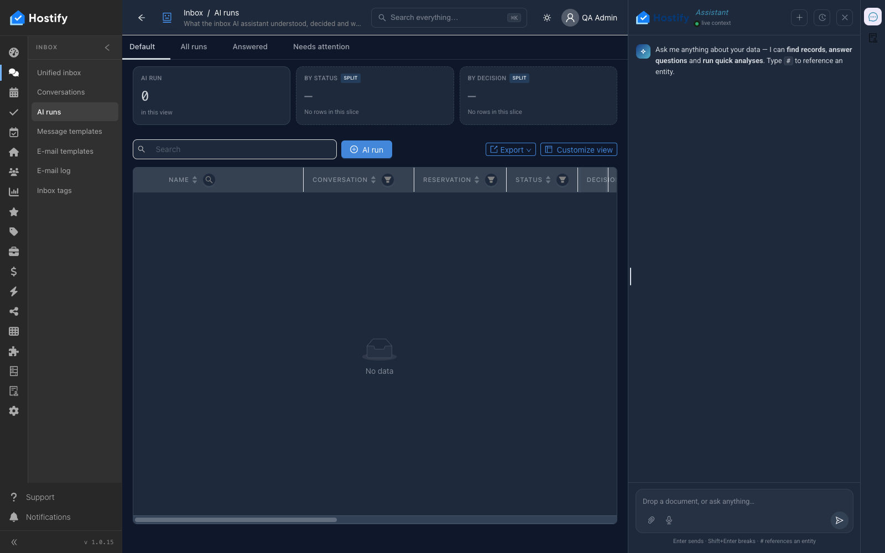


## Казус 3: messageTemplates in the dark theme (/app/inbox/messageTemplates)

_Нов в този пуск._

**Какво се обърка**

```
Error: messageTemplates: no part of the page stays light in the dark theme

expect(received).toEqual(expected) // deep equality

- Expected  - 1
+ Received  + 3

- Array []
+ Array [
+   "grid header ×8 (rgba(241, 245, 249, 0.04))",
+ ]
```

**Как да се възпроизведе**

1. Влез в https://hostify.bioseek.eu/app/ като администратор на акаунта (qa.admin@hostify-qa.test).
2. Меню: INBOX › Message templates — https://hostify.bioseek.eu/app/inbox/messageTemplates
3. Спек `tests/e2e/011-account-pages-dark.spec.ts`, проверка „messageTemplates in the dark theme (/app/inbox/messageTemplates)“.

**Скрийншоти**

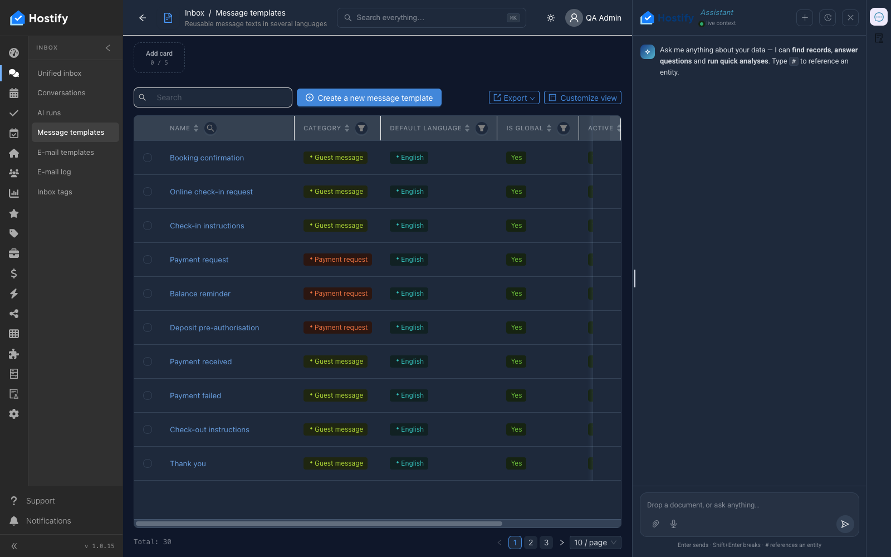


## Казус 4: emailTemplates in the dark theme (/app/inbox/emailTemplates)

_Нов в този пуск._

**Какво се обърка**

```
Error: emailTemplates: no part of the page stays light in the dark theme

expect(received).toEqual(expected) // deep equality

- Expected  - 1
+ Received  + 3

- Array []
+ Array [
+   "grid header ×9 (rgba(241, 245, 249, 0.04))",
+ ]
```

**Как да се възпроизведе**

1. Влез в https://hostify.bioseek.eu/app/ като администратор на акаунта (qa.admin@hostify-qa.test).
2. Меню: INBOX › E-mail templates — https://hostify.bioseek.eu/app/inbox/emailTemplates
3. Спек `tests/e2e/011-account-pages-dark.spec.ts`, проверка „emailTemplates in the dark theme (/app/inbox/emailTemplates)“.

**Скрийншоти**

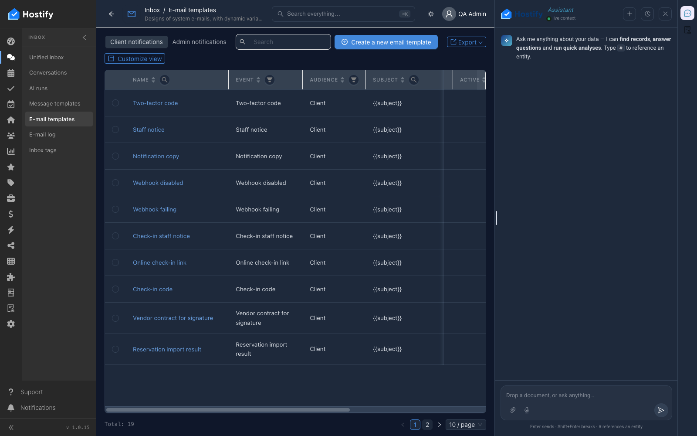


## Казус 5: emailLogs in the dark theme (/app/inbox/emailLogs)

_Нов в този пуск._

**Какво се обърка**

```
Error: emailLogs: no part of the page stays light in the dark theme

expect(received).toEqual(expected) // deep equality

- Expected  - 1
+ Received  + 3

- Array []
+ Array [
+   "grid header ×8 (rgba(241, 245, 249, 0.04))",
+ ]
```

**Как да се възпроизведе**

1. Влез в https://hostify.bioseek.eu/app/ като администратор на акаунта (qa.admin@hostify-qa.test).
2. Меню: INBOX › E-mail log — https://hostify.bioseek.eu/app/inbox/emailLogs
3. Спек `tests/e2e/011-account-pages-dark.spec.ts`, проверка „emailLogs in the dark theme (/app/inbox/emailLogs)“.

**Скрийншоти**


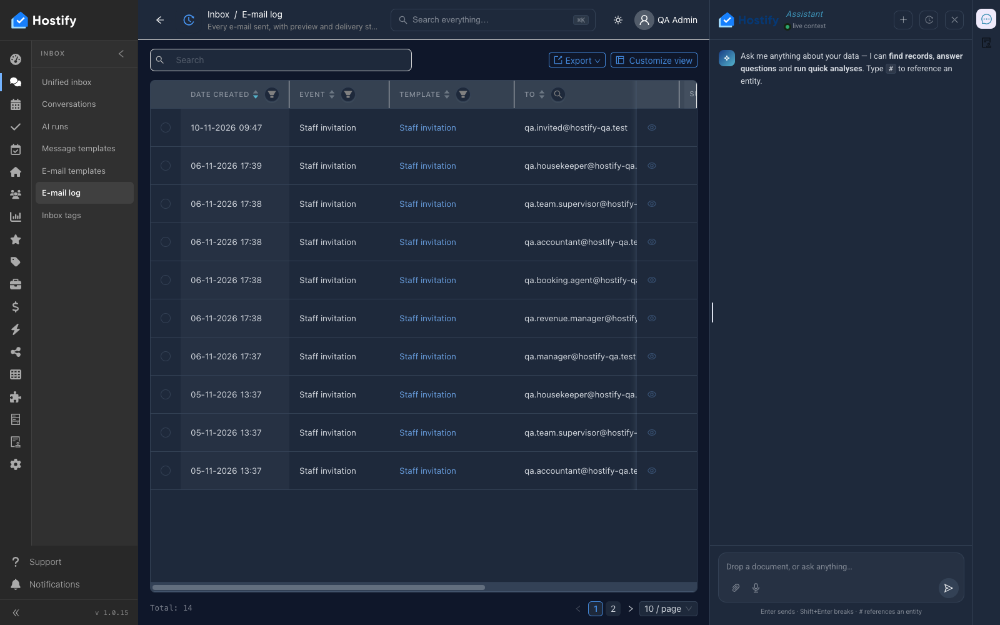


## Казус 6: inboxTags in the dark theme (/app/inbox/inboxTags)

_Нов в този пуск._

**Какво се обърка**

```
Error: inboxTags: no part of the page stays light in the dark theme

expect(received).toEqual(expected) // deep equality

- Expected  - 1
+ Received  + 3

- Array []
+ Array [
+   "grid header ×8 (rgba(241, 245, 249, 0.04))",
+ ]
```

**Как да се възпроизведе**

1. Влез в https://hostify.bioseek.eu/app/ като администратор на акаунта (qa.admin@hostify-qa.test).
2. Меню: INBOX › Inbox tags — https://hostify.bioseek.eu/app/inbox/inboxTags
3. Спек `tests/e2e/011-account-pages-dark.spec.ts`, проверка „inboxTags in the dark theme (/app/inbox/inboxTags)“.

**Скрийншоти**


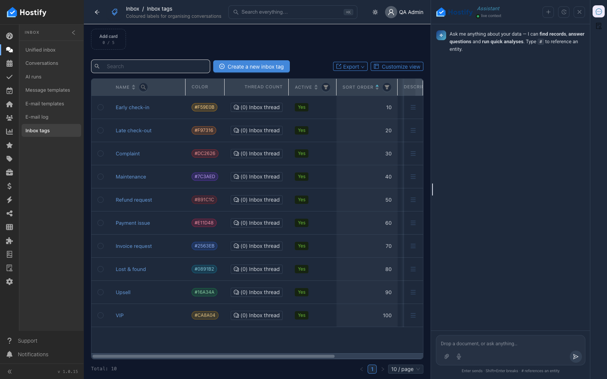


## Казус 7: tasks in the dark theme (/app/operations/tasks)

_Нов в този пуск._

**Какво се обърка**

```
Error: tasks: no part of the page stays light in the dark theme

expect(received).toEqual(expected) // deep equality

- Expected  - 1
+ Received  + 3

- Array []
+ Array [
+   "grid header ×17 (rgba(241, 245, 249, 0.04))",
+ ]
```

**Как да се възпроизведе**

1. Влез в https://hostify.bioseek.eu/app/ като администратор на акаунта (qa.admin@hostify-qa.test).
2. Меню: TASKS › Tasks — https://hostify.bioseek.eu/app/operations/tasks
3. Спек `tests/e2e/011-account-pages-dark.spec.ts`, проверка „tasks in the dark theme (/app/operations/tasks)“.

**Скрийншоти**

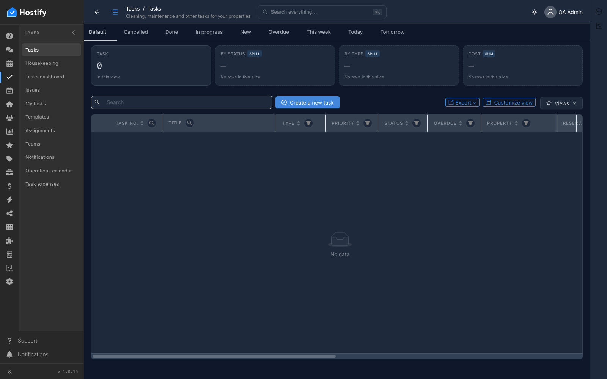


## Казус 8: housekeepingBoard in the dark theme (/app/operations/housekeepingBoard)

_Нов в този пуск._

**Какво се обърка**

```
Error: housekeepingBoard: no part of the page stays light in the dark theme

expect(received).toEqual(expected) // deep equality

- Expected  - 1
+ Received  + 3

- Array []
+ Array [
+   "grid header ×11 (rgba(241, 245, 249, 0.04))",
+ ]
```

**Как да се възпроизведе**

1. Влез в https://hostify.bioseek.eu/app/ като администратор на акаунта (qa.admin@hostify-qa.test).
2. Меню: TASKS › Housekeeping — https://hostify.bioseek.eu/app/operations/housekeepingBoard
3. Спек `tests/e2e/011-account-pages-dark.spec.ts`, проверка „housekeepingBoard in the dark theme (/app/operations/housekeepingBoard)“.

**Скрийншоти**

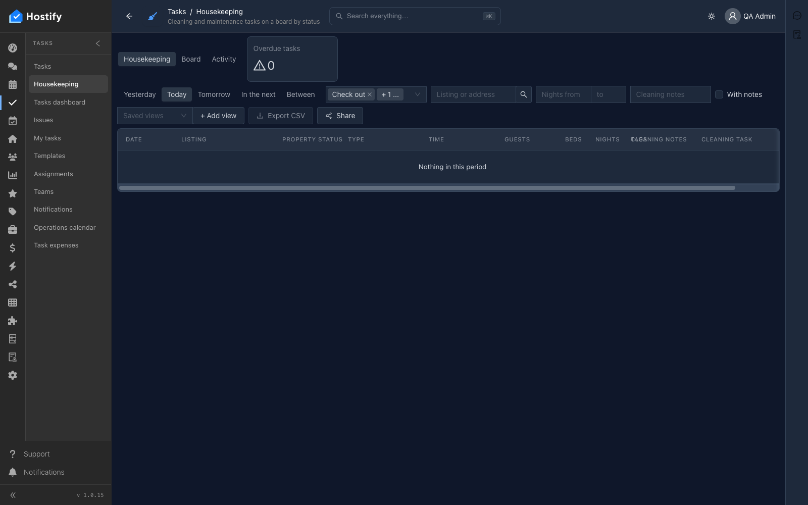


## Казус 9: taskIssues in the dark theme (/app/operations/taskIssues)

_Нов в този пуск._

**Какво се обърка**

```
Error: taskIssues: no part of the page stays light in the dark theme

expect(received).toEqual(expected) // deep equality

- Expected  - 1
+ Received  + 3

- Array []
+ Array [
+   "grid header ×15 (rgba(241, 245, 249, 0.04))",
+ ]
```

**Как да се възпроизведе**

1. Влез в https://hostify.bioseek.eu/app/ като администратор на акаунта (qa.admin@hostify-qa.test).
2. Меню: TASKS › Issues — https://hostify.bioseek.eu/app/operations/taskIssues
3. Спек `tests/e2e/011-account-pages-dark.spec.ts`, проверка „taskIssues in the dark theme (/app/operations/taskIssues)“.

**Скрийншоти**

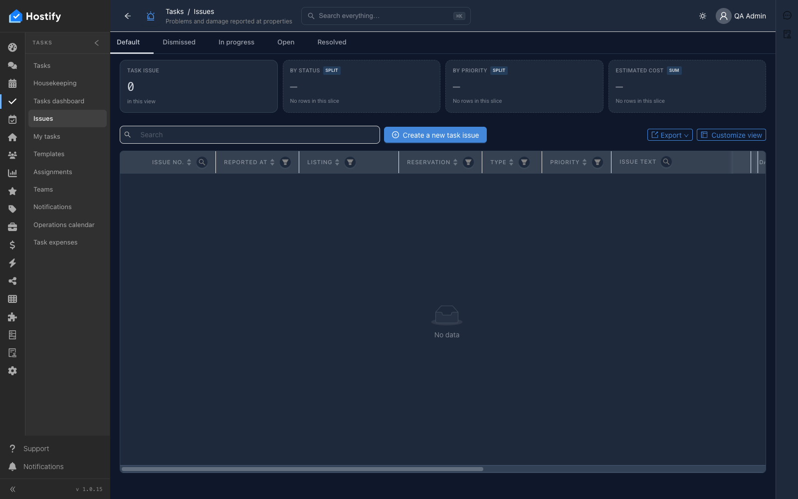


## Казус 10: taskTemplates in the dark theme (/app/operations/taskTemplates)

_Нов в този пуск._

**Какво се обърка**

```
Error: taskTemplates: no part of the page stays light in the dark theme

expect(received).toEqual(expected) // deep equality

- Expected  - 1
+ Received  + 3

- Array []
+ Array [
+   "grid header ×9 (rgba(241, 245, 249, 0.04))",
+ ]
```

**Как да се възпроизведе**

1. Влез в https://hostify.bioseek.eu/app/ като администратор на акаунта (qa.admin@hostify-qa.test).
2. Меню: TASKS › Templates — https://hostify.bioseek.eu/app/operations/taskTemplates
3. Спек `tests/e2e/011-account-pages-dark.spec.ts`, проверка „taskTemplates in the dark theme (/app/operations/taskTemplates)“.

**Скрийншоти**


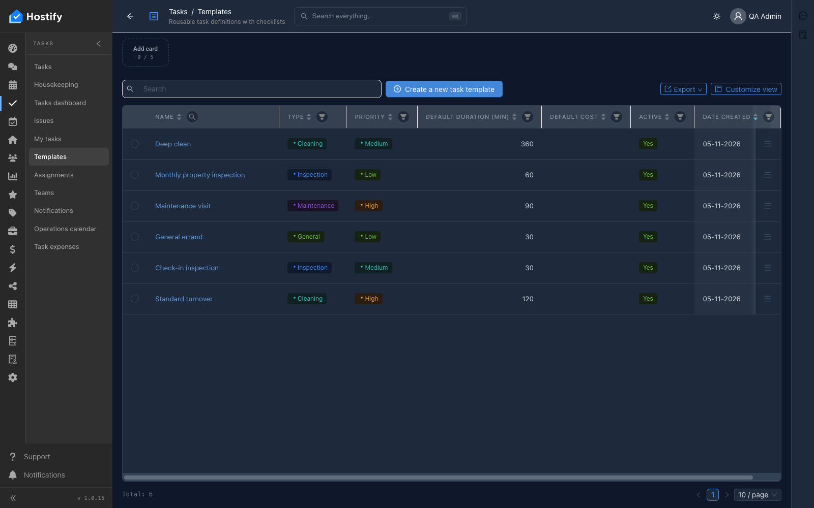


## Казус 11: defaultAssignments in the dark theme (/app/operations/defaultAssignments)

_Нов в този пуск._

**Какво се обърка**

```
Error: defaultAssignments: no part of the page stays light in the dark theme

expect(received).toEqual(expected) // deep equality

- Expected  - 1
+ Received  + 3

- Array []
+ Array [
+   "grid header ×9 (rgba(241, 245, 249, 0.04))",
+ ]
```

**Как да се възпроизведе**

1. Влез в https://hostify.bioseek.eu/app/ като администратор на акаунта (qa.admin@hostify-qa.test).
2. Меню: TASKS › Assignments — https://hostify.bioseek.eu/app/operations/defaultAssignments
3. Спек `tests/e2e/011-account-pages-dark.spec.ts`, проверка „defaultAssignments in the dark theme (/app/operations/defaultAssignments)“.

**Скрийншоти**

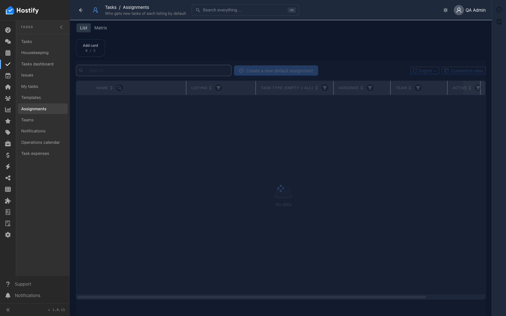
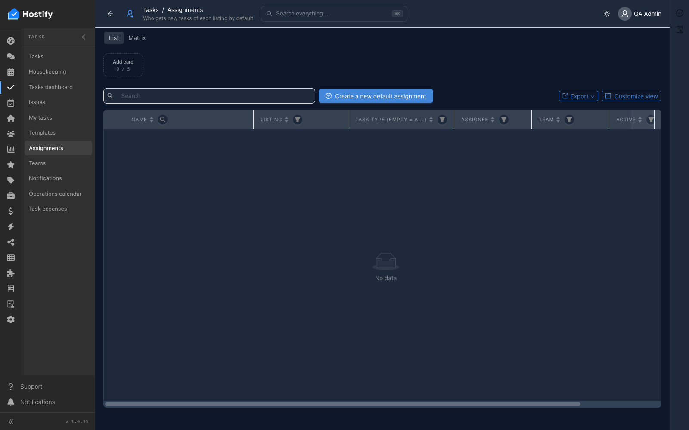


## Казус 12: taskTeams in the dark theme (/app/operations/taskTeams)

_Нов в този пуск._

**Какво се обърка**

```
Error: taskTeams: no part of the page stays light in the dark theme

expect(received).toEqual(expected) // deep equality

- Expected  - 1
+ Received  + 3

- Array []
+ Array [
+   "grid header ×9 (rgba(241, 245, 249, 0.04))",
+ ]
```

**Как да се възпроизведе**

1. Влез в https://hostify.bioseek.eu/app/ като администратор на акаунта (qa.admin@hostify-qa.test).
2. Меню: TASKS › Teams — https://hostify.bioseek.eu/app/operations/taskTeams
3. Спек `tests/e2e/011-account-pages-dark.spec.ts`, проверка „taskTeams in the dark theme (/app/operations/taskTeams)“.

**Скрийншоти**

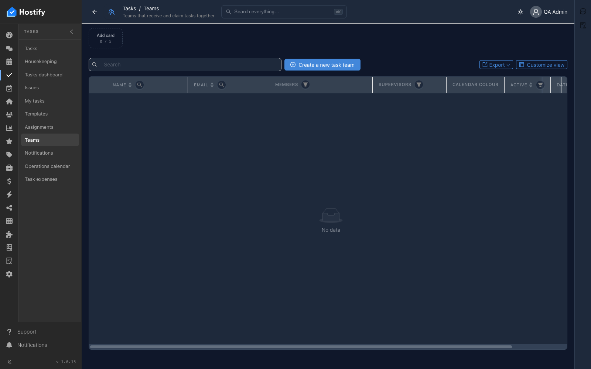


## Казус 13: taskNotificationSettings in the dark theme (/app/operations/taskNotificationSettings)

_Нов в този пуск._

**Какво се обърка**

```
Error: taskNotificationSettings: no part of the page stays light in the dark theme

expect(received).toEqual(expected) // deep equality

- Expected  - 1
+ Received  + 3

- Array []
+ Array [
+   "grid header ×10 (rgba(241, 245, 249, 0.04))",
+ ]
```

**Как да се възпроизведе**

1. Влез в https://hostify.bioseek.eu/app/ като администратор на акаунта (qa.admin@hostify-qa.test).
2. Меню: TASKS › Notifications — https://hostify.bioseek.eu/app/operations/taskNotificationSettings
3. Спек `tests/e2e/011-account-pages-dark.spec.ts`, проверка „taskNotificationSettings in the dark theme (/app/operations/taskNotificationSettings)“.

**Скрийншоти**


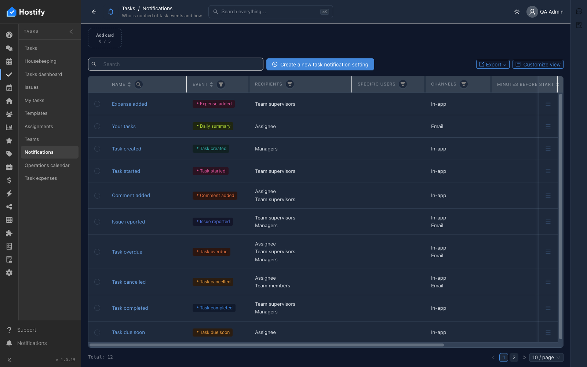


## Казус 14: taskExpenses in the dark theme (/app/operations/taskExpenses)

_Нов в този пуск._

**Какво се обърка**

```
Error: taskExpenses: no part of the page stays light in the dark theme

expect(received).toEqual(expected) // deep equality

- Expected  - 1
+ Received  + 3

- Array []
+ Array [
+   "grid header ×13 (rgba(241, 245, 249, 0.04))",
+ ]
```

**Как да се възпроизведе**

1. Влез в https://hostify.bioseek.eu/app/ като администратор на акаунта (qa.admin@hostify-qa.test).
2. Меню: TASKS › Task expenses — https://hostify.bioseek.eu/app/operations/taskExpenses
3. Спек `tests/e2e/011-account-pages-dark.spec.ts`, проверка „taskExpenses in the dark theme (/app/operations/taskExpenses)“.

**Скрийншоти**


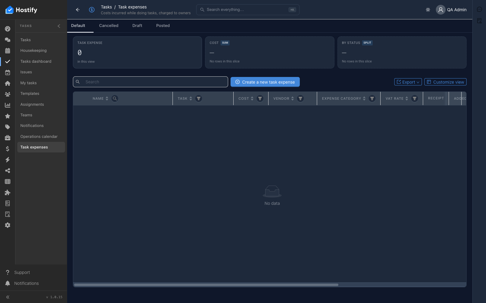


## Казус 15: reservations in the dark theme (/app/reservationsMenu/reservations)

_Нов в този пуск._

**Какво се обърка**

```
Error: reservations: no part of the page stays light in the dark theme

expect(received).toEqual(expected) // deep equality

- Expected  - 1
+ Received  + 3

- Array []
+ Array [
+   "grid header ×17 (rgba(241, 245, 249, 0.04))",
+ ]
```

**Как да се възпроизведе**

1. Влез в https://hostify.bioseek.eu/app/ като администратор на акаунта (qa.admin@hostify-qa.test).
2. Меню: RESERVATIONS › Reservations — https://hostify.bioseek.eu/app/reservationsMenu/reservations
3. Спек `tests/e2e/011-account-pages-dark.spec.ts`, проверка „reservations in the dark theme (/app/reservationsMenu/reservations)“.

**Скрийншоти**

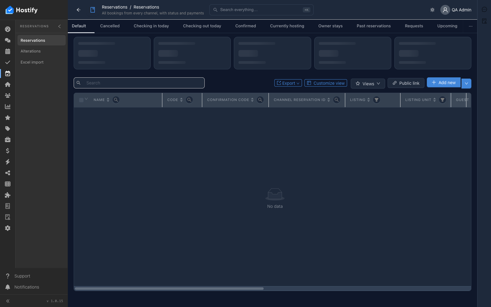
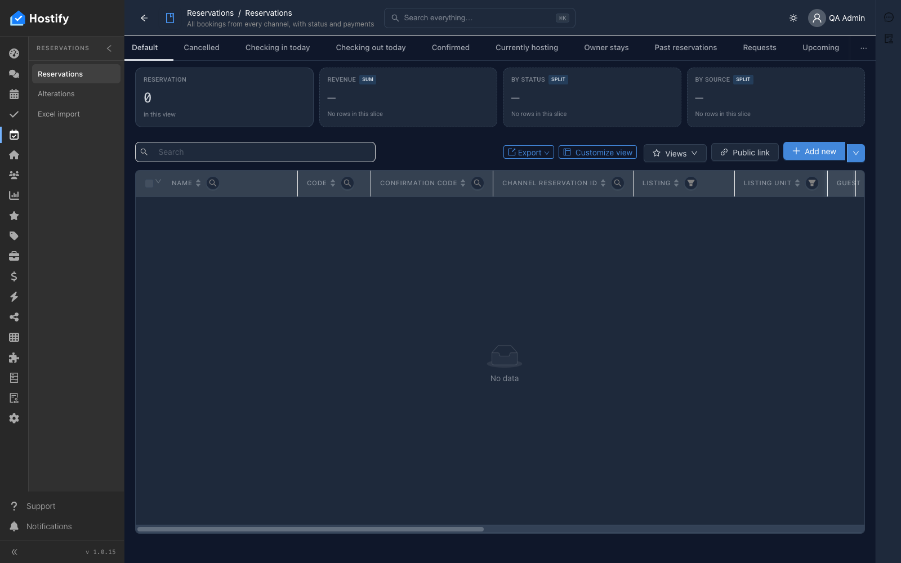


## Казус 16: reservationAlterations in the dark theme (/app/reservationsMenu/reservationAlterations)

_Нов в този пуск._

**Какво се обърка**

```
Error: reservationAlterations: no part of the page stays light in the dark theme

expect(received).toEqual(expected) // deep equality

- Expected  - 1
+ Received  + 3

- Array []
+ Array [
+   "grid header ×15 (rgba(241, 245, 249, 0.04))",
+ ]
```

**Как да се възпроизведе**

1. Влез в https://hostify.bioseek.eu/app/ като администратор на акаунта (qa.admin@hostify-qa.test).
2. Меню: RESERVATIONS › Alterations — https://hostify.bioseek.eu/app/reservationsMenu/reservationAlterations
3. Спек `tests/e2e/011-account-pages-dark.spec.ts`, проверка „reservationAlterations in the dark theme (/app/reservationsMenu/reservationAlterations)“.

**Скрийншоти**

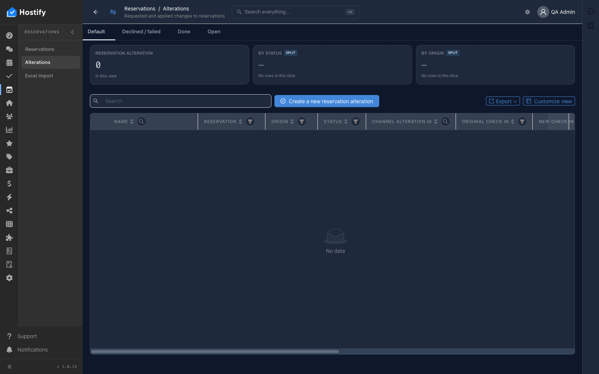
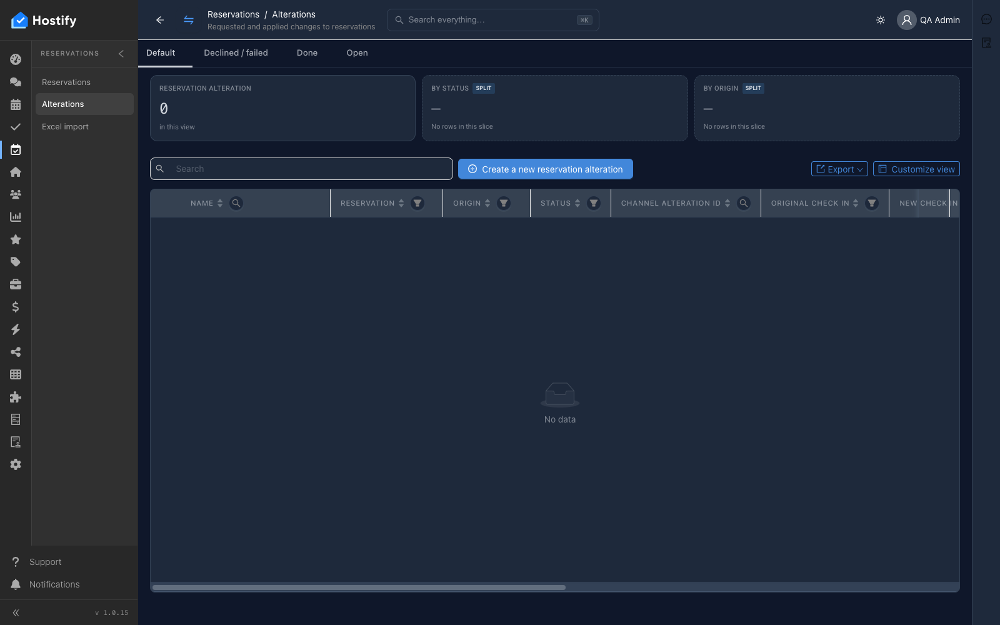


## Казус 17: reservationImports in the dark theme (/app/reservationsMenu/reservationImports)

_Нов в този пуск._

**Какво се обърка**

```
Error: reservationImports: no part of the page stays light in the dark theme

expect(received).toEqual(expected) // deep equality

- Expected  - 1
+ Received  + 3

- Array []
+ Array [
+   "grid header ×16 (rgba(241, 245, 249, 0.04))",
+ ]
```

**Как да се възпроизведе**

1. Влез в https://hostify.bioseek.eu/app/ като администратор на акаунта (qa.admin@hostify-qa.test).
2. Меню: RESERVATIONS › Excel import — https://hostify.bioseek.eu/app/reservationsMenu/reservationImports
3. Спек `tests/e2e/011-account-pages-dark.spec.ts`, проверка „reservationImports in the dark theme (/app/reservationsMenu/reservationImports)“.

**Скрийншоти**


## Казус 18: listings in the dark theme (/app/listingsMenu/listings)

_Нов в този пуск._

**Какво се обърка**

```
Error: listings: no part of the page stays light in the dark theme

expect(received).toEqual(expected) // deep equality

- Expected  - 1
+ Received  + 3

- Array []
+ Array [
+   "grid header ×28 (rgba(241, 245, 249, 0.04))",
+ ]
```

**Как да се възпроизведе**

1. Влез в https://hostify.bioseek.eu/app/ като администратор на акаунта (qa.admin@hostify-qa.test).
2. Меню: LISTINGS › Listings — https://hostify.bioseek.eu/app/listingsMenu/listings
3. Спек `tests/e2e/011-account-pages-dark.spec.ts`, проверка „listings in the dark theme (/app/listingsMenu/listings)“ — стъпките:
4. every column has a header and the actions column is the last one

**Скрийншоти**


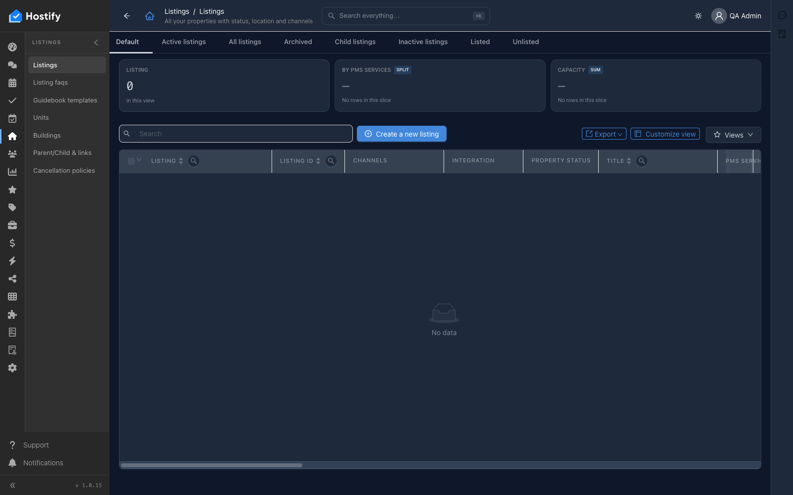


## Казус 19: listingFaqs in the dark theme (/app/listingsMenu/listingFaqs)

_Нов в този пуск._

**Какво се обърка**

```
Error: listingFaqs: no part of the page stays light in the dark theme

expect(received).toEqual(expected) // deep equality

- Expected  - 1
+ Received  + 3

- Array []
+ Array [
+   "grid header ×7 (rgba(241, 245, 249, 0.04))",
+ ]
```

**Как да се възпроизведе**

1. Влез в https://hostify.bioseek.eu/app/ като администратор на акаунта (qa.admin@hostify-qa.test).
2. Меню: LISTINGS › Listing faqs — https://hostify.bioseek.eu/app/listingsMenu/listingFaqs
3. Спек `tests/e2e/011-account-pages-dark.spec.ts`, проверка „listingFaqs in the dark theme (/app/listingsMenu/listingFaqs)“.

**Скрийншоти**

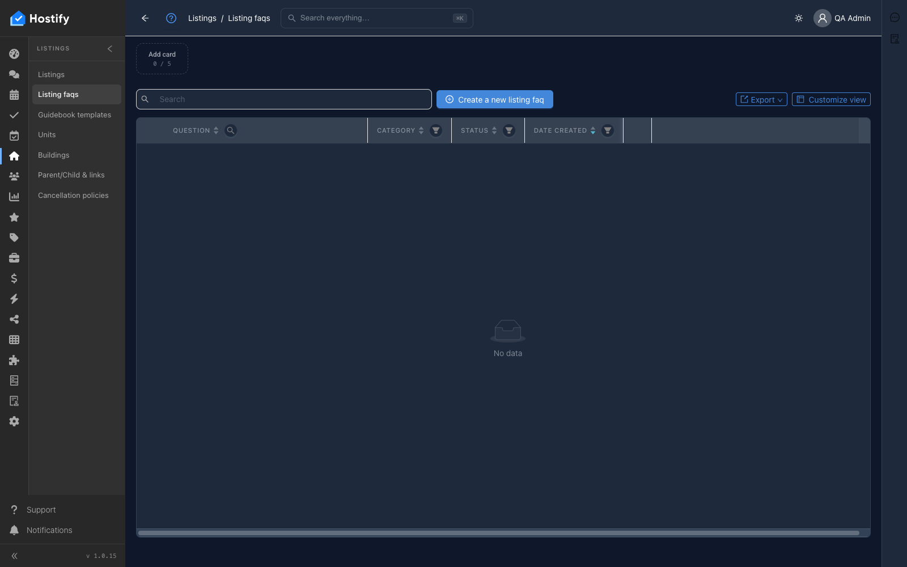


## Казус 20: guidebookTemplates in the dark theme (/app/listingsMenu/guidebookTemplates)

_Нов в този пуск._

**Какво се обърка**

```
Error: guidebookTemplates: no part of the page stays light in the dark theme

expect(received).toEqual(expected) // deep equality

- Expected  - 1
+ Received  + 3

- Array []
+ Array [
+   "grid header ×8 (rgba(241, 245, 249, 0.04))",
+ ]
```

**Как да се възпроизведе**

1. Влез в https://hostify.bioseek.eu/app/ като администратор на акаунта (qa.admin@hostify-qa.test).
2. Меню: LISTINGS › Guidebook templates — https://hostify.bioseek.eu/app/listingsMenu/guidebookTemplates
3. Спек `tests/e2e/011-account-pages-dark.spec.ts`, проверка „guidebookTemplates in the dark theme (/app/listingsMenu/guidebookTemplates)“.

**Скрийншоти**

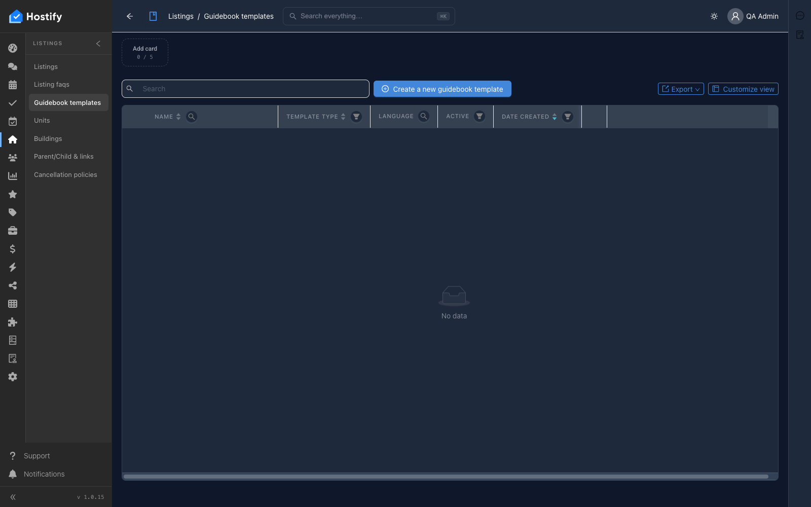


## Казус 21: listingUnits in the dark theme (/app/listingsMenu/listingUnits)

_Нов в този пуск._

**Какво се обърка**

```
Error: listingUnits: no part of the page stays light in the dark theme

expect(received).toEqual(expected) // deep equality

- Expected  - 1
+ Received  + 3

- Array []
+ Array [
+   "grid header ×13 (rgba(241, 245, 249, 0.04))",
+ ]
```

**Как да се възпроизведе**

1. Влез в https://hostify.bioseek.eu/app/ като администратор на акаунта (qa.admin@hostify-qa.test).
2. Меню: LISTINGS › Units — https://hostify.bioseek.eu/app/listingsMenu/listingUnits
3. Спек `tests/e2e/011-account-pages-dark.spec.ts`, проверка „listingUnits in the dark theme (/app/listingsMenu/listingUnits)“.

**Скрийншоти**

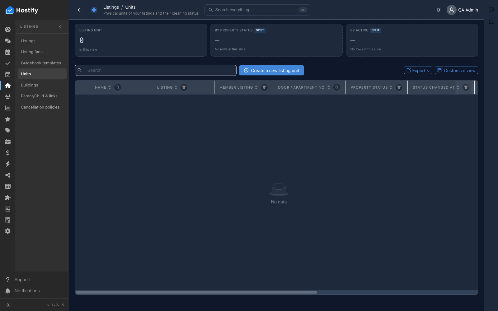


## Казус 22: listingBuildings in the dark theme (/app/listingsMenu/listingBuildings)

_Нов в този пуск._

**Какво се обърка**

```
Error: listingBuildings: no part of the page stays light in the dark theme

expect(received).toEqual(expected) // deep equality

- Expected  - 1
+ Received  + 3

- Array []
+ Array [
+   "grid header ×8 (rgba(241, 245, 249, 0.04))",
+ ]
```

**Как да се възпроизведе**

1. Влез в https://hostify.bioseek.eu/app/ като администратор на акаунта (qa.admin@hostify-qa.test).
2. Меню: LISTINGS › Buildings — https://hostify.bioseek.eu/app/listingsMenu/listingBuildings
3. Спек `tests/e2e/011-account-pages-dark.spec.ts`, проверка „listingBuildings in the dark theme (/app/listingsMenu/listingBuildings)“.

**Скрийншоти**

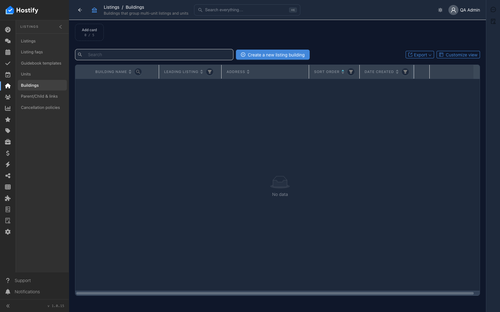


## Казус 23: listingLinks in the dark theme (/app/listingsMenu/listingLinks)

_Нов в този пуск._

**Какво се обърка**

```
Error: listingLinks: no part of the page stays light in the dark theme

expect(received).toEqual(expected) // deep equality

- Expected  - 1
+ Received  + 3

- Array []
+ Array [
+   "grid header ×14 (rgba(241, 245, 249, 0.04))",
+ ]
```

**Как да се възпроизведе**

1. Влез в https://hostify.bioseek.eu/app/ като администратор на акаунта (qa.admin@hostify-qa.test).
2. Меню: LISTINGS › Parent/Child & links — https://hostify.bioseek.eu/app/listingsMenu/listingLinks
3. Спек `tests/e2e/011-account-pages-dark.spec.ts`, проверка „listingLinks in the dark theme (/app/listingsMenu/listingLinks)“.

**Скрийншоти**


## Казус 24: listingPolicies in the dark theme (/app/listingsMenu/listingPolicies)

_Нов в този пуск._

**Какво се обърка**

```
Error: listingPolicies: no part of the page stays light in the dark theme

expect(received).toEqual(expected) // deep equality

- Expected  - 1
+ Received  + 3

- Array []
+ Array [
+   "grid header ×10 (rgba(241, 245, 249, 0.04))",
+ ]
```

**Как да се възпроизведе**

1. Влез в https://hostify.bioseek.eu/app/ като администратор на акаунта (qa.admin@hostify-qa.test).
2. Меню: LISTINGS › Cancellation policies — https://hostify.bioseek.eu/app/listingsMenu/listingPolicies
3. Спек `tests/e2e/011-account-pages-dark.spec.ts`, проверка „listingPolicies in the dark theme (/app/listingsMenu/listingPolicies)“.

**Скрийншоти**

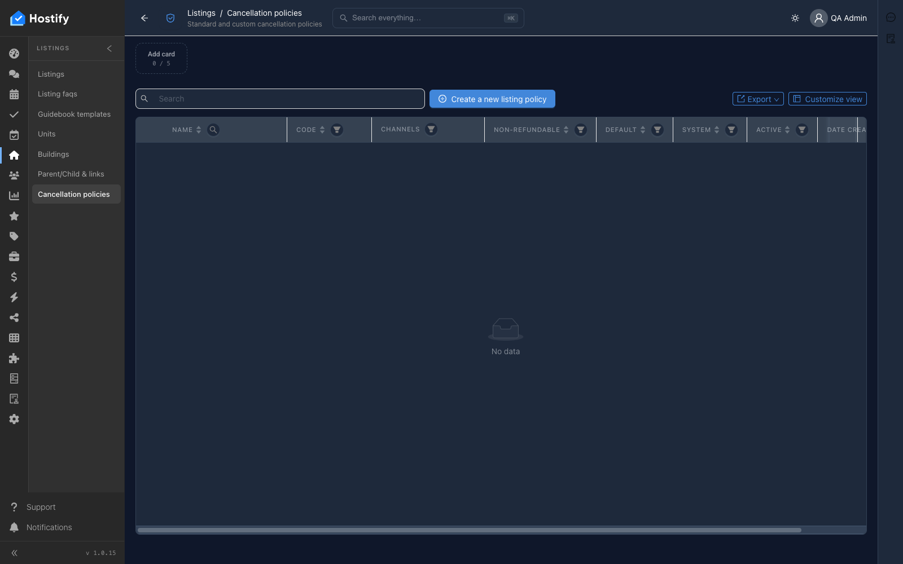


## Казус 25: guests in the dark theme (/app/guests)

_Нов в този пуск._

**Какво се обърка**

```
Error: guests: no part of the page stays light in the dark theme

expect(received).toEqual(expected) // deep equality

- Expected  - 1
+ Received  + 3

- Array []
+ Array [
+   "grid header ×13 (rgba(241, 245, 249, 0.04))",
+ ]
```

**Как да се възпроизведе**

1. Влез в https://hostify.bioseek.eu/app/ като администратор на акаунта (qa.admin@hostify-qa.test).
2. Меню: Guests — https://hostify.bioseek.eu/app/guests
3. Спек `tests/e2e/011-account-pages-dark.spec.ts`, проверка „guests in the dark theme (/app/guests)“.

**Скрийншоти**

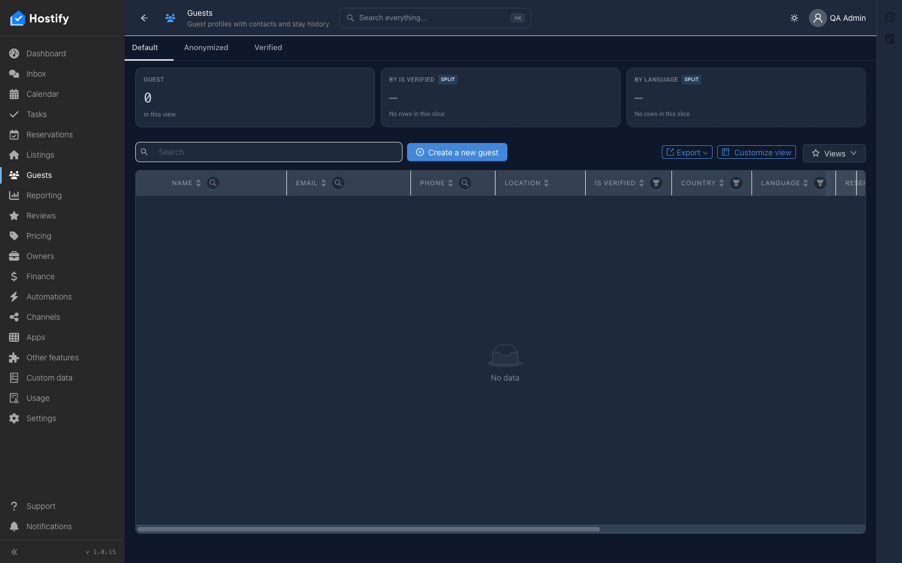


## Казус 26: reportingHousekeeping in the dark theme (/app/reporting/reportingHousekeeping)

_Нов в този пуск._

**Какво се обърка**

```
Error: reportingHousekeeping: no part of the page stays light in the dark theme

expect(received).toEqual(expected) // deep equality

- Expected  - 1
+ Received  + 3

- Array []
+ Array [
+   "grid header ×11 (rgba(241, 245, 249, 0.04))",
+ ]
```

**Как да се възпроизведе**

1. Влез в https://hostify.bioseek.eu/app/ като администратор на акаунта (qa.admin@hostify-qa.test).
2. Меню: REPORTING › Housekeeping — https://hostify.bioseek.eu/app/reporting/reportingHousekeeping
3. Спек `tests/e2e/011-account-pages-dark.spec.ts`, проверка „reportingHousekeeping in the dark theme (/app/reporting/reportingHousekeeping)“.

**Скрийншоти**


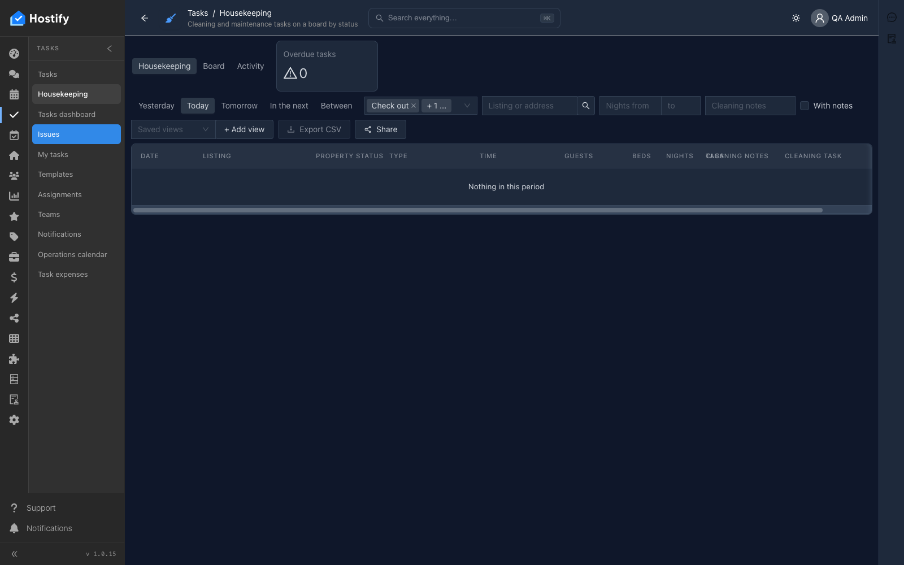


## Казус 27: channelHealth in the dark theme (/app/reporting/channelHealth)

_Нов в този пуск._

**Какво се обърка**

```
Error: the column "(no key)" has a header — the columns: Name | Channel | Connection | Last sync at | Errors (24 h) | Listings | (no header: no key) | Last error message

expect(received).not.toBe(expected) // Object.is equality

Expected: not ""
```

**Как да се възпроизведе**

1. Влез в https://hostify.bioseek.eu/app/ като администратор на акаунта (qa.admin@hostify-qa.test).
2. Меню: REPORTING › Channel Health — https://hostify.bioseek.eu/app/reporting/channelHealth
3. Спек `tests/e2e/011-account-pages-dark.spec.ts`, проверка „channelHealth in the dark theme (/app/reporting/channelHealth)“ — стъпките:
4. every column has a header and the actions column is the last one

**Скрийншоти**

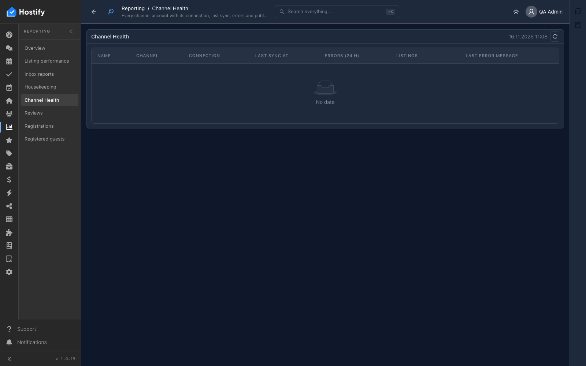


## Казус 28: reportingReviews in the dark theme (/app/reporting/reportingReviews)

_Нов в този пуск._

**Какво се обърка**

```
Error: reportingReviews: no part of the page stays light in the dark theme

expect(received).toEqual(expected) // deep equality

- Expected  - 1
+ Received  + 3

- Array []
+ Array [
+   "grid header ×15 (rgba(241, 245, 249, 0.04))",
+ ]
```

**Как да се възпроизведе**

1. Влез в https://hostify.bioseek.eu/app/ като администратор на акаунта (qa.admin@hostify-qa.test).
2. Меню: REPORTING › Reviews — https://hostify.bioseek.eu/app/reporting/reportingReviews
3. Спек `tests/e2e/011-account-pages-dark.spec.ts`, проверка „reportingReviews in the dark theme (/app/reporting/reportingReviews)“.

**Скрийншоти**

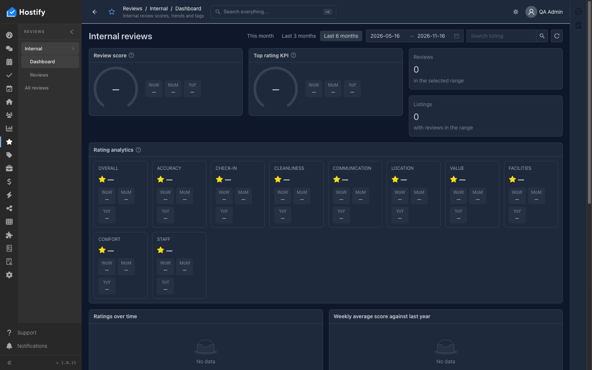


## Казус 29: guestCheckins in the dark theme (/app/reporting/guestCheckins)

_Нов в този пуск._

**Какво се обърка**

```
Error: guestCheckins: no part of the page stays light in the dark theme

expect(received).toEqual(expected) // deep equality

- Expected  - 1
+ Received  + 3

- Array []
+ Array [
+   "grid header ×14 (rgba(241, 245, 249, 0.04))",
+ ]
```

**Как да се възпроизведе**

1. Влез в https://hostify.bioseek.eu/app/ като администратор на акаунта (qa.admin@hostify-qa.test).
2. Меню: REPORTING › Registrations — https://hostify.bioseek.eu/app/reporting/guestCheckins
3. Спек `tests/e2e/011-account-pages-dark.spec.ts`, проверка „guestCheckins in the dark theme (/app/reporting/guestCheckins)“.

**Скрийншоти**


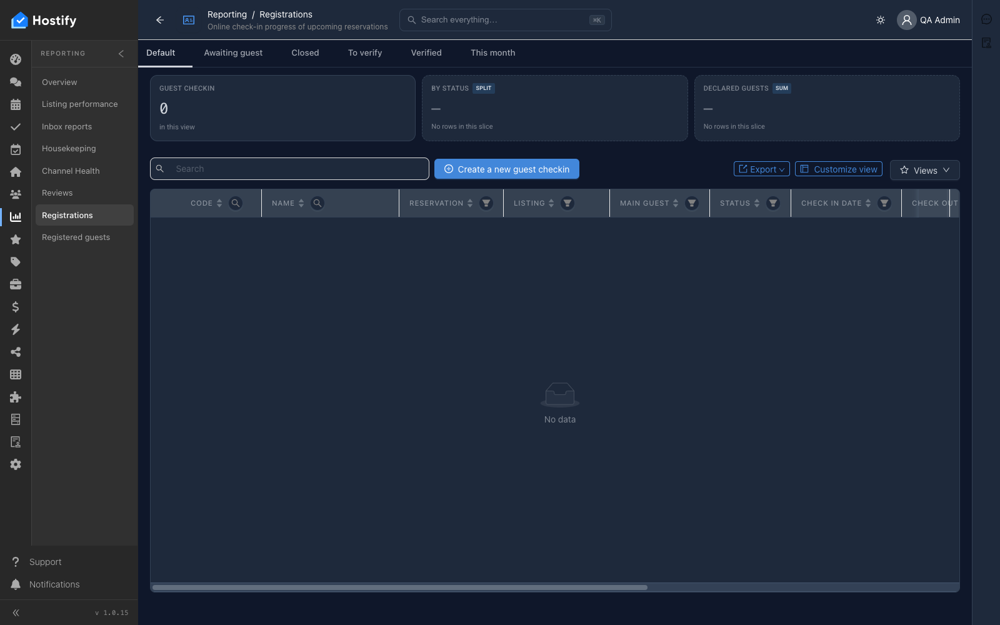


## Казус 30: checkinGuests in the dark theme (/app/reporting/checkinGuests)

_Нов в този пуск._

**Какво се обърка**

```
Error: checkinGuests: no part of the page stays light in the dark theme

expect(received).toEqual(expected) // deep equality

- Expected  - 1
+ Received  + 3

- Array []
+ Array [
+   "grid header ×13 (rgba(241, 245, 249, 0.04))",
+ ]
```

**Как да се възпроизведе**

1. Влез в https://hostify.bioseek.eu/app/ като администратор на акаунта (qa.admin@hostify-qa.test).
2. Меню: REPORTING › Registered guests — https://hostify.bioseek.eu/app/reporting/checkinGuests
3. Спек `tests/e2e/011-account-pages-dark.spec.ts`, проверка „checkinGuests in the dark theme (/app/reporting/checkinGuests)“.

**Скрийншоти**

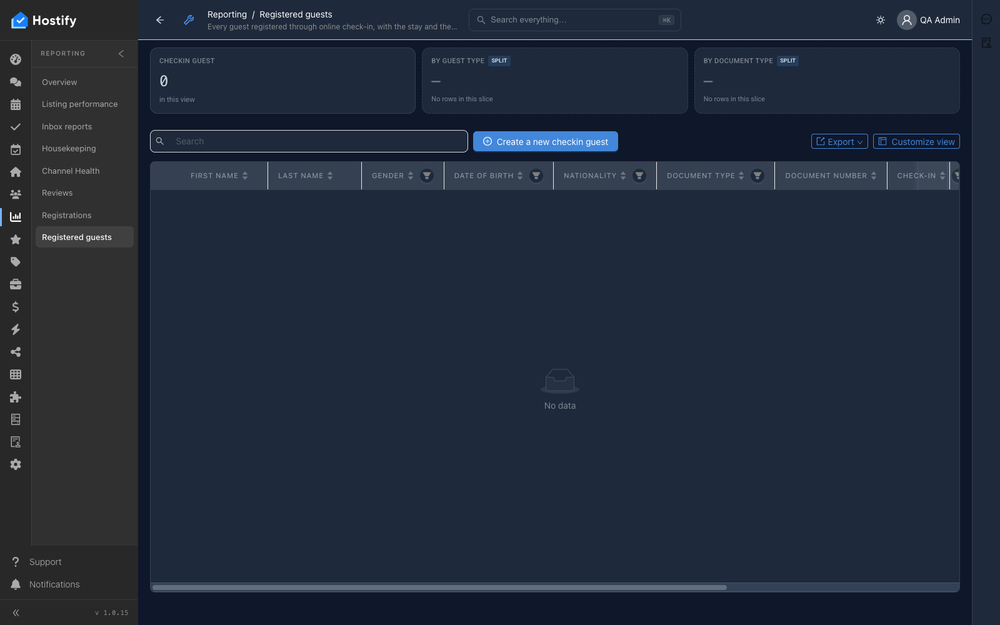


## Казус 31: pricingBasePrice in the dark theme (/app/pricing/pricingBasePrice)

_Нов в този пуск._

**Какво се обърка**

```
Error: pricingBasePrice: no part of the page stays light in the dark theme

expect(received).toEqual(expected) // deep equality

- Expected  - 1
+ Received  + 3

- Array []
+ Array [
+   "grid header ×10 (rgba(241, 245, 249, 0.04))",
+ ]
```

**Как да се възпроизведе**

1. Влез в https://hostify.bioseek.eu/app/ като администратор на акаунта (qa.admin@hostify-qa.test).
2. Меню: PRICING › Base Price — https://hostify.bioseek.eu/app/pricing/pricingBasePrice
3. Спек `tests/e2e/011-account-pages-dark.spec.ts`, проверка „pricingBasePrice in the dark theme (/app/pricing/pricingBasePrice)“.

**Скрийншоти**


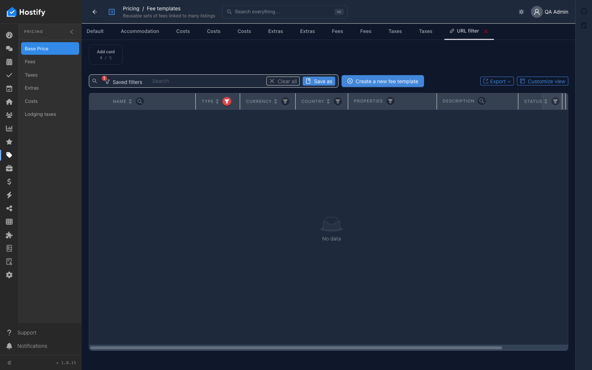


## Казус 32: pricingFees in the dark theme (/app/pricing/pricingFees)

_Нов в този пуск._

**Какво се обърка**

```
TimeoutError: page.goto: Timeout 60000ms exceeded.
Call log:
  - navigating to "https://hostify.bioseek.eu/app/", waiting until "domcontentloaded"

```

**Как да се възпроизведе**

1. Спек `tests/e2e/011-account-pages-dark.spec.ts`, проверка „pricingFees in the dark theme (/app/pricing/pricingFees)“.

---

Какво проверява спекът: 011 — every page of the ACCOUNT menu in the DARK theme (the sweep of 010, the theme switched on first).
