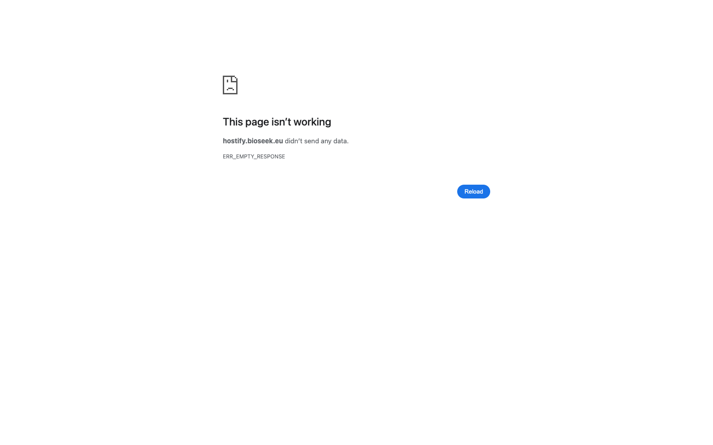

# 101-navbar-support-assistant — Support в лявото меню отваря асистента (не стария месинджър) — за администратора и за booking agent

- Пуск: 2026-11-16_09-29-38 · Приложение: https://hostify.bioseek.eu · Версия: 1.0.15
- Спек: `tests/e2e/101-navbar-support-assistant.spec.ts`
- Казуси: 2 от 2 проверки

## Казус 1: the administrator: „Support“ opens the assistant on the Dashboard and on another page

_Нов в този пуск._

**Какво се обърка**

```
Error: page.goto: net::ERR_EMPTY_RESPONSE at https://hostify.bioseek.eu/app/
Call log:
  - navigating to "https://hostify.bioseek.eu/app/", waiting until "domcontentloaded"

```
- неуспешна заявка: net::ERR_EMPTY_RESPONSE — `/app/`

**Как да се възпроизведе**

1. Влез в https://hostify.bioseek.eu/app/ като администратор на акаунта (qa.admin@hostify-qa.test).
2. Спек `tests/e2e/101-navbar-support-assistant.spec.ts`, проверка „the administrator: „Support“ opens the assistant on the Dashboard and on another page“.
3. Developer tools › Network: заявките по-горе отговарят така.

**Скрийншоти**




## Казус 2: a booking agent: „Support“ opens the assistant

_Нов в този пуск._

**Какво се обърка**

```
Error: expect(locator).toBeVisible() failed

Locator: locator('[data-test="login-input-email"]')
Expected: visible
Timeout: 45000ms
Error: element(s) not found

Call log:
  - Expect "toBeVisible" with timeout 45000ms
  - waiting for locator('[data-test="login-input-email"]')

```
- неуспешна заявка: net::ERR_CONNECTION_CLOSED — `/app/static/css/main.b9c80884.css`
- неуспешна заявка: net::ERR_EMPTY_RESPONSE — `/app/locales/en/_bundle.json`
- конзола: Localization bundle load failed; falling back to per-namespace loading TypeError: Failed to fetch — `/app/static/js/main.c75d4ea9.js`
- неуспешна заявка: net::ERR_NAME_NOT_RESOLVED — `/app/locales/en/gridDecorator.json`
- неуспешна заявка: net::ERR_NAME_NOT_RESOLVED — `/app/locales/en/taskManagement.json`
- неуспешна заявка: net::ERR_NAME_NOT_RESOLVED — `/app/locales/en/address.json`
- неуспешна заявка: net::ERR_NAME_NOT_RESOLVED — `/app/locales/en/beforeLeavePage.json`
- неуспешна заявка: net::ERR_NAME_NOT_RESOLVED — `/app/locales/en/changelog.json`
- неуспешна заявка: net::ERR_NAME_NOT_RESOLVED — `/app/locales/en/characteristicFilter.json`
- неуспешна заявка: net::ERR_NAME_NOT_RESOLVED — `/app/locales/en/common.json`

**Как да се възпроизведе**

1. Влез в https://hostify.bioseek.eu/app/ като bookingAgent на акаунта (qa.booking.agent@hostify-qa.test).
2. Страница: https://hostify.bioseek.eu/app/
3. Спек `tests/e2e/101-navbar-support-assistant.spec.ts`, проверка „a booking agent: „Support“ opens the assistant“.
4. Developer tools › Network: заявките по-горе отговарят така.
5. Developer tools › Console показва грешките по-горе.

**Скрийншоти**


---

Какво проверява спекът: 101 — „Support“ of the left menu opens the assistant (1.0.7: the separate support messenger is gone).
