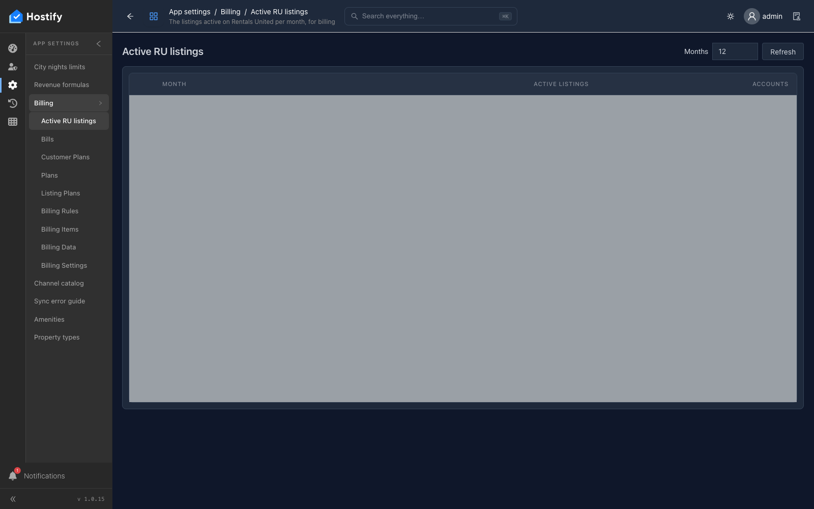
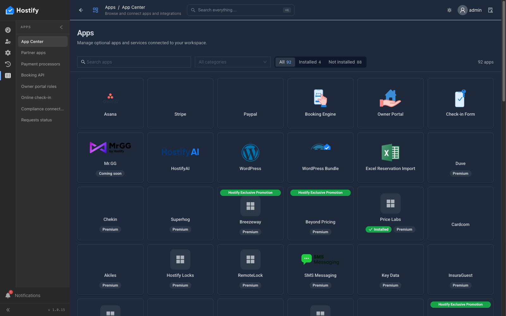
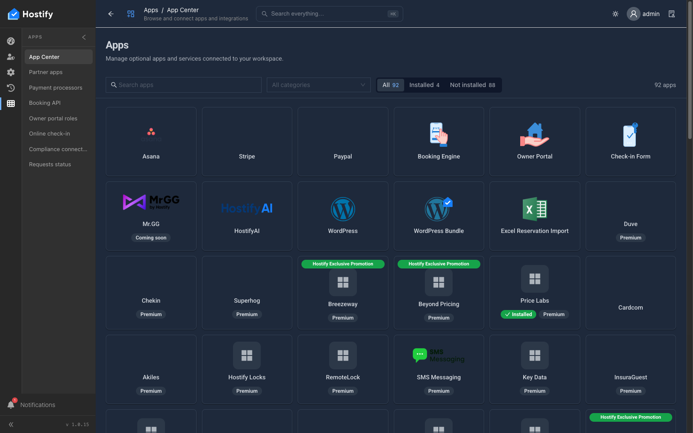
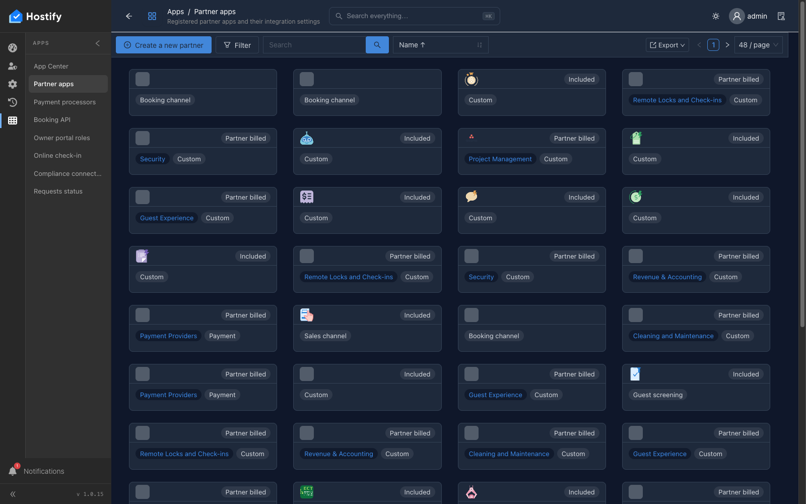
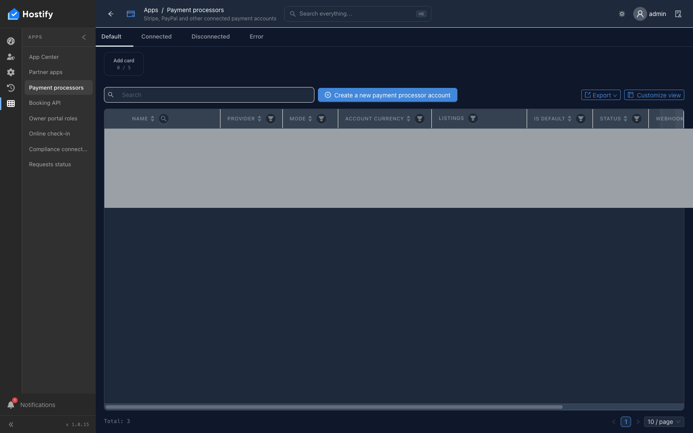
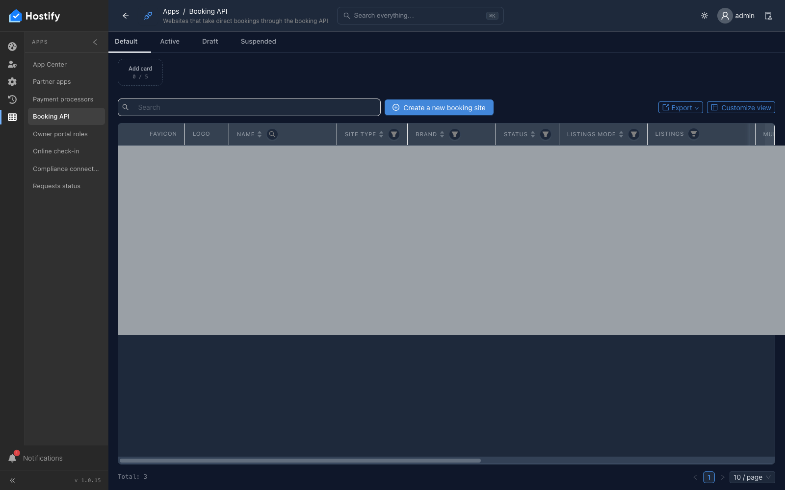
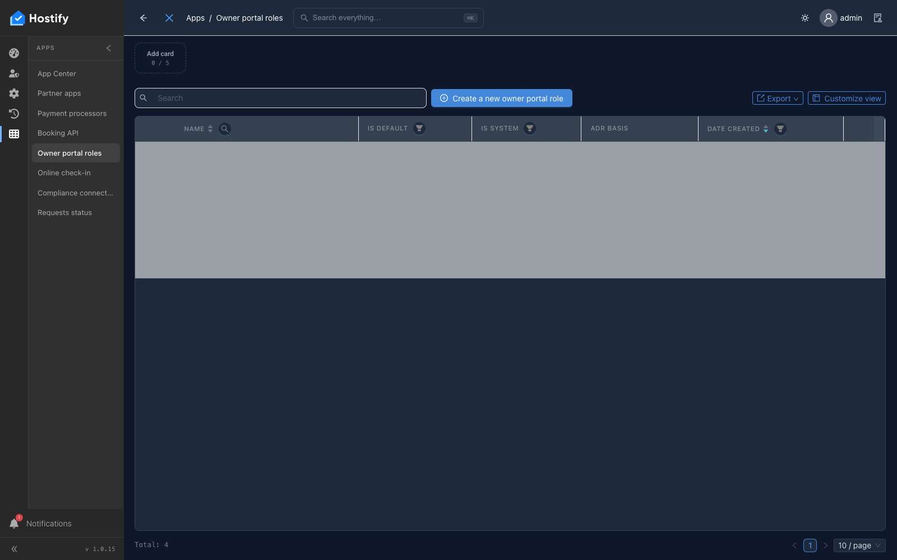
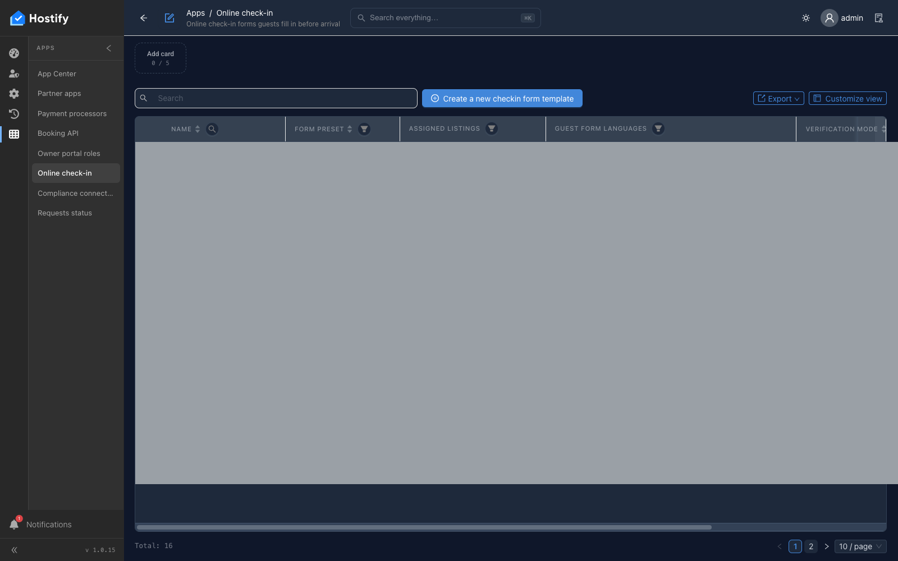
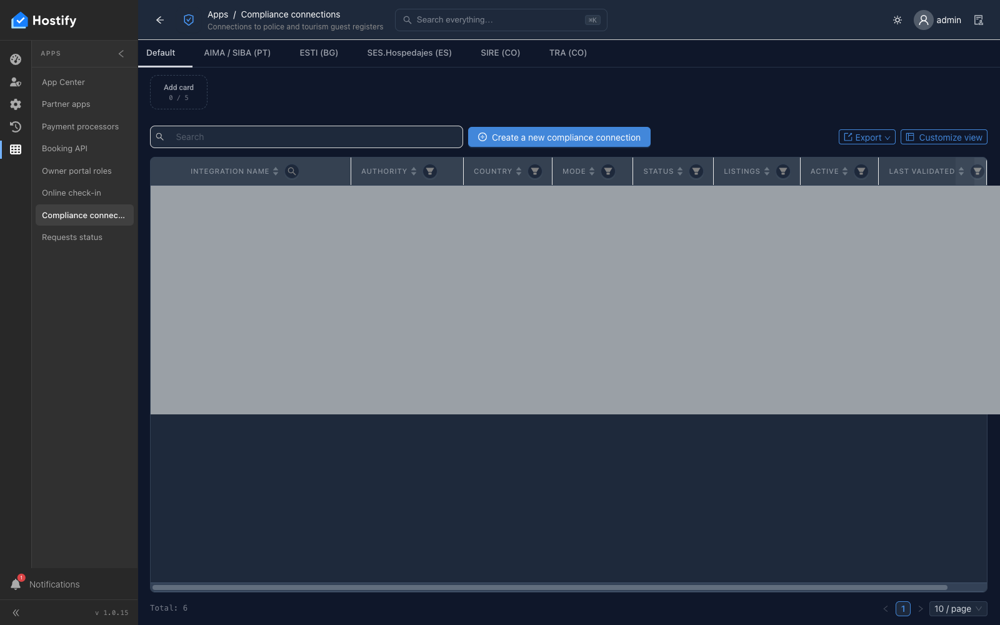
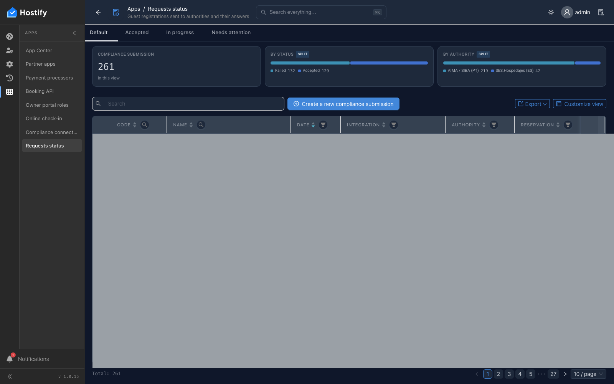

# 008-platform-pages-dark — тъмната тема на платформената конзола — всяка страница се отваря, оглежда се и нищо не остава светло

- Пуск: 2026-11-16_12-46-37 · Приложение: https://hostify.bioseek.eu · Версия: 1.0.15
- Спек: `tests/e2e/008-platform-pages-dark.spec.ts`
- Казуси: 9 от 34 проверки

## Казус 1: activeRuListings in the dark theme (/app/platformSettings/platformBilling/activeRuListings)

_Известен от пуска 2026-11-16 09:29 (същата версия) — не е отстранен._

**Какво се обърка**

```
Error: the column "(no key)" has a header — the columns: (no header: no key) | Month | Active listings | Accounts

expect(received).not.toBe(expected) // Object.is equality

Expected: not ""
```

**Как да се възпроизведе**

1. Влез в https://hostify.bioseek.eu/app/ като суперадминистратор (alarm@mail.bg).
2. Меню: APP SETTINGS › Billing › activeRuListings — https://hostify.bioseek.eu/app/platformSettings/platformBilling/activeRuListings
3. Спек `tests/e2e/008-platform-pages-dark.spec.ts`, проверка „activeRuListings in the dark theme (/app/platformSettings/platformBilling/activeRuListings)“ — стъпките:
4. every column has a header and the actions column is the last one

**Скрийншоти**




## Казус 2: appCenter in the dark theme (/app/apps/appCenter)

_Нов в този пуск._

**Какво се обърка**

```
Error: The page reported 9 error(s) — API answers, failed requests, console errors:
- [request.failed] net::ERR_BLOCKED_BY_ORB @ https://hostify-apps.bioseek.eu/plugins/turnoverbnb/logo.png
- [request.failed] net::ERR_BLOCKED_BY_ORB @ https://hostify-apps.bioseek.eu/plugins/breezeway/logo.png
- [request.failed] net::ERR_BLOCKED_BY_ORB @ https://hostify-apps.bioseek.eu/plugins/pricelabs/logo.svg
- [request.failed] net::ERR_BLOCKED_BY_ORB @ https://hostify-apps.bioseek.eu/plugins/remotelock/logo.png
- [request.failed] net::ERR_BLOCKED_BY_ORB @ https://hostify-apps.bioseek.eu/plugins/hostify-locks/logo.svg
- [request.failed] net::ERR_BLOCKED_BY_ORB @ https://hostify-apps.bioseek.eu/plugins/safely/logo.png
- [request.failed] net::ERR_BLOCKED_BY_ORB @ https://hostify-apps.bioseek.eu/plugins/doinn/logo.png
- [request.failed] net::ERR_BLOCKED_BY_ORB @ https://hostify-apps.bioseek.eu/plugins/key-data/logo.png
- [request.failed] net::ERR_BLOCKED_BY_ORB @ https://hostify-apps.bioseek.eu/plugins/beyond/logo.jpg
```
- неуспешна заявка: net::ERR_BLOCKED_BY_ORB — `https://hostify-apps.bioseek.eu/plugins/turnoverbnb/logo.png`
- неуспешна заявка: net::ERR_BLOCKED_BY_ORB — `https://hostify-apps.bioseek.eu/plugins/breezeway/logo.png`
- неуспешна заявка: net::ERR_BLOCKED_BY_ORB — `https://hostify-apps.bioseek.eu/plugins/pricelabs/logo.svg`
- неуспешна заявка: net::ERR_BLOCKED_BY_ORB — `https://hostify-apps.bioseek.eu/plugins/remotelock/logo.png`
- неуспешна заявка: net::ERR_BLOCKED_BY_ORB — `https://hostify-apps.bioseek.eu/plugins/hostify-locks/logo.svg`
- неуспешна заявка: net::ERR_BLOCKED_BY_ORB — `https://hostify-apps.bioseek.eu/plugins/safely/logo.png`
- неуспешна заявка: net::ERR_BLOCKED_BY_ORB — `https://hostify-apps.bioseek.eu/plugins/doinn/logo.png`
- неуспешна заявка: net::ERR_BLOCKED_BY_ORB — `https://hostify-apps.bioseek.eu/plugins/key-data/logo.png`
- неуспешна заявка: net::ERR_BLOCKED_BY_ORB — `https://hostify-apps.bioseek.eu/plugins/beyond/logo.jpg`

**Как да се възпроизведе**

1. Влез в https://hostify.bioseek.eu/app/ като суперадминистратор (alarm@mail.bg).
2. Меню: APPS › App Center — https://hostify.bioseek.eu/app/apps/appCenter
3. Спек `tests/e2e/008-platform-pages-dark.spec.ts`, проверка „appCenter in the dark theme (/app/apps/appCenter)“.
4. Developer tools › Network: заявките по-горе отговарят така.

**Скрийншоти**





## Казус 3: partners in the dark theme (/app/apps/partners)

_Известен от пуска 2026-11-16 09:29 (същата версия) — не е отстранен._

**Какво се обърка**

```
Error: The page reported 59 error(s) — API answers, failed requests, console errors:
- [request.failed] net::ERR_BLOCKED_BY_ORB @ https://hostify-apps.bioseek.eu/plugins/minut/logo.svg
- [request.failed] net::ERR_BLOCKED_BY_ORB @ https://hostify-apps.bioseek.eu/plugins/insuraguest/logo.png
- [request.failed] net::ERR_BLOCKED_BY_ORB @ https://hostify-apps.bioseek.eu/plugins/beyond/logo.jpg
- [request.failed] net::ERR_BLOCKED_BY_ORB @ https://hostify-apps.bioseek.eu/plugins/key-data/logo.png
- [request.failed] net::ERR_BLOCKED_BY_ORB @ https://hostify-apps.bioseek.eu/plugins/turnoverbnb/logo.png
- [request.failed] net::ERR_BLOCKED_BY_ORB @ https://hostify-apps.bioseek.eu/plugins/remotelock/logo.png
- [request.failed] net::ERR_BLOCKED_BY_ORB @ https://hostify-apps.bioseek.eu/plugins/turbosuite/logo.png
- [request.failed] net::ERR_BLOCKED_BY_ORB @ https://hostify-apps.bioseek.eu/plugins/pricelabs/logo.svg
- [request.failed] net::ERR_BLOCKED_BY_ORB @ https://hostify-apps.bioseek.eu/plugins/hostify-locks/logo.svg
- [request.failed] net::ERR_BLOCKED_BY_ORB @ https://hostify-apps.bioseek.eu/plugins/cardcom/logo.png
```
- неуспешна заявка: net::ERR_BLOCKED_BY_ORB — `https://hostify-apps.bioseek.eu/plugins/minut/logo.svg`
- неуспешна заявка: net::ERR_BLOCKED_BY_ORB — `https://hostify-apps.bioseek.eu/plugins/insuraguest/logo.png`
- неуспешна заявка: net::ERR_BLOCKED_BY_ORB — `https://hostify-apps.bioseek.eu/plugins/beyond/logo.jpg`
- неуспешна заявка: net::ERR_BLOCKED_BY_ORB — `https://hostify-apps.bioseek.eu/plugins/key-data/logo.png`
- неуспешна заявка: net::ERR_BLOCKED_BY_ORB — `https://hostify-apps.bioseek.eu/plugins/turnoverbnb/logo.png`
- неуспешна заявка: net::ERR_BLOCKED_BY_ORB — `https://hostify-apps.bioseek.eu/plugins/remotelock/logo.png`
- неуспешна заявка: net::ERR_BLOCKED_BY_ORB — `https://hostify-apps.bioseek.eu/plugins/turbosuite/logo.png`
- неуспешна заявка: net::ERR_BLOCKED_BY_ORB — `https://hostify-apps.bioseek.eu/plugins/pricelabs/logo.svg`
- неуспешна заявка: net::ERR_BLOCKED_BY_ORB — `https://hostify-apps.bioseek.eu/plugins/hostify-locks/logo.svg`
- неуспешна заявка: net::ERR_BLOCKED_BY_ORB — `https://hostify-apps.bioseek.eu/plugins/cardcom/logo.png`

**Как да се възпроизведе**

1. Влез в https://hostify.bioseek.eu/app/ като суперадминистратор (alarm@mail.bg).
2. Меню: APPS › Partner apps — https://hostify.bioseek.eu/app/apps/partners
3. Спек `tests/e2e/008-platform-pages-dark.spec.ts`, проверка „partners in the dark theme (/app/apps/partners)“.
4. Developer tools › Network: заявките по-горе отговарят така.

**Скрийншоти**





## Казус 4: paymentProcessorAccounts in the dark theme (/app/apps/paymentProcessorAccounts)

_Нов в този пуск._

**Какво се обърка**

```
Error: The page reported 48 error(s) — API answers, failed requests, console errors:
- [request.failed] net::ERR_BLOCKED_BY_ORB @ https://hostify-apps.bioseek.eu/plugins/key-data/logo.png
- [request.failed] net::ERR_BLOCKED_BY_ORB @ https://hostify-apps.bioseek.eu/plugins/turbosuite/logo.png
- [request.failed] net::ERR_BLOCKED_BY_ORB @ https://hostify-apps.bioseek.eu/plugins/akiles/logo.svg
- [request.failed] net::ERR_BLOCKED_BY_ORB @ https://hostify-apps.bioseek.eu/plugins/turnoverbnb/logo.png
- [request.failed] net::ERR_BLOCKED_BY_ORB @ https://hostify-apps.bioseek.eu/plugins/pricelabs/logo.svg
- [request.failed] net::ERR_BLOCKED_BY_ORB @ https://hostify-apps.bioseek.eu/plugins/beyond/logo.jpg
- [request.failed] net::ERR_BLOCKED_BY_ORB @ https://hostify-apps.bioseek.eu/plugins/minut/logo.svg
- [request.failed] net::ERR_BLOCKED_BY_ORB @ https://hostify-apps.bioseek.eu/plugins/remotelock/logo.png
- [request.failed] net::ERR_BLOCKED_BY_ORB @ https://hostify-apps.bioseek.eu/plugins/insuraguest/logo.png
- [request.failed] net::ERR_BLOCKED_BY_ORB @ https://hostify-apps.bioseek.eu/plugins/cardcom/logo.png
```
- неуспешна заявка: net::ERR_BLOCKED_BY_ORB — `https://hostify-apps.bioseek.eu/plugins/key-data/logo.png`
- неуспешна заявка: net::ERR_BLOCKED_BY_ORB — `https://hostify-apps.bioseek.eu/plugins/turbosuite/logo.png`
- неуспешна заявка: net::ERR_BLOCKED_BY_ORB — `https://hostify-apps.bioseek.eu/plugins/akiles/logo.svg`
- неуспешна заявка: net::ERR_BLOCKED_BY_ORB — `https://hostify-apps.bioseek.eu/plugins/turnoverbnb/logo.png`
- неуспешна заявка: net::ERR_BLOCKED_BY_ORB — `https://hostify-apps.bioseek.eu/plugins/pricelabs/logo.svg`
- неуспешна заявка: net::ERR_BLOCKED_BY_ORB — `https://hostify-apps.bioseek.eu/plugins/beyond/logo.jpg`
- неуспешна заявка: net::ERR_BLOCKED_BY_ORB — `https://hostify-apps.bioseek.eu/plugins/minut/logo.svg`
- неуспешна заявка: net::ERR_BLOCKED_BY_ORB — `https://hostify-apps.bioseek.eu/plugins/remotelock/logo.png`
- неуспешна заявка: net::ERR_BLOCKED_BY_ORB — `https://hostify-apps.bioseek.eu/plugins/insuraguest/logo.png`
- неуспешна заявка: net::ERR_BLOCKED_BY_ORB — `https://hostify-apps.bioseek.eu/plugins/cardcom/logo.png`

**Как да се възпроизведе**

1. Влез в https://hostify.bioseek.eu/app/ като суперадминистратор (alarm@mail.bg).
2. Меню: APPS › Payment processors — https://hostify.bioseek.eu/app/apps/paymentProcessorAccounts
3. Спек `tests/e2e/008-platform-pages-dark.spec.ts`, проверка „paymentProcessorAccounts in the dark theme (/app/apps/paymentProcessorAccounts)“.
4. Developer tools › Network: заявките по-горе отговарят така.

**Скрийншоти**




## Казус 5: bookingApiClients in the dark theme (/app/apps/bookingApiClients)

_Нов в този пуск._

**Какво се обърка**

```
Error: The page reported 48 error(s) — API answers, failed requests, console errors:
- [request.failed] net::ERR_BLOCKED_BY_ORB @ https://hostify-apps.bioseek.eu/plugins/paypal/logo.png
- [request.failed] net::ERR_BLOCKED_BY_ORB @ https://hostify-apps.bioseek.eu/plugins/stripe/logo.png
- [request.failed] net::ERR_BLOCKED_BY_ORB @ https://hostify-apps.bioseek.eu/plugins/doinn/logo.png
- [request.failed] net::ERR_BLOCKED_BY_ORB @ https://hostify-apps.bioseek.eu/plugins/cardcom/logo.png
- [request.failed] net::ERR_BLOCKED_BY_ORB @ https://hostify-apps.bioseek.eu/plugins/safely/logo.png
- [request.failed] net::ERR_BLOCKED_BY_ORB @ https://hostify-apps.bioseek.eu/plugins/pricelabs/logo.svg
- [request.failed] net::ERR_BLOCKED_BY_ORB @ https://hostify-apps.bioseek.eu/plugins/turnoverbnb/logo.png
- [request.failed] net::ERR_BLOCKED_BY_ORB @ https://hostify-apps.bioseek.eu/plugins/minut/logo.svg
- [request.failed] net::ERR_BLOCKED_BY_ORB @ https://hostify-apps.bioseek.eu/plugins/turbosuite/logo.png
- [request.failed] net::ERR_BLOCKED_BY_ORB @ https://hostify-apps.bioseek.eu/plugins/akiles/logo.svg
```
- неуспешна заявка: net::ERR_BLOCKED_BY_ORB — `https://hostify-apps.bioseek.eu/plugins/paypal/logo.png`
- неуспешна заявка: net::ERR_BLOCKED_BY_ORB — `https://hostify-apps.bioseek.eu/plugins/stripe/logo.png`
- неуспешна заявка: net::ERR_BLOCKED_BY_ORB — `https://hostify-apps.bioseek.eu/plugins/doinn/logo.png`
- неуспешна заявка: net::ERR_BLOCKED_BY_ORB — `https://hostify-apps.bioseek.eu/plugins/cardcom/logo.png`
- неуспешна заявка: net::ERR_BLOCKED_BY_ORB — `https://hostify-apps.bioseek.eu/plugins/safely/logo.png`
- неуспешна заявка: net::ERR_BLOCKED_BY_ORB — `https://hostify-apps.bioseek.eu/plugins/pricelabs/logo.svg`
- неуспешна заявка: net::ERR_BLOCKED_BY_ORB — `https://hostify-apps.bioseek.eu/plugins/turnoverbnb/logo.png`
- неуспешна заявка: net::ERR_BLOCKED_BY_ORB — `https://hostify-apps.bioseek.eu/plugins/minut/logo.svg`
- неуспешна заявка: net::ERR_BLOCKED_BY_ORB — `https://hostify-apps.bioseek.eu/plugins/turbosuite/logo.png`
- неуспешна заявка: net::ERR_BLOCKED_BY_ORB — `https://hostify-apps.bioseek.eu/plugins/akiles/logo.svg`

**Как да се възпроизведе**

1. Влез в https://hostify.bioseek.eu/app/ като суперадминистратор (alarm@mail.bg).
2. Меню: APPS › Booking API — https://hostify.bioseek.eu/app/apps/bookingApiClients
3. Спек `tests/e2e/008-platform-pages-dark.spec.ts`, проверка „bookingApiClients in the dark theme (/app/apps/bookingApiClients)“.
4. Developer tools › Network: заявките по-горе отговарят така.

**Скрийншоти**





## Казус 6: ownerPortalRoles in the dark theme (/app/apps/ownerPortalRoles)

_Нов в този пуск._

**Какво се обърка**

```
Error: The page reported 48 error(s) — API answers, failed requests, console errors:
- [request.failed] net::ERR_BLOCKED_BY_ORB @ https://hostify-apps.bioseek.eu/plugins/minut/logo.svg
- [request.failed] net::ERR_BLOCKED_BY_ORB @ https://hostify-apps.bioseek.eu/plugins/insuraguest/logo.png
- [request.failed] net::ERR_BLOCKED_BY_ORB @ https://hostify-apps.bioseek.eu/plugins/hostify-locks/logo.svg
- [request.failed] net::ERR_BLOCKED_BY_ORB @ https://hostify-apps.bioseek.eu/plugins/doinn/logo.png
- [request.failed] net::ERR_BLOCKED_BY_ORB @ https://hostify-apps.bioseek.eu/plugins/akiles/logo.svg
- [request.failed] net::ERR_BLOCKED_BY_ORB @ https://hostify-apps.bioseek.eu/plugins/cardcom/logo.png
- [request.failed] net::ERR_BLOCKED_BY_ORB @ https://hostify-apps.bioseek.eu/plugins/turnoverbnb/logo.png
- [request.failed] net::ERR_BLOCKED_BY_ORB @ https://hostify-apps.bioseek.eu/plugins/key-data/logo.png
- [request.failed] net::ERR_BLOCKED_BY_ORB @ https://hostify-apps.bioseek.eu/plugins/safely/logo.png
- [request.failed] net::ERR_BLOCKED_BY_ORB @ https://hostify-apps.bioseek.eu/plugins/pricelabs/logo.svg
```
- неуспешна заявка: net::ERR_BLOCKED_BY_ORB — `https://hostify-apps.bioseek.eu/plugins/minut/logo.svg`
- неуспешна заявка: net::ERR_BLOCKED_BY_ORB — `https://hostify-apps.bioseek.eu/plugins/insuraguest/logo.png`
- неуспешна заявка: net::ERR_BLOCKED_BY_ORB — `https://hostify-apps.bioseek.eu/plugins/hostify-locks/logo.svg`
- неуспешна заявка: net::ERR_BLOCKED_BY_ORB — `https://hostify-apps.bioseek.eu/plugins/doinn/logo.png`
- неуспешна заявка: net::ERR_BLOCKED_BY_ORB — `https://hostify-apps.bioseek.eu/plugins/akiles/logo.svg`
- неуспешна заявка: net::ERR_BLOCKED_BY_ORB — `https://hostify-apps.bioseek.eu/plugins/cardcom/logo.png`
- неуспешна заявка: net::ERR_BLOCKED_BY_ORB — `https://hostify-apps.bioseek.eu/plugins/turnoverbnb/logo.png`
- неуспешна заявка: net::ERR_BLOCKED_BY_ORB — `https://hostify-apps.bioseek.eu/plugins/key-data/logo.png`
- неуспешна заявка: net::ERR_BLOCKED_BY_ORB — `https://hostify-apps.bioseek.eu/plugins/safely/logo.png`
- неуспешна заявка: net::ERR_BLOCKED_BY_ORB — `https://hostify-apps.bioseek.eu/plugins/pricelabs/logo.svg`

**Как да се възпроизведе**

1. Влез в https://hostify.bioseek.eu/app/ като суперадминистратор (alarm@mail.bg).
2. Меню: APPS › Owner portal roles — https://hostify.bioseek.eu/app/apps/ownerPortalRoles
3. Спек `tests/e2e/008-platform-pages-dark.spec.ts`, проверка „ownerPortalRoles in the dark theme (/app/apps/ownerPortalRoles)“.
4. Developer tools › Network: заявките по-горе отговарят така.

**Скрийншоти**




## Казус 7: checkinFormTemplates in the dark theme (/app/apps/checkinFormTemplates)

_Нов в този пуск._

**Какво се обърка**

```
Error: The page reported 47 error(s) — API answers, failed requests, console errors:
- [request.failed] net::ERR_BLOCKED_BY_ORB @ https://hostify-apps.bioseek.eu/plugins/cardcom/logo.png
- [request.failed] net::ERR_BLOCKED_BY_ORB @ https://hostify-apps.bioseek.eu/plugins/key-data/logo.png
- [request.failed] net::ERR_BLOCKED_BY_ORB @ https://hostify-apps.bioseek.eu/plugins/hostify-locks/logo.svg
- [request.failed] net::ERR_BLOCKED_BY_ORB @ https://hostify-apps.bioseek.eu/plugins/insuraguest/logo.png
- [request.failed] net::ERR_BLOCKED_BY_ORB @ https://hostify-apps.bioseek.eu/plugins/turnoverbnb/logo.png
- [request.failed] net::ERR_BLOCKED_BY_ORB @ https://hostify-apps.bioseek.eu/plugins/pricelabs/logo.svg
- [request.failed] net::ERR_BLOCKED_BY_ORB @ https://hostify-apps.bioseek.eu/plugins/beyond/logo.jpg
- [request.failed] net::ERR_BLOCKED_BY_ORB @ https://hostify-apps.bioseek.eu/plugins/akiles/logo.svg
- [request.failed] net::ERR_BLOCKED_BY_ORB @ https://hostify-apps.bioseek.eu/plugins/minut/logo.svg
- [request.failed] net::ERR_BLOCKED_BY_ORB @ https://hostify-apps.bioseek.eu/plugins/turbosuite/logo.png
```
- неуспешна заявка: net::ERR_BLOCKED_BY_ORB — `https://hostify-apps.bioseek.eu/plugins/cardcom/logo.png`
- неуспешна заявка: net::ERR_BLOCKED_BY_ORB — `https://hostify-apps.bioseek.eu/plugins/key-data/logo.png`
- неуспешна заявка: net::ERR_BLOCKED_BY_ORB — `https://hostify-apps.bioseek.eu/plugins/hostify-locks/logo.svg`
- неуспешна заявка: net::ERR_BLOCKED_BY_ORB — `https://hostify-apps.bioseek.eu/plugins/insuraguest/logo.png`
- неуспешна заявка: net::ERR_BLOCKED_BY_ORB — `https://hostify-apps.bioseek.eu/plugins/turnoverbnb/logo.png`
- неуспешна заявка: net::ERR_BLOCKED_BY_ORB — `https://hostify-apps.bioseek.eu/plugins/pricelabs/logo.svg`
- неуспешна заявка: net::ERR_BLOCKED_BY_ORB — `https://hostify-apps.bioseek.eu/plugins/beyond/logo.jpg`
- неуспешна заявка: net::ERR_BLOCKED_BY_ORB — `https://hostify-apps.bioseek.eu/plugins/akiles/logo.svg`
- неуспешна заявка: net::ERR_BLOCKED_BY_ORB — `https://hostify-apps.bioseek.eu/plugins/minut/logo.svg`
- неуспешна заявка: net::ERR_BLOCKED_BY_ORB — `https://hostify-apps.bioseek.eu/plugins/turbosuite/logo.png`

**Как да се възпроизведе**

1. Влез в https://hostify.bioseek.eu/app/ като суперадминистратор (alarm@mail.bg).
2. Меню: APPS › Online check-in — https://hostify.bioseek.eu/app/apps/checkinFormTemplates
3. Спек `tests/e2e/008-platform-pages-dark.spec.ts`, проверка „checkinFormTemplates in the dark theme (/app/apps/checkinFormTemplates)“.
4. Developer tools › Network: заявките по-горе отговарят така.

**Скрийншоти**




## Казус 8: complianceConnections in the dark theme (/app/apps/complianceConnections)

_Нов в този пуск._

**Какво се обърка**

```
Error: The page reported 48 error(s) — API answers, failed requests, console errors:
- [request.failed] net::ERR_BLOCKED_BY_ORB @ https://hostify-apps.bioseek.eu/plugins/hostify-locks/logo.svg
- [request.failed] net::ERR_BLOCKED_BY_ORB @ https://hostify-apps.bioseek.eu/plugins/remotelock/logo.png
- [request.failed] net::ERR_BLOCKED_BY_ORB @ https://hostify-apps.bioseek.eu/plugins/turbosuite/logo.png
- [request.failed] net::ERR_BLOCKED_BY_ORB @ https://hostify-apps.bioseek.eu/plugins/insuraguest/logo.png
- [request.failed] net::ERR_BLOCKED_BY_ORB @ https://hostify-apps.bioseek.eu/plugins/doinn/logo.png
- [request.failed] net::ERR_BLOCKED_BY_ORB @ https://hostify-apps.bioseek.eu/plugins/minut/logo.svg
- [request.failed] net::ERR_BLOCKED_BY_ORB @ https://hostify-apps.bioseek.eu/plugins/cardcom/logo.png
- [request.failed] net::ERR_BLOCKED_BY_ORB @ https://hostify-apps.bioseek.eu/plugins/akiles/logo.svg
- [request.failed] net::ERR_BLOCKED_BY_ORB @ https://hostify-apps.bioseek.eu/plugins/pricelabs/logo.svg
- [request.failed] net::ERR_BLOCKED_BY_ORB @ https://hostify-apps.bioseek.eu/plugins/safely/logo.png
```
- неуспешна заявка: net::ERR_BLOCKED_BY_ORB — `https://hostify-apps.bioseek.eu/plugins/hostify-locks/logo.svg`
- неуспешна заявка: net::ERR_BLOCKED_BY_ORB — `https://hostify-apps.bioseek.eu/plugins/remotelock/logo.png`
- неуспешна заявка: net::ERR_BLOCKED_BY_ORB — `https://hostify-apps.bioseek.eu/plugins/turbosuite/logo.png`
- неуспешна заявка: net::ERR_BLOCKED_BY_ORB — `https://hostify-apps.bioseek.eu/plugins/insuraguest/logo.png`
- неуспешна заявка: net::ERR_BLOCKED_BY_ORB — `https://hostify-apps.bioseek.eu/plugins/doinn/logo.png`
- неуспешна заявка: net::ERR_BLOCKED_BY_ORB — `https://hostify-apps.bioseek.eu/plugins/minut/logo.svg`
- неуспешна заявка: net::ERR_BLOCKED_BY_ORB — `https://hostify-apps.bioseek.eu/plugins/cardcom/logo.png`
- неуспешна заявка: net::ERR_BLOCKED_BY_ORB — `https://hostify-apps.bioseek.eu/plugins/akiles/logo.svg`
- неуспешна заявка: net::ERR_BLOCKED_BY_ORB — `https://hostify-apps.bioseek.eu/plugins/pricelabs/logo.svg`
- неуспешна заявка: net::ERR_BLOCKED_BY_ORB — `https://hostify-apps.bioseek.eu/plugins/safely/logo.png`

**Как да се възпроизведе**

1. Влез в https://hostify.bioseek.eu/app/ като суперадминистратор (alarm@mail.bg).
2. Меню: APPS › Compliance connections — https://hostify.bioseek.eu/app/apps/complianceConnections
3. Спек `tests/e2e/008-platform-pages-dark.spec.ts`, проверка „complianceConnections in the dark theme (/app/apps/complianceConnections)“.
4. Developer tools › Network: заявките по-горе отговарят така.

**Скрийншоти**




## Казус 9: complianceSubmissions in the dark theme (/app/apps/complianceSubmissions)

_Нов в този пуск._

**Какво се обърка**

```
Error: The page reported 48 error(s) — API answers, failed requests, console errors:
- [request.failed] net::ERR_BLOCKED_BY_ORB @ https://hostify-apps.bioseek.eu/plugins/beyond/logo.jpg
- [request.failed] net::ERR_BLOCKED_BY_ORB @ https://hostify-apps.bioseek.eu/plugins/cardcom/logo.png
- [request.failed] net::ERR_BLOCKED_BY_ORB @ https://hostify-apps.bioseek.eu/plugins/safely/logo.png
- [request.failed] net::ERR_BLOCKED_BY_ORB @ https://hostify-apps.bioseek.eu/plugins/doinn/logo.png
- [request.failed] net::ERR_BLOCKED_BY_ORB @ https://hostify-apps.bioseek.eu/plugins/remotelock/logo.png
- [request.failed] net::ERR_BLOCKED_BY_ORB @ https://hostify-apps.bioseek.eu/plugins/turnoverbnb/logo.png
- [request.failed] net::ERR_BLOCKED_BY_ORB @ https://hostify-apps.bioseek.eu/plugins/minut/logo.svg
- [request.failed] net::ERR_BLOCKED_BY_ORB @ https://hostify-apps.bioseek.eu/plugins/key-data/logo.png
- [request.failed] net::ERR_BLOCKED_BY_ORB @ https://hostify-apps.bioseek.eu/plugins/hostify-locks/logo.svg
- [request.failed] net::ERR_BLOCKED_BY_ORB @ https://hostify-apps.bioseek.eu/plugins/insuraguest/logo.png
```
- неуспешна заявка: net::ERR_BLOCKED_BY_ORB — `https://hostify-apps.bioseek.eu/plugins/beyond/logo.jpg`
- неуспешна заявка: net::ERR_BLOCKED_BY_ORB — `https://hostify-apps.bioseek.eu/plugins/cardcom/logo.png`
- неуспешна заявка: net::ERR_BLOCKED_BY_ORB — `https://hostify-apps.bioseek.eu/plugins/safely/logo.png`
- неуспешна заявка: net::ERR_BLOCKED_BY_ORB — `https://hostify-apps.bioseek.eu/plugins/doinn/logo.png`
- неуспешна заявка: net::ERR_BLOCKED_BY_ORB — `https://hostify-apps.bioseek.eu/plugins/remotelock/logo.png`
- неуспешна заявка: net::ERR_BLOCKED_BY_ORB — `https://hostify-apps.bioseek.eu/plugins/turnoverbnb/logo.png`
- неуспешна заявка: net::ERR_BLOCKED_BY_ORB — `https://hostify-apps.bioseek.eu/plugins/minut/logo.svg`
- неуспешна заявка: net::ERR_BLOCKED_BY_ORB — `https://hostify-apps.bioseek.eu/plugins/key-data/logo.png`
- неуспешна заявка: net::ERR_BLOCKED_BY_ORB — `https://hostify-apps.bioseek.eu/plugins/hostify-locks/logo.svg`
- неуспешна заявка: net::ERR_BLOCKED_BY_ORB — `https://hostify-apps.bioseek.eu/plugins/insuraguest/logo.png`

**Как да се възпроизведе**

1. Влез в https://hostify.bioseek.eu/app/ като суперадминистратор (alarm@mail.bg).
2. Меню: APPS › Requests status — https://hostify.bioseek.eu/app/apps/complianceSubmissions
3. Спек `tests/e2e/008-platform-pages-dark.spec.ts`, проверка „complianceSubmissions in the dark theme (/app/apps/complianceSubmissions)“.
4. Developer tools › Network: заявките по-горе отговарят така.

**Скрийншоти**




---

Какво проверява спекът: 008 — every page of the PLATFORM console in the DARK theme (the sweep of 005, the theme switched on first).
