# 011-account-pages-dark — тъмната тема на акаунта — всяка страница се отваря, оглежда се и нищо не остава светло

- Пуск: 2026-11-16_13-11-21 · Приложение: https://hostify.bioseek.eu · Версия: 1.0.15
- Спек: `tests/e2e/011-account-pages-dark.spec.ts`
- Казуси: 36 от 162 проверки

## Казус 1: appCenter in the dark theme (/app/apps/appCenter)

_Нов в този пуск._

**Какво се обърка**

```
Error: The page reported 24 error(s) — API answers, failed requests, console errors:
- [request.failed] net::ERR_BLOCKED_BY_ORB @ https://hostify-apps.bioseek.eu/plugins/beyond/logo.jpg
- [request.failed] net::ERR_BLOCKED_BY_ORB @ https://hostify-apps.bioseek.eu/plugins/stripe/logo.png
- [request.failed] net::ERR_BLOCKED_BY_ORB @ https://hostify-apps.bioseek.eu/plugins/chekin/logo.svg
- [request.failed] net::ERR_BLOCKED_BY_ORB @ https://hostify-apps.bioseek.eu/plugins/paypal/logo.png
- [request.failed] net::ERR_BLOCKED_BY_ORB @ https://hostify-apps.bioseek.eu/plugins/duve/logo.png
- [request.failed] net::ERR_BLOCKED_BY_ORB @ https://hostify-apps.bioseek.eu/plugins/superhog/logo.png
- [request.failed] net::ERR_BLOCKED_BY_ORB @ https://hostify-apps.bioseek.eu/plugins/breezeway/logo.png
- [request.failed] net::ERR_BLOCKED_BY_ORB @ https://hostify-apps.bioseek.eu/plugins/pricelabs/logo.svg
- [request.failed] net::ERR_BLOCKED_BY_ORB @ https://hostify-apps.bioseek.eu/plugins/cardcom/logo.png
- [request.failed] net::ERR_BLOCKED_BY_ORB @ https://hostify-apps.bioseek.eu/plugins/akiles/logo.svg
```
- неуспешна заявка: net::ERR_BLOCKED_BY_ORB — `https://hostify-apps.bioseek.eu/plugins/beyond/logo.jpg`
- неуспешна заявка: net::ERR_BLOCKED_BY_ORB — `https://hostify-apps.bioseek.eu/plugins/stripe/logo.png`
- неуспешна заявка: net::ERR_BLOCKED_BY_ORB — `https://hostify-apps.bioseek.eu/plugins/chekin/logo.svg`
- неуспешна заявка: net::ERR_BLOCKED_BY_ORB — `https://hostify-apps.bioseek.eu/plugins/paypal/logo.png`
- неуспешна заявка: net::ERR_BLOCKED_BY_ORB — `https://hostify-apps.bioseek.eu/plugins/duve/logo.png`
- неуспешна заявка: net::ERR_BLOCKED_BY_ORB — `https://hostify-apps.bioseek.eu/plugins/superhog/logo.png`
- неуспешна заявка: net::ERR_BLOCKED_BY_ORB — `https://hostify-apps.bioseek.eu/plugins/breezeway/logo.png`
- неуспешна заявка: net::ERR_BLOCKED_BY_ORB — `https://hostify-apps.bioseek.eu/plugins/pricelabs/logo.svg`
- неуспешна заявка: net::ERR_BLOCKED_BY_ORB — `https://hostify-apps.bioseek.eu/plugins/cardcom/logo.png`
- неуспешна заявка: net::ERR_BLOCKED_BY_ORB — `https://hostify-apps.bioseek.eu/plugins/akiles/logo.svg`

**Как да се възпроизведе**

1. Влез в https://hostify.bioseek.eu/app/ като администратор на акаунта (qa.admin@hostify-qa.test).
2. Меню: APPS › App Center — https://hostify.bioseek.eu/app/apps/appCenter
3. Спек `tests/e2e/011-account-pages-dark.spec.ts`, проверка „appCenter in the dark theme (/app/apps/appCenter)“.
4. Developer tools › Network: заявките по-горе отговарят така.

**Скрийншоти**


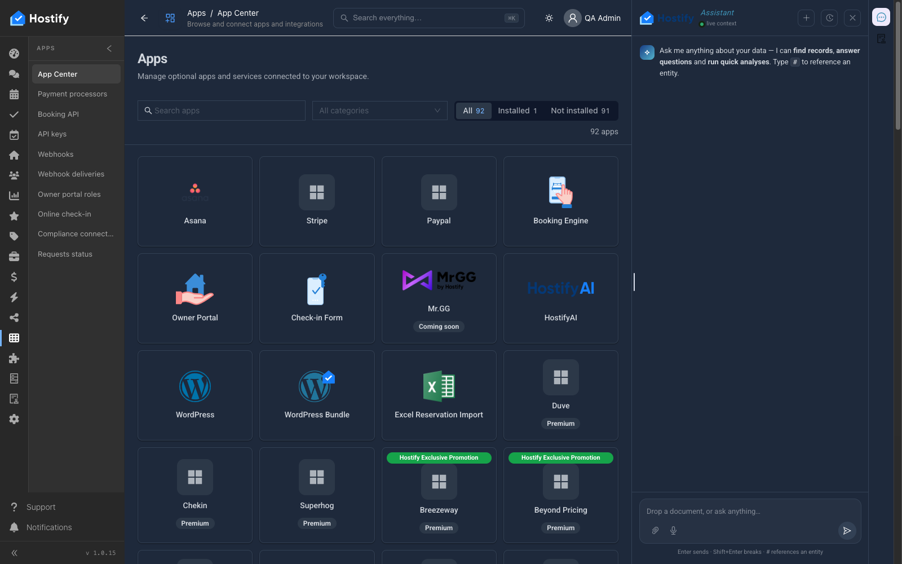


## Казус 2: bookingApiClients in the dark theme (/app/apps/bookingApiClients)

_Нов в този пуск._

**Какво се обърка**

```
Error: The page reported 48 error(s) — API answers, failed requests, console errors:
- [request.failed] net::ERR_BLOCKED_BY_ORB @ https://hostify-apps.bioseek.eu/plugins/pricelabs/logo.svg
- [request.failed] net::ERR_BLOCKED_BY_ORB @ https://hostify-apps.bioseek.eu/plugins/safely/logo.png
- [request.failed] net::ERR_BLOCKED_BY_ORB @ https://hostify-apps.bioseek.eu/plugins/akiles/logo.svg
- [request.failed] net::ERR_BLOCKED_BY_ORB @ https://hostify-apps.bioseek.eu/plugins/turbosuite/logo.png
- [request.failed] net::ERR_BLOCKED_BY_ORB @ https://hostify-apps.bioseek.eu/plugins/remotelock/logo.png
- [request.failed] net::ERR_BLOCKED_BY_ORB @ https://hostify-apps.bioseek.eu/plugins/minut/logo.svg
- [request.failed] net::ERR_BLOCKED_BY_ORB @ https://hostify-apps.bioseek.eu/plugins/doinn/logo.png
- [request.failed] net::ERR_BLOCKED_BY_ORB @ https://hostify-apps.bioseek.eu/plugins/hostify-locks/logo.svg
- [request.failed] net::ERR_BLOCKED_BY_ORB @ https://hostify-apps.bioseek.eu/plugins/turnoverbnb/logo.png
- [request.failed] net::ERR_BLOCKED_BY_ORB @ https://hostify-apps.bioseek.eu/plugins/key-data/logo.png
```
- неуспешна заявка: net::ERR_BLOCKED_BY_ORB — `https://hostify-apps.bioseek.eu/plugins/pricelabs/logo.svg`
- неуспешна заявка: net::ERR_BLOCKED_BY_ORB — `https://hostify-apps.bioseek.eu/plugins/safely/logo.png`
- неуспешна заявка: net::ERR_BLOCKED_BY_ORB — `https://hostify-apps.bioseek.eu/plugins/akiles/logo.svg`
- неуспешна заявка: net::ERR_BLOCKED_BY_ORB — `https://hostify-apps.bioseek.eu/plugins/turbosuite/logo.png`
- неуспешна заявка: net::ERR_BLOCKED_BY_ORB — `https://hostify-apps.bioseek.eu/plugins/remotelock/logo.png`
- неуспешна заявка: net::ERR_BLOCKED_BY_ORB — `https://hostify-apps.bioseek.eu/plugins/minut/logo.svg`
- неуспешна заявка: net::ERR_BLOCKED_BY_ORB — `https://hostify-apps.bioseek.eu/plugins/doinn/logo.png`
- неуспешна заявка: net::ERR_BLOCKED_BY_ORB — `https://hostify-apps.bioseek.eu/plugins/hostify-locks/logo.svg`
- неуспешна заявка: net::ERR_BLOCKED_BY_ORB — `https://hostify-apps.bioseek.eu/plugins/turnoverbnb/logo.png`
- неуспешна заявка: net::ERR_BLOCKED_BY_ORB — `https://hostify-apps.bioseek.eu/plugins/key-data/logo.png`

**Как да се възпроизведе**

1. Влез в https://hostify.bioseek.eu/app/ като администратор на акаунта (qa.admin@hostify-qa.test).
2. Меню: APPS › Booking API — https://hostify.bioseek.eu/app/apps/bookingApiClients
3. Спек `tests/e2e/011-account-pages-dark.spec.ts`, проверка „bookingApiClients in the dark theme (/app/apps/bookingApiClients)“.
4. Developer tools › Network: заявките по-горе отговарят така.

**Скрийншоти**


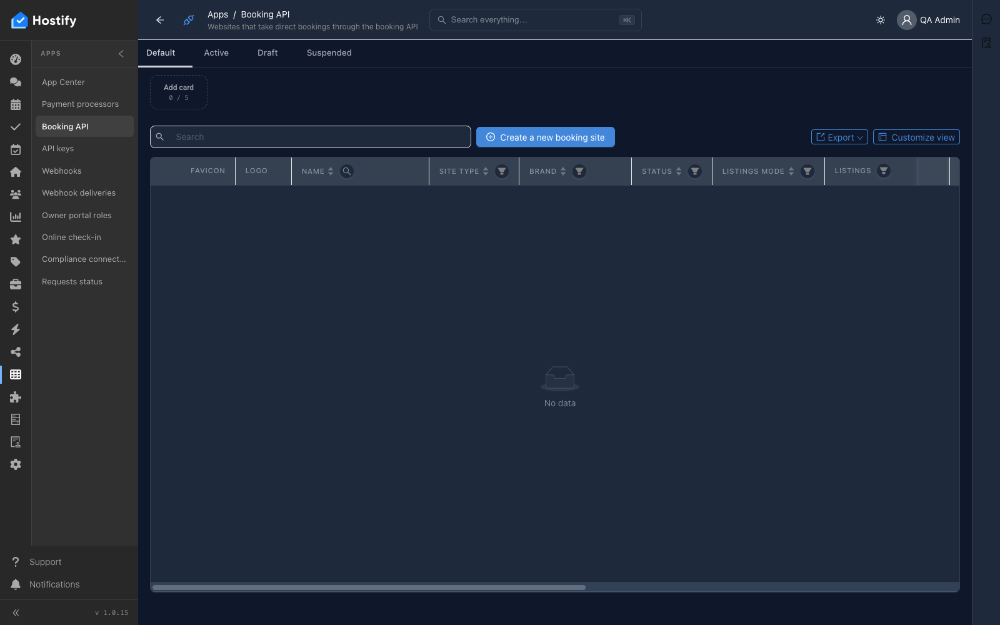


## Казус 3: webhookDeliveries in the dark theme (/app/apps/webhookDeliveries)

_Нов в този пуск._

**Какво се обърка**

```
Error: The page reported 42 error(s) — API answers, failed requests, console errors:
- [request.failed] net::ERR_BLOCKED_BY_ORB @ https://hostify-apps.bioseek.eu/plugins/akiles/logo.svg
- [request.failed] net::ERR_BLOCKED_BY_ORB @ https://hostify-apps.bioseek.eu/plugins/breezeway/logo.png
- [request.failed] net::ERR_BLOCKED_BY_ORB @ https://hostify-apps.bioseek.eu/plugins/minut/logo.svg
- [request.failed] net::ERR_BLOCKED_BY_ORB @ https://hostify-apps.bioseek.eu/plugins/key-data/logo.png
- [request.failed] net::ERR_BLOCKED_BY_ORB @ https://hostify-apps.bioseek.eu/plugins/remotelock/logo.png
- [request.failed] net::ERR_BLOCKED_BY_ORB @ https://hostify-apps.bioseek.eu/plugins/insuraguest/logo.png
- [request.failed] net::ERR_BLOCKED_BY_ORB @ https://hostify-apps.bioseek.eu/plugins/cardcom/logo.png
- [request.failed] net::ERR_BLOCKED_BY_ORB @ https://hostify-apps.bioseek.eu/plugins/turbosuite/logo.png
- [request.failed] net::ERR_BLOCKED_BY_ORB @ https://hostify-apps.bioseek.eu/plugins/doinn/logo.png
- [request.failed] net::ERR_BLOCKED_BY_ORB @ https://hostify-apps.bioseek.eu/plugins/pricelabs/logo.svg
```
- неуспешна заявка: net::ERR_BLOCKED_BY_ORB — `https://hostify-apps.bioseek.eu/plugins/akiles/logo.svg`
- неуспешна заявка: net::ERR_BLOCKED_BY_ORB — `https://hostify-apps.bioseek.eu/plugins/breezeway/logo.png`
- неуспешна заявка: net::ERR_BLOCKED_BY_ORB — `https://hostify-apps.bioseek.eu/plugins/minut/logo.svg`
- неуспешна заявка: net::ERR_BLOCKED_BY_ORB — `https://hostify-apps.bioseek.eu/plugins/key-data/logo.png`
- неуспешна заявка: net::ERR_BLOCKED_BY_ORB — `https://hostify-apps.bioseek.eu/plugins/remotelock/logo.png`
- неуспешна заявка: net::ERR_BLOCKED_BY_ORB — `https://hostify-apps.bioseek.eu/plugins/insuraguest/logo.png`
- неуспешна заявка: net::ERR_BLOCKED_BY_ORB — `https://hostify-apps.bioseek.eu/plugins/cardcom/logo.png`
- неуспешна заявка: net::ERR_BLOCKED_BY_ORB — `https://hostify-apps.bioseek.eu/plugins/turbosuite/logo.png`
- неуспешна заявка: net::ERR_BLOCKED_BY_ORB — `https://hostify-apps.bioseek.eu/plugins/doinn/logo.png`
- неуспешна заявка: net::ERR_BLOCKED_BY_ORB — `https://hostify-apps.bioseek.eu/plugins/pricelabs/logo.svg`

**Как да се възпроизведе**

1. Влез в https://hostify.bioseek.eu/app/ като администратор на акаунта (qa.admin@hostify-qa.test).
2. Меню: APPS › Webhook deliveries — https://hostify.bioseek.eu/app/apps/webhookDeliveries
3. Спек `tests/e2e/011-account-pages-dark.spec.ts`, проверка „webhookDeliveries in the dark theme (/app/apps/webhookDeliveries)“.
4. Developer tools › Network: заявките по-горе отговарят така.

**Скрийншоти**

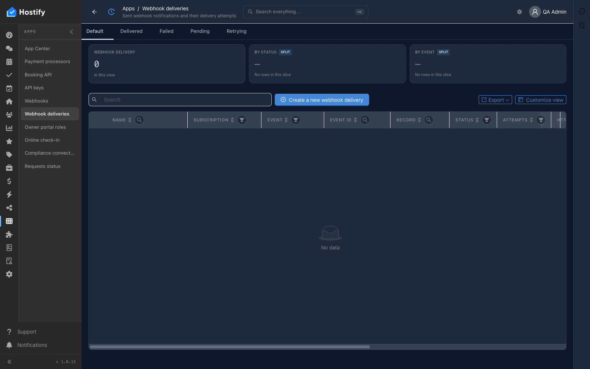


## Казус 4: ownerPortalRoles in the dark theme (/app/apps/ownerPortalRoles)

_Нов в този пуск._

**Какво се обърка**

```
Error: The page reported 48 error(s) — API answers, failed requests, console errors:
- [request.failed] net::ERR_BLOCKED_BY_ORB @ https://hostify-apps.bioseek.eu/plugins/turbosuite/logo.png
- [request.failed] net::ERR_BLOCKED_BY_ORB @ https://hostify-apps.bioseek.eu/plugins/remotelock/logo.png
- [request.failed] net::ERR_BLOCKED_BY_ORB @ https://hostify-apps.bioseek.eu/plugins/key-data/logo.png
- [request.failed] net::ERR_BLOCKED_BY_ORB @ https://hostify-apps.bioseek.eu/plugins/beyond/logo.jpg
- [request.failed] net::ERR_BLOCKED_BY_ORB @ https://hostify-apps.bioseek.eu/plugins/doinn/logo.png
- [request.failed] net::ERR_BLOCKED_BY_ORB @ https://hostify-apps.bioseek.eu/plugins/cardcom/logo.png
- [request.failed] net::ERR_BLOCKED_BY_ORB @ https://hostify-apps.bioseek.eu/plugins/akiles/logo.svg
- [request.failed] net::ERR_BLOCKED_BY_ORB @ https://hostify-apps.bioseek.eu/plugins/turnoverbnb/logo.png
- [request.failed] net::ERR_BLOCKED_BY_ORB @ https://hostify-apps.bioseek.eu/plugins/pricelabs/logo.svg
- [request.failed] net::ERR_BLOCKED_BY_ORB @ https://hostify-apps.bioseek.eu/plugins/breezeway/logo.png
```
- неуспешна заявка: net::ERR_BLOCKED_BY_ORB — `https://hostify-apps.bioseek.eu/plugins/turbosuite/logo.png`
- неуспешна заявка: net::ERR_BLOCKED_BY_ORB — `https://hostify-apps.bioseek.eu/plugins/remotelock/logo.png`
- неуспешна заявка: net::ERR_BLOCKED_BY_ORB — `https://hostify-apps.bioseek.eu/plugins/key-data/logo.png`
- неуспешна заявка: net::ERR_BLOCKED_BY_ORB — `https://hostify-apps.bioseek.eu/plugins/beyond/logo.jpg`
- неуспешна заявка: net::ERR_BLOCKED_BY_ORB — `https://hostify-apps.bioseek.eu/plugins/doinn/logo.png`
- неуспешна заявка: net::ERR_BLOCKED_BY_ORB — `https://hostify-apps.bioseek.eu/plugins/cardcom/logo.png`
- неуспешна заявка: net::ERR_BLOCKED_BY_ORB — `https://hostify-apps.bioseek.eu/plugins/akiles/logo.svg`
- неуспешна заявка: net::ERR_BLOCKED_BY_ORB — `https://hostify-apps.bioseek.eu/plugins/turnoverbnb/logo.png`
- неуспешна заявка: net::ERR_BLOCKED_BY_ORB — `https://hostify-apps.bioseek.eu/plugins/pricelabs/logo.svg`
- неуспешна заявка: net::ERR_BLOCKED_BY_ORB — `https://hostify-apps.bioseek.eu/plugins/breezeway/logo.png`

**Как да се възпроизведе**

1. Влез в https://hostify.bioseek.eu/app/ като администратор на акаунта (qa.admin@hostify-qa.test).
2. Меню: APPS › Owner portal roles — https://hostify.bioseek.eu/app/apps/ownerPortalRoles
3. Спек `tests/e2e/011-account-pages-dark.spec.ts`, проверка „ownerPortalRoles in the dark theme (/app/apps/ownerPortalRoles)“.
4. Developer tools › Network: заявките по-горе отговарят така.

**Скрийншоти**


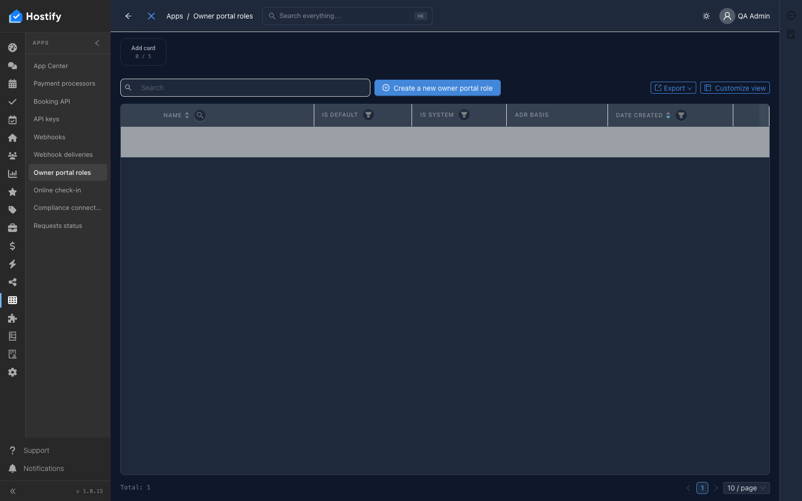


## Казус 5: checkinFormTemplates in the dark theme (/app/apps/checkinFormTemplates)

_Нов в този пуск._

**Какво се обърка**

```
Error: The page reported 48 error(s) — API answers, failed requests, console errors:
- [request.failed] net::ERR_BLOCKED_BY_ORB @ https://hostify-apps.bioseek.eu/plugins/remotelock/logo.png
- [request.failed] net::ERR_BLOCKED_BY_ORB @ https://hostify-apps.bioseek.eu/plugins/minut/logo.svg
- [request.failed] net::ERR_BLOCKED_BY_ORB @ https://hostify-apps.bioseek.eu/plugins/breezeway/logo.png
- [request.failed] net::ERR_BLOCKED_BY_ORB @ https://hostify-apps.bioseek.eu/plugins/safely/logo.png
- [request.failed] net::ERR_BLOCKED_BY_ORB @ https://hostify-apps.bioseek.eu/plugins/pricelabs/logo.svg
- [request.failed] net::ERR_BLOCKED_BY_ORB @ https://hostify-apps.bioseek.eu/plugins/key-data/logo.png
- [request.failed] net::ERR_BLOCKED_BY_ORB @ https://hostify-apps.bioseek.eu/plugins/turnoverbnb/logo.png
- [request.failed] net::ERR_BLOCKED_BY_ORB @ https://hostify-apps.bioseek.eu/plugins/beyond/logo.jpg
- [request.failed] net::ERR_BLOCKED_BY_ORB @ https://hostify-apps.bioseek.eu/plugins/turbosuite/logo.png
- [request.failed] net::ERR_BLOCKED_BY_ORB @ https://hostify-apps.bioseek.eu/plugins/cardcom/logo.png
```
- неуспешна заявка: net::ERR_BLOCKED_BY_ORB — `https://hostify-apps.bioseek.eu/plugins/remotelock/logo.png`
- неуспешна заявка: net::ERR_BLOCKED_BY_ORB — `https://hostify-apps.bioseek.eu/plugins/minut/logo.svg`
- неуспешна заявка: net::ERR_BLOCKED_BY_ORB — `https://hostify-apps.bioseek.eu/plugins/breezeway/logo.png`
- неуспешна заявка: net::ERR_BLOCKED_BY_ORB — `https://hostify-apps.bioseek.eu/plugins/safely/logo.png`
- неуспешна заявка: net::ERR_BLOCKED_BY_ORB — `https://hostify-apps.bioseek.eu/plugins/pricelabs/logo.svg`
- неуспешна заявка: net::ERR_BLOCKED_BY_ORB — `https://hostify-apps.bioseek.eu/plugins/key-data/logo.png`
- неуспешна заявка: net::ERR_BLOCKED_BY_ORB — `https://hostify-apps.bioseek.eu/plugins/turnoverbnb/logo.png`
- неуспешна заявка: net::ERR_BLOCKED_BY_ORB — `https://hostify-apps.bioseek.eu/plugins/beyond/logo.jpg`
- неуспешна заявка: net::ERR_BLOCKED_BY_ORB — `https://hostify-apps.bioseek.eu/plugins/turbosuite/logo.png`
- неуспешна заявка: net::ERR_BLOCKED_BY_ORB — `https://hostify-apps.bioseek.eu/plugins/cardcom/logo.png`

**Как да се възпроизведе**

1. Влез в https://hostify.bioseek.eu/app/ като администратор на акаунта (qa.admin@hostify-qa.test).
2. Меню: APPS › Online check-in — https://hostify.bioseek.eu/app/apps/checkinFormTemplates
3. Спек `tests/e2e/011-account-pages-dark.spec.ts`, проверка „checkinFormTemplates in the dark theme (/app/apps/checkinFormTemplates)“.
4. Developer tools › Network: заявките по-горе отговарят така.

**Скрийншоти**


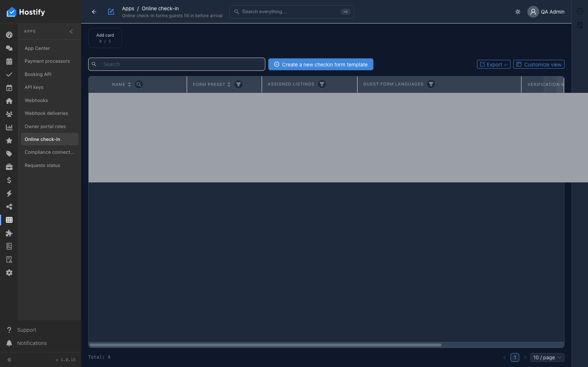


## Казус 6: complianceConnections in the dark theme (/app/apps/complianceConnections)

_Нов в този пуск._

**Какво се обърка**

```
Error: The page reported 48 error(s) — API answers, failed requests, console errors:
- [request.failed] net::ERR_BLOCKED_BY_ORB @ https://hostify-apps.bioseek.eu/plugins/duve/logo.png
- [request.failed] net::ERR_BLOCKED_BY_ORB @ https://hostify-apps.bioseek.eu/plugins/stripe/logo.png
- [request.failed] net::ERR_BLOCKED_BY_ORB @ https://hostify-apps.bioseek.eu/plugins/chekin/logo.svg
- [request.failed] net::ERR_BLOCKED_BY_ORB @ https://hostify-apps.bioseek.eu/plugins/paypal/logo.png
- [request.failed] net::ERR_BLOCKED_BY_ORB @ https://hostify-apps.bioseek.eu/plugins/superhog/logo.png
- [request.failed] net::ERR_BLOCKED_BY_ORB @ https://hostify-apps.bioseek.eu/plugins/breezeway/logo.png
- [request.failed] net::ERR_BLOCKED_BY_ORB @ https://hostify-apps.bioseek.eu/plugins/beyond/logo.jpg
- [request.failed] net::ERR_BLOCKED_BY_ORB @ https://hostify-apps.bioseek.eu/plugins/pricelabs/logo.svg
- [request.failed] net::ERR_BLOCKED_BY_ORB @ https://hostify-apps.bioseek.eu/plugins/cardcom/logo.png
- [request.failed] net::ERR_BLOCKED_BY_ORB @ https://hostify-apps.bioseek.eu/plugins/akiles/logo.svg
```
- неуспешна заявка: net::ERR_BLOCKED_BY_ORB — `https://hostify-apps.bioseek.eu/plugins/duve/logo.png`
- неуспешна заявка: net::ERR_BLOCKED_BY_ORB — `https://hostify-apps.bioseek.eu/plugins/stripe/logo.png`
- неуспешна заявка: net::ERR_BLOCKED_BY_ORB — `https://hostify-apps.bioseek.eu/plugins/chekin/logo.svg`
- неуспешна заявка: net::ERR_BLOCKED_BY_ORB — `https://hostify-apps.bioseek.eu/plugins/paypal/logo.png`
- неуспешна заявка: net::ERR_BLOCKED_BY_ORB — `https://hostify-apps.bioseek.eu/plugins/superhog/logo.png`
- неуспешна заявка: net::ERR_BLOCKED_BY_ORB — `https://hostify-apps.bioseek.eu/plugins/breezeway/logo.png`
- неуспешна заявка: net::ERR_BLOCKED_BY_ORB — `https://hostify-apps.bioseek.eu/plugins/beyond/logo.jpg`
- неуспешна заявка: net::ERR_BLOCKED_BY_ORB — `https://hostify-apps.bioseek.eu/plugins/pricelabs/logo.svg`
- неуспешна заявка: net::ERR_BLOCKED_BY_ORB — `https://hostify-apps.bioseek.eu/plugins/cardcom/logo.png`
- неуспешна заявка: net::ERR_BLOCKED_BY_ORB — `https://hostify-apps.bioseek.eu/plugins/akiles/logo.svg`

**Как да се възпроизведе**

1. Влез в https://hostify.bioseek.eu/app/ като администратор на акаунта (qa.admin@hostify-qa.test).
2. Меню: APPS › Compliance connections — https://hostify.bioseek.eu/app/apps/complianceConnections
3. Спек `tests/e2e/011-account-pages-dark.spec.ts`, проверка „complianceConnections in the dark theme (/app/apps/complianceConnections)“.
4. Developer tools › Network: заявките по-горе отговарят така.

**Скрийншоти**


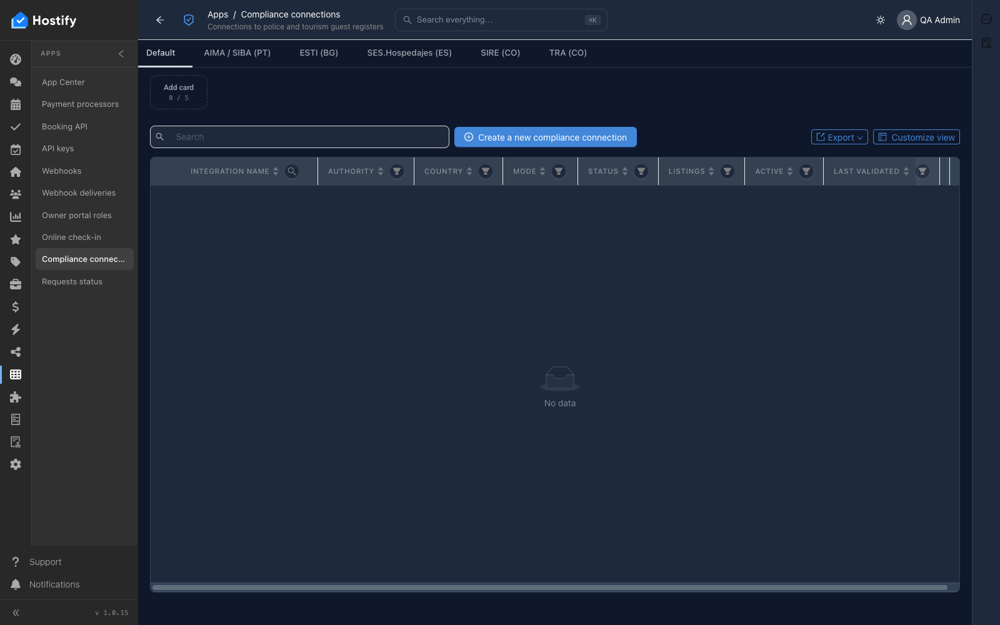


## Казус 7: accountProfile in the dark theme (/app/settings/accountProfile)

_Нов в този пуск._

**Какво се обърка**

```
Error: accountProfile: the screen is not presentable (1):
- [error/broken-image] https://hostify-apps.bioseek.eu/plugins/pesopay/logo.png
```
- неуспешна заявка: net::ERR_BLOCKED_BY_ORB — `https://hostify-apps.bioseek.eu/plugins/paypal/logo.png`
- неуспешна заявка: net::ERR_BLOCKED_BY_ORB — `https://hostify-apps.bioseek.eu/plugins/stripe/logo.png`
- неуспешна заявка: net::ERR_BLOCKED_BY_ORB — `https://hostify-apps.bioseek.eu/plugins/duve/logo.png`
- неуспешна заявка: net::ERR_BLOCKED_BY_ORB — `https://hostify-apps.bioseek.eu/plugins/chekin/logo.svg`
- неуспешна заявка: net::ERR_BLOCKED_BY_ORB — `https://hostify-apps.bioseek.eu/plugins/superhog/logo.png`
- неуспешна заявка: net::ERR_BLOCKED_BY_ORB — `https://hostify-apps.bioseek.eu/plugins/breezeway/logo.png`
- неуспешна заявка: net::ERR_BLOCKED_BY_ORB — `https://hostify-apps.bioseek.eu/plugins/pricelabs/logo.svg`
- неуспешна заявка: net::ERR_BLOCKED_BY_ORB — `https://hostify-apps.bioseek.eu/plugins/beyond/logo.jpg`
- неуспешна заявка: net::ERR_BLOCKED_BY_ORB — `https://hostify-apps.bioseek.eu/plugins/cardcom/logo.png`
- неуспешна заявка: net::ERR_BLOCKED_BY_ORB — `https://hostify-apps.bioseek.eu/plugins/akiles/logo.svg`
- на екрана (accountProfile): https://hostify-apps.bioseek.eu/plugins/pesopay/logo.png

**Как да се възпроизведе**

1. Влез в https://hostify.bioseek.eu/app/ като администратор на акаунта (qa.admin@hostify-qa.test).
2. Меню: SETTINGS › Account — https://hostify.bioseek.eu/app/settings/accountProfile
3. Спек `tests/e2e/011-account-pages-dark.spec.ts`, проверка „accountProfile in the dark theme (/app/settings/accountProfile)“.
4. Developer tools › Network: заявките по-горе отговарят така.

**Скрийншоти**


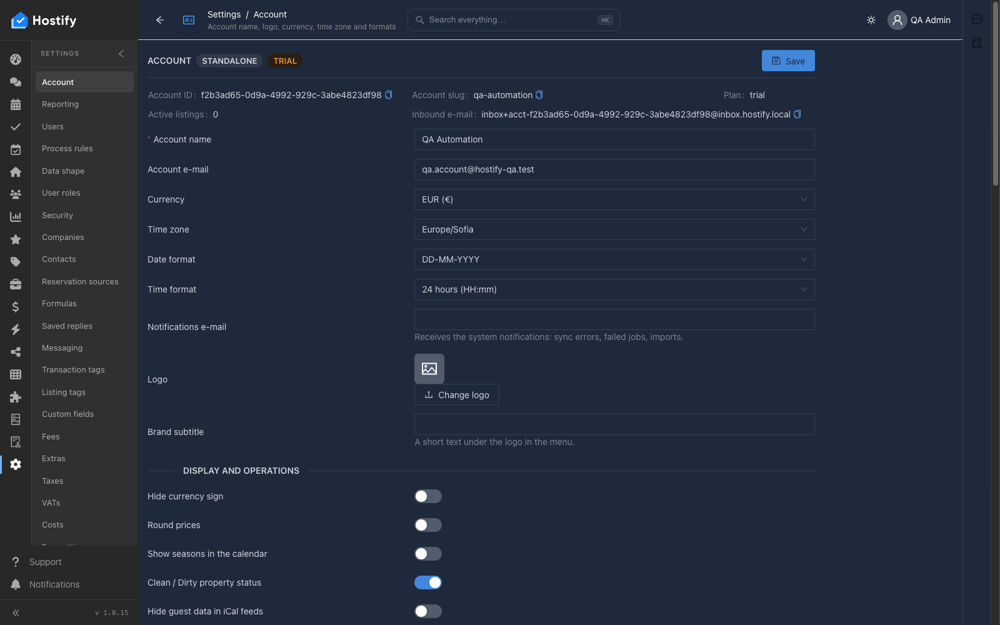


## Казус 8: reportingSettingsList in the dark theme (/app/settings/reportingSettingsList)

_Нов в този пуск._

**Какво се обърка**

```
Error: The page reported 78 error(s) — API answers, failed requests, console errors:
- [request.failed] net::ERR_BLOCKED_BY_ORB @ https://hostify-apps.bioseek.eu/plugins/paypal/logo.png
- [request.failed] net::ERR_BLOCKED_BY_ORB @ https://hostify-apps.bioseek.eu/plugins/stripe/logo.png
- [request.failed] net::ERR_BLOCKED_BY_ORB @ https://hostify-apps.bioseek.eu/plugins/duve/logo.png
- [request.failed] net::ERR_BLOCKED_BY_ORB @ https://hostify-apps.bioseek.eu/plugins/chekin/logo.svg
- [request.failed] net::ERR_BLOCKED_BY_ORB @ https://hostify-apps.bioseek.eu/plugins/superhog/logo.png
- [request.failed] net::ERR_BLOCKED_BY_ORB @ https://hostify-apps.bioseek.eu/plugins/breezeway/logo.png
- [request.failed] net::ERR_BLOCKED_BY_ORB @ https://hostify-apps.bioseek.eu/plugins/beyond/logo.jpg
- [request.failed] net::ERR_BLOCKED_BY_ORB @ https://hostify-apps.bioseek.eu/plugins/pricelabs/logo.svg
- [request.failed] net::ERR_BLOCKED_BY_ORB @ https://hostify-apps.bioseek.eu/plugins/akiles/logo.svg
- [request.failed] net::ERR_BLOCKED_BY_ORB @ https://hostify-apps.bioseek.eu/plugins/cardcom/logo.png
```
- неуспешна заявка: net::ERR_BLOCKED_BY_ORB — `https://hostify-apps.bioseek.eu/plugins/paypal/logo.png`
- неуспешна заявка: net::ERR_BLOCKED_BY_ORB — `https://hostify-apps.bioseek.eu/plugins/stripe/logo.png`
- неуспешна заявка: net::ERR_BLOCKED_BY_ORB — `https://hostify-apps.bioseek.eu/plugins/duve/logo.png`
- неуспешна заявка: net::ERR_BLOCKED_BY_ORB — `https://hostify-apps.bioseek.eu/plugins/chekin/logo.svg`
- неуспешна заявка: net::ERR_BLOCKED_BY_ORB — `https://hostify-apps.bioseek.eu/plugins/superhog/logo.png`
- неуспешна заявка: net::ERR_BLOCKED_BY_ORB — `https://hostify-apps.bioseek.eu/plugins/breezeway/logo.png`
- неуспешна заявка: net::ERR_BLOCKED_BY_ORB — `https://hostify-apps.bioseek.eu/plugins/beyond/logo.jpg`
- неуспешна заявка: net::ERR_BLOCKED_BY_ORB — `https://hostify-apps.bioseek.eu/plugins/pricelabs/logo.svg`
- неуспешна заявка: net::ERR_BLOCKED_BY_ORB — `https://hostify-apps.bioseek.eu/plugins/akiles/logo.svg`
- неуспешна заявка: net::ERR_BLOCKED_BY_ORB — `https://hostify-apps.bioseek.eu/plugins/cardcom/logo.png`

**Как да се възпроизведе**

1. Влез в https://hostify.bioseek.eu/app/ като администратор на акаунта (qa.admin@hostify-qa.test).
2. Меню: SETTINGS › Reporting — https://hostify.bioseek.eu/app/settings/reportingSettingsList
3. Спек `tests/e2e/011-account-pages-dark.spec.ts`, проверка „reportingSettingsList in the dark theme (/app/settings/reportingSettingsList)“.
4. Developer tools › Network: заявките по-горе отговарят така.

**Скрийншоти**


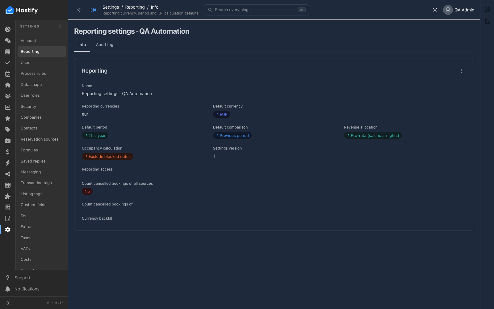


## Казус 9: users in the dark theme (/app/settings/users)

_Нов в този пуск._

**Какво се обърка**

```
Error: The page reported 78 error(s) — API answers, failed requests, console errors:
- [request.failed] net::ERR_BLOCKED_BY_ORB @ https://hostify-apps.bioseek.eu/plugins/duve/logo.png
- [request.failed] net::ERR_BLOCKED_BY_ORB @ https://hostify-apps.bioseek.eu/plugins/stripe/logo.png
- [request.failed] net::ERR_BLOCKED_BY_ORB @ https://hostify-apps.bioseek.eu/plugins/paypal/logo.png
- [request.failed] net::ERR_BLOCKED_BY_ORB @ https://hostify-apps.bioseek.eu/plugins/chekin/logo.svg
- [request.failed] net::ERR_BLOCKED_BY_ORB @ https://hostify-apps.bioseek.eu/plugins/breezeway/logo.png
- [request.failed] net::ERR_BLOCKED_BY_ORB @ https://hostify-apps.bioseek.eu/plugins/superhog/logo.png
- [request.failed] net::ERR_BLOCKED_BY_ORB @ https://hostify-apps.bioseek.eu/plugins/beyond/logo.jpg
- [request.failed] net::ERR_BLOCKED_BY_ORB @ https://hostify-apps.bioseek.eu/plugins/pricelabs/logo.svg
- [request.failed] net::ERR_BLOCKED_BY_ORB @ https://hostify-apps.bioseek.eu/plugins/cardcom/logo.png
- [request.failed] net::ERR_BLOCKED_BY_ORB @ https://hostify-apps.bioseek.eu/plugins/akiles/logo.svg
```
- неуспешна заявка: net::ERR_BLOCKED_BY_ORB — `https://hostify-apps.bioseek.eu/plugins/duve/logo.png`
- неуспешна заявка: net::ERR_BLOCKED_BY_ORB — `https://hostify-apps.bioseek.eu/plugins/stripe/logo.png`
- неуспешна заявка: net::ERR_BLOCKED_BY_ORB — `https://hostify-apps.bioseek.eu/plugins/paypal/logo.png`
- неуспешна заявка: net::ERR_BLOCKED_BY_ORB — `https://hostify-apps.bioseek.eu/plugins/chekin/logo.svg`
- неуспешна заявка: net::ERR_BLOCKED_BY_ORB — `https://hostify-apps.bioseek.eu/plugins/breezeway/logo.png`
- неуспешна заявка: net::ERR_BLOCKED_BY_ORB — `https://hostify-apps.bioseek.eu/plugins/superhog/logo.png`
- неуспешна заявка: net::ERR_BLOCKED_BY_ORB — `https://hostify-apps.bioseek.eu/plugins/beyond/logo.jpg`
- неуспешна заявка: net::ERR_BLOCKED_BY_ORB — `https://hostify-apps.bioseek.eu/plugins/pricelabs/logo.svg`
- неуспешна заявка: net::ERR_BLOCKED_BY_ORB — `https://hostify-apps.bioseek.eu/plugins/cardcom/logo.png`
- неуспешна заявка: net::ERR_BLOCKED_BY_ORB — `https://hostify-apps.bioseek.eu/plugins/akiles/logo.svg`

**Как да се възпроизведе**

1. Влез в https://hostify.bioseek.eu/app/ като администратор на акаунта (qa.admin@hostify-qa.test).
2. Меню: SETTINGS › Users — https://hostify.bioseek.eu/app/settings/users
3. Спек `tests/e2e/011-account-pages-dark.spec.ts`, проверка „users in the dark theme (/app/settings/users)“ — стъпките:
4. every column has a header and the actions column is the last one
5. Developer tools › Network: заявките по-горе отговарят така.

**Скрийншоти**

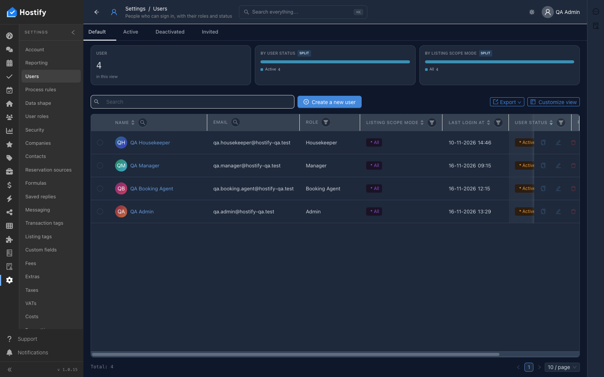


## Казус 10: dataShape in the dark theme (/app/settings/dataShape)

_Нов в този пуск._

**Какво се обърка**

```
Error: The page reported 78 error(s) — API answers, failed requests, console errors:
- [request.failed] net::ERR_BLOCKED_BY_ORB @ https://hostify-apps.bioseek.eu/plugins/stripe/logo.png
- [request.failed] net::ERR_BLOCKED_BY_ORB @ https://hostify-apps.bioseek.eu/plugins/paypal/logo.png
- [request.failed] net::ERR_BLOCKED_BY_ORB @ https://hostify-apps.bioseek.eu/plugins/duve/logo.png
- [request.failed] net::ERR_BLOCKED_BY_ORB @ https://hostify-apps.bioseek.eu/plugins/chekin/logo.svg
- [request.failed] net::ERR_BLOCKED_BY_ORB @ https://hostify-apps.bioseek.eu/plugins/superhog/logo.png
- [request.failed] net::ERR_BLOCKED_BY_ORB @ https://hostify-apps.bioseek.eu/plugins/breezeway/logo.png
- [request.failed] net::ERR_BLOCKED_BY_ORB @ https://hostify-apps.bioseek.eu/plugins/beyond/logo.jpg
- [request.failed] net::ERR_BLOCKED_BY_ORB @ https://hostify-apps.bioseek.eu/plugins/pricelabs/logo.svg
- [request.failed] net::ERR_BLOCKED_BY_ORB @ https://hostify-apps.bioseek.eu/plugins/cardcom/logo.png
- [request.failed] net::ERR_BLOCKED_BY_ORB @ https://hostify-apps.bioseek.eu/plugins/akiles/logo.svg
```
- неуспешна заявка: net::ERR_BLOCKED_BY_ORB — `https://hostify-apps.bioseek.eu/plugins/stripe/logo.png`
- неуспешна заявка: net::ERR_BLOCKED_BY_ORB — `https://hostify-apps.bioseek.eu/plugins/paypal/logo.png`
- неуспешна заявка: net::ERR_BLOCKED_BY_ORB — `https://hostify-apps.bioseek.eu/plugins/duve/logo.png`
- неуспешна заявка: net::ERR_BLOCKED_BY_ORB — `https://hostify-apps.bioseek.eu/plugins/chekin/logo.svg`
- неуспешна заявка: net::ERR_BLOCKED_BY_ORB — `https://hostify-apps.bioseek.eu/plugins/superhog/logo.png`
- неуспешна заявка: net::ERR_BLOCKED_BY_ORB — `https://hostify-apps.bioseek.eu/plugins/breezeway/logo.png`
- неуспешна заявка: net::ERR_BLOCKED_BY_ORB — `https://hostify-apps.bioseek.eu/plugins/beyond/logo.jpg`
- неуспешна заявка: net::ERR_BLOCKED_BY_ORB — `https://hostify-apps.bioseek.eu/plugins/pricelabs/logo.svg`
- неуспешна заявка: net::ERR_BLOCKED_BY_ORB — `https://hostify-apps.bioseek.eu/plugins/cardcom/logo.png`
- неуспешна заявка: net::ERR_BLOCKED_BY_ORB — `https://hostify-apps.bioseek.eu/plugins/akiles/logo.svg`

**Как да се възпроизведе**

1. Влез в https://hostify.bioseek.eu/app/ като администратор на акаунта (qa.admin@hostify-qa.test).
2. Меню: SETTINGS › Data shape — https://hostify.bioseek.eu/app/settings/dataShape
3. Спек `tests/e2e/011-account-pages-dark.spec.ts`, проверка „dataShape in the dark theme (/app/settings/dataShape)“.
4. Developer tools › Network: заявките по-горе отговарят така.

**Скрийншоти**

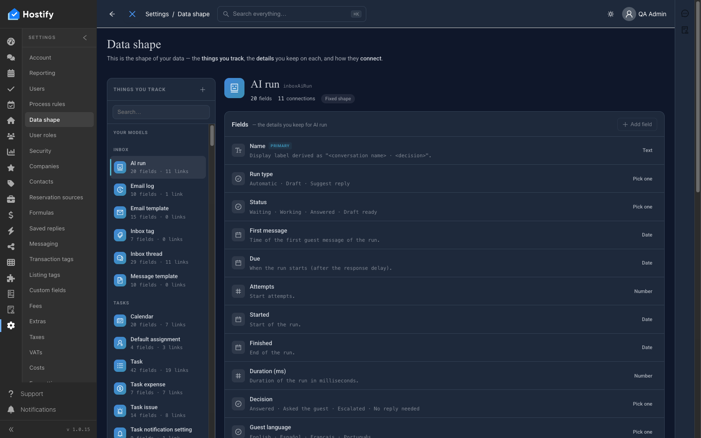


## Казус 11: securityGroups in the dark theme (/app/settings/securityGroups)

_Нов в този пуск._

**Какво се обърка**

```
Error: The page reported 78 error(s) — API answers, failed requests, console errors:
- [request.failed] net::ERR_BLOCKED_BY_ORB @ https://hostify-apps.bioseek.eu/plugins/duve/logo.png
- [request.failed] net::ERR_BLOCKED_BY_ORB @ https://hostify-apps.bioseek.eu/plugins/paypal/logo.png
- [request.failed] net::ERR_BLOCKED_BY_ORB @ https://hostify-apps.bioseek.eu/plugins/stripe/logo.png
- [request.failed] net::ERR_BLOCKED_BY_ORB @ https://hostify-apps.bioseek.eu/plugins/chekin/logo.svg
- [request.failed] net::ERR_BLOCKED_BY_ORB @ https://hostify-apps.bioseek.eu/plugins/superhog/logo.png
- [request.failed] net::ERR_BLOCKED_BY_ORB @ https://hostify-apps.bioseek.eu/plugins/beyond/logo.jpg
- [request.failed] net::ERR_BLOCKED_BY_ORB @ https://hostify-apps.bioseek.eu/plugins/pricelabs/logo.svg
- [request.failed] net::ERR_BLOCKED_BY_ORB @ https://hostify-apps.bioseek.eu/plugins/breezeway/logo.png
- [request.failed] net::ERR_BLOCKED_BY_ORB @ https://hostify-apps.bioseek.eu/plugins/cardcom/logo.png
- [request.failed] net::ERR_BLOCKED_BY_ORB @ https://hostify-apps.bioseek.eu/plugins/akiles/logo.svg
```
- неуспешна заявка: net::ERR_BLOCKED_BY_ORB — `https://hostify-apps.bioseek.eu/plugins/duve/logo.png`
- неуспешна заявка: net::ERR_BLOCKED_BY_ORB — `https://hostify-apps.bioseek.eu/plugins/paypal/logo.png`
- неуспешна заявка: net::ERR_BLOCKED_BY_ORB — `https://hostify-apps.bioseek.eu/plugins/stripe/logo.png`
- неуспешна заявка: net::ERR_BLOCKED_BY_ORB — `https://hostify-apps.bioseek.eu/plugins/chekin/logo.svg`
- неуспешна заявка: net::ERR_BLOCKED_BY_ORB — `https://hostify-apps.bioseek.eu/plugins/superhog/logo.png`
- неуспешна заявка: net::ERR_BLOCKED_BY_ORB — `https://hostify-apps.bioseek.eu/plugins/beyond/logo.jpg`
- неуспешна заявка: net::ERR_BLOCKED_BY_ORB — `https://hostify-apps.bioseek.eu/plugins/pricelabs/logo.svg`
- неуспешна заявка: net::ERR_BLOCKED_BY_ORB — `https://hostify-apps.bioseek.eu/plugins/breezeway/logo.png`
- неуспешна заявка: net::ERR_BLOCKED_BY_ORB — `https://hostify-apps.bioseek.eu/plugins/cardcom/logo.png`
- неуспешна заявка: net::ERR_BLOCKED_BY_ORB — `https://hostify-apps.bioseek.eu/plugins/akiles/logo.svg`

**Как да се възпроизведе**

1. Влез в https://hostify.bioseek.eu/app/ като администратор на акаунта (qa.admin@hostify-qa.test).
2. Меню: SETTINGS › User roles — https://hostify.bioseek.eu/app/settings/securityGroups
3. Спек `tests/e2e/011-account-pages-dark.spec.ts`, проверка „securityGroups in the dark theme (/app/settings/securityGroups)“.
4. Developer tools › Network: заявките по-горе отговарят така.

**Скрийншоти**

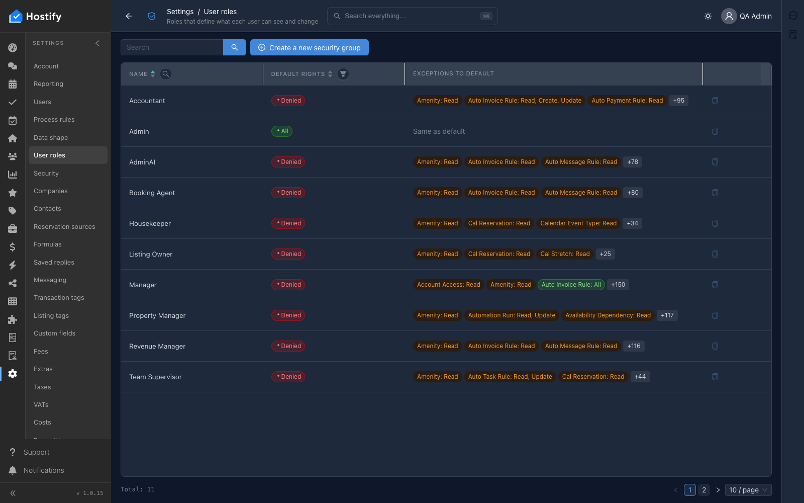


## Казус 12: securitySettings in the dark theme (/app/settings/securitySettings)

_Нов в този пуск._

**Какво се обърка**

```
Error: The page reported 75 error(s) — API answers, failed requests, console errors:
- [request.failed] net::ERR_BLOCKED_BY_ORB @ https://hostify-apps.bioseek.eu/plugins/paypal/logo.png
- [request.failed] net::ERR_BLOCKED_BY_ORB @ https://hostify-apps.bioseek.eu/plugins/stripe/logo.png
- [request.failed] net::ERR_BLOCKED_BY_ORB @ https://hostify-apps.bioseek.eu/plugins/chekin/logo.svg
- [request.failed] net::ERR_BLOCKED_BY_ORB @ https://hostify-apps.bioseek.eu/plugins/duve/logo.png
- [request.failed] net::ERR_BLOCKED_BY_ORB @ https://hostify-apps.bioseek.eu/plugins/superhog/logo.png
- [request.failed] net::ERR_BLOCKED_BY_ORB @ https://hostify-apps.bioseek.eu/plugins/breezeway/logo.png
- [request.failed] net::ERR_BLOCKED_BY_ORB @ https://hostify-apps.bioseek.eu/plugins/beyond/logo.jpg
- [request.failed] net::ERR_BLOCKED_BY_ORB @ https://hostify-apps.bioseek.eu/plugins/pricelabs/logo.svg
- [request.failed] net::ERR_BLOCKED_BY_ORB @ https://hostify-apps.bioseek.eu/plugins/cardcom/logo.png
- [request.failed] net::ERR_BLOCKED_BY_ORB @ https://hostify-apps.bioseek.eu/plugins/akiles/logo.svg
```
- неуспешна заявка: net::ERR_BLOCKED_BY_ORB — `https://hostify-apps.bioseek.eu/plugins/paypal/logo.png`
- неуспешна заявка: net::ERR_BLOCKED_BY_ORB — `https://hostify-apps.bioseek.eu/plugins/stripe/logo.png`
- неуспешна заявка: net::ERR_BLOCKED_BY_ORB — `https://hostify-apps.bioseek.eu/plugins/chekin/logo.svg`
- неуспешна заявка: net::ERR_BLOCKED_BY_ORB — `https://hostify-apps.bioseek.eu/plugins/duve/logo.png`
- неуспешна заявка: net::ERR_BLOCKED_BY_ORB — `https://hostify-apps.bioseek.eu/plugins/superhog/logo.png`
- неуспешна заявка: net::ERR_BLOCKED_BY_ORB — `https://hostify-apps.bioseek.eu/plugins/breezeway/logo.png`
- неуспешна заявка: net::ERR_BLOCKED_BY_ORB — `https://hostify-apps.bioseek.eu/plugins/beyond/logo.jpg`
- неуспешна заявка: net::ERR_BLOCKED_BY_ORB — `https://hostify-apps.bioseek.eu/plugins/pricelabs/logo.svg`
- неуспешна заявка: net::ERR_BLOCKED_BY_ORB — `https://hostify-apps.bioseek.eu/plugins/cardcom/logo.png`
- неуспешна заявка: net::ERR_BLOCKED_BY_ORB — `https://hostify-apps.bioseek.eu/plugins/akiles/logo.svg`

**Как да се възпроизведе**

1. Влез в https://hostify.bioseek.eu/app/ като администратор на акаунта (qa.admin@hostify-qa.test).
2. Меню: SETTINGS › Security — https://hostify.bioseek.eu/app/settings/securitySettings
3. Спек `tests/e2e/011-account-pages-dark.spec.ts`, проверка „securitySettings in the dark theme (/app/settings/securitySettings)“.
4. Developer tools › Network: заявките по-горе отговарят така.

**Скрийншоти**

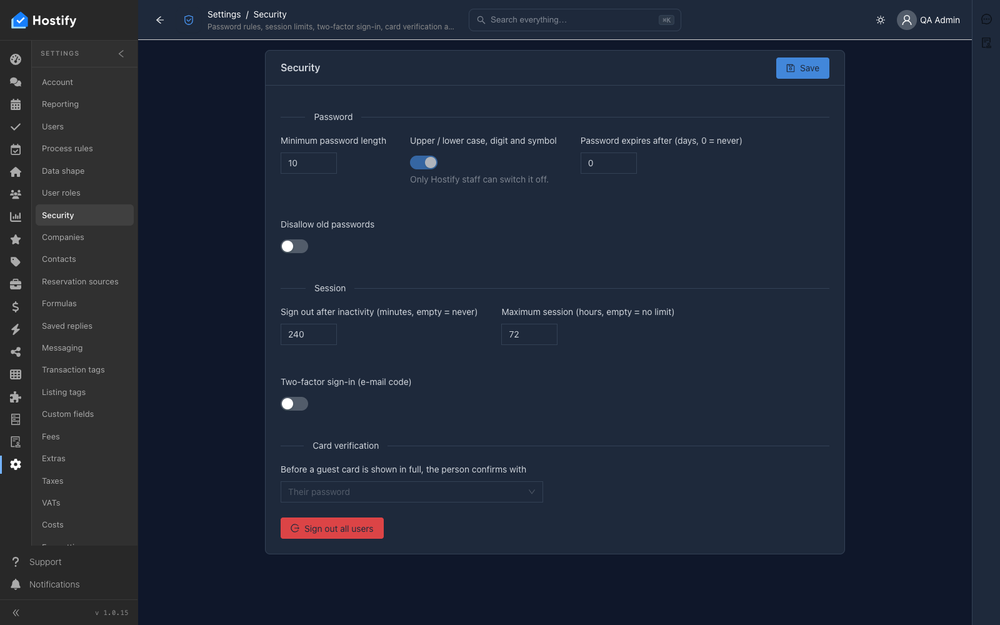


## Казус 13: companies in the dark theme (/app/settings/companies)

_Нов в този пуск._

**Какво се обърка**

```
Error: The page reported 78 error(s) — API answers, failed requests, console errors:
- [request.failed] net::ERR_BLOCKED_BY_ORB @ https://hostify-apps.bioseek.eu/plugins/paypal/logo.png
- [request.failed] net::ERR_BLOCKED_BY_ORB @ https://hostify-apps.bioseek.eu/plugins/stripe/logo.png
- [request.failed] net::ERR_BLOCKED_BY_ORB @ https://hostify-apps.bioseek.eu/plugins/duve/logo.png
- [request.failed] net::ERR_BLOCKED_BY_ORB @ https://hostify-apps.bioseek.eu/plugins/chekin/logo.svg
- [request.failed] net::ERR_BLOCKED_BY_ORB @ https://hostify-apps.bioseek.eu/plugins/superhog/logo.png
- [request.failed] net::ERR_BLOCKED_BY_ORB @ https://hostify-apps.bioseek.eu/plugins/breezeway/logo.png
- [request.failed] net::ERR_BLOCKED_BY_ORB @ https://hostify-apps.bioseek.eu/plugins/beyond/logo.jpg
- [request.failed] net::ERR_BLOCKED_BY_ORB @ https://hostify-apps.bioseek.eu/plugins/pricelabs/logo.svg
- [request.failed] net::ERR_BLOCKED_BY_ORB @ https://hostify-apps.bioseek.eu/plugins/cardcom/logo.png
- [request.failed] net::ERR_BLOCKED_BY_ORB @ https://hostify-apps.bioseek.eu/plugins/akiles/logo.svg
```
- неуспешна заявка: net::ERR_BLOCKED_BY_ORB — `https://hostify-apps.bioseek.eu/plugins/paypal/logo.png`
- неуспешна заявка: net::ERR_BLOCKED_BY_ORB — `https://hostify-apps.bioseek.eu/plugins/stripe/logo.png`
- неуспешна заявка: net::ERR_BLOCKED_BY_ORB — `https://hostify-apps.bioseek.eu/plugins/duve/logo.png`
- неуспешна заявка: net::ERR_BLOCKED_BY_ORB — `https://hostify-apps.bioseek.eu/plugins/chekin/logo.svg`
- неуспешна заявка: net::ERR_BLOCKED_BY_ORB — `https://hostify-apps.bioseek.eu/plugins/superhog/logo.png`
- неуспешна заявка: net::ERR_BLOCKED_BY_ORB — `https://hostify-apps.bioseek.eu/plugins/breezeway/logo.png`
- неуспешна заявка: net::ERR_BLOCKED_BY_ORB — `https://hostify-apps.bioseek.eu/plugins/beyond/logo.jpg`
- неуспешна заявка: net::ERR_BLOCKED_BY_ORB — `https://hostify-apps.bioseek.eu/plugins/pricelabs/logo.svg`
- неуспешна заявка: net::ERR_BLOCKED_BY_ORB — `https://hostify-apps.bioseek.eu/plugins/cardcom/logo.png`
- неуспешна заявка: net::ERR_BLOCKED_BY_ORB — `https://hostify-apps.bioseek.eu/plugins/akiles/logo.svg`

**Как да се възпроизведе**

1. Влез в https://hostify.bioseek.eu/app/ като администратор на акаунта (qa.admin@hostify-qa.test).
2. Меню: SETTINGS › Companies — https://hostify.bioseek.eu/app/settings/companies
3. Спек `tests/e2e/011-account-pages-dark.spec.ts`, проверка „companies in the dark theme (/app/settings/companies)“.
4. Developer tools › Network: заявките по-горе отговарят така.

**Скрийншоти**

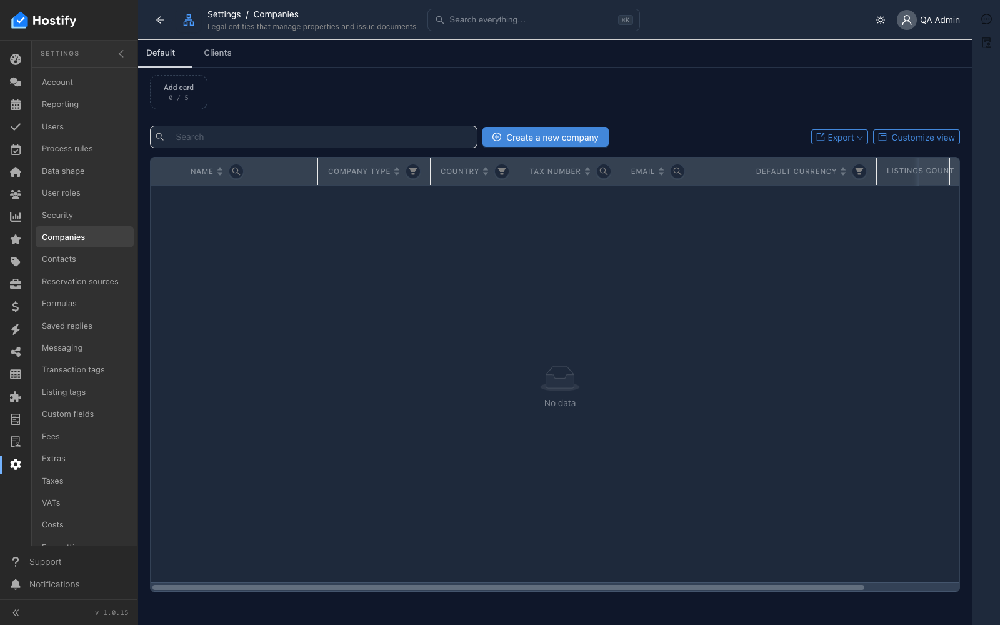


## Казус 14: contacts in the dark theme (/app/settings/contacts)

_Нов в този пуск._

**Какво се обърка**

```
Error: The page reported 78 error(s) — API answers, failed requests, console errors:
- [request.failed] net::ERR_BLOCKED_BY_ORB @ https://hostify-apps.bioseek.eu/plugins/duve/logo.png
- [request.failed] net::ERR_BLOCKED_BY_ORB @ https://hostify-apps.bioseek.eu/plugins/paypal/logo.png
- [request.failed] net::ERR_BLOCKED_BY_ORB @ https://hostify-apps.bioseek.eu/plugins/chekin/logo.svg
- [request.failed] net::ERR_BLOCKED_BY_ORB @ https://hostify-apps.bioseek.eu/plugins/stripe/logo.png
- [request.failed] net::ERR_BLOCKED_BY_ORB @ https://hostify-apps.bioseek.eu/plugins/superhog/logo.png
- [request.failed] net::ERR_BLOCKED_BY_ORB @ https://hostify-apps.bioseek.eu/plugins/breezeway/logo.png
- [request.failed] net::ERR_BLOCKED_BY_ORB @ https://hostify-apps.bioseek.eu/plugins/beyond/logo.jpg
- [request.failed] net::ERR_BLOCKED_BY_ORB @ https://hostify-apps.bioseek.eu/plugins/pricelabs/logo.svg
- [request.failed] net::ERR_BLOCKED_BY_ORB @ https://hostify-apps.bioseek.eu/plugins/cardcom/logo.png
- [request.failed] net::ERR_BLOCKED_BY_ORB @ https://hostify-apps.bioseek.eu/plugins/akiles/logo.svg
```
- неуспешна заявка: net::ERR_BLOCKED_BY_ORB — `https://hostify-apps.bioseek.eu/plugins/duve/logo.png`
- неуспешна заявка: net::ERR_BLOCKED_BY_ORB — `https://hostify-apps.bioseek.eu/plugins/paypal/logo.png`
- неуспешна заявка: net::ERR_BLOCKED_BY_ORB — `https://hostify-apps.bioseek.eu/plugins/chekin/logo.svg`
- неуспешна заявка: net::ERR_BLOCKED_BY_ORB — `https://hostify-apps.bioseek.eu/plugins/stripe/logo.png`
- неуспешна заявка: net::ERR_BLOCKED_BY_ORB — `https://hostify-apps.bioseek.eu/plugins/superhog/logo.png`
- неуспешна заявка: net::ERR_BLOCKED_BY_ORB — `https://hostify-apps.bioseek.eu/plugins/breezeway/logo.png`
- неуспешна заявка: net::ERR_BLOCKED_BY_ORB — `https://hostify-apps.bioseek.eu/plugins/beyond/logo.jpg`
- неуспешна заявка: net::ERR_BLOCKED_BY_ORB — `https://hostify-apps.bioseek.eu/plugins/pricelabs/logo.svg`
- неуспешна заявка: net::ERR_BLOCKED_BY_ORB — `https://hostify-apps.bioseek.eu/plugins/cardcom/logo.png`
- неуспешна заявка: net::ERR_BLOCKED_BY_ORB — `https://hostify-apps.bioseek.eu/plugins/akiles/logo.svg`

**Как да се възпроизведе**

1. Влез в https://hostify.bioseek.eu/app/ като администратор на акаунта (qa.admin@hostify-qa.test).
2. Меню: SETTINGS › Contacts — https://hostify.bioseek.eu/app/settings/contacts
3. Спек `tests/e2e/011-account-pages-dark.spec.ts`, проверка „contacts in the dark theme (/app/settings/contacts)“.
4. Developer tools › Network: заявките по-горе отговарят така.

**Скрийншоти**


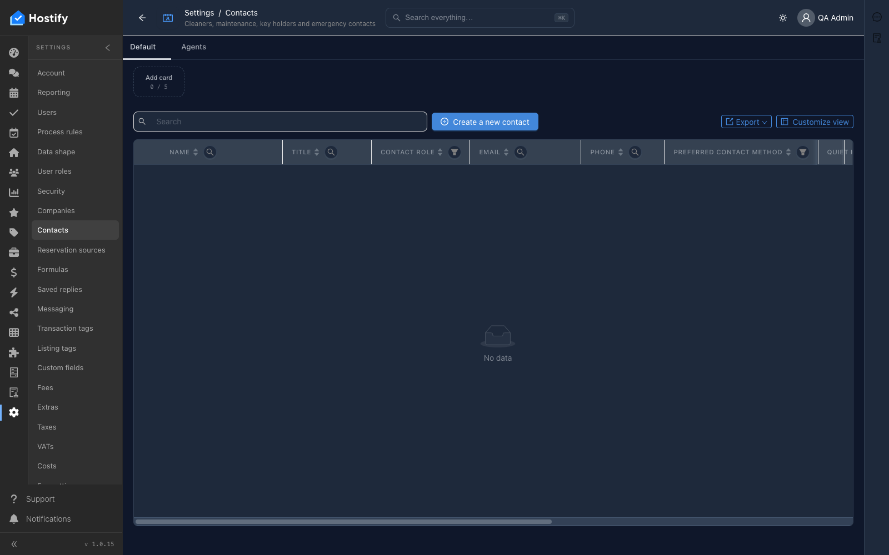


## Казус 15: reservationSources in the dark theme (/app/settings/reservationSources)

_Нов в този пуск._

**Какво се обърка**

```
Error: The page reported 78 error(s) — API answers, failed requests, console errors:
- [request.failed] net::ERR_BLOCKED_BY_ORB @ https://hostify-apps.bioseek.eu/plugins/duve/logo.png
- [request.failed] net::ERR_BLOCKED_BY_ORB @ https://hostify-apps.bioseek.eu/plugins/paypal/logo.png
- [request.failed] net::ERR_BLOCKED_BY_ORB @ https://hostify-apps.bioseek.eu/plugins/stripe/logo.png
- [request.failed] net::ERR_BLOCKED_BY_ORB @ https://hostify-apps.bioseek.eu/plugins/chekin/logo.svg
- [request.failed] net::ERR_BLOCKED_BY_ORB @ https://hostify-apps.bioseek.eu/plugins/superhog/logo.png
- [request.failed] net::ERR_BLOCKED_BY_ORB @ https://hostify-apps.bioseek.eu/plugins/breezeway/logo.png
- [request.failed] net::ERR_BLOCKED_BY_ORB @ https://hostify-apps.bioseek.eu/plugins/beyond/logo.jpg
- [request.failed] net::ERR_BLOCKED_BY_ORB @ https://hostify-apps.bioseek.eu/plugins/pricelabs/logo.svg
- [request.failed] net::ERR_BLOCKED_BY_ORB @ https://hostify-apps.bioseek.eu/plugins/cardcom/logo.png
- [request.failed] net::ERR_BLOCKED_BY_ORB @ https://hostify-apps.bioseek.eu/plugins/akiles/logo.svg
```
- неуспешна заявка: net::ERR_BLOCKED_BY_ORB — `https://hostify-apps.bioseek.eu/plugins/duve/logo.png`
- неуспешна заявка: net::ERR_BLOCKED_BY_ORB — `https://hostify-apps.bioseek.eu/plugins/paypal/logo.png`
- неуспешна заявка: net::ERR_BLOCKED_BY_ORB — `https://hostify-apps.bioseek.eu/plugins/stripe/logo.png`
- неуспешна заявка: net::ERR_BLOCKED_BY_ORB — `https://hostify-apps.bioseek.eu/plugins/chekin/logo.svg`
- неуспешна заявка: net::ERR_BLOCKED_BY_ORB — `https://hostify-apps.bioseek.eu/plugins/superhog/logo.png`
- неуспешна заявка: net::ERR_BLOCKED_BY_ORB — `https://hostify-apps.bioseek.eu/plugins/breezeway/logo.png`
- неуспешна заявка: net::ERR_BLOCKED_BY_ORB — `https://hostify-apps.bioseek.eu/plugins/beyond/logo.jpg`
- неуспешна заявка: net::ERR_BLOCKED_BY_ORB — `https://hostify-apps.bioseek.eu/plugins/pricelabs/logo.svg`
- неуспешна заявка: net::ERR_BLOCKED_BY_ORB — `https://hostify-apps.bioseek.eu/plugins/cardcom/logo.png`
- неуспешна заявка: net::ERR_BLOCKED_BY_ORB — `https://hostify-apps.bioseek.eu/plugins/akiles/logo.svg`

**Как да се възпроизведе**

1. Влез в https://hostify.bioseek.eu/app/ като администратор на акаунта (qa.admin@hostify-qa.test).
2. Меню: SETTINGS › Reservation sources — https://hostify.bioseek.eu/app/settings/reservationSources
3. Спек `tests/e2e/011-account-pages-dark.spec.ts`, проверка „reservationSources in the dark theme (/app/settings/reservationSources)“.
4. Developer tools › Network: заявките по-горе отговарят така.

**Скрийншоти**


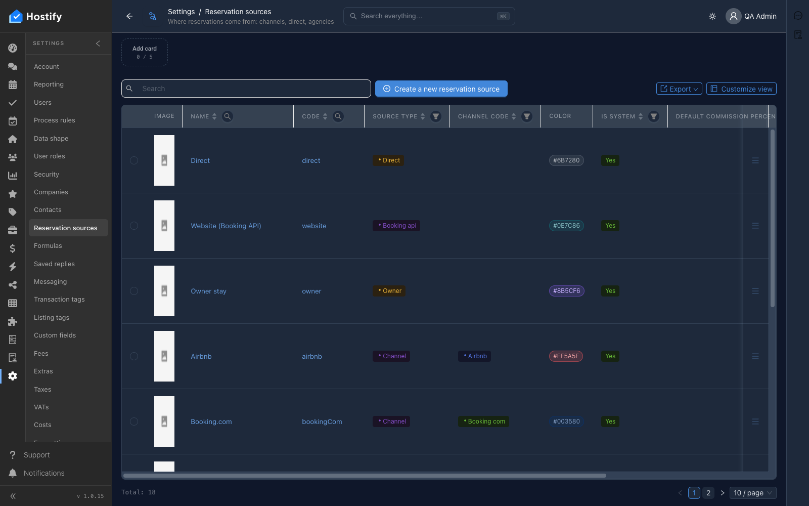


## Казус 16: settingsFormulas in the dark theme (/app/settings/settingsFormulas)

_Нов в този пуск._

**Какво се обърка**

```
Error: The page reported 78 error(s) — API answers, failed requests, console errors:
- [request.failed] net::ERR_BLOCKED_BY_ORB @ https://hostify-apps.bioseek.eu/plugins/stripe/logo.png
- [request.failed] net::ERR_BLOCKED_BY_ORB @ https://hostify-apps.bioseek.eu/plugins/paypal/logo.png
- [request.failed] net::ERR_BLOCKED_BY_ORB @ https://hostify-apps.bioseek.eu/plugins/chekin/logo.svg
- [request.failed] net::ERR_BLOCKED_BY_ORB @ https://hostify-apps.bioseek.eu/plugins/duve/logo.png
- [request.failed] net::ERR_BLOCKED_BY_ORB @ https://hostify-apps.bioseek.eu/plugins/superhog/logo.png
- [request.failed] net::ERR_BLOCKED_BY_ORB @ https://hostify-apps.bioseek.eu/plugins/breezeway/logo.png
- [request.failed] net::ERR_BLOCKED_BY_ORB @ https://hostify-apps.bioseek.eu/plugins/beyond/logo.jpg
- [request.failed] net::ERR_BLOCKED_BY_ORB @ https://hostify-apps.bioseek.eu/plugins/pricelabs/logo.svg
- [request.failed] net::ERR_BLOCKED_BY_ORB @ https://hostify-apps.bioseek.eu/plugins/cardcom/logo.png
- [request.failed] net::ERR_BLOCKED_BY_ORB @ https://hostify-apps.bioseek.eu/plugins/akiles/logo.svg
```
- неуспешна заявка: net::ERR_BLOCKED_BY_ORB — `https://hostify-apps.bioseek.eu/plugins/stripe/logo.png`
- неуспешна заявка: net::ERR_BLOCKED_BY_ORB — `https://hostify-apps.bioseek.eu/plugins/paypal/logo.png`
- неуспешна заявка: net::ERR_BLOCKED_BY_ORB — `https://hostify-apps.bioseek.eu/plugins/chekin/logo.svg`
- неуспешна заявка: net::ERR_BLOCKED_BY_ORB — `https://hostify-apps.bioseek.eu/plugins/duve/logo.png`
- неуспешна заявка: net::ERR_BLOCKED_BY_ORB — `https://hostify-apps.bioseek.eu/plugins/superhog/logo.png`
- неуспешна заявка: net::ERR_BLOCKED_BY_ORB — `https://hostify-apps.bioseek.eu/plugins/breezeway/logo.png`
- неуспешна заявка: net::ERR_BLOCKED_BY_ORB — `https://hostify-apps.bioseek.eu/plugins/beyond/logo.jpg`
- неуспешна заявка: net::ERR_BLOCKED_BY_ORB — `https://hostify-apps.bioseek.eu/plugins/pricelabs/logo.svg`
- неуспешна заявка: net::ERR_BLOCKED_BY_ORB — `https://hostify-apps.bioseek.eu/plugins/cardcom/logo.png`
- неуспешна заявка: net::ERR_BLOCKED_BY_ORB — `https://hostify-apps.bioseek.eu/plugins/akiles/logo.svg`

**Как да се възпроизведе**

1. Влез в https://hostify.bioseek.eu/app/ като администратор на акаунта (qa.admin@hostify-qa.test).
2. Меню: SETTINGS › Formulas — https://hostify.bioseek.eu/app/settings/settingsFormulas
3. Спек `tests/e2e/011-account-pages-dark.spec.ts`, проверка „settingsFormulas in the dark theme (/app/settings/settingsFormulas)“.
4. Developer tools › Network: заявките по-горе отговарят така.

**Скрийншоти**

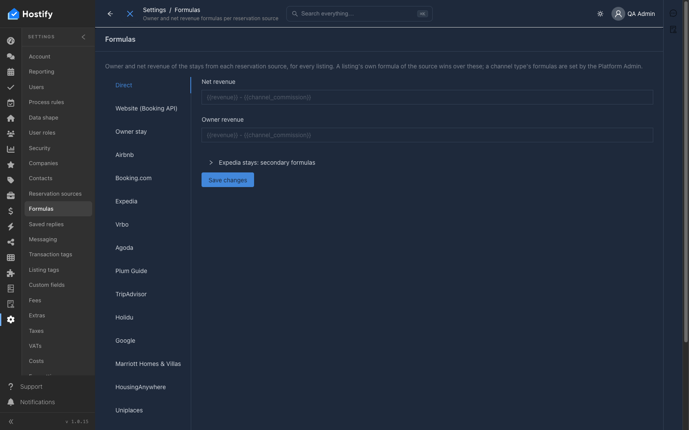


## Казус 17: savedReplies in the dark theme (/app/settings/savedReplies)

_Нов в този пуск._

**Какво се обърка**

```
Error: The page reported 78 error(s) — API answers, failed requests, console errors:
- [request.failed] net::ERR_BLOCKED_BY_ORB @ https://hostify-apps.bioseek.eu/plugins/duve/logo.png
- [request.failed] net::ERR_BLOCKED_BY_ORB @ https://hostify-apps.bioseek.eu/plugins/stripe/logo.png
- [request.failed] net::ERR_BLOCKED_BY_ORB @ https://hostify-apps.bioseek.eu/plugins/chekin/logo.svg
- [request.failed] net::ERR_BLOCKED_BY_ORB @ https://hostify-apps.bioseek.eu/plugins/paypal/logo.png
- [request.failed] net::ERR_BLOCKED_BY_ORB @ https://hostify-apps.bioseek.eu/plugins/superhog/logo.png
- [request.failed] net::ERR_BLOCKED_BY_ORB @ https://hostify-apps.bioseek.eu/plugins/breezeway/logo.png
- [request.failed] net::ERR_BLOCKED_BY_ORB @ https://hostify-apps.bioseek.eu/plugins/beyond/logo.jpg
- [request.failed] net::ERR_BLOCKED_BY_ORB @ https://hostify-apps.bioseek.eu/plugins/pricelabs/logo.svg
- [request.failed] net::ERR_BLOCKED_BY_ORB @ https://hostify-apps.bioseek.eu/plugins/cardcom/logo.png
- [request.failed] net::ERR_BLOCKED_BY_ORB @ https://hostify-apps.bioseek.eu/plugins/akiles/logo.svg
```
- неуспешна заявка: net::ERR_BLOCKED_BY_ORB — `https://hostify-apps.bioseek.eu/plugins/duve/logo.png`
- неуспешна заявка: net::ERR_BLOCKED_BY_ORB — `https://hostify-apps.bioseek.eu/plugins/stripe/logo.png`
- неуспешна заявка: net::ERR_BLOCKED_BY_ORB — `https://hostify-apps.bioseek.eu/plugins/chekin/logo.svg`
- неуспешна заявка: net::ERR_BLOCKED_BY_ORB — `https://hostify-apps.bioseek.eu/plugins/paypal/logo.png`
- неуспешна заявка: net::ERR_BLOCKED_BY_ORB — `https://hostify-apps.bioseek.eu/plugins/superhog/logo.png`
- неуспешна заявка: net::ERR_BLOCKED_BY_ORB — `https://hostify-apps.bioseek.eu/plugins/breezeway/logo.png`
- неуспешна заявка: net::ERR_BLOCKED_BY_ORB — `https://hostify-apps.bioseek.eu/plugins/beyond/logo.jpg`
- неуспешна заявка: net::ERR_BLOCKED_BY_ORB — `https://hostify-apps.bioseek.eu/plugins/pricelabs/logo.svg`
- неуспешна заявка: net::ERR_BLOCKED_BY_ORB — `https://hostify-apps.bioseek.eu/plugins/cardcom/logo.png`
- неуспешна заявка: net::ERR_BLOCKED_BY_ORB — `https://hostify-apps.bioseek.eu/plugins/akiles/logo.svg`

**Как да се възпроизведе**

1. Влез в https://hostify.bioseek.eu/app/ като администратор на акаунта (qa.admin@hostify-qa.test).
2. Меню: SETTINGS › Saved replies — https://hostify.bioseek.eu/app/settings/savedReplies
3. Спек `tests/e2e/011-account-pages-dark.spec.ts`, проверка „savedReplies in the dark theme (/app/settings/savedReplies)“.
4. Developer tools › Network: заявките по-горе отговарят така.

**Скрийншоти**

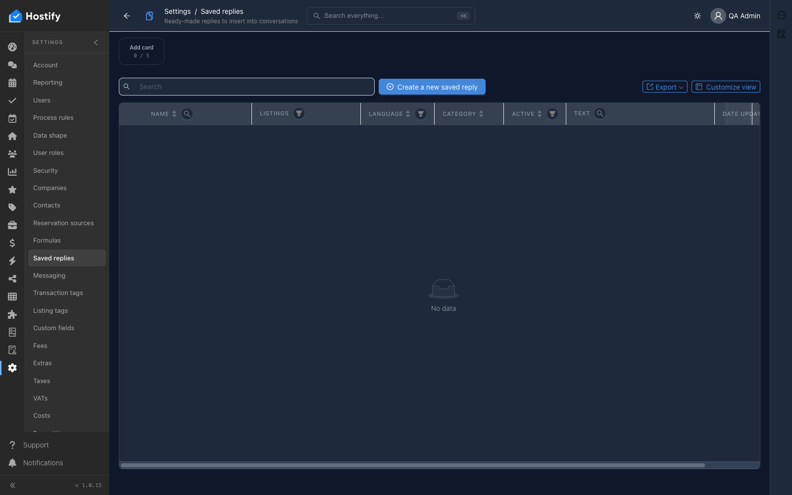


## Казус 18: messagingSettings in the dark theme (/app/settings/messagingSettings)

_Нов в този пуск._

**Какво се обърка**

```
Error: The page reported 72 error(s) — API answers, failed requests, console errors:
- [request.failed] net::ERR_BLOCKED_BY_ORB @ https://hostify-apps.bioseek.eu/plugins/stripe/logo.png
- [request.failed] net::ERR_BLOCKED_BY_ORB @ https://hostify-apps.bioseek.eu/plugins/paypal/logo.png
- [request.failed] net::ERR_BLOCKED_BY_ORB @ https://hostify-apps.bioseek.eu/plugins/duve/logo.png
- [request.failed] net::ERR_BLOCKED_BY_ORB @ https://hostify-apps.bioseek.eu/plugins/chekin/logo.svg
- [request.failed] net::ERR_BLOCKED_BY_ORB @ https://hostify-apps.bioseek.eu/plugins/superhog/logo.png
- [request.failed] net::ERR_BLOCKED_BY_ORB @ https://hostify-apps.bioseek.eu/plugins/breezeway/logo.png
- [request.failed] net::ERR_BLOCKED_BY_ORB @ https://hostify-apps.bioseek.eu/plugins/pricelabs/logo.svg
- [request.failed] net::ERR_BLOCKED_BY_ORB @ https://hostify-apps.bioseek.eu/plugins/akiles/logo.svg
- [request.failed] net::ERR_BLOCKED_BY_ORB @ https://hostify-apps.bioseek.eu/plugins/beyond/logo.jpg
- [request.failed] net::ERR_BLOCKED_BY_ORB @ https://hostify-apps.bioseek.eu/plugins/cardcom/logo.png
```
- неуспешна заявка: net::ERR_BLOCKED_BY_ORB — `https://hostify-apps.bioseek.eu/plugins/stripe/logo.png`
- неуспешна заявка: net::ERR_BLOCKED_BY_ORB — `https://hostify-apps.bioseek.eu/plugins/paypal/logo.png`
- неуспешна заявка: net::ERR_BLOCKED_BY_ORB — `https://hostify-apps.bioseek.eu/plugins/duve/logo.png`
- неуспешна заявка: net::ERR_BLOCKED_BY_ORB — `https://hostify-apps.bioseek.eu/plugins/chekin/logo.svg`
- неуспешна заявка: net::ERR_BLOCKED_BY_ORB — `https://hostify-apps.bioseek.eu/plugins/superhog/logo.png`
- неуспешна заявка: net::ERR_BLOCKED_BY_ORB — `https://hostify-apps.bioseek.eu/plugins/breezeway/logo.png`
- неуспешна заявка: net::ERR_BLOCKED_BY_ORB — `https://hostify-apps.bioseek.eu/plugins/pricelabs/logo.svg`
- неуспешна заявка: net::ERR_BLOCKED_BY_ORB — `https://hostify-apps.bioseek.eu/plugins/akiles/logo.svg`
- неуспешна заявка: net::ERR_BLOCKED_BY_ORB — `https://hostify-apps.bioseek.eu/plugins/beyond/logo.jpg`
- неуспешна заявка: net::ERR_BLOCKED_BY_ORB — `https://hostify-apps.bioseek.eu/plugins/cardcom/logo.png`

**Как да се възпроизведе**

1. Влез в https://hostify.bioseek.eu/app/ като администратор на акаунта (qa.admin@hostify-qa.test).
2. Меню: SETTINGS › Messaging — https://hostify.bioseek.eu/app/settings/messagingSettings
3. Спек `tests/e2e/011-account-pages-dark.spec.ts`, проверка „messagingSettings in the dark theme (/app/settings/messagingSettings)“.
4. Developer tools › Network: заявките по-горе отговарят така.

**Скрийншоти**

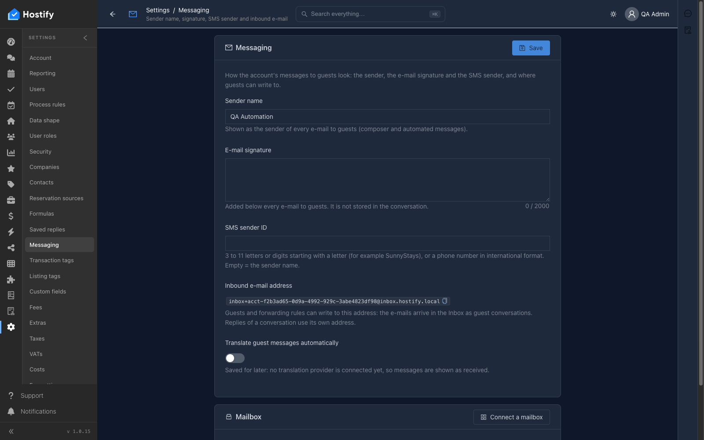


## Казус 19: transactionTags in the dark theme (/app/settings/transactionTags)

_Нов в този пуск._

**Какво се обърка**

```
Error: The page reported 78 error(s) — API answers, failed requests, console errors:
- [request.failed] net::ERR_BLOCKED_BY_ORB @ https://hostify-apps.bioseek.eu/plugins/chekin/logo.svg
- [request.failed] net::ERR_BLOCKED_BY_ORB @ https://hostify-apps.bioseek.eu/plugins/paypal/logo.png
- [request.failed] net::ERR_BLOCKED_BY_ORB @ https://hostify-apps.bioseek.eu/plugins/duve/logo.png
- [request.failed] net::ERR_BLOCKED_BY_ORB @ https://hostify-apps.bioseek.eu/plugins/stripe/logo.png
- [request.failed] net::ERR_BLOCKED_BY_ORB @ https://hostify-apps.bioseek.eu/plugins/superhog/logo.png
- [request.failed] net::ERR_BLOCKED_BY_ORB @ https://hostify-apps.bioseek.eu/plugins/breezeway/logo.png
- [request.failed] net::ERR_BLOCKED_BY_ORB @ https://hostify-apps.bioseek.eu/plugins/beyond/logo.jpg
- [request.failed] net::ERR_BLOCKED_BY_ORB @ https://hostify-apps.bioseek.eu/plugins/pricelabs/logo.svg
- [request.failed] net::ERR_BLOCKED_BY_ORB @ https://hostify-apps.bioseek.eu/plugins/cardcom/logo.png
- [request.failed] net::ERR_BLOCKED_BY_ORB @ https://hostify-apps.bioseek.eu/plugins/akiles/logo.svg
```
- неуспешна заявка: net::ERR_BLOCKED_BY_ORB — `https://hostify-apps.bioseek.eu/plugins/chekin/logo.svg`
- неуспешна заявка: net::ERR_BLOCKED_BY_ORB — `https://hostify-apps.bioseek.eu/plugins/paypal/logo.png`
- неуспешна заявка: net::ERR_BLOCKED_BY_ORB — `https://hostify-apps.bioseek.eu/plugins/duve/logo.png`
- неуспешна заявка: net::ERR_BLOCKED_BY_ORB — `https://hostify-apps.bioseek.eu/plugins/stripe/logo.png`
- неуспешна заявка: net::ERR_BLOCKED_BY_ORB — `https://hostify-apps.bioseek.eu/plugins/superhog/logo.png`
- неуспешна заявка: net::ERR_BLOCKED_BY_ORB — `https://hostify-apps.bioseek.eu/plugins/breezeway/logo.png`
- неуспешна заявка: net::ERR_BLOCKED_BY_ORB — `https://hostify-apps.bioseek.eu/plugins/beyond/logo.jpg`
- неуспешна заявка: net::ERR_BLOCKED_BY_ORB — `https://hostify-apps.bioseek.eu/plugins/pricelabs/logo.svg`
- неуспешна заявка: net::ERR_BLOCKED_BY_ORB — `https://hostify-apps.bioseek.eu/plugins/cardcom/logo.png`
- неуспешна заявка: net::ERR_BLOCKED_BY_ORB — `https://hostify-apps.bioseek.eu/plugins/akiles/logo.svg`

**Как да се възпроизведе**

1. Влез в https://hostify.bioseek.eu/app/ като администратор на акаунта (qa.admin@hostify-qa.test).
2. Меню: SETTINGS › Transaction tags — https://hostify.bioseek.eu/app/settings/transactionTags
3. Спек `tests/e2e/011-account-pages-dark.spec.ts`, проверка „transactionTags in the dark theme (/app/settings/transactionTags)“.
4. Developer tools › Network: заявките по-горе отговарят така.

**Скрийншоти**


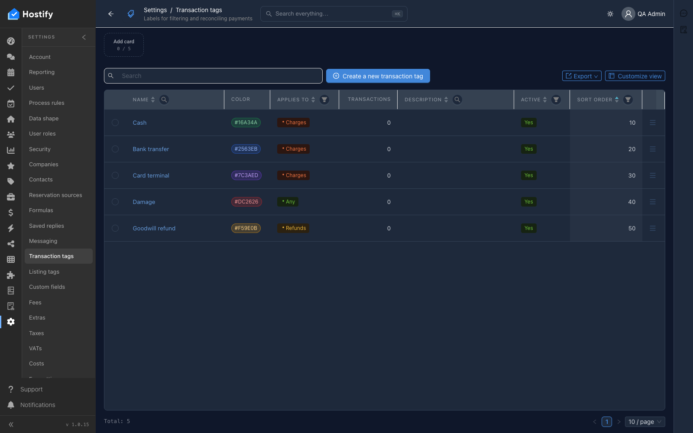


## Казус 20: listingTags in the dark theme (/app/settings/listingTags)

_Нов в този пуск._

**Какво се обърка**

```
Error: The page reported 78 error(s) — API answers, failed requests, console errors:
- [request.failed] net::ERR_BLOCKED_BY_ORB @ https://hostify-apps.bioseek.eu/plugins/paypal/logo.png
- [request.failed] net::ERR_BLOCKED_BY_ORB @ https://hostify-apps.bioseek.eu/plugins/chekin/logo.svg
- [request.failed] net::ERR_BLOCKED_BY_ORB @ https://hostify-apps.bioseek.eu/plugins/duve/logo.png
- [request.failed] net::ERR_BLOCKED_BY_ORB @ https://hostify-apps.bioseek.eu/plugins/stripe/logo.png
- [request.failed] net::ERR_BLOCKED_BY_ORB @ https://hostify-apps.bioseek.eu/plugins/superhog/logo.png
- [request.failed] net::ERR_BLOCKED_BY_ORB @ https://hostify-apps.bioseek.eu/plugins/breezeway/logo.png
- [request.failed] net::ERR_BLOCKED_BY_ORB @ https://hostify-apps.bioseek.eu/plugins/beyond/logo.jpg
- [request.failed] net::ERR_BLOCKED_BY_ORB @ https://hostify-apps.bioseek.eu/plugins/pricelabs/logo.svg
- [request.failed] net::ERR_BLOCKED_BY_ORB @ https://hostify-apps.bioseek.eu/plugins/cardcom/logo.png
- [request.failed] net::ERR_BLOCKED_BY_ORB @ https://hostify-apps.bioseek.eu/plugins/akiles/logo.svg
```
- неуспешна заявка: net::ERR_BLOCKED_BY_ORB — `https://hostify-apps.bioseek.eu/plugins/paypal/logo.png`
- неуспешна заявка: net::ERR_BLOCKED_BY_ORB — `https://hostify-apps.bioseek.eu/plugins/chekin/logo.svg`
- неуспешна заявка: net::ERR_BLOCKED_BY_ORB — `https://hostify-apps.bioseek.eu/plugins/duve/logo.png`
- неуспешна заявка: net::ERR_BLOCKED_BY_ORB — `https://hostify-apps.bioseek.eu/plugins/stripe/logo.png`
- неуспешна заявка: net::ERR_BLOCKED_BY_ORB — `https://hostify-apps.bioseek.eu/plugins/superhog/logo.png`
- неуспешна заявка: net::ERR_BLOCKED_BY_ORB — `https://hostify-apps.bioseek.eu/plugins/breezeway/logo.png`
- неуспешна заявка: net::ERR_BLOCKED_BY_ORB — `https://hostify-apps.bioseek.eu/plugins/beyond/logo.jpg`
- неуспешна заявка: net::ERR_BLOCKED_BY_ORB — `https://hostify-apps.bioseek.eu/plugins/pricelabs/logo.svg`
- неуспешна заявка: net::ERR_BLOCKED_BY_ORB — `https://hostify-apps.bioseek.eu/plugins/cardcom/logo.png`
- неуспешна заявка: net::ERR_BLOCKED_BY_ORB — `https://hostify-apps.bioseek.eu/plugins/akiles/logo.svg`

**Как да се възпроизведе**

1. Влез в https://hostify.bioseek.eu/app/ като администратор на акаунта (qa.admin@hostify-qa.test).
2. Меню: SETTINGS › Listing tags — https://hostify.bioseek.eu/app/settings/listingTags
3. Спек `tests/e2e/011-account-pages-dark.spec.ts`, проверка „listingTags in the dark theme (/app/settings/listingTags)“.
4. Developer tools › Network: заявките по-горе отговарят така.

**Скрийншоти**

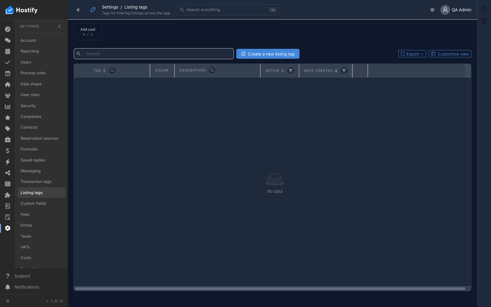


## Казус 21: customFields in the dark theme (/app/settings/customFields)

_Нов в този пуск._

**Какво се обърка**

```
Error: The page reported 78 error(s) — API answers, failed requests, console errors:
- [request.failed] net::ERR_BLOCKED_BY_ORB @ https://hostify-apps.bioseek.eu/plugins/paypal/logo.png
- [request.failed] net::ERR_BLOCKED_BY_ORB @ https://hostify-apps.bioseek.eu/plugins/duve/logo.png
- [request.failed] net::ERR_BLOCKED_BY_ORB @ https://hostify-apps.bioseek.eu/plugins/chekin/logo.svg
- [request.failed] net::ERR_BLOCKED_BY_ORB @ https://hostify-apps.bioseek.eu/plugins/stripe/logo.png
- [request.failed] net::ERR_BLOCKED_BY_ORB @ https://hostify-apps.bioseek.eu/plugins/superhog/logo.png
- [request.failed] net::ERR_BLOCKED_BY_ORB @ https://hostify-apps.bioseek.eu/plugins/breezeway/logo.png
- [request.failed] net::ERR_BLOCKED_BY_ORB @ https://hostify-apps.bioseek.eu/plugins/pricelabs/logo.svg
- [request.failed] net::ERR_BLOCKED_BY_ORB @ https://hostify-apps.bioseek.eu/plugins/beyond/logo.jpg
- [request.failed] net::ERR_BLOCKED_BY_ORB @ https://hostify-apps.bioseek.eu/plugins/cardcom/logo.png
- [request.failed] net::ERR_BLOCKED_BY_ORB @ https://hostify-apps.bioseek.eu/plugins/akiles/logo.svg
```
- неуспешна заявка: net::ERR_BLOCKED_BY_ORB — `https://hostify-apps.bioseek.eu/plugins/paypal/logo.png`
- неуспешна заявка: net::ERR_BLOCKED_BY_ORB — `https://hostify-apps.bioseek.eu/plugins/duve/logo.png`
- неуспешна заявка: net::ERR_BLOCKED_BY_ORB — `https://hostify-apps.bioseek.eu/plugins/chekin/logo.svg`
- неуспешна заявка: net::ERR_BLOCKED_BY_ORB — `https://hostify-apps.bioseek.eu/plugins/stripe/logo.png`
- неуспешна заявка: net::ERR_BLOCKED_BY_ORB — `https://hostify-apps.bioseek.eu/plugins/superhog/logo.png`
- неуспешна заявка: net::ERR_BLOCKED_BY_ORB — `https://hostify-apps.bioseek.eu/plugins/breezeway/logo.png`
- неуспешна заявка: net::ERR_BLOCKED_BY_ORB — `https://hostify-apps.bioseek.eu/plugins/pricelabs/logo.svg`
- неуспешна заявка: net::ERR_BLOCKED_BY_ORB — `https://hostify-apps.bioseek.eu/plugins/beyond/logo.jpg`
- неуспешна заявка: net::ERR_BLOCKED_BY_ORB — `https://hostify-apps.bioseek.eu/plugins/cardcom/logo.png`
- неуспешна заявка: net::ERR_BLOCKED_BY_ORB — `https://hostify-apps.bioseek.eu/plugins/akiles/logo.svg`

**Как да се възпроизведе**

1. Влез в https://hostify.bioseek.eu/app/ като администратор на акаунта (qa.admin@hostify-qa.test).
2. Меню: SETTINGS › Custom fields — https://hostify.bioseek.eu/app/settings/customFields
3. Спек `tests/e2e/011-account-pages-dark.spec.ts`, проверка „customFields in the dark theme (/app/settings/customFields)“.
4. Developer tools › Network: заявките по-горе отговарят така.

**Скрийншоти**


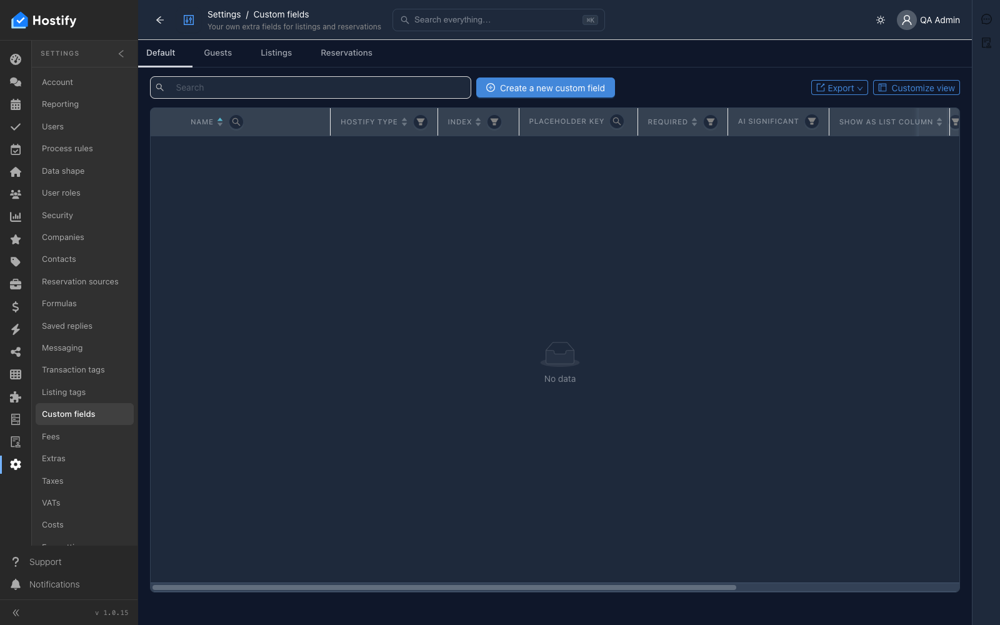


## Казус 22: settingsFees in the dark theme (/app/settings/settingsFees)

_Нов в този пуск._

**Какво се обърка**

```
Error: The page reported 78 error(s) — API answers, failed requests, console errors:
- [request.failed] net::ERR_BLOCKED_BY_ORB @ https://hostify-apps.bioseek.eu/plugins/stripe/logo.png
- [request.failed] net::ERR_BLOCKED_BY_ORB @ https://hostify-apps.bioseek.eu/plugins/chekin/logo.svg
- [request.failed] net::ERR_BLOCKED_BY_ORB @ https://hostify-apps.bioseek.eu/plugins/paypal/logo.png
- [request.failed] net::ERR_BLOCKED_BY_ORB @ https://hostify-apps.bioseek.eu/plugins/duve/logo.png
- [request.failed] net::ERR_BLOCKED_BY_ORB @ https://hostify-apps.bioseek.eu/plugins/superhog/logo.png
- [request.failed] net::ERR_BLOCKED_BY_ORB @ https://hostify-apps.bioseek.eu/plugins/breezeway/logo.png
- [request.failed] net::ERR_BLOCKED_BY_ORB @ https://hostify-apps.bioseek.eu/plugins/beyond/logo.jpg
- [request.failed] net::ERR_BLOCKED_BY_ORB @ https://hostify-apps.bioseek.eu/plugins/pricelabs/logo.svg
- [request.failed] net::ERR_BLOCKED_BY_ORB @ https://hostify-apps.bioseek.eu/plugins/cardcom/logo.png
- [request.failed] net::ERR_BLOCKED_BY_ORB @ https://hostify-apps.bioseek.eu/plugins/akiles/logo.svg
```
- неуспешна заявка: net::ERR_BLOCKED_BY_ORB — `https://hostify-apps.bioseek.eu/plugins/stripe/logo.png`
- неуспешна заявка: net::ERR_BLOCKED_BY_ORB — `https://hostify-apps.bioseek.eu/plugins/chekin/logo.svg`
- неуспешна заявка: net::ERR_BLOCKED_BY_ORB — `https://hostify-apps.bioseek.eu/plugins/paypal/logo.png`
- неуспешна заявка: net::ERR_BLOCKED_BY_ORB — `https://hostify-apps.bioseek.eu/plugins/duve/logo.png`
- неуспешна заявка: net::ERR_BLOCKED_BY_ORB — `https://hostify-apps.bioseek.eu/plugins/superhog/logo.png`
- неуспешна заявка: net::ERR_BLOCKED_BY_ORB — `https://hostify-apps.bioseek.eu/plugins/breezeway/logo.png`
- неуспешна заявка: net::ERR_BLOCKED_BY_ORB — `https://hostify-apps.bioseek.eu/plugins/beyond/logo.jpg`
- неуспешна заявка: net::ERR_BLOCKED_BY_ORB — `https://hostify-apps.bioseek.eu/plugins/pricelabs/logo.svg`
- неуспешна заявка: net::ERR_BLOCKED_BY_ORB — `https://hostify-apps.bioseek.eu/plugins/cardcom/logo.png`
- неуспешна заявка: net::ERR_BLOCKED_BY_ORB — `https://hostify-apps.bioseek.eu/plugins/akiles/logo.svg`

**Как да се възпроизведе**

1. Влез в https://hostify.bioseek.eu/app/ като администратор на акаунта (qa.admin@hostify-qa.test).
2. Меню: SETTINGS › Fees — https://hostify.bioseek.eu/app/settings/settingsFees
3. Спек `tests/e2e/011-account-pages-dark.spec.ts`, проверка „settingsFees in the dark theme (/app/settings/settingsFees)“.
4. Developer tools › Network: заявките по-горе отговарят така.

**Скрийншоти**

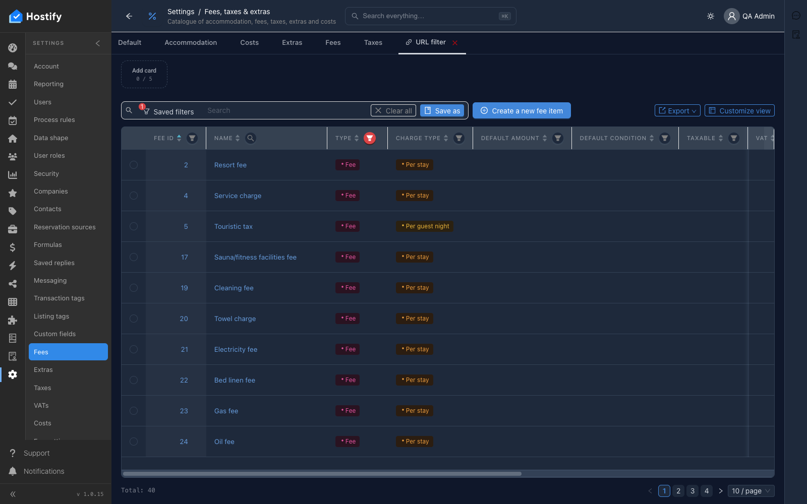


## Казус 23: settingsExtras in the dark theme (/app/settings/settingsExtras)

_Нов в този пуск._

**Какво се обърка**

```
Error: The page reported 78 error(s) — API answers, failed requests, console errors:
- [request.failed] net::ERR_BLOCKED_BY_ORB @ https://hostify-apps.bioseek.eu/plugins/chekin/logo.svg
- [request.failed] net::ERR_BLOCKED_BY_ORB @ https://hostify-apps.bioseek.eu/plugins/paypal/logo.png
- [request.failed] net::ERR_BLOCKED_BY_ORB @ https://hostify-apps.bioseek.eu/plugins/duve/logo.png
- [request.failed] net::ERR_BLOCKED_BY_ORB @ https://hostify-apps.bioseek.eu/plugins/stripe/logo.png
- [request.failed] net::ERR_BLOCKED_BY_ORB @ https://hostify-apps.bioseek.eu/plugins/superhog/logo.png
- [request.failed] net::ERR_BLOCKED_BY_ORB @ https://hostify-apps.bioseek.eu/plugins/breezeway/logo.png
- [request.failed] net::ERR_BLOCKED_BY_ORB @ https://hostify-apps.bioseek.eu/plugins/beyond/logo.jpg
- [request.failed] net::ERR_BLOCKED_BY_ORB @ https://hostify-apps.bioseek.eu/plugins/pricelabs/logo.svg
- [request.failed] net::ERR_BLOCKED_BY_ORB @ https://hostify-apps.bioseek.eu/plugins/cardcom/logo.png
- [request.failed] net::ERR_BLOCKED_BY_ORB @ https://hostify-apps.bioseek.eu/plugins/akiles/logo.svg
```
- неуспешна заявка: net::ERR_BLOCKED_BY_ORB — `https://hostify-apps.bioseek.eu/plugins/chekin/logo.svg`
- неуспешна заявка: net::ERR_BLOCKED_BY_ORB — `https://hostify-apps.bioseek.eu/plugins/paypal/logo.png`
- неуспешна заявка: net::ERR_BLOCKED_BY_ORB — `https://hostify-apps.bioseek.eu/plugins/duve/logo.png`
- неуспешна заявка: net::ERR_BLOCKED_BY_ORB — `https://hostify-apps.bioseek.eu/plugins/stripe/logo.png`
- неуспешна заявка: net::ERR_BLOCKED_BY_ORB — `https://hostify-apps.bioseek.eu/plugins/superhog/logo.png`
- неуспешна заявка: net::ERR_BLOCKED_BY_ORB — `https://hostify-apps.bioseek.eu/plugins/breezeway/logo.png`
- неуспешна заявка: net::ERR_BLOCKED_BY_ORB — `https://hostify-apps.bioseek.eu/plugins/beyond/logo.jpg`
- неуспешна заявка: net::ERR_BLOCKED_BY_ORB — `https://hostify-apps.bioseek.eu/plugins/pricelabs/logo.svg`
- неуспешна заявка: net::ERR_BLOCKED_BY_ORB — `https://hostify-apps.bioseek.eu/plugins/cardcom/logo.png`
- неуспешна заявка: net::ERR_BLOCKED_BY_ORB — `https://hostify-apps.bioseek.eu/plugins/akiles/logo.svg`

**Как да се възпроизведе**

1. Влез в https://hostify.bioseek.eu/app/ като администратор на акаунта (qa.admin@hostify-qa.test).
2. Меню: SETTINGS › Extras — https://hostify.bioseek.eu/app/settings/settingsExtras
3. Спек `tests/e2e/011-account-pages-dark.spec.ts`, проверка „settingsExtras in the dark theme (/app/settings/settingsExtras)“.
4. Developer tools › Network: заявките по-горе отговарят така.

**Скрийншоти**

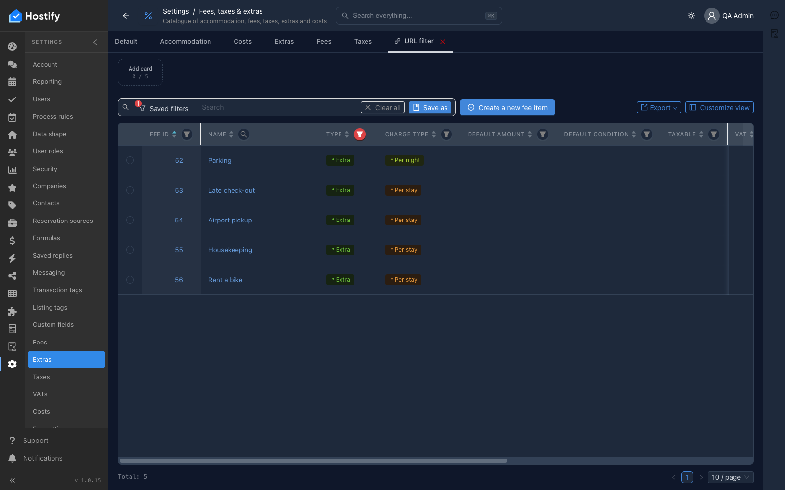


## Казус 24: settingsTaxes in the dark theme (/app/settings/settingsTaxes)

_Нов в този пуск._

**Какво се обърка**

```
Error: The page reported 78 error(s) — API answers, failed requests, console errors:
- [request.failed] net::ERR_BLOCKED_BY_ORB @ https://hostify-apps.bioseek.eu/plugins/paypal/logo.png
- [request.failed] net::ERR_BLOCKED_BY_ORB @ https://hostify-apps.bioseek.eu/plugins/stripe/logo.png
- [request.failed] net::ERR_BLOCKED_BY_ORB @ https://hostify-apps.bioseek.eu/plugins/duve/logo.png
- [request.failed] net::ERR_BLOCKED_BY_ORB @ https://hostify-apps.bioseek.eu/plugins/chekin/logo.svg
- [request.failed] net::ERR_BLOCKED_BY_ORB @ https://hostify-apps.bioseek.eu/plugins/superhog/logo.png
- [request.failed] net::ERR_BLOCKED_BY_ORB @ https://hostify-apps.bioseek.eu/plugins/breezeway/logo.png
- [request.failed] net::ERR_BLOCKED_BY_ORB @ https://hostify-apps.bioseek.eu/plugins/beyond/logo.jpg
- [request.failed] net::ERR_BLOCKED_BY_ORB @ https://hostify-apps.bioseek.eu/plugins/cardcom/logo.png
- [request.failed] net::ERR_BLOCKED_BY_ORB @ https://hostify-apps.bioseek.eu/plugins/pricelabs/logo.svg
- [request.failed] net::ERR_BLOCKED_BY_ORB @ https://hostify-apps.bioseek.eu/plugins/akiles/logo.svg
```
- неуспешна заявка: net::ERR_BLOCKED_BY_ORB — `https://hostify-apps.bioseek.eu/plugins/paypal/logo.png`
- неуспешна заявка: net::ERR_BLOCKED_BY_ORB — `https://hostify-apps.bioseek.eu/plugins/stripe/logo.png`
- неуспешна заявка: net::ERR_BLOCKED_BY_ORB — `https://hostify-apps.bioseek.eu/plugins/duve/logo.png`
- неуспешна заявка: net::ERR_BLOCKED_BY_ORB — `https://hostify-apps.bioseek.eu/plugins/chekin/logo.svg`
- неуспешна заявка: net::ERR_BLOCKED_BY_ORB — `https://hostify-apps.bioseek.eu/plugins/superhog/logo.png`
- неуспешна заявка: net::ERR_BLOCKED_BY_ORB — `https://hostify-apps.bioseek.eu/plugins/breezeway/logo.png`
- неуспешна заявка: net::ERR_BLOCKED_BY_ORB — `https://hostify-apps.bioseek.eu/plugins/beyond/logo.jpg`
- неуспешна заявка: net::ERR_BLOCKED_BY_ORB — `https://hostify-apps.bioseek.eu/plugins/cardcom/logo.png`
- неуспешна заявка: net::ERR_BLOCKED_BY_ORB — `https://hostify-apps.bioseek.eu/plugins/pricelabs/logo.svg`
- неуспешна заявка: net::ERR_BLOCKED_BY_ORB — `https://hostify-apps.bioseek.eu/plugins/akiles/logo.svg`

**Как да се възпроизведе**

1. Влез в https://hostify.bioseek.eu/app/ като администратор на акаунта (qa.admin@hostify-qa.test).
2. Меню: SETTINGS › Taxes — https://hostify.bioseek.eu/app/settings/settingsTaxes
3. Спек `tests/e2e/011-account-pages-dark.spec.ts`, проверка „settingsTaxes in the dark theme (/app/settings/settingsTaxes)“.
4. Developer tools › Network: заявките по-горе отговарят така.

**Скрийншоти**

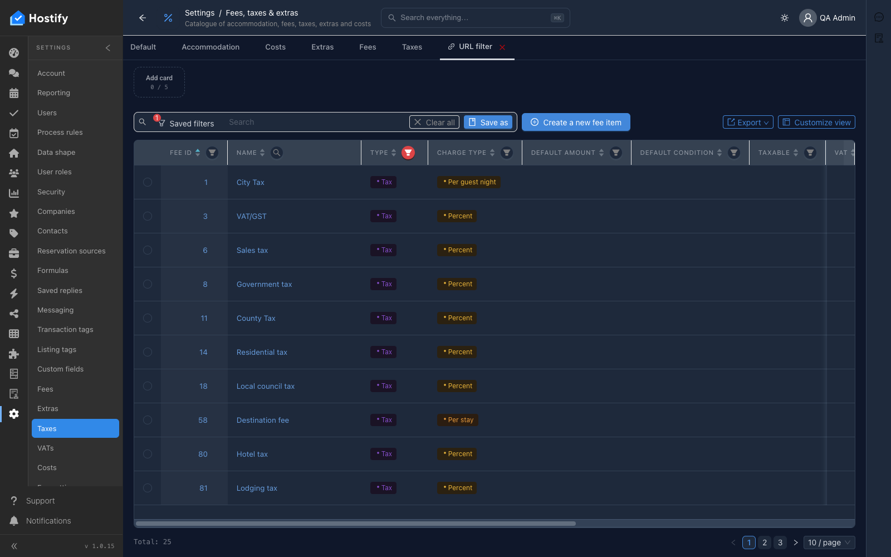


## Казус 25: vatRates in the dark theme (/app/settings/vatRates)

_Нов в този пуск._

**Какво се обърка**

```
Error: The page reported 78 error(s) — API answers, failed requests, console errors:
- [request.failed] net::ERR_BLOCKED_BY_ORB @ https://hostify-apps.bioseek.eu/plugins/paypal/logo.png
- [request.failed] net::ERR_BLOCKED_BY_ORB @ https://hostify-apps.bioseek.eu/plugins/duve/logo.png
- [request.failed] net::ERR_BLOCKED_BY_ORB @ https://hostify-apps.bioseek.eu/plugins/chekin/logo.svg
- [request.failed] net::ERR_BLOCKED_BY_ORB @ https://hostify-apps.bioseek.eu/plugins/stripe/logo.png
- [request.failed] net::ERR_BLOCKED_BY_ORB @ https://hostify-apps.bioseek.eu/plugins/superhog/logo.png
- [request.failed] net::ERR_BLOCKED_BY_ORB @ https://hostify-apps.bioseek.eu/plugins/breezeway/logo.png
- [request.failed] net::ERR_BLOCKED_BY_ORB @ https://hostify-apps.bioseek.eu/plugins/beyond/logo.jpg
- [request.failed] net::ERR_BLOCKED_BY_ORB @ https://hostify-apps.bioseek.eu/plugins/pricelabs/logo.svg
- [request.failed] net::ERR_BLOCKED_BY_ORB @ https://hostify-apps.bioseek.eu/plugins/cardcom/logo.png
- [request.failed] net::ERR_BLOCKED_BY_ORB @ https://hostify-apps.bioseek.eu/plugins/akiles/logo.svg
```
- неуспешна заявка: net::ERR_BLOCKED_BY_ORB — `https://hostify-apps.bioseek.eu/plugins/paypal/logo.png`
- неуспешна заявка: net::ERR_BLOCKED_BY_ORB — `https://hostify-apps.bioseek.eu/plugins/duve/logo.png`
- неуспешна заявка: net::ERR_BLOCKED_BY_ORB — `https://hostify-apps.bioseek.eu/plugins/chekin/logo.svg`
- неуспешна заявка: net::ERR_BLOCKED_BY_ORB — `https://hostify-apps.bioseek.eu/plugins/stripe/logo.png`
- неуспешна заявка: net::ERR_BLOCKED_BY_ORB — `https://hostify-apps.bioseek.eu/plugins/superhog/logo.png`
- неуспешна заявка: net::ERR_BLOCKED_BY_ORB — `https://hostify-apps.bioseek.eu/plugins/breezeway/logo.png`
- неуспешна заявка: net::ERR_BLOCKED_BY_ORB — `https://hostify-apps.bioseek.eu/plugins/beyond/logo.jpg`
- неуспешна заявка: net::ERR_BLOCKED_BY_ORB — `https://hostify-apps.bioseek.eu/plugins/pricelabs/logo.svg`
- неуспешна заявка: net::ERR_BLOCKED_BY_ORB — `https://hostify-apps.bioseek.eu/plugins/cardcom/logo.png`
- неуспешна заявка: net::ERR_BLOCKED_BY_ORB — `https://hostify-apps.bioseek.eu/plugins/akiles/logo.svg`

**Как да се възпроизведе**

1. Влез в https://hostify.bioseek.eu/app/ като администратор на акаунта (qa.admin@hostify-qa.test).
2. Меню: SETTINGS › VATs — https://hostify.bioseek.eu/app/settings/vatRates
3. Спек `tests/e2e/011-account-pages-dark.spec.ts`, проверка „vatRates in the dark theme (/app/settings/vatRates)“.
4. Developer tools › Network: заявките по-горе отговарят така.

**Скрийншоти**

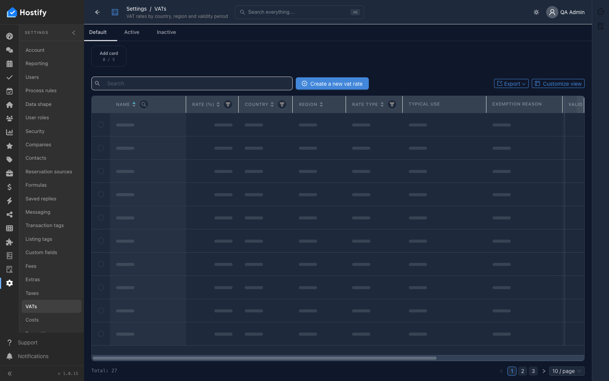
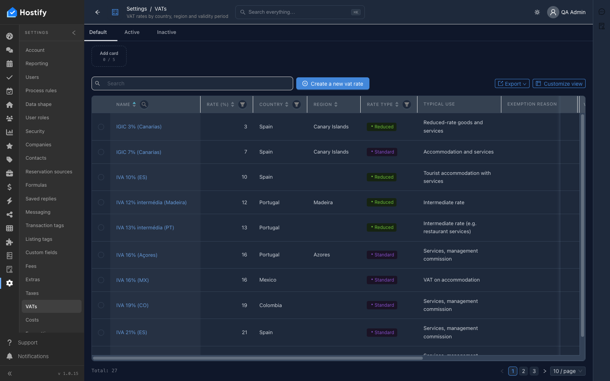


## Казус 26: settingsCosts in the dark theme (/app/settings/settingsCosts)

_Нов в този пуск._

**Какво се обърка**

```
Error: The page reported 78 error(s) — API answers, failed requests, console errors:
- [request.failed] net::ERR_BLOCKED_BY_ORB @ https://hostify-apps.bioseek.eu/plugins/paypal/logo.png
- [request.failed] net::ERR_BLOCKED_BY_ORB @ https://hostify-apps.bioseek.eu/plugins/stripe/logo.png
- [request.failed] net::ERR_BLOCKED_BY_ORB @ https://hostify-apps.bioseek.eu/plugins/duve/logo.png
- [request.failed] net::ERR_BLOCKED_BY_ORB @ https://hostify-apps.bioseek.eu/plugins/chekin/logo.svg
- [request.failed] net::ERR_BLOCKED_BY_ORB @ https://hostify-apps.bioseek.eu/plugins/superhog/logo.png
- [request.failed] net::ERR_BLOCKED_BY_ORB @ https://hostify-apps.bioseek.eu/plugins/breezeway/logo.png
- [request.failed] net::ERR_BLOCKED_BY_ORB @ https://hostify-apps.bioseek.eu/plugins/beyond/logo.jpg
- [request.failed] net::ERR_BLOCKED_BY_ORB @ https://hostify-apps.bioseek.eu/plugins/pricelabs/logo.svg
- [request.failed] net::ERR_BLOCKED_BY_ORB @ https://hostify-apps.bioseek.eu/plugins/cardcom/logo.png
- [request.failed] net::ERR_BLOCKED_BY_ORB @ https://hostify-apps.bioseek.eu/plugins/akiles/logo.svg
```
- неуспешна заявка: net::ERR_BLOCKED_BY_ORB — `https://hostify-apps.bioseek.eu/plugins/paypal/logo.png`
- неуспешна заявка: net::ERR_BLOCKED_BY_ORB — `https://hostify-apps.bioseek.eu/plugins/stripe/logo.png`
- неуспешна заявка: net::ERR_BLOCKED_BY_ORB — `https://hostify-apps.bioseek.eu/plugins/duve/logo.png`
- неуспешна заявка: net::ERR_BLOCKED_BY_ORB — `https://hostify-apps.bioseek.eu/plugins/chekin/logo.svg`
- неуспешна заявка: net::ERR_BLOCKED_BY_ORB — `https://hostify-apps.bioseek.eu/plugins/superhog/logo.png`
- неуспешна заявка: net::ERR_BLOCKED_BY_ORB — `https://hostify-apps.bioseek.eu/plugins/breezeway/logo.png`
- неуспешна заявка: net::ERR_BLOCKED_BY_ORB — `https://hostify-apps.bioseek.eu/plugins/beyond/logo.jpg`
- неуспешна заявка: net::ERR_BLOCKED_BY_ORB — `https://hostify-apps.bioseek.eu/plugins/pricelabs/logo.svg`
- неуспешна заявка: net::ERR_BLOCKED_BY_ORB — `https://hostify-apps.bioseek.eu/plugins/cardcom/logo.png`
- неуспешна заявка: net::ERR_BLOCKED_BY_ORB — `https://hostify-apps.bioseek.eu/plugins/akiles/logo.svg`

**Как да се възпроизведе**

1. Влез в https://hostify.bioseek.eu/app/ като администратор на акаунта (qa.admin@hostify-qa.test).
2. Меню: SETTINGS › Costs — https://hostify.bioseek.eu/app/settings/settingsCosts
3. Спек `tests/e2e/011-account-pages-dark.spec.ts`, проверка „settingsCosts in the dark theme (/app/settings/settingsCosts)“.
4. Developer tools › Network: заявките по-горе отговарят така.

**Скрийншоти**


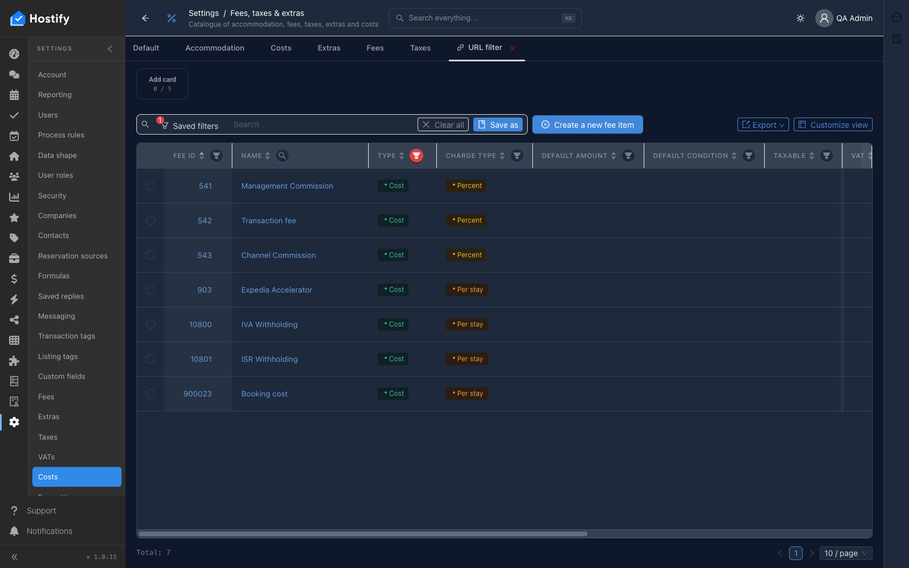


## Казус 27: feeItemSettings in the dark theme (/app/settings/feeItemSettings)

_Нов в този пуск._

**Какво се обърка**

```
Error: The page reported 78 error(s) — API answers, failed requests, console errors:
- [request.failed] net::ERR_BLOCKED_BY_ORB @ https://hostify-apps.bioseek.eu/plugins/chekin/logo.svg
- [request.failed] net::ERR_BLOCKED_BY_ORB @ https://hostify-apps.bioseek.eu/plugins/duve/logo.png
- [request.failed] net::ERR_BLOCKED_BY_ORB @ https://hostify-apps.bioseek.eu/plugins/paypal/logo.png
- [request.failed] net::ERR_BLOCKED_BY_ORB @ https://hostify-apps.bioseek.eu/plugins/stripe/logo.png
- [request.failed] net::ERR_BLOCKED_BY_ORB @ https://hostify-apps.bioseek.eu/plugins/superhog/logo.png
- [request.failed] net::ERR_BLOCKED_BY_ORB @ https://hostify-apps.bioseek.eu/plugins/breezeway/logo.png
- [request.failed] net::ERR_BLOCKED_BY_ORB @ https://hostify-apps.bioseek.eu/plugins/beyond/logo.jpg
- [request.failed] net::ERR_BLOCKED_BY_ORB @ https://hostify-apps.bioseek.eu/plugins/pricelabs/logo.svg
- [request.failed] net::ERR_BLOCKED_BY_ORB @ https://hostify-apps.bioseek.eu/plugins/cardcom/logo.png
- [request.failed] net::ERR_BLOCKED_BY_ORB @ https://hostify-apps.bioseek.eu/plugins/akiles/logo.svg
```
- неуспешна заявка: net::ERR_BLOCKED_BY_ORB — `https://hostify-apps.bioseek.eu/plugins/chekin/logo.svg`
- неуспешна заявка: net::ERR_BLOCKED_BY_ORB — `https://hostify-apps.bioseek.eu/plugins/duve/logo.png`
- неуспешна заявка: net::ERR_BLOCKED_BY_ORB — `https://hostify-apps.bioseek.eu/plugins/paypal/logo.png`
- неуспешна заявка: net::ERR_BLOCKED_BY_ORB — `https://hostify-apps.bioseek.eu/plugins/stripe/logo.png`
- неуспешна заявка: net::ERR_BLOCKED_BY_ORB — `https://hostify-apps.bioseek.eu/plugins/superhog/logo.png`
- неуспешна заявка: net::ERR_BLOCKED_BY_ORB — `https://hostify-apps.bioseek.eu/plugins/breezeway/logo.png`
- неуспешна заявка: net::ERR_BLOCKED_BY_ORB — `https://hostify-apps.bioseek.eu/plugins/beyond/logo.jpg`
- неуспешна заявка: net::ERR_BLOCKED_BY_ORB — `https://hostify-apps.bioseek.eu/plugins/pricelabs/logo.svg`
- неуспешна заявка: net::ERR_BLOCKED_BY_ORB — `https://hostify-apps.bioseek.eu/plugins/cardcom/logo.png`
- неуспешна заявка: net::ERR_BLOCKED_BY_ORB — `https://hostify-apps.bioseek.eu/plugins/akiles/logo.svg`

**Как да се възпроизведе**

1. Влез в https://hostify.bioseek.eu/app/ като администратор на акаунта (qa.admin@hostify-qa.test).
2. Меню: SETTINGS › Fee settings — https://hostify.bioseek.eu/app/settings/feeItemSettings
3. Спек `tests/e2e/011-account-pages-dark.spec.ts`, проверка „feeItemSettings in the dark theme (/app/settings/feeItemSettings)“.
4. Developer tools › Network: заявките по-горе отговарят така.

**Скрийншоти**

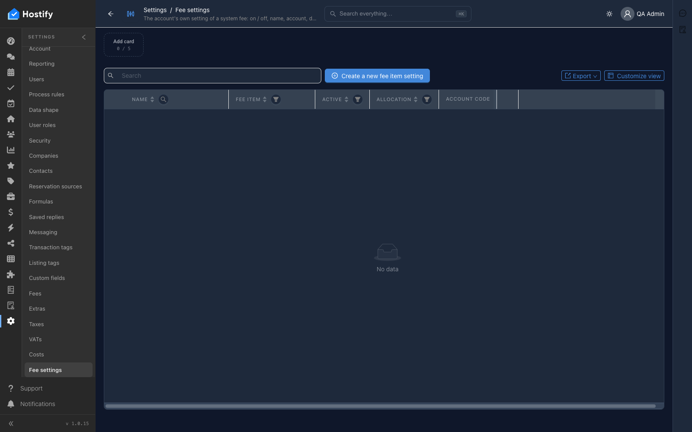


## Казус 28: vatRateSettings in the dark theme (/app/settings/vatRateSettings)

_Нов в този пуск._

**Какво се обърка**

```
Error: The page reported 78 error(s) — API answers, failed requests, console errors:
- [request.failed] net::ERR_BLOCKED_BY_ORB @ https://hostify-apps.bioseek.eu/plugins/paypal/logo.png
- [request.failed] net::ERR_BLOCKED_BY_ORB @ https://hostify-apps.bioseek.eu/plugins/stripe/logo.png
- [request.failed] net::ERR_BLOCKED_BY_ORB @ https://hostify-apps.bioseek.eu/plugins/duve/logo.png
- [request.failed] net::ERR_BLOCKED_BY_ORB @ https://hostify-apps.bioseek.eu/plugins/chekin/logo.svg
- [request.failed] net::ERR_BLOCKED_BY_ORB @ https://hostify-apps.bioseek.eu/plugins/superhog/logo.png
- [request.failed] net::ERR_BLOCKED_BY_ORB @ https://hostify-apps.bioseek.eu/plugins/breezeway/logo.png
- [request.failed] net::ERR_BLOCKED_BY_ORB @ https://hostify-apps.bioseek.eu/plugins/beyond/logo.jpg
- [request.failed] net::ERR_BLOCKED_BY_ORB @ https://hostify-apps.bioseek.eu/plugins/akiles/logo.svg
- [request.failed] net::ERR_BLOCKED_BY_ORB @ https://hostify-apps.bioseek.eu/plugins/pricelabs/logo.svg
- [request.failed] net::ERR_BLOCKED_BY_ORB @ https://hostify-apps.bioseek.eu/plugins/cardcom/logo.png
```
- неуспешна заявка: net::ERR_BLOCKED_BY_ORB — `https://hostify-apps.bioseek.eu/plugins/paypal/logo.png`
- неуспешна заявка: net::ERR_BLOCKED_BY_ORB — `https://hostify-apps.bioseek.eu/plugins/stripe/logo.png`
- неуспешна заявка: net::ERR_BLOCKED_BY_ORB — `https://hostify-apps.bioseek.eu/plugins/duve/logo.png`
- неуспешна заявка: net::ERR_BLOCKED_BY_ORB — `https://hostify-apps.bioseek.eu/plugins/chekin/logo.svg`
- неуспешна заявка: net::ERR_BLOCKED_BY_ORB — `https://hostify-apps.bioseek.eu/plugins/superhog/logo.png`
- неуспешна заявка: net::ERR_BLOCKED_BY_ORB — `https://hostify-apps.bioseek.eu/plugins/breezeway/logo.png`
- неуспешна заявка: net::ERR_BLOCKED_BY_ORB — `https://hostify-apps.bioseek.eu/plugins/beyond/logo.jpg`
- неуспешна заявка: net::ERR_BLOCKED_BY_ORB — `https://hostify-apps.bioseek.eu/plugins/akiles/logo.svg`
- неуспешна заявка: net::ERR_BLOCKED_BY_ORB — `https://hostify-apps.bioseek.eu/plugins/pricelabs/logo.svg`
- неуспешна заявка: net::ERR_BLOCKED_BY_ORB — `https://hostify-apps.bioseek.eu/plugins/cardcom/logo.png`

**Как да се възпроизведе**

1. Влез в https://hostify.bioseek.eu/app/ като администратор на акаунта (qa.admin@hostify-qa.test).
2. Меню: SETTINGS › VAT rate settings — https://hostify.bioseek.eu/app/settings/vatRateSettings
3. Спек `tests/e2e/011-account-pages-dark.spec.ts`, проверка „vatRateSettings in the dark theme (/app/settings/vatRateSettings)“.
4. Developer tools › Network: заявките по-горе отговарят така.

**Скрийншоти**


## Казус 29: paymentSchedules in the dark theme (/app/settings/paymentSchedules)

_Нов в този пуск._

**Какво се обърка**

```
Error: The page reported 78 error(s) — API answers, failed requests, console errors:
- [request.failed] net::ERR_BLOCKED_BY_ORB @ https://hostify-apps.bioseek.eu/plugins/stripe/logo.png
- [request.failed] net::ERR_BLOCKED_BY_ORB @ https://hostify-apps.bioseek.eu/plugins/paypal/logo.png
- [request.failed] net::ERR_BLOCKED_BY_ORB @ https://hostify-apps.bioseek.eu/plugins/duve/logo.png
- [request.failed] net::ERR_BLOCKED_BY_ORB @ https://hostify-apps.bioseek.eu/plugins/chekin/logo.svg
- [request.failed] net::ERR_BLOCKED_BY_ORB @ https://hostify-apps.bioseek.eu/plugins/breezeway/logo.png
- [request.failed] net::ERR_BLOCKED_BY_ORB @ https://hostify-apps.bioseek.eu/plugins/superhog/logo.png
- [request.failed] net::ERR_BLOCKED_BY_ORB @ https://hostify-apps.bioseek.eu/plugins/beyond/logo.jpg
- [request.failed] net::ERR_BLOCKED_BY_ORB @ https://hostify-apps.bioseek.eu/plugins/pricelabs/logo.svg
- [request.failed] net::ERR_BLOCKED_BY_ORB @ https://hostify-apps.bioseek.eu/plugins/cardcom/logo.png
- [request.failed] net::ERR_BLOCKED_BY_ORB @ https://hostify-apps.bioseek.eu/plugins/akiles/logo.svg
```
- неуспешна заявка: net::ERR_BLOCKED_BY_ORB — `https://hostify-apps.bioseek.eu/plugins/stripe/logo.png`
- неуспешна заявка: net::ERR_BLOCKED_BY_ORB — `https://hostify-apps.bioseek.eu/plugins/paypal/logo.png`
- неуспешна заявка: net::ERR_BLOCKED_BY_ORB — `https://hostify-apps.bioseek.eu/plugins/duve/logo.png`
- неуспешна заявка: net::ERR_BLOCKED_BY_ORB — `https://hostify-apps.bioseek.eu/plugins/chekin/logo.svg`
- неуспешна заявка: net::ERR_BLOCKED_BY_ORB — `https://hostify-apps.bioseek.eu/plugins/breezeway/logo.png`
- неуспешна заявка: net::ERR_BLOCKED_BY_ORB — `https://hostify-apps.bioseek.eu/plugins/superhog/logo.png`
- неуспешна заявка: net::ERR_BLOCKED_BY_ORB — `https://hostify-apps.bioseek.eu/plugins/beyond/logo.jpg`
- неуспешна заявка: net::ERR_BLOCKED_BY_ORB — `https://hostify-apps.bioseek.eu/plugins/pricelabs/logo.svg`
- неуспешна заявка: net::ERR_BLOCKED_BY_ORB — `https://hostify-apps.bioseek.eu/plugins/cardcom/logo.png`
- неуспешна заявка: net::ERR_BLOCKED_BY_ORB — `https://hostify-apps.bioseek.eu/plugins/akiles/logo.svg`

**Как да се възпроизведе**

1. Влез в https://hostify.bioseek.eu/app/ като администратор на акаунта (qa.admin@hostify-qa.test).
2. Меню: SETTINGS › Payment schedules — https://hostify.bioseek.eu/app/settings/paymentSchedules
3. Спек `tests/e2e/011-account-pages-dark.spec.ts`, проверка „paymentSchedules in the dark theme (/app/settings/paymentSchedules)“.
4. Developer tools › Network: заявките по-горе отговарят така.

**Скрийншоти**

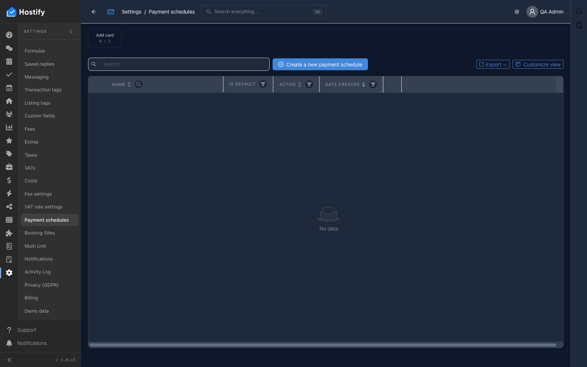


## Казус 30: bookingSites in the dark theme (/app/settings/bookingSites)

_Нов в този пуск._

**Какво се обърка**

```
Error: The page reported 78 error(s) — API answers, failed requests, console errors:
- [request.failed] net::ERR_BLOCKED_BY_ORB @ https://hostify-apps.bioseek.eu/plugins/stripe/logo.png
- [request.failed] net::ERR_BLOCKED_BY_ORB @ https://hostify-apps.bioseek.eu/plugins/paypal/logo.png
- [request.failed] net::ERR_BLOCKED_BY_ORB @ https://hostify-apps.bioseek.eu/plugins/duve/logo.png
- [request.failed] net::ERR_BLOCKED_BY_ORB @ https://hostify-apps.bioseek.eu/plugins/chekin/logo.svg
- [request.failed] net::ERR_BLOCKED_BY_ORB @ https://hostify-apps.bioseek.eu/plugins/superhog/logo.png
- [request.failed] net::ERR_BLOCKED_BY_ORB @ https://hostify-apps.bioseek.eu/plugins/breezeway/logo.png
- [request.failed] net::ERR_BLOCKED_BY_ORB @ https://hostify-apps.bioseek.eu/plugins/pricelabs/logo.svg
- [request.failed] net::ERR_BLOCKED_BY_ORB @ https://hostify-apps.bioseek.eu/plugins/beyond/logo.jpg
- [request.failed] net::ERR_BLOCKED_BY_ORB @ https://hostify-apps.bioseek.eu/plugins/cardcom/logo.png
- [request.failed] net::ERR_BLOCKED_BY_ORB @ https://hostify-apps.bioseek.eu/plugins/akiles/logo.svg
```
- неуспешна заявка: net::ERR_BLOCKED_BY_ORB — `https://hostify-apps.bioseek.eu/plugins/stripe/logo.png`
- неуспешна заявка: net::ERR_BLOCKED_BY_ORB — `https://hostify-apps.bioseek.eu/plugins/paypal/logo.png`
- неуспешна заявка: net::ERR_BLOCKED_BY_ORB — `https://hostify-apps.bioseek.eu/plugins/duve/logo.png`
- неуспешна заявка: net::ERR_BLOCKED_BY_ORB — `https://hostify-apps.bioseek.eu/plugins/chekin/logo.svg`
- неуспешна заявка: net::ERR_BLOCKED_BY_ORB — `https://hostify-apps.bioseek.eu/plugins/superhog/logo.png`
- неуспешна заявка: net::ERR_BLOCKED_BY_ORB — `https://hostify-apps.bioseek.eu/plugins/breezeway/logo.png`
- неуспешна заявка: net::ERR_BLOCKED_BY_ORB — `https://hostify-apps.bioseek.eu/plugins/pricelabs/logo.svg`
- неуспешна заявка: net::ERR_BLOCKED_BY_ORB — `https://hostify-apps.bioseek.eu/plugins/beyond/logo.jpg`
- неуспешна заявка: net::ERR_BLOCKED_BY_ORB — `https://hostify-apps.bioseek.eu/plugins/cardcom/logo.png`
- неуспешна заявка: net::ERR_BLOCKED_BY_ORB — `https://hostify-apps.bioseek.eu/plugins/akiles/logo.svg`

**Как да се възпроизведе**

1. Влез в https://hostify.bioseek.eu/app/ като администратор на акаунта (qa.admin@hostify-qa.test).
2. Меню: SETTINGS › Booking Sites — https://hostify.bioseek.eu/app/settings/bookingSites
3. Спек `tests/e2e/011-account-pages-dark.spec.ts`, проверка „bookingSites in the dark theme (/app/settings/bookingSites)“.
4. Developer tools › Network: заявките по-горе отговарят така.

**Скрийншоти**

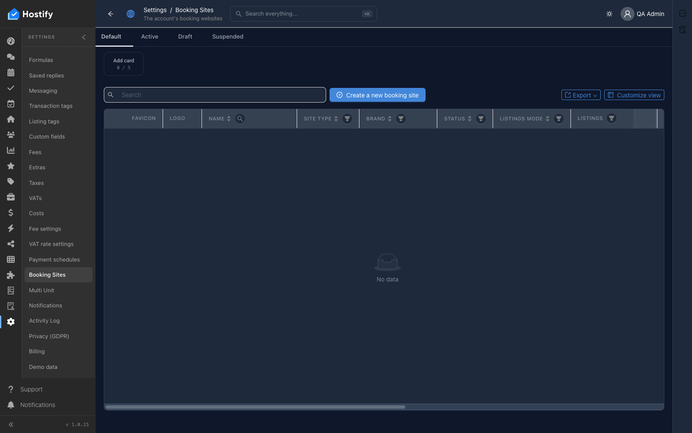


## Казус 31: listingGroups in the dark theme (/app/settings/listingGroups)

_Нов в този пуск._

**Какво се обърка**

```
Error: The page reported 78 error(s) — API answers, failed requests, console errors:
- [request.failed] net::ERR_BLOCKED_BY_ORB @ https://hostify-apps.bioseek.eu/plugins/chekin/logo.svg
- [request.failed] net::ERR_BLOCKED_BY_ORB @ https://hostify-apps.bioseek.eu/plugins/paypal/logo.png
- [request.failed] net::ERR_BLOCKED_BY_ORB @ https://hostify-apps.bioseek.eu/plugins/duve/logo.png
- [request.failed] net::ERR_BLOCKED_BY_ORB @ https://hostify-apps.bioseek.eu/plugins/stripe/logo.png
- [request.failed] net::ERR_BLOCKED_BY_ORB @ https://hostify-apps.bioseek.eu/plugins/superhog/logo.png
- [request.failed] net::ERR_BLOCKED_BY_ORB @ https://hostify-apps.bioseek.eu/plugins/breezeway/logo.png
- [request.failed] net::ERR_BLOCKED_BY_ORB @ https://hostify-apps.bioseek.eu/plugins/beyond/logo.jpg
- [request.failed] net::ERR_BLOCKED_BY_ORB @ https://hostify-apps.bioseek.eu/plugins/akiles/logo.svg
- [request.failed] net::ERR_BLOCKED_BY_ORB @ https://hostify-apps.bioseek.eu/plugins/cardcom/logo.png
- [request.failed] net::ERR_BLOCKED_BY_ORB @ https://hostify-apps.bioseek.eu/plugins/pricelabs/logo.svg
```
- неуспешна заявка: net::ERR_BLOCKED_BY_ORB — `https://hostify-apps.bioseek.eu/plugins/chekin/logo.svg`
- неуспешна заявка: net::ERR_BLOCKED_BY_ORB — `https://hostify-apps.bioseek.eu/plugins/paypal/logo.png`
- неуспешна заявка: net::ERR_BLOCKED_BY_ORB — `https://hostify-apps.bioseek.eu/plugins/duve/logo.png`
- неуспешна заявка: net::ERR_BLOCKED_BY_ORB — `https://hostify-apps.bioseek.eu/plugins/stripe/logo.png`
- неуспешна заявка: net::ERR_BLOCKED_BY_ORB — `https://hostify-apps.bioseek.eu/plugins/superhog/logo.png`
- неуспешна заявка: net::ERR_BLOCKED_BY_ORB — `https://hostify-apps.bioseek.eu/plugins/breezeway/logo.png`
- неуспешна заявка: net::ERR_BLOCKED_BY_ORB — `https://hostify-apps.bioseek.eu/plugins/beyond/logo.jpg`
- неуспешна заявка: net::ERR_BLOCKED_BY_ORB — `https://hostify-apps.bioseek.eu/plugins/akiles/logo.svg`
- неуспешна заявка: net::ERR_BLOCKED_BY_ORB — `https://hostify-apps.bioseek.eu/plugins/cardcom/logo.png`
- неуспешна заявка: net::ERR_BLOCKED_BY_ORB — `https://hostify-apps.bioseek.eu/plugins/pricelabs/logo.svg`

**Как да се възпроизведе**

1. Влез в https://hostify.bioseek.eu/app/ като администратор на акаунта (qa.admin@hostify-qa.test).
2. Меню: SETTINGS › Multi Unit — https://hostify.bioseek.eu/app/settings/listingGroups
3. Спек `tests/e2e/011-account-pages-dark.spec.ts`, проверка „listingGroups in the dark theme (/app/settings/listingGroups)“.
4. Developer tools › Network: заявките по-горе отговарят така.

**Скрийншоти**


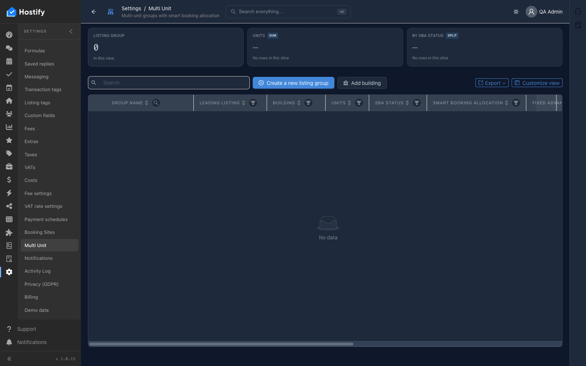


## Казус 32: notificationSettings in the dark theme (/app/settings/notificationSettings)

_Нов в този пуск._

**Какво се обърка**

```
Error: notificationSettings: no button of the first row outside the actions column

expect(locator).toHaveCount(expected) failed

Locator:  locator('.ant-table').filter({ hasNot: locator('.hydra-dashboard-widget') }).first().locator('tbody tr.ant-table-row').first().locator('td:not(.actions):not(.ant-table-selection-column) button')
Expected: 0
Received: 2
Timeout:  15000ms

Call log:
  - notificationSettings: no button of the first row outside the actions column with timeout 15000ms
  - waiting for locator('.ant-table').filter({ hasNot: locator('.hydra-dashboard-widget') }).first().locator('tbody tr.ant-table-row').first().locator('td:not(.actions):not(.ant-table-selection-column) button')
```
- неуспешна заявка: net::ERR_BLOCKED_BY_ORB — `https://hostify-apps.bioseek.eu/plugins/duve/logo.png`
- неуспешна заявка: net::ERR_BLOCKED_BY_ORB — `https://hostify-apps.bioseek.eu/plugins/paypal/logo.png`
- неуспешна заявка: net::ERR_BLOCKED_BY_ORB — `https://hostify-apps.bioseek.eu/plugins/chekin/logo.svg`
- неуспешна заявка: net::ERR_BLOCKED_BY_ORB — `https://hostify-apps.bioseek.eu/plugins/stripe/logo.png`
- неуспешна заявка: net::ERR_BLOCKED_BY_ORB — `https://hostify-apps.bioseek.eu/plugins/superhog/logo.png`
- неуспешна заявка: net::ERR_BLOCKED_BY_ORB — `https://hostify-apps.bioseek.eu/plugins/beyond/logo.jpg`
- неуспешна заявка: net::ERR_BLOCKED_BY_ORB — `https://hostify-apps.bioseek.eu/plugins/breezeway/logo.png`
- неуспешна заявка: net::ERR_BLOCKED_BY_ORB — `https://hostify-apps.bioseek.eu/plugins/pricelabs/logo.svg`
- неуспешна заявка: net::ERR_BLOCKED_BY_ORB — `https://hostify-apps.bioseek.eu/plugins/cardcom/logo.png`
- неуспешна заявка: net::ERR_BLOCKED_BY_ORB — `https://hostify-apps.bioseek.eu/plugins/akiles/logo.svg`

**Как да се възпроизведе**

1. Влез в https://hostify.bioseek.eu/app/ като администратор на акаунта (qa.admin@hostify-qa.test).
2. Меню: SETTINGS › Notifications — https://hostify.bioseek.eu/app/settings/notificationSettings
3. Спек `tests/e2e/011-account-pages-dark.spec.ts`, проверка „notificationSettings in the dark theme (/app/settings/notificationSettings)“ — стъпките:
4. every column has a header and the actions column is the last one
5. Developer tools › Network: заявките по-горе отговарят така.

**Скрийншоти**


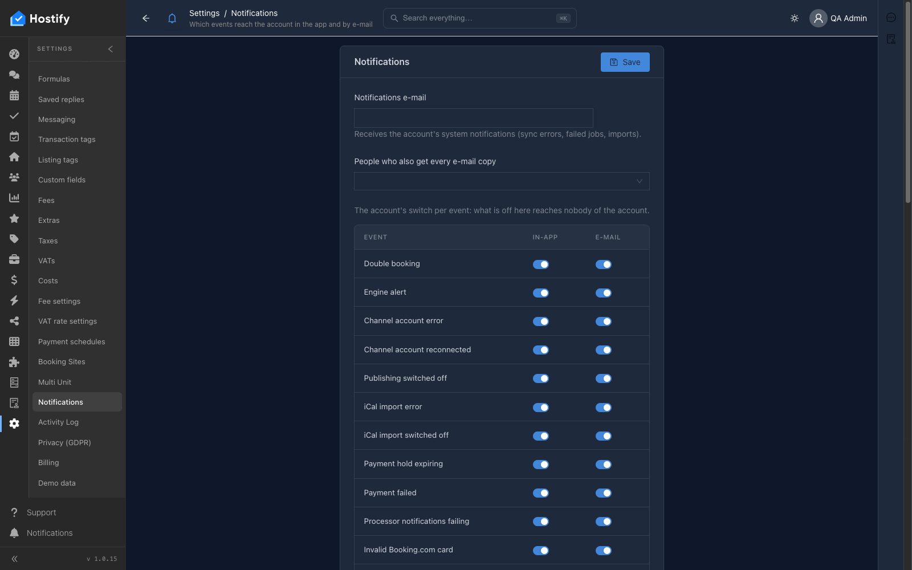


## Казус 33: syncActivities in the dark theme (/app/settings/syncActivities)

_Нов в този пуск._

**Какво се обърка**

```
Error: The page reported 78 error(s) — API answers, failed requests, console errors:
- [request.failed] net::ERR_BLOCKED_BY_ORB @ https://hostify-apps.bioseek.eu/plugins/duve/logo.png
- [request.failed] net::ERR_BLOCKED_BY_ORB @ https://hostify-apps.bioseek.eu/plugins/stripe/logo.png
- [request.failed] net::ERR_BLOCKED_BY_ORB @ https://hostify-apps.bioseek.eu/plugins/paypal/logo.png
- [request.failed] net::ERR_BLOCKED_BY_ORB @ https://hostify-apps.bioseek.eu/plugins/chekin/logo.svg
- [request.failed] net::ERR_BLOCKED_BY_ORB @ https://hostify-apps.bioseek.eu/plugins/superhog/logo.png
- [request.failed] net::ERR_BLOCKED_BY_ORB @ https://hostify-apps.bioseek.eu/plugins/breezeway/logo.png
- [request.failed] net::ERR_BLOCKED_BY_ORB @ https://hostify-apps.bioseek.eu/plugins/beyond/logo.jpg
- [request.failed] net::ERR_BLOCKED_BY_ORB @ https://hostify-apps.bioseek.eu/plugins/pricelabs/logo.svg
- [request.failed] net::ERR_BLOCKED_BY_ORB @ https://hostify-apps.bioseek.eu/plugins/cardcom/logo.png
- [request.failed] net::ERR_BLOCKED_BY_ORB @ https://hostify-apps.bioseek.eu/plugins/akiles/logo.svg
```
- неуспешна заявка: net::ERR_BLOCKED_BY_ORB — `https://hostify-apps.bioseek.eu/plugins/duve/logo.png`
- неуспешна заявка: net::ERR_BLOCKED_BY_ORB — `https://hostify-apps.bioseek.eu/plugins/stripe/logo.png`
- неуспешна заявка: net::ERR_BLOCKED_BY_ORB — `https://hostify-apps.bioseek.eu/plugins/paypal/logo.png`
- неуспешна заявка: net::ERR_BLOCKED_BY_ORB — `https://hostify-apps.bioseek.eu/plugins/chekin/logo.svg`
- неуспешна заявка: net::ERR_BLOCKED_BY_ORB — `https://hostify-apps.bioseek.eu/plugins/superhog/logo.png`
- неуспешна заявка: net::ERR_BLOCKED_BY_ORB — `https://hostify-apps.bioseek.eu/plugins/breezeway/logo.png`
- неуспешна заявка: net::ERR_BLOCKED_BY_ORB — `https://hostify-apps.bioseek.eu/plugins/beyond/logo.jpg`
- неуспешна заявка: net::ERR_BLOCKED_BY_ORB — `https://hostify-apps.bioseek.eu/plugins/pricelabs/logo.svg`
- неуспешна заявка: net::ERR_BLOCKED_BY_ORB — `https://hostify-apps.bioseek.eu/plugins/cardcom/logo.png`
- неуспешна заявка: net::ERR_BLOCKED_BY_ORB — `https://hostify-apps.bioseek.eu/plugins/akiles/logo.svg`

**Как да се възпроизведе**

1. Влез в https://hostify.bioseek.eu/app/ като администратор на акаунта (qa.admin@hostify-qa.test).
2. Меню: SETTINGS › Activity Log — https://hostify.bioseek.eu/app/settings/syncActivities
3. Спек `tests/e2e/011-account-pages-dark.spec.ts`, проверка „syncActivities in the dark theme (/app/settings/syncActivities)“.
4. Developer tools › Network: заявките по-горе отговарят така.

**Скрийншоти**

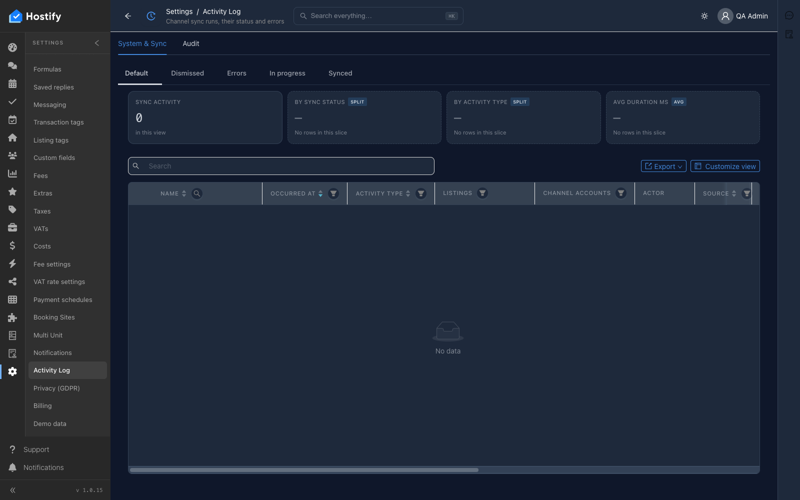


## Казус 34: privacySettings in the dark theme (/app/settings/privacySettings)

_Нов в този пуск._

**Какво се обърка**

```
Error: The page reported 69 error(s) — API answers, failed requests, console errors:
- [request.failed] net::ERR_BLOCKED_BY_ORB @ https://hostify-apps.bioseek.eu/plugins/paypal/logo.png
- [request.failed] net::ERR_BLOCKED_BY_ORB @ https://hostify-apps.bioseek.eu/plugins/stripe/logo.png
- [request.failed] net::ERR_BLOCKED_BY_ORB @ https://hostify-apps.bioseek.eu/plugins/duve/logo.png
- [request.failed] net::ERR_BLOCKED_BY_ORB @ https://hostify-apps.bioseek.eu/plugins/chekin/logo.svg
- [request.failed] net::ERR_BLOCKED_BY_ORB @ https://hostify-apps.bioseek.eu/plugins/superhog/logo.png
- [request.failed] net::ERR_BLOCKED_BY_ORB @ https://hostify-apps.bioseek.eu/plugins/breezeway/logo.png
- [request.failed] net::ERR_BLOCKED_BY_ORB @ https://hostify-apps.bioseek.eu/plugins/beyond/logo.jpg
- [request.failed] net::ERR_BLOCKED_BY_ORB @ https://hostify-apps.bioseek.eu/plugins/pricelabs/logo.svg
- [request.failed] net::ERR_BLOCKED_BY_ORB @ https://hostify-apps.bioseek.eu/plugins/cardcom/logo.png
- [request.failed] net::ERR_BLOCKED_BY_ORB @ https://hostify-apps.bioseek.eu/plugins/akiles/logo.svg
```
- неуспешна заявка: net::ERR_BLOCKED_BY_ORB — `https://hostify-apps.bioseek.eu/plugins/paypal/logo.png`
- неуспешна заявка: net::ERR_BLOCKED_BY_ORB — `https://hostify-apps.bioseek.eu/plugins/stripe/logo.png`
- неуспешна заявка: net::ERR_BLOCKED_BY_ORB — `https://hostify-apps.bioseek.eu/plugins/duve/logo.png`
- неуспешна заявка: net::ERR_BLOCKED_BY_ORB — `https://hostify-apps.bioseek.eu/plugins/chekin/logo.svg`
- неуспешна заявка: net::ERR_BLOCKED_BY_ORB — `https://hostify-apps.bioseek.eu/plugins/superhog/logo.png`
- неуспешна заявка: net::ERR_BLOCKED_BY_ORB — `https://hostify-apps.bioseek.eu/plugins/breezeway/logo.png`
- неуспешна заявка: net::ERR_BLOCKED_BY_ORB — `https://hostify-apps.bioseek.eu/plugins/beyond/logo.jpg`
- неуспешна заявка: net::ERR_BLOCKED_BY_ORB — `https://hostify-apps.bioseek.eu/plugins/pricelabs/logo.svg`
- неуспешна заявка: net::ERR_BLOCKED_BY_ORB — `https://hostify-apps.bioseek.eu/plugins/cardcom/logo.png`
- неуспешна заявка: net::ERR_BLOCKED_BY_ORB — `https://hostify-apps.bioseek.eu/plugins/akiles/logo.svg`

**Как да се възпроизведе**

1. Влез в https://hostify.bioseek.eu/app/ като администратор на акаунта (qa.admin@hostify-qa.test).
2. Меню: SETTINGS › Privacy (GDPR) — https://hostify.bioseek.eu/app/settings/privacySettings
3. Спек `tests/e2e/011-account-pages-dark.spec.ts`, проверка „privacySettings in the dark theme (/app/settings/privacySettings)“.
4. Developer tools › Network: заявките по-горе отговарят така.

**Скрийншоти**

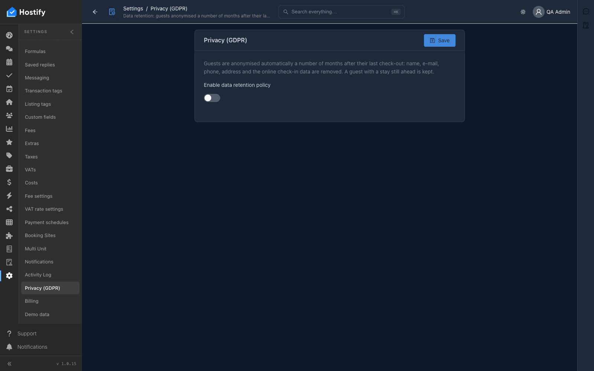


## Казус 35: accountBilling in the dark theme (/app/settings/accountBilling)

_Нов в този пуск._

**Какво се обърка**

```
Error: the column "(no key)" has a header — the columns: Number | Period | Date | Due | Amount | Status | (no header: no key)

expect(received).not.toBe(expected) // Object.is equality

Expected: not ""
```
- неуспешна заявка: net::ERR_BLOCKED_BY_ORB — `https://hostify-apps.bioseek.eu/plugins/paypal/logo.png`
- неуспешна заявка: net::ERR_BLOCKED_BY_ORB — `https://hostify-apps.bioseek.eu/plugins/stripe/logo.png`
- неуспешна заявка: net::ERR_BLOCKED_BY_ORB — `https://hostify-apps.bioseek.eu/plugins/duve/logo.png`
- неуспешна заявка: net::ERR_BLOCKED_BY_ORB — `https://hostify-apps.bioseek.eu/plugins/chekin/logo.svg`
- неуспешна заявка: net::ERR_BLOCKED_BY_ORB — `https://hostify-apps.bioseek.eu/plugins/superhog/logo.png`
- неуспешна заявка: net::ERR_BLOCKED_BY_ORB — `https://hostify-apps.bioseek.eu/plugins/breezeway/logo.png`
- неуспешна заявка: net::ERR_BLOCKED_BY_ORB — `https://hostify-apps.bioseek.eu/plugins/beyond/logo.jpg`
- неуспешна заявка: net::ERR_BLOCKED_BY_ORB — `https://hostify-apps.bioseek.eu/plugins/pricelabs/logo.svg`
- неуспешна заявка: net::ERR_BLOCKED_BY_ORB — `https://hostify-apps.bioseek.eu/plugins/cardcom/logo.png`
- неуспешна заявка: net::ERR_BLOCKED_BY_ORB — `https://hostify-apps.bioseek.eu/plugins/akiles/logo.svg`

**Как да се възпроизведе**

1. Влез в https://hostify.bioseek.eu/app/ като администратор на акаунта (qa.admin@hostify-qa.test).
2. Меню: SETTINGS › Billing — https://hostify.bioseek.eu/app/settings/accountBilling
3. Спек `tests/e2e/011-account-pages-dark.spec.ts`, проверка „accountBilling in the dark theme (/app/settings/accountBilling)“ — стъпките:
4. every column has a header and the actions column is the last one
5. Developer tools › Network: заявките по-горе отговарят така.

**Скрийншоти**

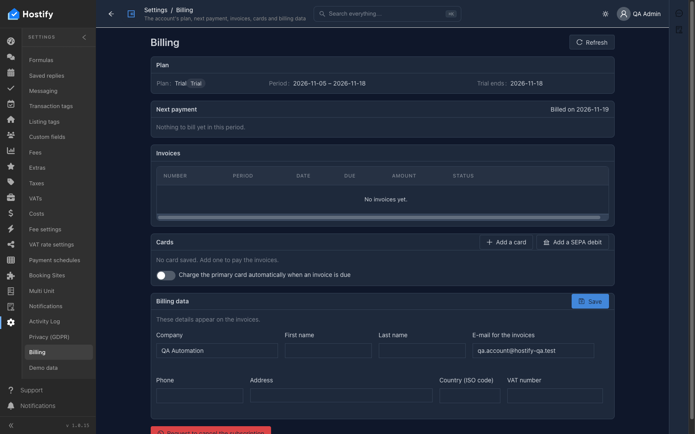


## Казус 36: demoData in the dark theme (/app/settings/demoData)

_Нов в този пуск._

**Какво се обърка**

```
Error: The page reported 66 error(s) — API answers, failed requests, console errors:
- [request.failed] net::ERR_BLOCKED_BY_ORB @ https://hostify-apps.bioseek.eu/plugins/duve/logo.png
- [request.failed] net::ERR_BLOCKED_BY_ORB @ https://hostify-apps.bioseek.eu/plugins/stripe/logo.png
- [request.failed] net::ERR_BLOCKED_BY_ORB @ https://hostify-apps.bioseek.eu/plugins/paypal/logo.png
- [request.failed] net::ERR_BLOCKED_BY_ORB @ https://hostify-apps.bioseek.eu/plugins/chekin/logo.svg
- [request.failed] net::ERR_BLOCKED_BY_ORB @ https://hostify-apps.bioseek.eu/plugins/superhog/logo.png
- [request.failed] net::ERR_BLOCKED_BY_ORB @ https://hostify-apps.bioseek.eu/plugins/breezeway/logo.png
- [request.failed] net::ERR_BLOCKED_BY_ORB @ https://hostify-apps.bioseek.eu/plugins/beyond/logo.jpg
- [request.failed] net::ERR_BLOCKED_BY_ORB @ https://hostify-apps.bioseek.eu/plugins/cardcom/logo.png
- [request.failed] net::ERR_BLOCKED_BY_ORB @ https://hostify-apps.bioseek.eu/plugins/pricelabs/logo.svg
- [request.failed] net::ERR_BLOCKED_BY_ORB @ https://hostify-apps.bioseek.eu/plugins/akiles/logo.svg
```
- неуспешна заявка: net::ERR_BLOCKED_BY_ORB — `https://hostify-apps.bioseek.eu/plugins/duve/logo.png`
- неуспешна заявка: net::ERR_BLOCKED_BY_ORB — `https://hostify-apps.bioseek.eu/plugins/stripe/logo.png`
- неуспешна заявка: net::ERR_BLOCKED_BY_ORB — `https://hostify-apps.bioseek.eu/plugins/paypal/logo.png`
- неуспешна заявка: net::ERR_BLOCKED_BY_ORB — `https://hostify-apps.bioseek.eu/plugins/chekin/logo.svg`
- неуспешна заявка: net::ERR_BLOCKED_BY_ORB — `https://hostify-apps.bioseek.eu/plugins/superhog/logo.png`
- неуспешна заявка: net::ERR_BLOCKED_BY_ORB — `https://hostify-apps.bioseek.eu/plugins/breezeway/logo.png`
- неуспешна заявка: net::ERR_BLOCKED_BY_ORB — `https://hostify-apps.bioseek.eu/plugins/beyond/logo.jpg`
- неуспешна заявка: net::ERR_BLOCKED_BY_ORB — `https://hostify-apps.bioseek.eu/plugins/cardcom/logo.png`
- неуспешна заявка: net::ERR_BLOCKED_BY_ORB — `https://hostify-apps.bioseek.eu/plugins/pricelabs/logo.svg`
- неуспешна заявка: net::ERR_BLOCKED_BY_ORB — `https://hostify-apps.bioseek.eu/plugins/akiles/logo.svg`

**Как да се възпроизведе**

1. Влез в https://hostify.bioseek.eu/app/ като администратор на акаунта (qa.admin@hostify-qa.test).
2. Меню: SETTINGS › Demo data — https://hostify.bioseek.eu/app/settings/demoData
3. Спек `tests/e2e/011-account-pages-dark.spec.ts`, проверка „demoData in the dark theme (/app/settings/demoData)“.
4. Developer tools › Network: заявките по-горе отговарят така.

**Скрийншоти**


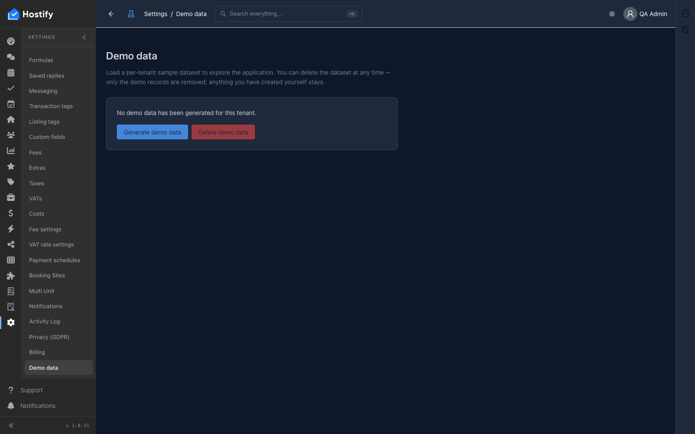


---

Какво проверява спекът: 011 — every page of the ACCOUNT menu in the DARK theme (the sweep of 010, the theme switched on first).
