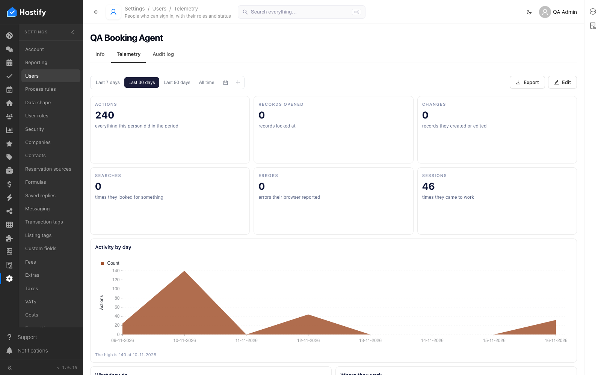
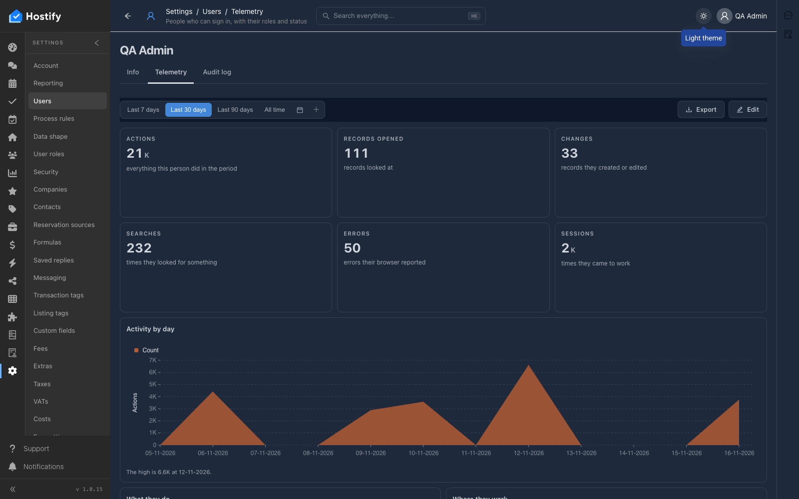
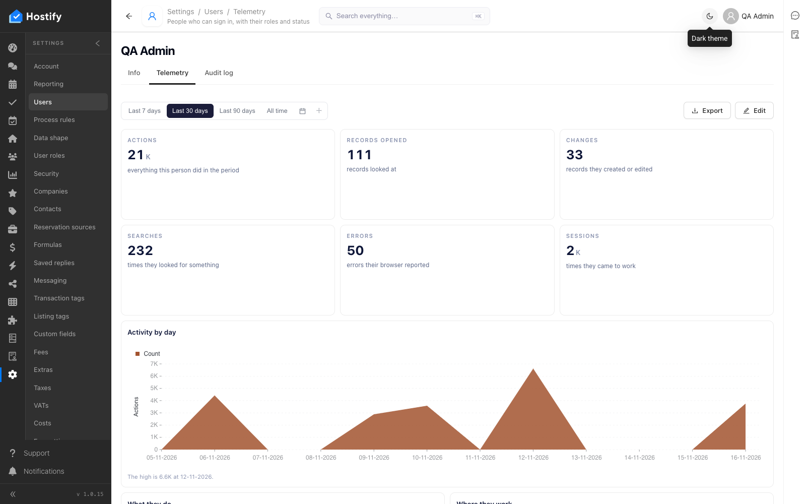

# 111-user-telemetry — Telemetry на човек — какво е направил (таговете на 110), часът на устройството му, тъмната тема

- Пуск: 2026-11-16_13-52-26 · Приложение: https://hostify.bioseek.eu · Версия: 1.0.15
- Спек: `tests/e2e/111-user-telemetry.spec.ts`
- Казуси: 2 от 5 проверки

## Казус 1: a session whose device time zone is unknown is named with the UTC time and says "UTC"

_Нов в този пуск._

**Какво се обърка**

```
Error: the newest session is the one signed in at 2026-11-16 11:59 UTC

expect(received).not.toMatch(expected)

Expected pattern: not /^not yet/
Received string:      "not yet: desktop · 1.0.15 · Windows · 2026-11-16 13:59"

Call Log:
- Timeout 120000ms exceeded while waiting on the predicate
```

**Как да се възпроизведе**

1. Влез в https://hostify.bioseek.eu/app/ като администратор на акаунта (qa.admin@hostify-qa.test).
2. Страница: https://hostify.bioseek.eu/app/settings/users/5037b7a6-32c4-4ae0-9772-1ba9bbc0d024/telemetry
3. Спек `tests/e2e/111-user-telemetry.spec.ts`, проверка „a session whose device time zone is unknown is named with the UTC time and says "UTC"“ — стъпките:
4. the booking agent signs in; the zone of the device does not reach the server

**Скрийншоти**




**Предупреждения в конзолата**

- [ReviewsMenuChannels] TypeError: Failed to fetch
- [hydraPartner] navbarExtensionLoader failed TypeError: Failed to fetch
- [InboxMenuCount] TypeError: Failed to fetch
- [AlertsMenuCount] TypeError: Failed to fetch
- [demoData] the demo data status could not be read — no welcome modal TypeError: Failed to fetch
- [hydraPartner] the plugin surfaces were not read TypeError: Failed to fetch

## Казус 2: in the dark theme the Changes card and table are dark and readable; the theme goes back to light

_Нов в този пуск._

**Какво се обърка**

```
Error: The page reported 1 error(s) — API answers, failed requests, console errors:
- [console.error] [dashboard] data load failed TypeError: Failed to fetch @ https://hostify.bioseek.eu/app/static/js/main.c75d4ea9.js
```
- конзола: [dashboard] data load failed TypeError: Failed to fetch — `/app/static/js/main.c75d4ea9.js`

**Как да се възпроизведе**

1. Влез в https://hostify.bioseek.eu/app/ като администратор на акаунта (qa.admin@hostify-qa.test).
2. Страница: https://hostify.bioseek.eu/app/settings/users/614d3d67-77d4-4351-abf8-90443678862d/telemetry
3. Спек `tests/e2e/111-user-telemetry.spec.ts`, проверка „in the dark theme the Changes card and table are dark and readable; the theme goes back to light“ — стъпките:
4. after a reload the theme is still light
5. Developer tools › Console показва грешките по-горе.

**Скрийншоти**





**Предупреждения в конзолата**

- [InboxMenuCount] TypeError: Failed to fetch
- [ReviewsMenuChannels] TypeError: Failed to fetch
- [hydraPartner] navbarExtensionLoader failed TypeError: Failed to fetch
- [demoData] the demo data status could not be read — no welcome modal TypeError: Failed to fetch
- [AlertsMenuCount] TypeError: Failed to fetch
- [hydraPartner] the plugin surfaces were not read TypeError: Failed to fetch

---

Какво проверява спекът: 111 — a person's Telemetry: what the person did, the time on the person's own device, the dark theme (1.0.7–1.0.10).
