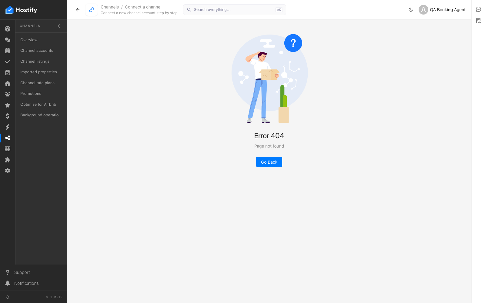
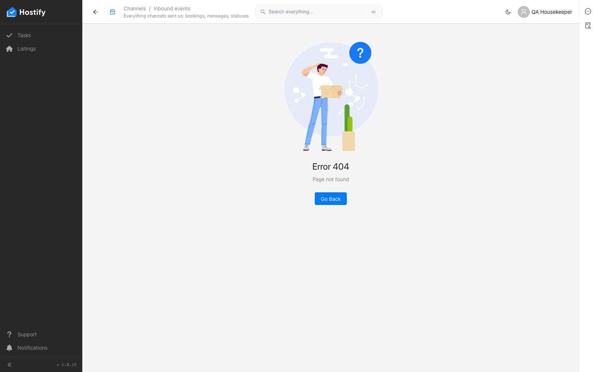
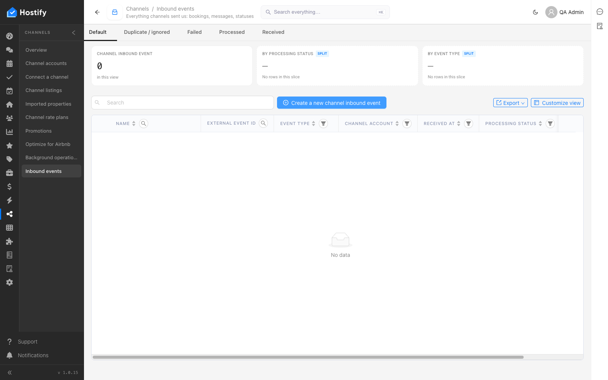
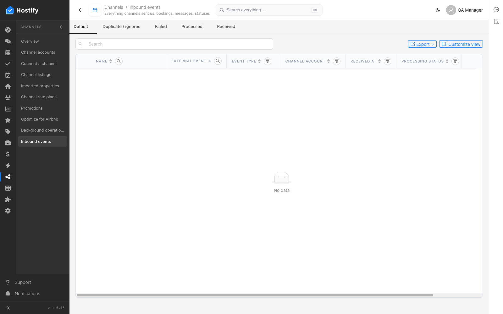

# 103-channels-by-role — каналите по роли — кой вижда страниците и кой има активни бутони (само гледане); колоните с опитите в Inbound events

- Пуск: 2026-11-16_14-42-23 · Приложение: https://hostify.bioseek.eu · Версия: 1.0.15
- Спек: `tests/e2e/103-channels-by-role.spec.ts`
- Казуси: 4 от 7 проверки

## Казус 1: booking agent: the channels are seen, nothing can be started; Inbound events is not his

_Нов в този пуск._

**Какво се обърка**

```
Error: booking agent: sites that can be connected

expect(received).toBe(expected) // Object.is equality

Expected: 0
Received: 23
```

**Как да се възпроизведе**

1. Влез в https://hostify.bioseek.eu/app/ като bookingAgent на акаунта (qa.booking.agent@hostify-qa.test).
2. Страница: https://hostify.bioseek.eu/app/channelManager/channelConnectWizard
3. Спек `tests/e2e/103-channels-by-role.spec.ts`, проверка „booking agent: the channels are seen, nothing can be started; Inbound events is not his“ — стъпките:
4. channelsHub opens and is presentable
5. channelAccounts opens and is presentable
6. channelListings opens and is presentable
7. channelProperties opens and is presentable
8. channelRatePlans opens and is presentable
9. channelListingPromotions opens and is presentable
10. airbnbOpportunities opens and is presentable
11. channelCommands opens and is presentable
12. Overview: every site tile is disabled
13. Channel accounts: no enabled "Connect a channel"
14. Optimize for Airbnb: the actions are off and the line says who sets the channel up
15. Inbound events and the connect wizard by their address: "Page not found"

**Скрийншоти**




**Предупреждения в конзолата**

- [InboxMenuCount] TypeError: Failed to fetch
- [ReviewsMenuChannels] TypeError: Failed to fetch
- [hydraPartner] navbarExtensionLoader failed TypeError: Failed to fetch
- [demoData] the demo data status could not be read — no welcome modal TypeError: Failed to fetch
- [AlertsMenuCount] TypeError: Failed to fetch
- [hydraPartner] the plugin surfaces were not read TypeError: Failed to fetch

## Казус 2: housekeeper: Channels is not on the menu and its pages say "Page not found"

_Нов в този пуск._

**Какво се обърка**

```
Error: The page reported 2 error(s) — API answers, failed requests, console errors:
- [api.status] POST 403 @ https://hostify.bioseek.eu/api/inboxThread/inbox
- [api.status] POST 403 @ https://hostify.bioseek.eu/api/review/channels
```
- сървърът отговори: POST 403 — `/api/inboxThread/inbox`
- сървърът отговори: POST 403 — `/api/review/channels`

**Как да се възпроизведе**

1. Влез в https://hostify.bioseek.eu/app/ като housekeeper на акаунта (qa.housekeeper@hostify-qa.test).
2. Страница: https://hostify.bioseek.eu/app/channelManager/channelInboundEvents
3. Спек `tests/e2e/103-channels-by-role.spec.ts`, проверка „housekeeper: Channels is not on the menu and its pages say "Page not found"“ — стъпките:
4. channelsHub by its address
5. channelAccounts by its address
6. channelListings by its address
7. channelProperties by its address
8. channelRatePlans by its address
9. channelListingPromotions by its address
10. airbnbOpportunities by its address
11. channelCommands by its address
12. channelInboundEvents by its address
13. Developer tools › Network: заявките по-горе отговарят така.

**Скрийншоти**




**Предупреждения в конзолата**

- [hydraPartner] navbarExtensionLoader failed TypeError: Failed to fetch
- [InboxMenuCount] TypeError: Failed to fetch
- [ReviewsMenuChannels] TypeError: Failed to fetch
- [AlertsMenuCount] TypeError: Failed to fetch
- [demoData] the demo data status could not be read — no welcome modal TypeError: Failed to fetch
- [hydraPartner] the plugin surfaces were not read TypeError: Failed to fetch
- [InboxMenuCount] Response
- [ReviewsMenuChannels] Response
- [InboxMenuCount] Response
- [ReviewsMenuChannels] Response

## Казус 3: admin: Inbound events show the attempts of an event and when it is tried next (1.0.15)

_Нов в този пуск._

**Какво се обърка**

```
Error: admin: a column for the attempts — the columns: Name | External event id | Event type | Channel account | Received at | Processing status | Processed record

expect(received).not.toEqual(expected) // deep equality

Expected: not []

```

**Как да се възпроизведе**

1. Влез в https://hostify.bioseek.eu/app/ като администратор на акаунта (qa.admin@hostify-qa.test).
2. Страница: https://hostify.bioseek.eu/app/channelManager/channelInboundEvents
3. Спек `tests/e2e/103-channels-by-role.spec.ts`, проверка „admin: Inbound events show the attempts of an event and when it is tried next (1.0.15)“.

**Скрийншоти**





**Предупреждения в конзолата**

- [InboxMenuCount] TypeError: Failed to fetch
- [hydraPartner] navbarExtensionLoader failed TypeError: Failed to fetch
- [ReviewsMenuChannels] TypeError: Failed to fetch
- [AlertsMenuCount] TypeError: Failed to fetch
- [demoData] the demo data status could not be read — no welcome modal TypeError: Failed to fetch
- [hydraPartner] the plugin surfaces were not read TypeError: Failed to fetch

## Казус 4: manager: Inbound events show the attempts of an event and when it is tried next (1.0.15)

_Нов в този пуск._

**Какво се обърка**

```
Error: manager: a column for the attempts — the columns: Name | External event id | Event type | Channel account | Received at | Processing status | Processed record

expect(received).not.toEqual(expected) // deep equality

Expected: not []

```

**Как да се възпроизведе**

1. Влез в https://hostify.bioseek.eu/app/ като manager на акаунта (qa.manager@hostify-qa.test).
2. Страница: https://hostify.bioseek.eu/app/channelManager/channelInboundEvents
3. Спек `tests/e2e/103-channels-by-role.spec.ts`, проверка „manager: Inbound events show the attempts of an event and when it is tried next (1.0.15)“.

**Скрийншоти**




**Предупреждения в конзолата**

- [InboxMenuCount] TypeError: Failed to fetch
- [hydraPartner] navbarExtensionLoader failed TypeError: Failed to fetch
- [ReviewsMenuChannels] TypeError: Failed to fetch
- [demoData] the demo data status could not be read — no welcome modal TypeError: Failed to fetch
- [AlertsMenuCount] TypeError: Failed to fetch
- [hydraPartner] the plugin surfaces were not read TypeError: Failed to fetch

---

Какво проверява спекът: 103 — Channels by role (1.0.11–1.0.15): every role sees the channels it may see; only the administrator and the
