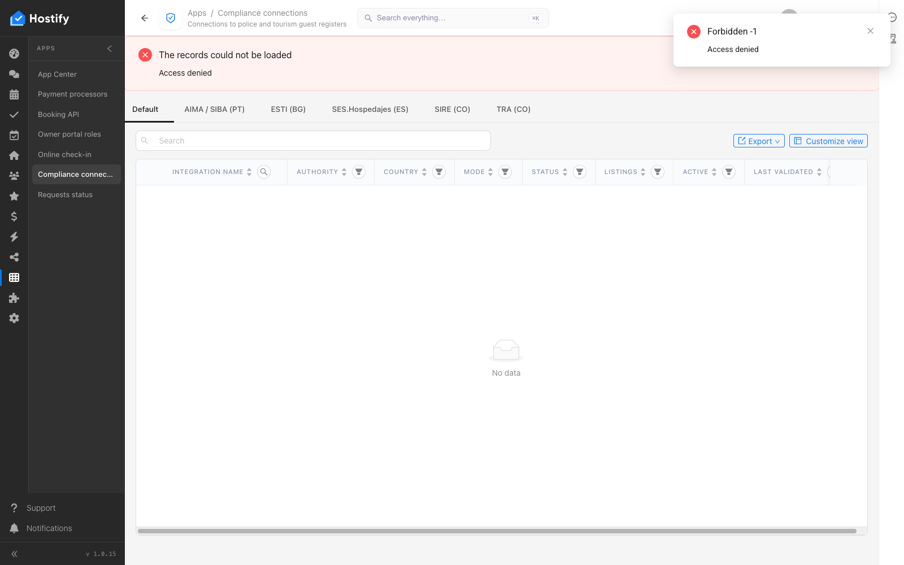
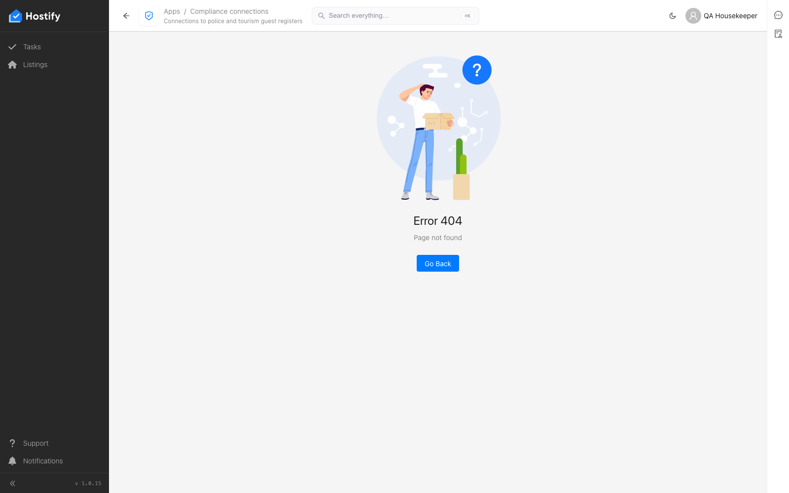

# 104-apps-by-role — Apps и плъгините по роли — App Center и страниците на Apps се отварят без отказ за ролите, които ги имат (само гледане)

- Пуск: 2026-11-16_14-55-22 · Приложение: https://hostify.bioseek.eu · Версия: 1.0.15
- Спек: `tests/e2e/104-apps-by-role.spec.ts`
- Казуси: 2 от 4 проверки

## Казус 1: bookingAgent: App Center shows the apps and every page of Apps opens without a refusal

_Нов в този пуск._

**Какво се обърка**

```
Error: The page reported 7 error(s) — API answers, failed requests, console errors:
- [api.status] GET 403 @ https://hostify.bioseek.eu/api/complianceConnection/search?size=100&page=1
- [console.error] Grid read failed for "bookingApiClient" requestFailed {message: Access denied, error: -1, code: 403} @ https://hostify.bioseek.eu/app/static/js/main.c75d4ea9.js?1.0.15
- [api.status] GET 403 @ https://hostify.bioseek.eu/api/bookingApiClient/search?page=1&size=10&lang=en&sort=date_created&sort=descend
- [console.error] Grid read failed for "ownerPortalRole" requestFailed {message: Access denied, error: -1, code: 403} @ https://hostify.bioseek.eu/app/static/js/main.c75d4ea9.js?1.0.15
- [api.status] GET 403 @ https://hostify.bioseek.eu/api/ownerPortalRole/search?page=1&size=10&lang=en&sort=date_created&sort=descend
- [console.error] Grid read failed for "complianceConnection" requestFailed {message: Access denied, error: -1, code: 403} @ https://hostify.bioseek.eu/app/static/js/main.c75d4ea9.js?1.0.15
- [api.status] GET 403 @ https://hostify.bioseek.eu/api/complianceConnection/search?page=1&size=10&lang=en
```
- сървърът отговори: GET 403 — `/api/complianceConnection/search?size=100&page=1`
- конзола: Grid read failed for "bookingApiClient" requestFailed {message: Access denied, error: -1, code: 403} — `/app/static/js/main.c75d4ea9.js?1.0.15`
- сървърът отговори: GET 403 — `/api/bookingApiClient/search?page=1&size=10&lang=en&sort=date_created&sort=descend`
- конзола: Grid read failed for "ownerPortalRole" requestFailed {message: Access denied, error: -1, code: 403} — `/app/static/js/main.c75d4ea9.js?1.0.15`
- сървърът отговори: GET 403 — `/api/ownerPortalRole/search?page=1&size=10&lang=en&sort=date_created&sort=descend`
- конзола: Grid read failed for "complianceConnection" requestFailed {message: Access denied, error: -1, code: 403} — `/app/static/js/main.c75d4ea9.js?1.0.15`
- сървърът отговори: GET 403 — `/api/complianceConnection/search?page=1&size=10&lang=en`

**Как да се възпроизведе**

1. Влез в https://hostify.bioseek.eu/app/ като bookingAgent на акаунта (qa.booking.agent@hostify-qa.test).
2. Страница: https://hostify.bioseek.eu/app/apps/complianceConnections
3. Спек `tests/e2e/104-apps-by-role.spec.ts`, проверка „bookingAgent: App Center shows the apps and every page of Apps opens without a refusal“ — стъпките:
4. App Center shows its apps
5. paymentProcessorAccounts opens and is presentable
6. bookingApiClients opens and is presentable
7. ownerPortalRoles opens and is presentable
8. checkinFormTemplates opens and is presentable
9. complianceConnections opens and is presentable
10. Developer tools › Network: заявките по-горе отговарят така.
11. Developer tools › Console показва грешките по-горе.

**Скрийншоти**




**Предупреждения в конзолата**

- [InboxMenuCount] TypeError: Failed to fetch
- [hydraPartner] navbarExtensionLoader failed TypeError: Failed to fetch
- [ReviewsMenuChannels] TypeError: Failed to fetch
- [AlertsMenuCount] TypeError: Failed to fetch
- [demoData] the demo data status could not be read — no welcome modal TypeError: Failed to fetch
- [hydraPartner] the plugin surfaces were not read TypeError: Failed to fetch

## Казус 2: housekeeper: the pages of Apps say "Page not found"

_Известен от пуска 2026-11-16 14:42 (същата версия) — не е отстранен._

**Какво се обърка**

```
Error: The page reported 2 error(s) — API answers, failed requests, console errors:
- [api.status] POST 403 @ https://hostify.bioseek.eu/api/inboxThread/inbox
- [api.status] POST 403 @ https://hostify.bioseek.eu/api/review/channels
```
- сървърът отговори: POST 403 — `/api/inboxThread/inbox`
- сървърът отговори: POST 403 — `/api/review/channels`

**Как да се възпроизведе**

1. Влез в https://hostify.bioseek.eu/app/ като housekeeper на акаунта (qa.housekeeper@hostify-qa.test).
2. Страница: https://hostify.bioseek.eu/app/apps/complianceConnections
3. Спек `tests/e2e/104-apps-by-role.spec.ts`, проверка „housekeeper: the pages of Apps say "Page not found"“ — стъпките:
4. appCenter by its address
5. paymentProcessorAccounts by its address
6. bookingApiClients by its address
7. ownerPortalRoles by its address
8. checkinFormTemplates by its address
9. complianceConnections by its address
10. Developer tools › Network: заявките по-горе отговарят така.

**Скрийншоти**




**Предупреждения в конзолата**

- [hydraPartner] navbarExtensionLoader failed TypeError: Failed to fetch
- [ReviewsMenuChannels] TypeError: Failed to fetch
- [InboxMenuCount] TypeError: Failed to fetch
- [demoData] the demo data status could not be read — no welcome modal TypeError: Failed to fetch
- [AlertsMenuCount] TypeError: Failed to fetch
- [hydraPartner] the plugin surfaces were not read TypeError: Failed to fetch
- [InboxMenuCount] Response
- [ReviewsMenuChannels] Response
- [InboxMenuCount] Response
- [ReviewsMenuChannels] Response

---

Какво проверява спекът: 104 — Apps by role (1.0.11): every person of the account uses the installed plugins; only the administrator and the
