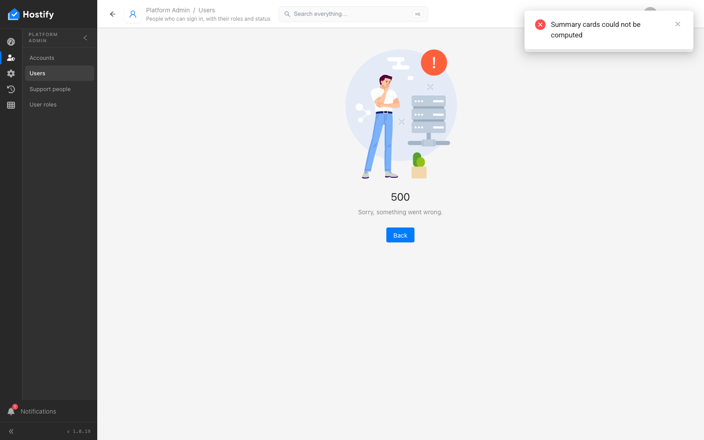

# 002-qa-account — почистване на предишния пуск; акаунт „QA Automation“ и неговият администратор през формите

- Пуск: 2026-11-17_12-08-15 · Приложение: https://hostify.bioseek.eu · Версия: 1.0.19
- Спек: `tests/e2e/002-qa-account.spec.ts`
- Казуси: 1 от 2 проверки

## Казус 1: the administrator of the account exists — created through the Users form when missing

_Нов в този пуск._

**Какво се обърка**

```
Test timeout of 420000ms exceeded.
```
- на екрана (platform-admin-users): 500
- на екрана (platform-admin-users): ServerErrorFailed to fetch
- на екрана (platform-admin-users): Summary cards could not be computed

**Как да се възпроизведе**

1. Влез в https://hostify.bioseek.eu/app/ като суперадминистратор (alarm@mail.bg).
2. Страница: https://hostify.bioseek.eu/app/platformAdmin/users
3. Спек `tests/e2e/002-qa-account.spec.ts`, проверка „the administrator of the account exists — created through the Users form when missing“.

**Скрийншоти**




**Предупреждения в конзолата**

- [AlertsMenuCount] TypeError: Failed to fetch

---

Какво проверява спекът: 002 — the QA account and its administrator exist, and the account is empty.
