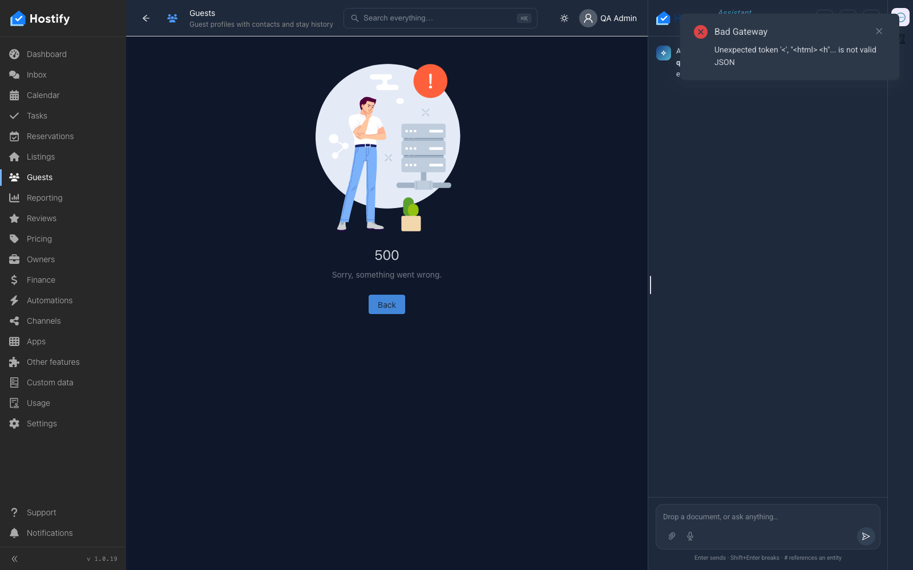

# 011-account-pages-dark — тъмната тема на акаунта — всяка страница се отваря, оглежда се и нищо не остава светло

- Пуск: 2026-11-17_12-08-15 · Приложение: https://hostify.bioseek.eu · Версия: 1.0.19
- Спек: `tests/e2e/011-account-pages-dark.spec.ts`
- Казуси: 2 от 161 проверки

## Казус 1: guests in the dark theme (/app/guests)

_Нов в този пуск._

**Какво се обърка**

```
Error: guests: the screen is not presentable (2):
- [blocker/result-500] 500
- [error/error-notification] Bad Gateway Unexpected token '<', "<html> <h"... is not valid JSON
```
- конзола: Grid read failed for "listingPolicy" requestFailed {message: Unexpected token '<', "<html>
 — `/app/static/js/main.68479564.js`
- сървърът отговори: GET 502 — `/api/listingPolicy/search?page=1&size=10&lang=en&sort=date_created&sort=descend`
- конзола: {name: Guests, path: page, error: ChunkLoadError: Loading chunk 16713 failed. — `/app/static/js/main.68479564.js`
- конзола: ChunkLoadError: Loading CSS chunk 27024 failed. — `/app/static/js/main.68479564.js`
- на екрана (guests): 500
- на екрана (guests): Bad Gateway Unexpected token '<', "<html> <h"... is not valid JSON

**Как да се възпроизведе**

1. Влез в https://hostify.bioseek.eu/app/ като администратор на акаунта (qa.admin@hostify-qa.test).
2. Меню: Guests — https://hostify.bioseek.eu/app/guests
3. Спек `tests/e2e/011-account-pages-dark.spec.ts`, проверка „guests in the dark theme (/app/guests)“.
4. Developer tools › Network: заявките по-горе отговарят така.
5. Developer tools › Console показва грешките по-горе.

**Скрийншоти**





## Казус 2: reportingOverview in the dark theme (/app/reporting/reportingOverview)

_Нов в този пуск._

**Какво се обърка**

```
Error: expect(locator).toBeVisible() failed

Locator: locator('[data-test="login-input-email"]')
Expected: visible
Timeout: 45000ms
Error: element(s) not found

Call log:
  - Expect "toBeVisible" with timeout 45000ms
  - waiting for locator('[data-test="login-input-email"]')

```

**Как да се възпроизведе**

1. Спек `tests/e2e/011-account-pages-dark.spec.ts`, проверка „reportingOverview in the dark theme (/app/reporting/reportingOverview)“.

---

Какво проверява спекът: 011 — every page of the ACCOUNT menu in the DARK theme (the sweep of 010, the theme switched on first).
