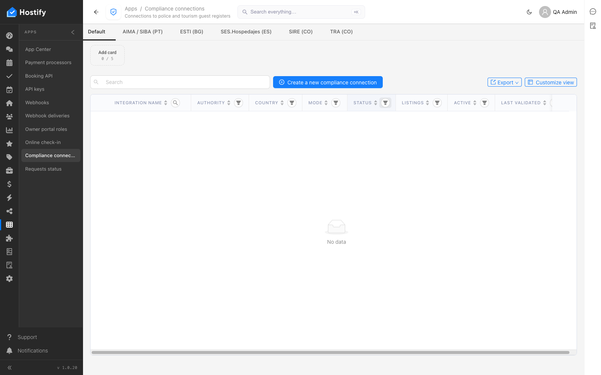

# 104-apps-by-role — Apps и плъгините по роли — App Center и страниците на Apps се отварят без отказ за ролите, които ги имат (само гледане)

- Пуск: 2026-11-17_12-08-15 · Приложение: https://hostify.bioseek.eu · Версия: 1.0.19
- Спек: `tests/e2e/104-apps-by-role.spec.ts`
- Казуси: 4 от 4 проверки

## Казус 1: admin: App Center shows the apps and every page of Apps opens without a refusal

_Нов в този пуск._

**Какво се обърка**

```
Error: The page reported 52 error(s) — API answers, failed requests, console errors:
- [request.failed] net::ERR_BLOCKED_BY_ORB @ https://hostify-apps.bioseek.eu/plugins/remotelock/logo.png
- [request.failed] net::ERR_BLOCKED_BY_ORB @ https://hostify-apps.bioseek.eu/plugins/insuraguest/logo.png
- [request.failed] net::ERR_BLOCKED_BY_ORB @ https://hostify-apps.bioseek.eu/plugins/superhog/logo.png
- [request.failed] net::ERR_BLOCKED_BY_ORB @ https://hostify-apps.bioseek.eu/plugins/beyond/logo.jpg
- [request.failed] net::ERR_BLOCKED_BY_ORB @ https://hostify-apps.bioseek.eu/plugins/breezeway/logo.png
- [request.failed] net::ERR_BLOCKED_BY_ORB @ https://hostify-apps.bioseek.eu/plugins/hostify-locks/logo.svg
- [request.failed] net::ERR_BLOCKED_BY_ORB @ https://hostify-apps.bioseek.eu/plugins/key-data/logo.png
- [request.failed] net::ERR_BLOCKED_BY_ORB @ https://hostify-apps.bioseek.eu/plugins/doinn/logo.png
- [request.failed] net::ERR_BLOCKED_BY_ORB @ https://hostify-apps.bioseek.eu/plugins/cardcom/logo.png
- [request.failed] net::ERR_BLOCKED_BY_ORB @ https://hostify-apps.bioseek.eu/plugins/turnoverbnb/logo.png
```
- неуспешна заявка: net::ERR_BLOCKED_BY_ORB — `https://hostify-apps.bioseek.eu/plugins/remotelock/logo.png`
- неуспешна заявка: net::ERR_BLOCKED_BY_ORB — `https://hostify-apps.bioseek.eu/plugins/insuraguest/logo.png`
- неуспешна заявка: net::ERR_BLOCKED_BY_ORB — `https://hostify-apps.bioseek.eu/plugins/superhog/logo.png`
- неуспешна заявка: net::ERR_BLOCKED_BY_ORB — `https://hostify-apps.bioseek.eu/plugins/beyond/logo.jpg`
- неуспешна заявка: net::ERR_BLOCKED_BY_ORB — `https://hostify-apps.bioseek.eu/plugins/breezeway/logo.png`
- неуспешна заявка: net::ERR_BLOCKED_BY_ORB — `https://hostify-apps.bioseek.eu/plugins/hostify-locks/logo.svg`
- неуспешна заявка: net::ERR_BLOCKED_BY_ORB — `https://hostify-apps.bioseek.eu/plugins/key-data/logo.png`
- неуспешна заявка: net::ERR_BLOCKED_BY_ORB — `https://hostify-apps.bioseek.eu/plugins/doinn/logo.png`
- неуспешна заявка: net::ERR_BLOCKED_BY_ORB — `https://hostify-apps.bioseek.eu/plugins/cardcom/logo.png`
- неуспешна заявка: net::ERR_BLOCKED_BY_ORB — `https://hostify-apps.bioseek.eu/plugins/turnoverbnb/logo.png`

**Как да се възпроизведе**

1. Влез в https://hostify.bioseek.eu/app/ като администратор на акаунта (qa.admin@hostify-qa.test).
2. Страница: https://hostify.bioseek.eu/app/apps/complianceConnections
3. Спек `tests/e2e/104-apps-by-role.spec.ts`, проверка „admin: App Center shows the apps and every page of Apps opens without a refusal“ — стъпките:
4. App Center shows its apps
5. paymentProcessorAccounts opens and is presentable
6. bookingApiClients opens and is presentable
7. ownerPortalRoles opens and is presentable
8. checkinFormTemplates opens and is presentable
9. complianceConnections opens and is presentable
10. Developer tools › Network: заявките по-горе отговарят така.

**Скрийншоти**




**Предупреждения в конзолата**

- [ReviewsMenuChannels] TypeError: Failed to fetch
- [InboxMenuCount] TypeError: Failed to fetch
- [hydraPartner] navbarExtensionLoader failed TypeError: Failed to fetch
- [demoData] the demo data status could not be read — no welcome modal TypeError: Failed to fetch
- [AlertsMenuCount] TypeError: Failed to fetch
- [hydraPartner] the plugin surfaces were not read TypeError: Failed to fetch

## Казус 2: manager: App Center shows the apps and every page of Apps opens without a refusal

_Нов в този пуск._

**Какво се обърка**

```
Error: expect(locator).toBeHidden() failed

Locator:  locator('[data-test="login-modal"]').locator('.ant-modal')
Expected: hidden
Received: visible
Timeout:  30000ms

Call log:
  - Expect "toBeHidden" with timeout 30000ms
  - waiting for locator('[data-test="login-modal"]').locator('.ant-modal')
    33 × locator resolved to <div role="dialog" tabindex="-1" aria-modal="true" aria-labelledby="_r_1_" class="ant-modal css-ry7cab">…</div>
       - unexpected value "visible"
```

**Как да се възпроизведе**

1. Влез в https://hostify.bioseek.eu/app/ като manager на акаунта (qa.manager@hostify-qa.test).
2. Страница: https://hostify.bioseek.eu/app/
3. Спек `tests/e2e/104-apps-by-role.spec.ts`, проверка „manager: App Center shows the apps and every page of Apps opens without a refusal“.

**Скрийншоти**


## Казус 3: bookingAgent: App Center shows the apps and every page of Apps opens without a refusal

_Нов в този пуск._

**Какво се обърка**

```
Error: expect(locator).toBeHidden() failed

Locator:  locator('[data-test="login-modal"]').locator('.ant-modal')
Expected: hidden
Received: visible
Timeout:  30000ms

Call log:
  - Expect "toBeHidden" with timeout 30000ms
  - waiting for locator('[data-test="login-modal"]').locator('.ant-modal')
    33 × locator resolved to <div role="dialog" tabindex="-1" aria-modal="true" aria-labelledby="_r_1_" class="ant-modal css-ry7cab">…</div>
       - unexpected value "visible"
```

**Как да се възпроизведе**

1. Влез в https://hostify.bioseek.eu/app/ като bookingAgent на акаунта (qa.booking.agent@hostify-qa.test).
2. Страница: https://hostify.bioseek.eu/app/
3. Спек `tests/e2e/104-apps-by-role.spec.ts`, проверка „bookingAgent: App Center shows the apps and every page of Apps opens without a refusal“.

**Скрийншоти**


## Казус 4: housekeeper: the pages of Apps say "Page not found"

_Нов в този пуск._

**Какво се обърка**

```
Error: expect(locator).toBeHidden() failed

Locator:  locator('[data-test="login-modal"]').locator('.ant-modal')
Expected: hidden
Received: visible
Timeout:  30000ms

Call log:
  - Expect "toBeHidden" with timeout 30000ms
  - waiting for locator('[data-test="login-modal"]').locator('.ant-modal')
    33 × locator resolved to <div role="dialog" tabindex="-1" aria-modal="true" aria-labelledby="_r_1_" class="ant-modal css-ry7cab">…</div>
       - unexpected value "visible"
```

**Как да се възпроизведе**

1. Влез в https://hostify.bioseek.eu/app/ като housekeeper на акаунта (qa.housekeeper@hostify-qa.test).
2. Страница: https://hostify.bioseek.eu/app/
3. Спек `tests/e2e/104-apps-by-role.spec.ts`, проверка „housekeeper: the pages of Apps say "Page not found"“.

**Скрийншоти**


---

Какво проверява спекът: 104 — Apps by role (1.0.11): every person of the account uses the installed plugins; only the administrator and the
