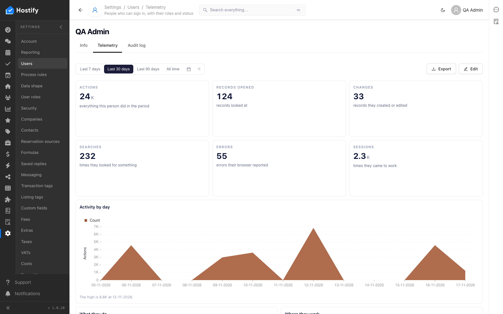
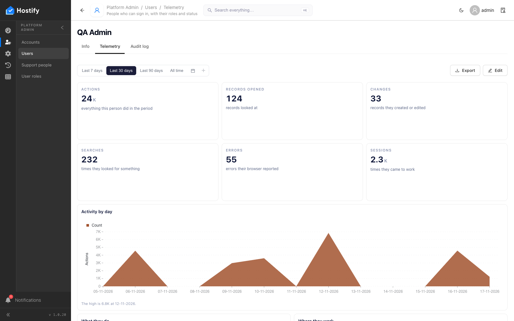
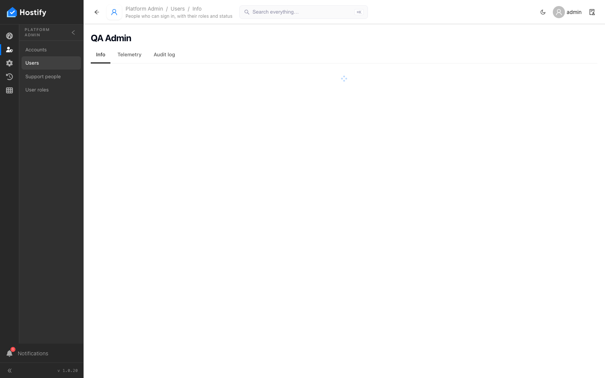

# 111-user-telemetry — Telemetry на човек — какво е направил (таговете на 110), часът на устройството му, тъмната тема

- Пуск: 2026-11-17_12-08-15 · Приложение: https://hostify.bioseek.eu · Версия: 1.0.19
- Спек: `tests/e2e/111-user-telemetry.spec.ts`
- Казуси: 4 от 5 проверки

## Казус 1: the administrator's Telemetry lists the three tags of 110 among its Changes

_Нов в този пуск._

**Какво се обърка**

```
Error: the three tags of 110 exist (spec 110 ran before)

expect(received).toEqual(expected) // deep equality

- Expected  - 5
+ Received  + 1

- Array [
-   "QA Tag Pet friendly",
-   "QA Tag Retired",
-   "QA Tag Sea view",
- ]
```

**Как да се възпроизведе**

1. Влез в https://hostify.bioseek.eu/app/ като администратор на акаунта (qa.admin@hostify-qa.test).
2. Страница: https://hostify.bioseek.eu/app/settings/users/614d3d67-77d4-4351-abf8-90443678862d/telemetry
3. Спек `tests/e2e/111-user-telemetry.spec.ts`, проверка „the administrator's Telemetry lists the three tags of 110 among its Changes“.

**Скрийншоти**




**Предупреждения в конзолата**

- [hydraPartner] navbarExtensionLoader failed TypeError: Failed to fetch
- [InboxMenuCount] TypeError: Failed to fetch
- [ReviewsMenuChannels] TypeError: Failed to fetch
- [demoData] the demo data status could not be read — no welcome modal TypeError: Failed to fetch
- [AlertsMenuCount] TypeError: Failed to fetch
- [hydraPartner] the plugin surfaces were not read TypeError: Failed to fetch

## Казус 2: a person's session is named with the time of their own device (Pacific/Auckland), not UTC

_Нов в този пуск._

**Какво се обърка**

```
Error: expect(locator).toBeHidden() failed

Locator:  locator('[data-test="login-modal"]').locator('.ant-modal')
Expected: hidden
Received: visible
Timeout:  30000ms

Call log:
  - Expect "toBeHidden" with timeout 30000ms
  - waiting for locator('[data-test="login-modal"]').locator('.ant-modal')
    33 × locator resolved to <div role="dialog" tabindex="-1" aria-modal="true" aria-labelledby="_r_1_" class="ant-modal css-ry7cab">…</div>
       - unexpected value "visible"
```

**Как да се възпроизведе**

1. Спек `tests/e2e/111-user-telemetry.spec.ts`, проверка „a person's session is named with the time of their own device (Pacific/Auckland), not UTC“ — стъпките:
2. the booking agent signs in from a browser in Pacific/Auckland

**Скрийншоти**


## Казус 3: a session whose device time zone is unknown is named with the UTC time and says "UTC"

_Нов в този пуск._

**Какво се обърка**

```
Error: expect(locator).toBeHidden() failed

Locator:  locator('[data-test="login-modal"]').locator('.ant-modal')
Expected: hidden
Received: visible
Timeout:  30000ms

Call log:
  - Expect "toBeHidden" with timeout 30000ms
  - waiting for locator('[data-test="login-modal"]').locator('.ant-modal')
    33 × locator resolved to <div role="dialog" tabindex="-1" aria-modal="true" aria-labelledby="_r_1_" class="ant-modal css-ry7cab">…</div>
       - unexpected value "visible"
```

**Как да се възпроизведе**

1. Спек `tests/e2e/111-user-telemetry.spec.ts`, проверка „a session whose device time zone is unknown is named with the UTC time and says "UTC"“ — стъпките:
2. the booking agent signs in; the zone of the device does not reach the server

**Скрийншоти**


## Казус 4: the super administrator sees the same Changes on the person's page of Platform Admin Users

_Нов в този пуск._

**Какво се обърка**

```
Error: the three tags of 110 exist (spec 110 ran before)

expect(received).toEqual(expected) // deep equality

- Expected  - 5
+ Received  + 1

- Array [
-   "QA Tag Pet friendly",
-   "QA Tag Retired",
-   "QA Tag Sea view",
- ]
```

**Как да се възпроизведе**

1. Влез в https://hostify.bioseek.eu/app/ като суперадминистратор (alarm@mail.bg).
2. Страница: https://hostify.bioseek.eu/app/platformAdmin/users/614d3d67-77d4-4351-abf8-90443678862d/info
3. Спек `tests/e2e/111-user-telemetry.spec.ts`, проверка „the super administrator sees the same Changes on the person's page of Platform Admin Users“.

**Скрийншоти**





**Предупреждения в конзолата**

- [AlertsMenuCount] TypeError: Failed to fetch

---

Какво проверява спекът: 111 — a person's Telemetry: what the person did, the time on the person's own device, the dark theme (1.0.7–1.0.10).
