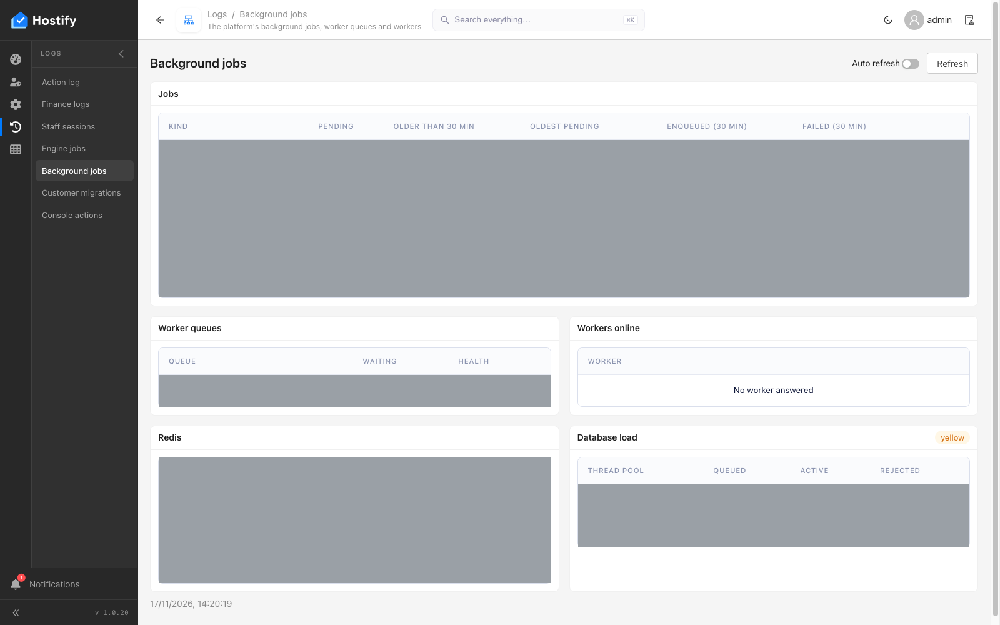

# 005-platform-pages — проверка на навбар менютата на платформената конзола (всяка страница се отваря и се оглежда)

- Пуск: 2026-11-17_14-12-09 · Приложение: https://hostify.bioseek.eu · Версия: 1.0.20
- Спек: `tests/e2e/005-platform-pages.spec.ts`
- Казуси: 1 от 35 проверки

## Казус 1: backgroundJobs opens (/app/platformLogs/backgroundJobs)

_Нов в този пуск._

**Какво се обърка**

```
Error: the column "(no key)" has a header — the columns: Kind | Pending | Older than 30 min | Oldest pending | Enqueued (30 min) | Failed (30 min) | (no header: no key)

expect(received).not.toBe(expected) // Object.is equality

Expected: not ""
```

**Как да се възпроизведе**

1. Влез в https://hostify.bioseek.eu/app/ като суперадминистратор (alarm@mail.bg).
2. Меню: LOGS › Background jobs — https://hostify.bioseek.eu/app/platformLogs/backgroundJobs
3. Спек `tests/e2e/005-platform-pages.spec.ts`, проверка „backgroundJobs opens (/app/platformLogs/backgroundJobs)“ — стъпките:
4. every column has a header and the actions column is the last one

**Скрийншоти**





---

Какво проверява спекът: 005 — every page of the PLATFORM console opens for the super administrator.
