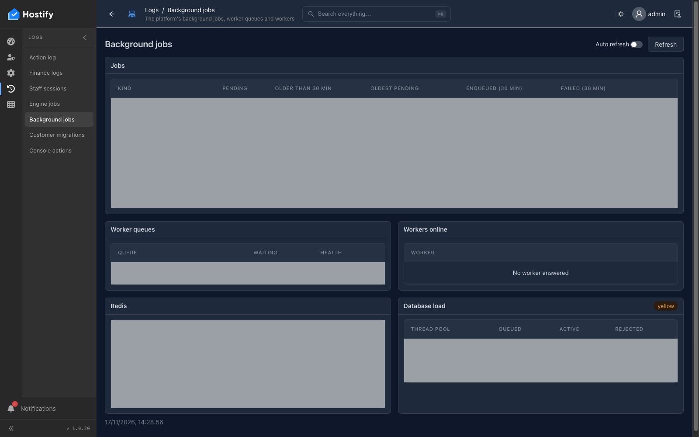

# 008-platform-pages-dark — тъмната тема на платформената конзола — всяка страница се отваря, оглежда се и нищо не остава светло

- Пуск: 2026-11-17_14-12-09 · Приложение: https://hostify.bioseek.eu · Версия: 1.0.20
- Спек: `tests/e2e/008-platform-pages-dark.spec.ts`
- Казуси: 1 от 34 проверки

## Казус 1: backgroundJobs in the dark theme (/app/platformLogs/backgroundJobs)

_Нов в този пуск._

**Какво се обърка**

```
Error: the column "(no key)" has a header — the columns: Kind | Pending | Older than 30 min | Oldest pending | Enqueued (30 min) | Failed (30 min) | (no header: no key)

expect(received).not.toBe(expected) // Object.is equality

Expected: not ""
```

**Как да се възпроизведе**

1. Влез в https://hostify.bioseek.eu/app/ като суперадминистратор (alarm@mail.bg).
2. Меню: LOGS › Background jobs — https://hostify.bioseek.eu/app/platformLogs/backgroundJobs
3. Спек `tests/e2e/008-platform-pages-dark.spec.ts`, проверка „backgroundJobs in the dark theme (/app/platformLogs/backgroundJobs)“ — стъпките:
4. every column has a header and the actions column is the last one

**Скрийншоти**




---

Какво проверява спекът: 008 — every page of the PLATFORM console in the DARK theme (the sweep of 005, the theme switched on first).
