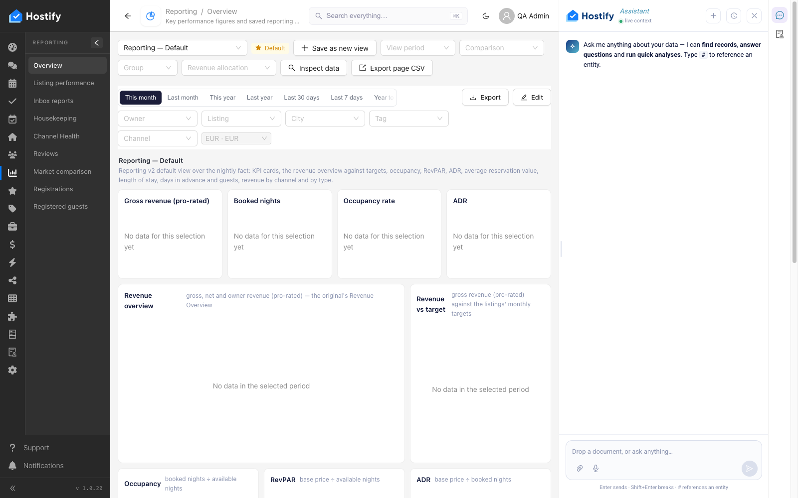
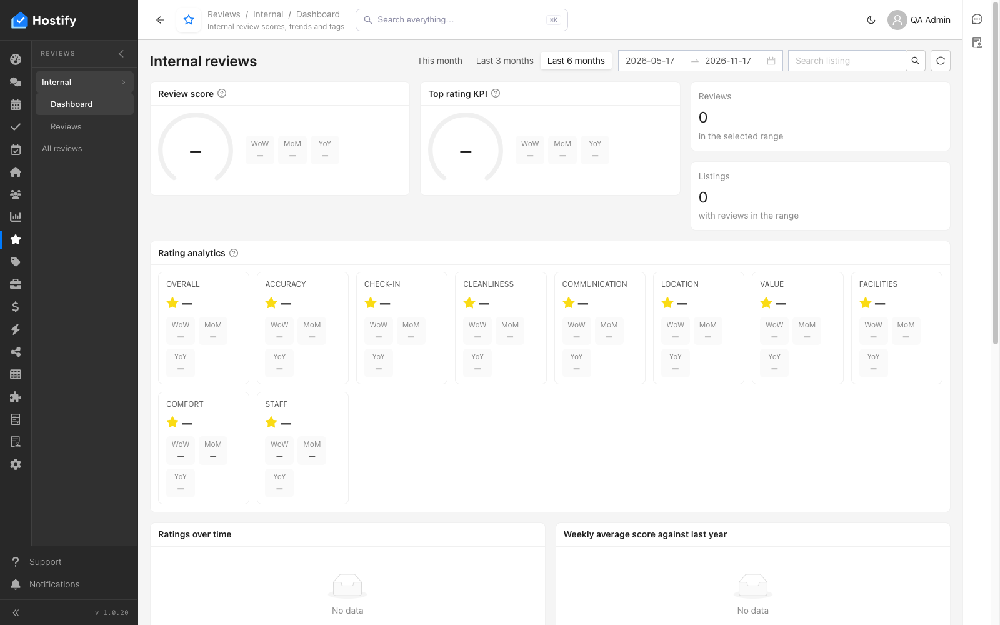
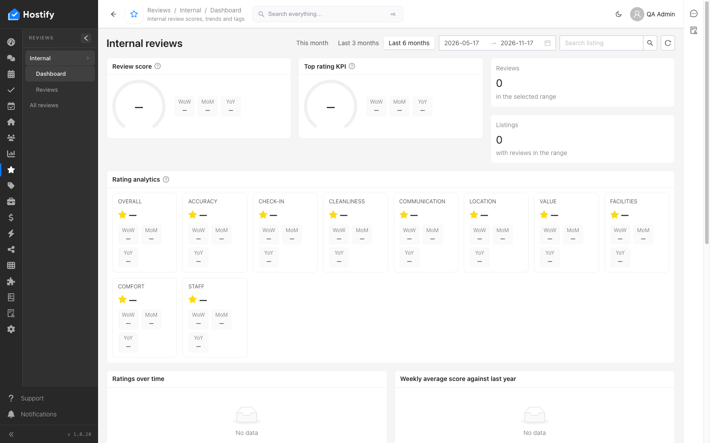
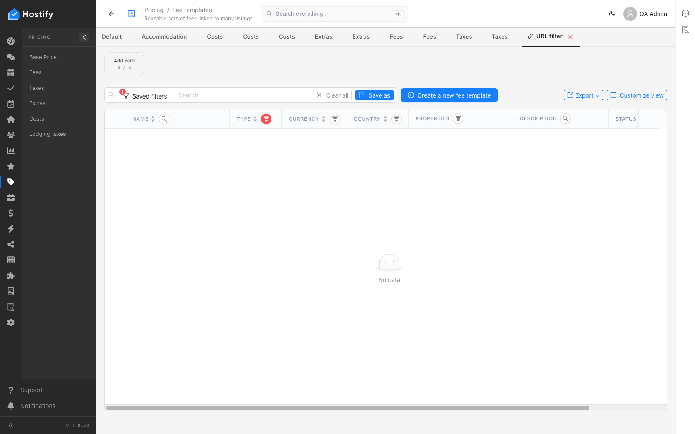

# 010-account-pages — проверка на навбар менютата на акаунта (всяка страница се отваря и се оглежда)

- Пуск: 2026-11-17_14-12-09 · Приложение: https://hostify.bioseek.eu · Версия: 1.0.20
- Спек: `tests/e2e/010-account-pages.spec.ts`
- Казуси: 12 от 176 проверки

## Казус 1: bookingOptimizer opens (/app/reporting/bookingOptimizer)

_Нов в този пуск._

**Какво се обърка**

```
Error: submenu node "bookingOptimizer"

expect(locator).toBeVisible() failed

Locator: locator('.cc-submenu-slide-panel').locator('[data-test="bookingOptimizer"]')
Expected: visible
Timeout: 30000ms
Error: element(s) not found

Call log:
  - submenu node "bookingOptimizer" with timeout 30000ms
  - waiting for locator('.cc-submenu-slide-panel').locator('[data-test="bookingOptimizer"]')
```

**Как да се възпроизведе**

1. Страница: https://hostify.bioseek.eu/app/reporting/reportingOverview
2. Спек `tests/e2e/010-account-pages.spec.ts`, проверка „bookingOptimizer opens (/app/reporting/bookingOptimizer)“.

**Скрийншоти**




## Казус 2: airbnbReviewsDashboard opens (/app/reviewsMenu/airbnbReviewsMenu/airbnbReviewsDashboard)

_Нов в този пуск._

**Какво се обърка**

```
Error: submenu node "airbnbReviewsMenu"

expect(locator).toBeVisible() failed

Locator: locator('.cc-submenu-slide-panel').locator('[data-test="airbnbReviewsMenu"]')
Expected: visible
Timeout: 30000ms
Error: element(s) not found

Call log:
  - submenu node "airbnbReviewsMenu" with timeout 30000ms
  - waiting for locator('.cc-submenu-slide-panel').locator('[data-test="airbnbReviewsMenu"]')
```

**Как да се възпроизведе**

1. Страница: https://hostify.bioseek.eu/app/reviewsMenu/internalReviewsMenu/internalReviewsDashboard
2. Спек `tests/e2e/010-account-pages.spec.ts`, проверка „airbnbReviewsDashboard opens (/app/reviewsMenu/airbnbReviewsMenu/airbnbReviewsDashboard)“.

**Скрийншоти**


## Казус 3: airbnbReviews opens (/app/reviewsMenu/airbnbReviewsMenu/airbnbReviews)

_Нов в този пуск._

**Какво се обърка**

```
Error: submenu node "airbnbReviewsMenu"

expect(locator).toBeVisible() failed

Locator: locator('.cc-submenu-slide-panel').locator('[data-test="airbnbReviewsMenu"]')
Expected: visible
Timeout: 30000ms
Error: element(s) not found

Call log:
  - submenu node "airbnbReviewsMenu" with timeout 30000ms
  - waiting for locator('.cc-submenu-slide-panel').locator('[data-test="airbnbReviewsMenu"]')
```

**Как да се възпроизведе**

1. Страница: https://hostify.bioseek.eu/app/reviewsMenu/internalReviewsMenu/internalReviewsDashboard
2. Спек `tests/e2e/010-account-pages.spec.ts`, проверка „airbnbReviews opens (/app/reviewsMenu/airbnbReviewsMenu/airbnbReviews)“.

**Скрийншоти**




## Казус 4: airbnbReviewListings opens (/app/reviewsMenu/airbnbReviewsMenu/airbnbReviewListings)

_Нов в този пуск._

**Какво се обърка**

```
Error: submenu node "airbnbReviewsMenu"

expect(locator).toBeVisible() failed

Locator: locator('.cc-submenu-slide-panel').locator('[data-test="airbnbReviewsMenu"]')
Expected: visible
Timeout: 30000ms
Error: element(s) not found

Call log:
  - submenu node "airbnbReviewsMenu" with timeout 30000ms
  - waiting for locator('.cc-submenu-slide-panel').locator('[data-test="airbnbReviewsMenu"]')
```

**Как да се възпроизведе**

1. Страница: https://hostify.bioseek.eu/app/reviewsMenu/internalReviewsMenu/internalReviewsDashboard
2. Спек `tests/e2e/010-account-pages.spec.ts`, проверка „airbnbReviewListings opens (/app/reviewsMenu/airbnbReviewsMenu/airbnbReviewListings)“.

**Скрийншоти**


## Казус 5: airbnbTripIssues opens (/app/reviewsMenu/airbnbReviewsMenu/airbnbTripIssues)

_Нов в този пуск._

**Какво се обърка**

```
Error: submenu node "airbnbReviewsMenu"

expect(locator).toBeVisible() failed

Locator: locator('.cc-submenu-slide-panel').locator('[data-test="airbnbReviewsMenu"]')
Expected: visible
Timeout: 30000ms
Error: element(s) not found

Call log:
  - submenu node "airbnbReviewsMenu" with timeout 30000ms
  - waiting for locator('.cc-submenu-slide-panel').locator('[data-test="airbnbReviewsMenu"]')
```

**Как да се възпроизведе**

1. Страница: https://hostify.bioseek.eu/app/reviewsMenu/internalReviewsMenu/internalReviewsDashboard
2. Спек `tests/e2e/010-account-pages.spec.ts`, проверка „airbnbTripIssues opens (/app/reviewsMenu/airbnbReviewsMenu/airbnbTripIssues)“.

**Скрийншоти**


## Казус 6: bookingComReviewsDashboard opens (/app/reviewsMenu/bookingComReviewsMenu/bookingComReviewsDashboard)

_Нов в този пуск._

**Какво се обърка**

```
Error: submenu node "bookingComReviewsMenu"

expect(locator).toBeVisible() failed

Locator: locator('.cc-submenu-slide-panel').locator('[data-test="bookingComReviewsMenu"]')
Expected: visible
Timeout: 30000ms
Error: element(s) not found

Call log:
  - submenu node "bookingComReviewsMenu" with timeout 30000ms
  - waiting for locator('.cc-submenu-slide-panel').locator('[data-test="bookingComReviewsMenu"]')
```

**Как да се възпроизведе**

1. Страница: https://hostify.bioseek.eu/app/reviewsMenu/internalReviewsMenu/internalReviewsDashboard
2. Спек `tests/e2e/010-account-pages.spec.ts`, проверка „bookingComReviewsDashboard opens (/app/reviewsMenu/bookingComReviewsMenu/bookingComReviewsDashboard)“.

**Скрийншоти**


## Казус 7: bookingComReviews opens (/app/reviewsMenu/bookingComReviewsMenu/bookingComReviews)

_Нов в този пуск._

**Какво се обърка**

```
Error: submenu node "bookingComReviewsMenu"

expect(locator).toBeVisible() failed

Locator: locator('.cc-submenu-slide-panel').locator('[data-test="bookingComReviewsMenu"]')
Expected: visible
Timeout: 30000ms
Error: element(s) not found

Call log:
  - submenu node "bookingComReviewsMenu" with timeout 30000ms
  - waiting for locator('.cc-submenu-slide-panel').locator('[data-test="bookingComReviewsMenu"]')
```

**Как да се възпроизведе**

1. Страница: https://hostify.bioseek.eu/app/reviewsMenu/internalReviewsMenu/internalReviewsDashboard
2. Спек `tests/e2e/010-account-pages.spec.ts`, проверка „bookingComReviews opens (/app/reviewsMenu/bookingComReviewsMenu/bookingComReviews)“.

**Скрийншоти**


## Казус 8: bookingComReviewListings opens (/app/reviewsMenu/bookingComReviewsMenu/bookingComReviewListings)

_Нов в този пуск._

**Какво се обърка**

```
Error: submenu node "bookingComReviewsMenu"

expect(locator).toBeVisible() failed

Locator: locator('.cc-submenu-slide-panel').locator('[data-test="bookingComReviewsMenu"]')
Expected: visible
Timeout: 30000ms
Error: element(s) not found

Call log:
  - submenu node "bookingComReviewsMenu" with timeout 30000ms
  - waiting for locator('.cc-submenu-slide-panel').locator('[data-test="bookingComReviewsMenu"]')
```

**Как да се възпроизведе**

1. Страница: https://hostify.bioseek.eu/app/reviewsMenu/internalReviewsMenu/internalReviewsDashboard
2. Спек `tests/e2e/010-account-pages.spec.ts`, проверка „bookingComReviewListings opens (/app/reviewsMenu/bookingComReviewsMenu/bookingComReviewListings)“.

**Скрийншоти**


## Казус 9: vrboReviewsDashboard opens (/app/reviewsMenu/vrboReviewsMenu/vrboReviewsDashboard)

_Нов в този пуск._

**Какво се обърка**

```
Error: submenu node "vrboReviewsMenu"

expect(locator).toBeVisible() failed

Locator: locator('.cc-submenu-slide-panel').locator('[data-test="vrboReviewsMenu"]')
Expected: visible
Timeout: 30000ms
Error: element(s) not found

Call log:
  - submenu node "vrboReviewsMenu" with timeout 30000ms
  - waiting for locator('.cc-submenu-slide-panel').locator('[data-test="vrboReviewsMenu"]')
```

**Как да се възпроизведе**

1. Страница: https://hostify.bioseek.eu/app/reviewsMenu/internalReviewsMenu/internalReviewsDashboard
2. Спек `tests/e2e/010-account-pages.spec.ts`, проверка „vrboReviewsDashboard opens (/app/reviewsMenu/vrboReviewsMenu/vrboReviewsDashboard)“.

**Скрийншоти**


## Казус 10: vrboReviews opens (/app/reviewsMenu/vrboReviewsMenu/vrboReviews)

_Нов в този пуск._

**Какво се обърка**

```
Error: submenu node "vrboReviewsMenu"

expect(locator).toBeVisible() failed

Locator: locator('.cc-submenu-slide-panel').locator('[data-test="vrboReviewsMenu"]')
Expected: visible
Timeout: 30000ms
Error: element(s) not found

Call log:
  - submenu node "vrboReviewsMenu" with timeout 30000ms
  - waiting for locator('.cc-submenu-slide-panel').locator('[data-test="vrboReviewsMenu"]')
```

**Как да се възпроизведе**

1. Страница: https://hostify.bioseek.eu/app/reviewsMenu/internalReviewsMenu/internalReviewsDashboard
2. Спек `tests/e2e/010-account-pages.spec.ts`, проверка „vrboReviews opens (/app/reviewsMenu/vrboReviewsMenu/vrboReviews)“.

**Скрийншоти**




## Казус 11: vrboReviewListings opens (/app/reviewsMenu/vrboReviewsMenu/vrboReviewListings)

_Нов в този пуск._

**Какво се обърка**

```
Error: submenu node "vrboReviewsMenu"

expect(locator).toBeVisible() failed

Locator: locator('.cc-submenu-slide-panel').locator('[data-test="vrboReviewsMenu"]')
Expected: visible
Timeout: 30000ms
Error: element(s) not found

Call log:
  - submenu node "vrboReviewsMenu" with timeout 30000ms
  - waiting for locator('.cc-submenu-slide-panel').locator('[data-test="vrboReviewsMenu"]')
```

**Как да се възпроизведе**

1. Страница: https://hostify.bioseek.eu/app/reviewsMenu/internalReviewsMenu/internalReviewsDashboard
2. Спек `tests/e2e/010-account-pages.spec.ts`, проверка „vrboReviewListings opens (/app/reviewsMenu/vrboReviewsMenu/vrboReviewListings)“.

**Скрийншоти**


## Казус 12: pricingPromotions opens (/app/pricing/pricingPromotions)

_Нов в този пуск._

**Какво се обърка**

```
Error: submenu node "pricingPromotions"

expect(locator).toBeVisible() failed

Locator: locator('.cc-submenu-slide-panel').locator('[data-test="pricingPromotions"]')
Expected: visible
Timeout: 30000ms
Error: element(s) not found

Call log:
  - submenu node "pricingPromotions" with timeout 30000ms
  - waiting for locator('.cc-submenu-slide-panel').locator('[data-test="pricingPromotions"]')
```

**Как да се възпроизведе**

1. Страница: https://hostify.bioseek.eu/app/pricing/feeTemplates?feeItemType=_or&feeItemType=accommodation
2. Спек `tests/e2e/010-account-pages.spec.ts`, проверка „pricingPromotions opens (/app/pricing/pricingPromotions)“.

**Скрийншоти**




---

Какво проверява спекът: 010 — every page of the ACCOUNT menu opens for the account administrator of the QA account.
