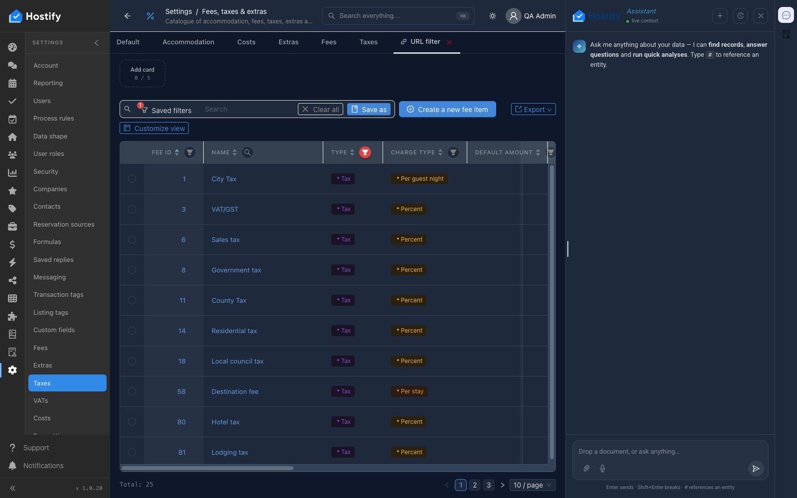

# 011-account-pages-dark — тъмната тема на акаунта — всяка страница се отваря, оглежда се и нищо не остава светло

- Пуск: 2026-11-17_14-12-09 · Приложение: https://hostify.bioseek.eu · Версия: 1.0.20
- Спек: `tests/e2e/011-account-pages-dark.spec.ts`
- Казуси: 1 от 161 проверки

## Казус 1: settingsTaxes in the dark theme (/app/settings/settingsTaxes)

_Нов в този пуск._

**Какво се обърка**

```
Error: The page reported 2 error(s) — API answers, failed requests, console errors:
- [request.failed] net::ERR_CONNECTION_TIMED_OUT @ https://hostify-apps.bioseek.eu/plugins/clearing/logo.png
- [request.failed] net::ERR_CONNECTION_TIMED_OUT @ https://hostify-apps.bioseek.eu/plugins/icare-orion/logo.png
```
- неуспешна заявка: net::ERR_CONNECTION_TIMED_OUT — `https://hostify-apps.bioseek.eu/plugins/clearing/logo.png`
- неуспешна заявка: net::ERR_CONNECTION_TIMED_OUT — `https://hostify-apps.bioseek.eu/plugins/icare-orion/logo.png`

**Как да се възпроизведе**

1. Влез в https://hostify.bioseek.eu/app/ като администратор на акаунта (qa.admin@hostify-qa.test).
2. Меню: SETTINGS › Taxes — https://hostify.bioseek.eu/app/settings/settingsTaxes
3. Спек `tests/e2e/011-account-pages-dark.spec.ts`, проверка „settingsTaxes in the dark theme (/app/settings/settingsTaxes)“ — стъпките:
4. every column has a header and the actions column is the last one
5. Developer tools › Network: заявките по-горе отговарят така.

**Скрийншоти**





---

Какво проверява спекът: 011 — every page of the ACCOUNT menu in the DARK theme (the sweep of 010, the theme switched on first).
