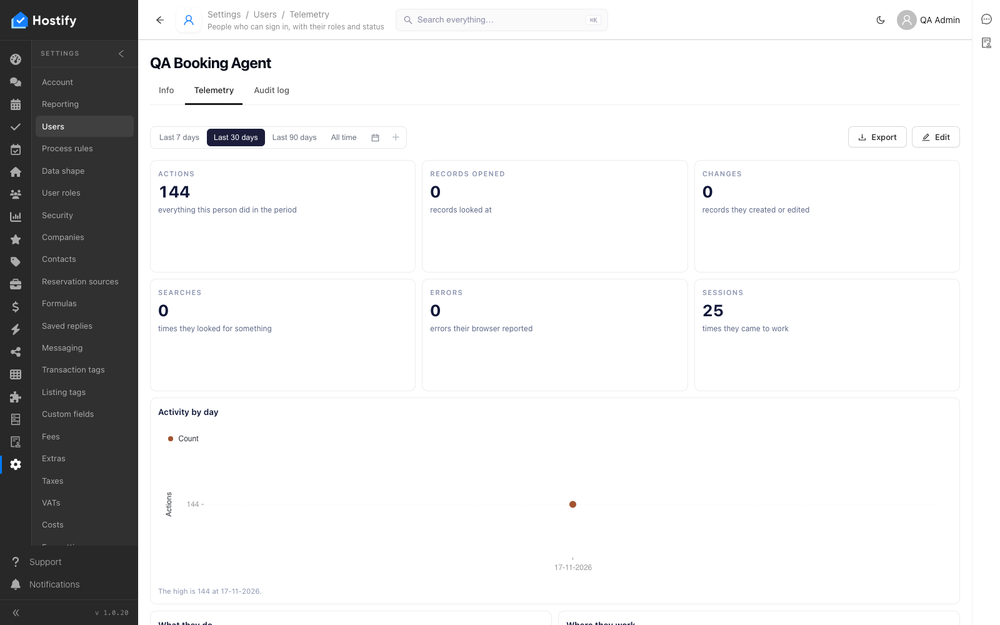

# 111-user-telemetry — Telemetry на човек — какво е направил (таговете на 110), часът на устройството му, тъмната тема

- Пуск: 2026-11-17_17-24-40 · Приложение: https://hostify.bioseek.eu · Версия: 1.0.20
- Спек: `tests/e2e/111-user-telemetry.spec.ts`
- Казуси: 2 от 5 проверки

## Казус 1: a person's session is named with the time of their own device (Pacific/Auckland), not UTC

_Нов в този пуск._

**Какво се обърка**

```
Error: the newest session is named with the time of Auckland (2026-11-18 04:46), not UTC (2026-11-17 15:46)

expect(received).toBe(expected) // Object.is equality

Expected: "Auckland"
Received: "desktop · 1.0.20 · Windows · 2026-11-17 17:38"

Call Log:
- Timeout 120000ms exceeded while waiting on the predicate
```

**Как да се възпроизведе**

1. Влез в https://hostify.bioseek.eu/app/ като администратор на акаунта (qa.admin@hostify-qa.test).
2. Страница: https://hostify.bioseek.eu/app/settings/users/f488cb90-ec50-4520-bb1e-9a148b70d1d6/telemetry
3. Спек `tests/e2e/111-user-telemetry.spec.ts`, проверка „a person's session is named with the time of their own device (Pacific/Auckland), not UTC“ — стъпките:
4. the booking agent signs in from a browser in Pacific/Auckland

**Скрийншоти**




**Предупреждения в конзолата**

- [InboxMenuCount] TypeError: Failed to fetch
- [ReviewsMenuChannels] TypeError: Failed to fetch
- [hydraPartner] navbarExtensionLoader failed TypeError: Failed to fetch
- [AlertsMenuCount] TypeError: Failed to fetch
- [demoData] the demo data status could not be read — no welcome modal TypeError: Failed to fetch
- [hydraPartner] the plugin surfaces were not read TypeError: Failed to fetch

## Казус 2: a session whose device time zone is unknown is named with the UTC time and says "UTC"

_Нов в този пуск._

**Какво се обърка**

```
Error: the newest session is the one signed in at 2026-11-17 15:49 UTC

expect(received).not.toMatch(expected)

Expected pattern: not /^not yet/
Received string:      "not yet: desktop · 1.0.20 · Windows · 2026-11-17 17:38"

Call Log:
- Timeout 120000ms exceeded while waiting on the predicate
```

**Как да се възпроизведе**

1. Влез в https://hostify.bioseek.eu/app/ като администратор на акаунта (qa.admin@hostify-qa.test).
2. Страница: https://hostify.bioseek.eu/app/settings/users/f488cb90-ec50-4520-bb1e-9a148b70d1d6/telemetry
3. Спек `tests/e2e/111-user-telemetry.spec.ts`, проверка „a session whose device time zone is unknown is named with the UTC time and says "UTC"“ — стъпките:
4. the booking agent signs in; the zone of the device does not reach the server

**Скрийншоти**


**Предупреждения в конзолата**

- [hydraPartner] navbarExtensionLoader failed TypeError: Failed to fetch
- [InboxMenuCount] TypeError: Failed to fetch
- [ReviewsMenuChannels] TypeError: Failed to fetch
- [demoData] the demo data status could not be read — no welcome modal TypeError: Failed to fetch
- [AlertsMenuCount] TypeError: Failed to fetch
- [hydraPartner] the plugin surfaces were not read TypeError: Failed to fetch

---

Какво проверява спекът: 111 — a person's Telemetry: what the person did, the time on the person's own device, the dark theme (1.0.7–1.0.10).
