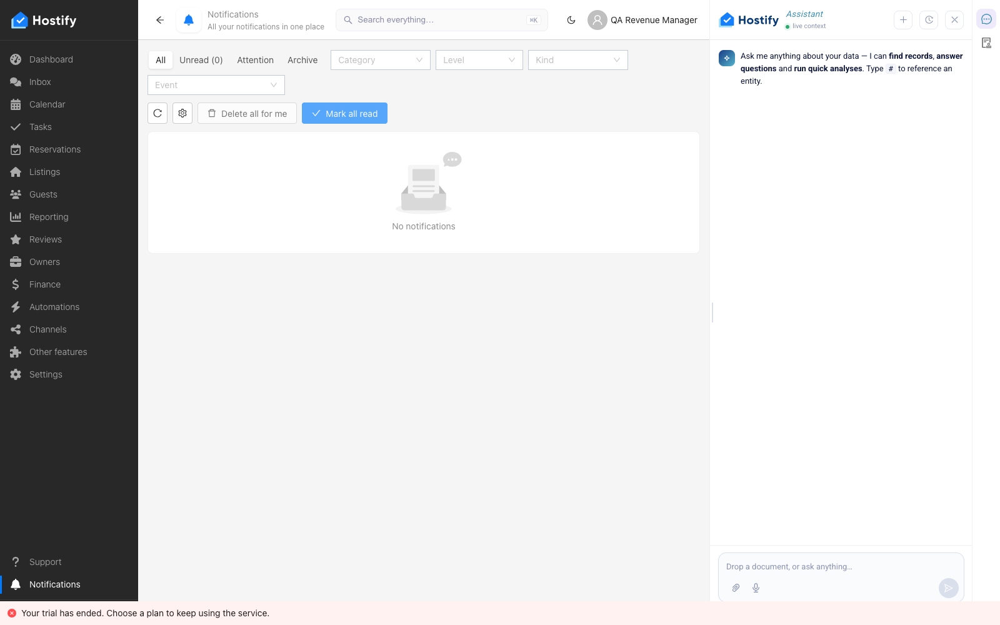
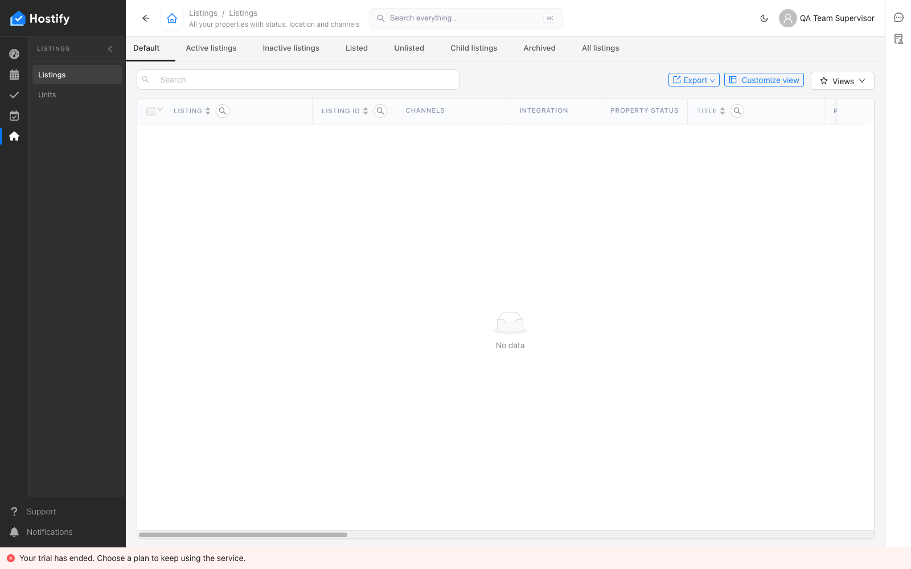
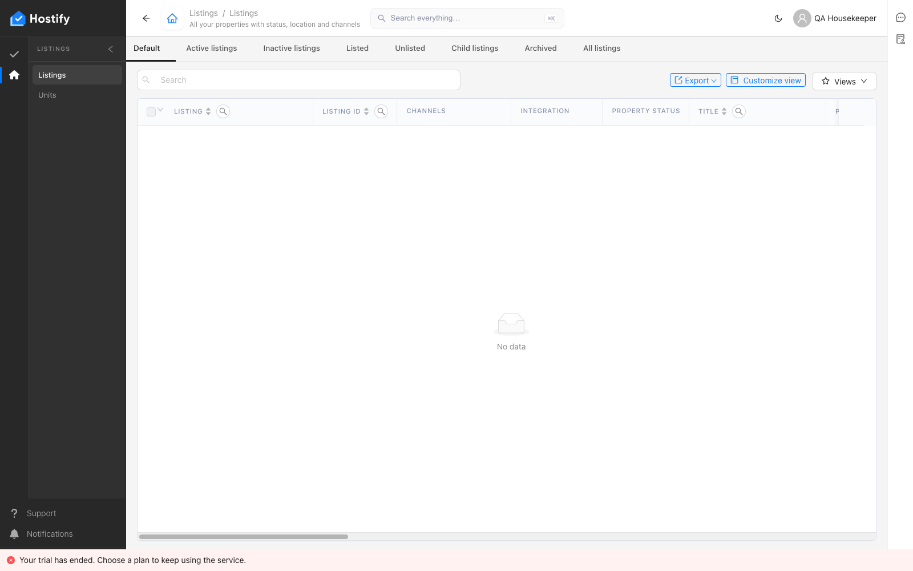

# 102-role-access — права по роли — всяка роля от 100 вижда точно своите страници, отваря ги без 403 и не вижда чуждите

- Пуск: 2026-11-18_10-10-13 · Приложение: https://hostify.bioseek.eu · Версия: 1.0.20
- Спек: `tests/e2e/102-role-access.spec.ts`
- Казуси: 6 от 6 проверки

## Казус 1: manager: the menu holds the role's pages, each opens without a refusal, the administrator's pages are refused

_Нов в този пуск._

**Какво се обърка**

```
TimeoutError: locator.click: Timeout 20000ms exceeded.
Call log:
  - waiting for locator('.cc-sidebar').locator('[data-test="navbarCollapse"]')
    - locator resolved to <button type="button" aria-expanded="true" title="Collapse menu" aria-label="Collapse menu" data-test="navbarCollapse" class="cc-sidebar-footer__button cc-sidebar-footer__collapse">…</button>
  - attempting click action
    2 × waiting for element to be visible, enabled and stable
      - element is visible, enabled and stable
      - scrolling into view if needed
      - done scrolling
      - <path d="M512 64c247.4 0 448 200.6 448 448S759.4 960 512 960 64 759.4 64 512 264.6 64 512 64zm127.98 274.82h-.04l-.08.06L512 466.75 384.14 338.88c-.04-.05-.06-.06-.08-.06a.12.12 0 00-.07 0c-.03 0-.05.01-.09.05l-45.02 45.02a.2.2 0 00-.05.09.12.12 0 000 .07v.02a.27.27 0 00.06.06L466.75 512 338.88 639.86c-.05.04-.06.06-.06.08a.12.12 0 000 .07c0 .03.01.05.05.09l45.02 45.02a.2.2 0 00.09.05.12.12 0 00.07 0c.02 0 .04-.01.08-.05L512 557.25l127.86 127.87c.04.04.06.05.08.05a.12.12 0 00.07 0c.03 0 .05-.01.09-.…></path> from <div role="alert" data-show="true" data-test="account-status-banner" class="ant-alert ant-alert-error ant-alert-outlined ant-alert-banner hydra css-ry7cab">…</div> subtree intercepts pointer events
    - retrying click action
    - waiting 20ms
```

**Как да се възпроизведе**

1. Страница: https://hostify.bioseek.eu/app/alerts
2. Спек `tests/e2e/102-role-access.spec.ts`, проверка „manager: the menu holds the role's pages, each opens without a refusal, the administrator's pages are refused“ — стъпките:
3. the live menu holds exactly the pages the inventory gives the role

**Скрийншоти**


## Казус 2: revenueManager: the menu holds the role's pages, each opens without a refusal, the administrator's pages are refused

_Нов в този пуск._

**Какво се обърка**

```
TimeoutError: locator.click: Timeout 20000ms exceeded.
Call log:
  - waiting for locator('.cc-sidebar').locator('[data-test="navbarCollapse"]')
    - locator resolved to <button type="button" aria-expanded="true" title="Collapse menu" aria-label="Collapse menu" data-test="navbarCollapse" class="cc-sidebar-footer__button cc-sidebar-footer__collapse">…</button>
  - attempting click action
    2 × waiting for element to be visible, enabled and stable
      - element is visible, enabled and stable
      - scrolling into view if needed
      - done scrolling
      - <path d="M512 64c247.4 0 448 200.6 448 448S759.4 960 512 960 64 759.4 64 512 264.6 64 512 64zm127.98 274.82h-.04l-.08.06L512 466.75 384.14 338.88c-.04-.05-.06-.06-.08-.06a.12.12 0 00-.07 0c-.03 0-.05.01-.09.05l-45.02 45.02a.2.2 0 00-.05.09.12.12 0 000 .07v.02a.27.27 0 00.06.06L466.75 512 338.88 639.86c-.05.04-.06.06-.06.08a.12.12 0 000 .07c0 .03.01.05.05.09l45.02 45.02a.2.2 0 00.09.05.12.12 0 00.07 0c.02 0 .04-.01.08-.05L512 557.25l127.86 127.87c.04.04.06.05.08.05a.12.12 0 00.07 0c.03 0 .05-.01.09-.…></path> from <div role="alert" data-show="true" data-test="account-status-banner" class="ant-alert ant-alert-error ant-alert-outlined ant-alert-banner hydra css-ry7cab">…</div> subtree intercepts pointer events
    - retrying click action
    - waiting 20ms
```
- сървърът отговори: GET 403 — `/api/user/search?size=100`

**Как да се възпроизведе**

1. Страница: https://hostify.bioseek.eu/app/alerts
2. Спек `tests/e2e/102-role-access.spec.ts`, проверка „revenueManager: the menu holds the role's pages, each opens without a refusal, the administrator's pages are refused“ — стъпките:
3. the live menu holds exactly the pages the inventory gives the role
4. Developer tools › Network: заявките по-горе отговарят така.

**Скрийншоти**




## Казус 3: bookingAgent: the menu holds the role's pages, each opens without a refusal, the administrator's pages are refused

_Нов в този пуск._

**Какво се обърка**

```
TimeoutError: locator.click: Timeout 20000ms exceeded.
Call log:
  - waiting for locator('.cc-sidebar').locator('[data-test="navbarCollapse"]')
    - locator resolved to <button type="button" aria-expanded="true" title="Collapse menu" aria-label="Collapse menu" data-test="navbarCollapse" class="cc-sidebar-footer__button cc-sidebar-footer__collapse">…</button>
  - attempting click action
    2 × waiting for element to be visible, enabled and stable
      - element is visible, enabled and stable
      - scrolling into view if needed
      - done scrolling
      - <path d="M512 64c247.4 0 448 200.6 448 448S759.4 960 512 960 64 759.4 64 512 264.6 64 512 64zm127.98 274.82h-.04l-.08.06L512 466.75 384.14 338.88c-.04-.05-.06-.06-.08-.06a.12.12 0 00-.07 0c-.03 0-.05.01-.09.05l-45.02 45.02a.2.2 0 00-.05.09.12.12 0 000 .07v.02a.27.27 0 00.06.06L466.75 512 338.88 639.86c-.05.04-.06.06-.06.08a.12.12 0 000 .07c0 .03.01.05.05.09l45.02 45.02a.2.2 0 00.09.05.12.12 0 00.07 0c.02 0 .04-.01.08-.05L512 557.25l127.86 127.87c.04.04.06.05.08.05a.12.12 0 00.07 0c.03 0 .05-.01.09-.…></path> from <div role="alert" data-show="true" data-test="account-status-banner" class="ant-alert ant-alert-error ant-alert-outlined ant-alert-banner hydra css-ry7cab">…</div> subtree intercepts pointer events
    - retrying click action
    - waiting 20ms
```

**Как да се възпроизведе**

1. Страница: https://hostify.bioseek.eu/app/alerts
2. Спек `tests/e2e/102-role-access.spec.ts`, проверка „bookingAgent: the menu holds the role's pages, each opens without a refusal, the administrator's pages are refused“ — стъпките:
3. the live menu holds exactly the pages the inventory gives the role

**Скрийншоти**


## Казус 4: accountant: the menu holds the role's pages, each opens without a refusal, the administrator's pages are refused

_Нов в този пуск._

**Какво се обърка**

```
TimeoutError: locator.click: Timeout 20000ms exceeded.
Call log:
  - waiting for locator('.cc-sidebar').locator('[data-test="navbarCollapse"]')
    - locator resolved to <button type="button" aria-expanded="true" title="Collapse menu" aria-label="Collapse menu" data-test="navbarCollapse" class="cc-sidebar-footer__button cc-sidebar-footer__collapse">…</button>
  - attempting click action
    2 × waiting for element to be visible, enabled and stable
      - element is visible, enabled and stable
      - scrolling into view if needed
      - done scrolling
      - <path d="M512 64c247.4 0 448 200.6 448 448S759.4 960 512 960 64 759.4 64 512 264.6 64 512 64zm127.98 274.82h-.04l-.08.06L512 466.75 384.14 338.88c-.04-.05-.06-.06-.08-.06a.12.12 0 00-.07 0c-.03 0-.05.01-.09.05l-45.02 45.02a.2.2 0 00-.05.09.12.12 0 000 .07v.02a.27.27 0 00.06.06L466.75 512 338.88 639.86c-.05.04-.06.06-.06.08a.12.12 0 000 .07c0 .03.01.05.05.09l45.02 45.02a.2.2 0 00.09.05.12.12 0 00.07 0c.02 0 .04-.01.08-.05L512 557.25l127.86 127.87c.04.04.06.05.08.05a.12.12 0 00.07 0c.03 0 .05-.01.09-.…></path> from <div role="alert" data-show="true" data-test="account-status-banner" class="ant-alert ant-alert-error ant-alert-outlined ant-alert-banner hydra css-ry7cab">…</div> subtree intercepts pointer events
    - retrying click action
    - waiting 20ms
```
- сървърът отговори: GET 403 — `/api/inboxTag/search?size=100`
- сървърът отговори: POST 403 — `/api/inboxThread/inbox`
- сървърът отговори: GET 403 — `/api/syncActivity/search?syncStatus=error&sort=occurredAt&sort=desc&size=100&page=1`
- сървърът отговори: POST 403 — `/api/automationApp/state`

**Как да се възпроизведе**

1. Страница: https://hostify.bioseek.eu/app/alerts
2. Спек `tests/e2e/102-role-access.spec.ts`, проверка „accountant: the menu holds the role's pages, each opens without a refusal, the administrator's pages are refused“ — стъпките:
3. the live menu holds exactly the pages the inventory gives the role
4. Developer tools › Network: заявките по-горе отговарят така.

**Скрийншоти**


## Казус 5: teamSupervisor: the menu holds the role's pages, each opens without a refusal, the administrator's pages are refused

_Нов в този пуск._

**Какво се обърка**

```
TimeoutError: locator.click: Timeout 20000ms exceeded.
Call log:
  - waiting for locator('.cc-sidebar').locator('[data-test="checkFindings"]')

```
- сървърът отговори: GET 403 — `/api/listingTag/search?size=100&page=1`
- сървърът отговори: GET 403 — `/api/reservationSource/search?size=100&page=1`
- сървърът отговори: GET 403 — `/api/syncActivity/search?syncStatus=error&sort=occurredAt&sort=desc&size=100&page=1`

**Как да се възпроизведе**

1. Страница: https://hostify.bioseek.eu/app/listingsMenu/listings
2. Спек `tests/e2e/102-role-access.spec.ts`, проверка „teamSupervisor: the menu holds the role's pages, each opens without a refusal, the administrator's pages are refused“ — стъпките:
3. the live menu holds exactly the pages the inventory gives the role
4. Developer tools › Network: заявките по-горе отговарят така.

**Скрийншоти**




## Казус 6: housekeeper: the menu holds the role's pages, each opens without a refusal, the administrator's pages are refused

_Нов в този пуск._

**Какво се обърка**

```
TimeoutError: locator.click: Timeout 20000ms exceeded.
Call log:
  - waiting for locator('.cc-sidebar').locator('[data-test="tasks"]')

```

**Как да се възпроизведе**

1. Страница: https://hostify.bioseek.eu/app/listingsMenu/listings
2. Спек `tests/e2e/102-role-access.spec.ts`, проверка „housekeeper: the menu holds the role's pages, each opens without a refusal, the administrator's pages are refused“ — стъпките:
3. the live menu holds exactly the pages the inventory gives the role

**Скрийншоти**




---

Какво проверява спекът: 102 — every role of the QA account sees its own pages, opens them without a refusal, and is refused the others.
