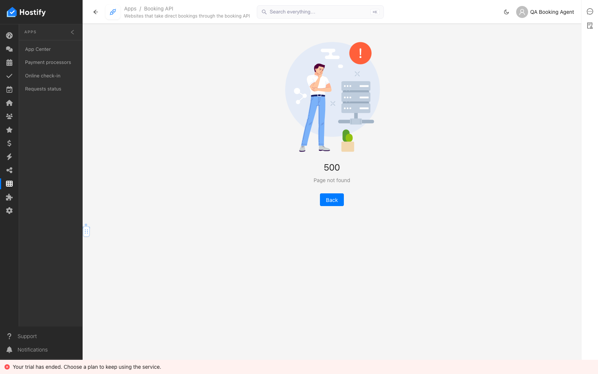

# 104-apps-by-role — Apps и плъгините по роли — App Center и страниците на Apps се отварят без отказ за ролите, които ги имат (само гледане)

- Пуск: 2026-11-18_10-10-13 · Приложение: https://hostify.bioseek.eu · Версия: 1.0.20
- Спек: `tests/e2e/104-apps-by-role.spec.ts`
- Казуси: 1 от 4 проверки

## Казус 1: bookingAgent: App Center shows the apps and every page of Apps opens without a refusal

_Известен от пуска 2026-11-17 17:24 (същата версия) — не е отстранен._

**Какво се обърка**

```
Error: a spinner keeps turning after 30 s: ant-spin ant-spin-spinning ant-spin-section css-ry7cab css-var-_r_5_ (20×20 px)
```
- сървърът отговори: GET 403 — `/api/ownerPortalSettings?id=bookingApiClients&lang=en`

**Как да се възпроизведе**

1. Влез в https://hostify.bioseek.eu/app/ като bookingAgent на акаунта (qa.booking.agent@hostify-qa.test).
2. Страница: https://hostify.bioseek.eu/app/apps/bookingApiClients/info
3. Спек `tests/e2e/104-apps-by-role.spec.ts`, проверка „bookingAgent: App Center shows the apps and every page of Apps opens without a refusal“ — стъпките:
4. App Center shows its apps
5. paymentProcessorAccounts opens and is presentable
6. checkinFormTemplates opens and is presentable
7. bookingApiClients is not the role's: "Page not found"
8. Developer tools › Network: заявките по-горе отговарят така.

**Скрийншоти**




**Предупреждения в конзолата**

- [hydraPartner] navbarExtensionLoader failed TypeError: Failed to fetch
- [InboxMenuCount] TypeError: Failed to fetch
- [ReviewsMenuChannels] TypeError: Failed to fetch
- [AlertsMenuCount] TypeError: Failed to fetch
- [demoData] the demo data status could not be read — no welcome modal TypeError: Failed to fetch
- [hydraPartner] the plugin surfaces were not read TypeError: Failed to fetch

---

Какво проверява спекът: 104 — Apps by role (1.0.11): every person of the account uses the installed plugins; only the administrator and the
