# 102-role-access — права по роли — всяка роля от 100 вижда точно своите страници, отваря ги без 403 и не вижда чуждите

- Пуск: 2026-11-18_15-45-41 · Приложение: https://hostify.bioseek.eu · Версия: 1.0.21
- Спек: `tests/e2e/102-role-access.spec.ts`
- Казуси: 6 от 6 проверки

## Казус 1: manager: the menu holds the role's pages, each opens without a refusal, the administrator's pages are refused

_Нов в този пуск._

**Какво се обърка**

```
Error: manager: nodes of the live menu the inventory does not give the role

expect(received).toEqual(expected) // deep equality

- Expected  - 1
+ Received  + 6

- Array []
+ Array [
+   "conversationScores",
+   "checkFindings",
+   "listingBenchmarks",
```
- сървърът отговори: GET 403 — `/api/pivotTenantSetting/search?model=pvm-property-performance&size=5`

**Как да се възпроизведе**

1. Влез в https://hostify.bioseek.eu/app/ като manager на акаунта (qa.manager@hostify-qa.test).
2. Меню: SETTINGS › Activity Log — https://hostify.bioseek.eu/app/settings/syncActivities
3. Спек `tests/e2e/102-role-access.spec.ts`, проверка „manager: the menu holds the role's pages, each opens without a refusal, the administrator's pages are refused“ — стъпките:
4. the live menu holds exactly the pages the inventory gives the role
5. dashboards (/app/dashboards)
6. inbox › unifiedInbox (/app/inbox/unifiedInbox)
7. inbox › inboxThreads (/app/inbox/inboxThreads)
8. inbox › inboxAiRuns (/app/inbox/inboxAiRuns)
9. inbox › messageTemplates (/app/inbox/messageTemplates)
10. inbox › inboxTags (/app/inbox/inboxTags)
11. multiCalendar (/app/multiCalendar)
12. operations › tasks (/app/operations/tasks)
13. operations › housekeepingBoard (/app/operations/housekeepingBoard)
14. operations › taskDashboard (/app/operations/taskDashboard)
15. operations › taskIssues (/app/operations/taskIssues)
16. operations › myTasks (/app/operations/myTasks)
17. operations › taskTemplates (/app/operations/taskTemplates)
18. operations › defaultAssignments (/app/operations/defaultAssignments)
19. operations › taskTeams (/app/operations/taskTeams)
20. operations › taskNotificationSettings (/app/operations/taskNotificationSettings)
21. operations › calendar (/app/operations/calendar)
22. operations › taskExpenses (/app/operations/taskExpenses)
23. reservationsMenu › reservations (/app/reservationsMenu/reservations)
24. reservationsMenu › reservationAlterations (/app/reservationsMenu/reservationAlterations)
25. reservationsMenu › reservationImports (/app/reservationsMenu/reservationImports)
26. listingsMenu › listings (/app/listingsMenu/listings)
27. every column has a header and the actions column is the last one
28. listingsMenu › listingUnits (/app/listingsMenu/listingUnits)
29. listingsMenu › listingBuildings (/app/listingsMenu/listingBuildings)
30. listingsMenu › listingLinks (/app/listingsMenu/listingLinks)
31. listingsMenu › listingPolicies (/app/listingsMenu/listingPolicies)
32. guests (/app/guests)
33. every column has a header and the actions column is the last one
34. reporting › reportingOverview (/app/reporting/reportingOverview)
35. reporting › pivotGrid (/app/reporting/pivotGrid)
36. reporting › inboxReports (/app/reporting/inboxReports)
37. reporting › reportingHousekeeping (/app/reporting/reportingHousekeeping)
38. every column has a header and the actions column is the last one
39. reporting › channelHealth (/app/reporting/channelHealth)
40. reporting › reportingReviews (/app/reporting/reportingReviews)
41. every column has a header and the actions column is the last one
42. reporting › guestCheckins (/app/reporting/guestCheckins)
43. reporting › checkinGuests (/app/reporting/checkinGuests)
44. pricing › pricingBasePrice (/app/pricing/pricingBasePrice)
45. every column has a header and the actions column is the last one
46. pricing › pricingFees (/app/pricing/pricingFees)
47. every column has a header and the actions column is the last one
48. pricing › pricingTaxes (/app/pricing/pricingTaxes)
49. every column has a header and the actions column is the last one
50. pricing › pricingExtras (/app/pricing/pricingExtras)
51. every column has a header and the actions column is the last one
52. pricing › pricingCosts (/app/pricing/pricingCosts)
53. every column has a header and the actions column is the last one
54. pricing › taxRules (/app/pricing/taxRules)
55. ownersMenu › ownerStatements (/app/ownersMenu/ownerStatements)
56. ownersMenu › ownerPayments (/app/ownersMenu/ownerPayments)
57. ownersMenu › owners (/app/ownersMenu/owners)
58. every column has a header and the actions column is the last one
59. ownersMenu › ownerContracts (/app/ownersMenu/ownerContracts)
60. ownersMenu › ownerContractTemplates (/app/ownersMenu/ownerContractTemplates)
61. ownersMenu › ownerPnl (/app/ownersMenu/ownerPnl)
62. ownersMenu › generalLedger (/app/ownersMenu/generalLedger)
63. ownersMenu › ledgerAccounts (/app/ownersMenu/ledgerAccounts)
64. finance › invoices (/app/finance/invoices)
65. every column has a header and the actions column is the last one
66. finance › expenses (/app/finance/expenses)
67. finance › costCategories (/app/finance/costCategories)
68. finance › paymentTransactions (/app/finance/paymentTransactions)
69. automations › automationsHub (/app/automations/automationsHub)
70. automations › autoMessageRules (/app/automations/autoMessageRules)
71. automations › autoPaymentRules (/app/automations/autoPaymentRules)
72. automations › autoPricingRules (/app/automations/autoPricingRules)
73. automations › autoTaskRules (/app/automations/autoTaskRules)
74. automations › autoInvoiceRules (/app/automations/autoInvoiceRules)
75. automations › massMessages (/app/automations/massMessages)
76. automations › automationRuns (/app/automations/automationRuns)
77. channelManager › channelsHub (/app/channelManager/channelsHub)
78. channelManager › channelAccounts (/app/channelManager/channelAccounts)
79. channelManager › channelConnectWizard (/app/channelManager/channelConnectWizard)
80. channelManager › channelListings (/app/channelManager/channelListings)
81. channelManager › channelProperties (/app/channelManager/channelProperties)
82. channelManager › channelRatePlans (/app/channelManager/channelRatePlans)
83. channelManager › channelListingPromotions (/app/channelManager/channelListingPromotions)
84. channelManager › airbnbOpportunities (/app/channelManager/airbnbOpportunities)
85. channelManager › channelCommands (/app/channelManager/channelCommands)
86. apps › appCenter (/app/apps/appCenter)
87. apps › paymentProcessorAccounts (/app/apps/paymentProcessorAccounts)
88. apps › bookingApiClients (/app/apps/bookingApiClients)
89. apps › ownerPortalRoles (/app/apps/ownerPortalRoles)
90. apps › checkinFormTemplates (/app/apps/checkinFormTemplates)
91. apps › complianceConnections (/app/apps/complianceConnections)
92. apps › complianceSubmissions (/app/apps/complianceSubmissions)
93. ourFeatures › ourReporting › reportsOverview (/app/ourFeatures/ourReporting/reportsOverview)
94. ourFeatures › ourReporting › reportRuns (/app/ourFeatures/ourReporting/reportRuns)
95. ourFeatures › ourReporting › reportDefinitions (/app/ourFeatures/ourReporting/reportDefinitions)
96. ourFeatures › ourReporting › reportCategories (/app/ourFeatures/ourReporting/reportCategories)
97. ourFeatures › ourReporting › reservationNights (/app/ourFeatures/ourReporting/reservationNights)
98. ourFeatures › ourReporting › kpiDefinitions (/app/ourFeatures/ourReporting/kpiDefinitions)
99. ourFeatures › ourOwners › ownerStatementRuns (/app/ourFeatures/ourOwners/ownerStatementRuns)
100. ourFeatures › ourOwners › sepaPayoutBatches (/app/ourFeatures/ourOwners/sepaPayoutBatches)
101. ourFeatures › ourOwners › eInvoiceSubmissions (/app/ourFeatures/ourOwners/eInvoiceSubmissions)
102. ourFeatures › ownersSettings › vendors (/app/ourFeatures/ownersSettings/vendors)
103. every column has a header and the actions column is the last one
104. ourFeatures › ownersSettings › printTemplates (/app/ourFeatures/ownersSettings/printTemplates)
105. ourFeatures › ownersSettings › vendorContracts (/app/ourFeatures/ownersSettings/vendorContracts)
106. ourFeatures › ownersSettings › fiscalSeriesList (/app/ourFeatures/ownersSettings/fiscalSeriesList)
107. ourFeatures › ownersSettings › taxJurisdictions (/app/ourFeatures/ownersSettings/taxJurisdictions)
108. ourFeatures › ownersSettings › costCategorySettings (/app/ourFeatures/ownersSettings/costCategorySettings)
109. ourFeatures › ourFinance › creditCards (/app/ourFeatures/ourFinance/creditCards)
110. ourFeatures › ourSettings › brands (/app/ourFeatures/ourSettings/brands)
111. ourFeatures › ourSettings › accountGenealogy (/app/ourFeatures/ourSettings/accountGenealogy)
112. ourFeatures › ourSettings › inboxAiSettings (/app/ourFeatures/ourSettings/inboxAiSettings)
113. ourFeatures › ourSettings › documents (/app/ourFeatures/ourSettings/documents)
114. ourFeatures › ourSettings › documentCustomFields (/app/ourFeatures/ourSettings/documentCustomFields)
115. ourFeatures › ourSettings › histories (/app/ourFeatures/ourSettings/histories)
116. ourFeatures › ourSettings › engineHealth (/app/ourFeatures/ourSettings/engineHealth)
117. ourFeatures › ourSettings › calUpdateLogs (/app/ourFeatures/ourSettings/calUpdateLogs)
118. ourFeatures › ourSettings › changeAnnouncements (/app/ourFeatures/ourSettings/changeAnnouncements)
119. ourFeatures › ourSettings › calendarService › calWarnings (/app/ourFeatures/ourSettings/calendarService/calWarnings)
120. every column has a header and the actions column is the last one
121. ourFeatures › ourSettings › calendarService › icalSubscriptions (/app/ourFeatures/ourSettings/calendarService/icalSubscriptions)
122. ourFeatures › ourSettings › calendarService › icalExportFeeds (/app/ourFeatures/ourSettings/calendarService/icalExportFeeds)
123. ourFeatures › ourSettings › calendarService › availabilityDependencies (/app/ourFeatures/ourSettings/calendarService/availabilityDependencies)
124. ourFeatures › ourSettings › calendarService › pricingDependencies (/app/ourFeatures/ourSettings/calendarService/pricingDependencies)
125. ourFeatures › ourSettings › calendarService › ratePlans (/app/ourFeatures/ourSettings/calendarService/ratePlans)
126. ourFeatures › ourSettings › calendarService › calStretches (/app/ourFeatures/ourSettings/calendarService/calStretches)
127. ourFeatures › ourSettings › calendarService › calReservations (/app/ourFeatures/ourSettings/calendarService/calReservations)
128. ourFeatures › ourSettings › calendarService › deferredWrites (/app/ourFeatures/ourSettings/calendarService/deferredWrites)
129. ourFeatures › ourSettings › calendarService › engineAlerts (/app/ourFeatures/ourSettings/calendarService/engineAlerts)
130. ourFeatures › ourSettings › calendarService › dailyViews (/app/ourFeatures/ourSettings/calendarService/dailyViews)
131. ourFeatures › ourSettings › calendarService › monthlyViews (/app/ourFeatures/ourSettings/calendarService/monthlyViews)
132. ourFeatures › ourSettings › calendarService › websiteStatsList (/app/ourFeatures/ourSettings/calendarService/websiteStatsList)
133. ourFeatures › ourSettings › calendarService › icalBlocks (/app/ourFeatures/ourSettings/calendarService/icalBlocks)
134. settings › reportingSettingsList (/app/settings/reportingSettingsList)
135. settings › companies (/app/settings/companies)
136. settings › contacts (/app/settings/contacts)
137. every column has a header and the actions column is the last one
138. settings › reservationSources (/app/settings/reservationSources)
139. settings › settingsFormulas (/app/settings/settingsFormulas)
140. settings › savedReplies (/app/settings/savedReplies)
141. settings › messagingSettings (/app/settings/messagingSettings)
142. settings › transactionTags (/app/settings/transactionTags)
143. settings › listingTags (/app/settings/listingTags)
144. settings › customFields (/app/settings/customFields)
145. settings › settingsFees (/app/settings/settingsFees)
146. settings › settingsExtras (/app/settings/settingsExtras)
147. every column has a header and the actions column is the last one
148. settings › settingsTaxes (/app/settings/settingsTaxes)
149. every column has a header and the actions column is the last one
150. settings › vatRates (/app/settings/vatRates)
151. settings › settingsCosts (/app/settings/settingsCosts)
152. every column has a header and the actions column is the last one
153. settings › feeItemSettings (/app/settings/feeItemSettings)
154. settings › vatRateSettings (/app/settings/vatRateSettings)
155. settings › bookingSites (/app/settings/bookingSites)
156. settings › listingGroups (/app/settings/listingGroups)
157. settings › syncActivities (/app/settings/syncActivities)
158. the administrator's pages, by their address, show "Page not found" and no data
159. Developer tools › Network: заявките по-горе отговарят така.

**Скрийншоти**

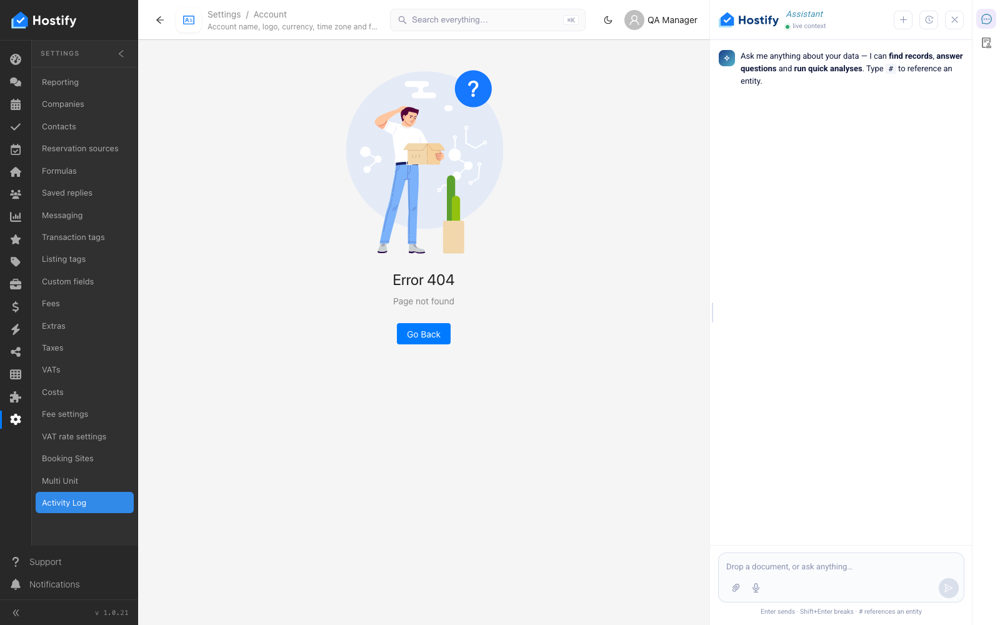


## Казус 2: revenueManager: the menu holds the role's pages, each opens without a refusal, the administrator's pages are refused

_Нов в този пуск._

**Какво се обърка**

```
Error: revenueManager: nodes of the live menu the inventory does not give the role

expect(received).toEqual(expected) // deep equality

- Expected  - 1
+ Received  + 4

- Array []
+ Array [
+   "checkFindings",
+   "listingBenchmarks",
+ ]
```
- сървърът отговори: GET 403 — `/api/user/search?size=100`
- сървърът отговори: GET 403 — `/api/pivotTenantSetting/search?model=pvm-property-performance&size=5`
- сървърът отговори: GET 403 — `/api/history/search?item=rs-f2b3ad65-0d9a-4992-929c-3abe4823df98&size=20&page=1`
- на екрана (reportingSettingsList): Failed to load the audit log
- на екрана (contacts): Failed to load the audit log

**Как да се възпроизведе**

1. Влез в https://hostify.bioseek.eu/app/ като revenueManager на акаунта (qa.revenue.manager@hostify-qa.test).
2. Меню: SETTINGS › Activity Log — https://hostify.bioseek.eu/app/settings/syncActivities
3. Спек `tests/e2e/102-role-access.spec.ts`, проверка „revenueManager: the menu holds the role's pages, each opens without a refusal, the administrator's pages are refused“ — стъпките:
4. the live menu holds exactly the pages the inventory gives the role
5. dashboards (/app/dashboards)
6. inbox › unifiedInbox (/app/inbox/unifiedInbox)
7. inbox › inboxThreads (/app/inbox/inboxThreads)
8. multiCalendar (/app/multiCalendar)
9. operations › tasks (/app/operations/tasks)
10. every column has a header and the actions column is the last one
11. operations › housekeepingBoard (/app/operations/housekeepingBoard)
12. operations › taskIssues (/app/operations/taskIssues)
13. operations › calendar (/app/operations/calendar)
14. operations › taskExpenses (/app/operations/taskExpenses)
15. reservationsMenu › reservations (/app/reservationsMenu/reservations)
16. reservationsMenu › reservationAlterations (/app/reservationsMenu/reservationAlterations)
17. listingsMenu › listings (/app/listingsMenu/listings)
18. every column has a header and the actions column is the last one
19. listingsMenu › listingUnits (/app/listingsMenu/listingUnits)
20. listingsMenu › listingLinks (/app/listingsMenu/listingLinks)
21. guests (/app/guests)
22. every column has a header and the actions column is the last one
23. reporting › reportingOverview (/app/reporting/reportingOverview)
24. reporting › pivotGrid (/app/reporting/pivotGrid)
25. reporting › reportingHousekeeping (/app/reporting/reportingHousekeeping)
26. every column has a header and the actions column is the last one
27. reporting › channelHealth (/app/reporting/channelHealth)
28. reporting › reportingReviews (/app/reporting/reportingReviews)
29. every column has a header and the actions column is the last one
30. ownersMenu › ownerStatements (/app/ownersMenu/ownerStatements)
31. ownersMenu › ownerPayments (/app/ownersMenu/ownerPayments)
32. ownersMenu › owners (/app/ownersMenu/owners)
33. every column has a header and the actions column is the last one
34. ownersMenu › ownerContracts (/app/ownersMenu/ownerContracts)
35. finance › invoices (/app/finance/invoices)
36. every column has a header and the actions column is the last one
37. finance › expenses (/app/finance/expenses)
38. automations › automationsHub (/app/automations/automationsHub)
39. automations › autoMessageRules (/app/automations/autoMessageRules)
40. automations › autoPaymentRules (/app/automations/autoPaymentRules)
41. automations › autoPricingRules (/app/automations/autoPricingRules)
42. automations › autoTaskRules (/app/automations/autoTaskRules)
43. automations › massMessages (/app/automations/massMessages)
44. automations › automationRuns (/app/automations/automationRuns)
45. channelManager › channelsHub (/app/channelManager/channelsHub)
46. channelManager › channelAccounts (/app/channelManager/channelAccounts)
47. channelManager › channelListings (/app/channelManager/channelListings)
48. channelManager › channelProperties (/app/channelManager/channelProperties)
49. channelManager › channelRatePlans (/app/channelManager/channelRatePlans)
50. channelManager › channelListingPromotions (/app/channelManager/channelListingPromotions)
51. channelManager › airbnbOpportunities (/app/channelManager/airbnbOpportunities)
52. channelManager › channelCommands (/app/channelManager/channelCommands)
53. ourFeatures › ourReporting › reportsOverview (/app/ourFeatures/ourReporting/reportsOverview)
54. ourFeatures › ourReporting › reportRuns (/app/ourFeatures/ourReporting/reportRuns)
55. ourFeatures › ourReporting › reportDefinitions (/app/ourFeatures/ourReporting/reportDefinitions)
56. ourFeatures › ourOwners › ownerStatementRuns (/app/ourFeatures/ourOwners/ownerStatementRuns)
57. ourFeatures › ourOwners › sepaPayoutBatches (/app/ourFeatures/ourOwners/sepaPayoutBatches)
58. ourFeatures › ourOwners › eInvoiceSubmissions (/app/ourFeatures/ourOwners/eInvoiceSubmissions)
59. ourFeatures › ourSettings › brands (/app/ourFeatures/ourSettings/brands)
60. ourFeatures › ourSettings › documents (/app/ourFeatures/ourSettings/documents)
61. ourFeatures › ourSettings › documentCustomFields (/app/ourFeatures/ourSettings/documentCustomFields)
62. ourFeatures › ourSettings › engineHealth (/app/ourFeatures/ourSettings/engineHealth)
63. ourFeatures › ourSettings › calUpdateLogs (/app/ourFeatures/ourSettings/calUpdateLogs)
64. ourFeatures › ourSettings › changeAnnouncements (/app/ourFeatures/ourSettings/changeAnnouncements)
65. ourFeatures › ourSettings › calendarService › calWarnings (/app/ourFeatures/ourSettings/calendarService/calWarnings)
66. every column has a header and the actions column is the last one
67. ourFeatures › ourSettings › calendarService › icalSubscriptions (/app/ourFeatures/ourSettings/calendarService/icalSubscriptions)
68. ourFeatures › ourSettings › calendarService › icalExportFeeds (/app/ourFeatures/ourSettings/calendarService/icalExportFeeds)
69. ourFeatures › ourSettings › calendarService › availabilityDependencies (/app/ourFeatures/ourSettings/calendarService/availabilityDependencies)
70. ourFeatures › ourSettings › calendarService › pricingDependencies (/app/ourFeatures/ourSettings/calendarService/pricingDependencies)
71. ourFeatures › ourSettings › calendarService › ratePlans (/app/ourFeatures/ourSettings/calendarService/ratePlans)
72. ourFeatures › ourSettings › calendarService › calStretches (/app/ourFeatures/ourSettings/calendarService/calStretches)
73. ourFeatures › ourSettings › calendarService › calReservations (/app/ourFeatures/ourSettings/calendarService/calReservations)
74. ourFeatures › ourSettings › calendarService › deferredWrites (/app/ourFeatures/ourSettings/calendarService/deferredWrites)
75. ourFeatures › ourSettings › calendarService › engineAlerts (/app/ourFeatures/ourSettings/calendarService/engineAlerts)
76. ourFeatures › ourSettings › calendarService › dailyViews (/app/ourFeatures/ourSettings/calendarService/dailyViews)
77. ourFeatures › ourSettings › calendarService › monthlyViews (/app/ourFeatures/ourSettings/calendarService/monthlyViews)
78. ourFeatures › ourSettings › calendarService › websiteStatsList (/app/ourFeatures/ourSettings/calendarService/websiteStatsList)
79. ourFeatures › ourSettings › calendarService › icalBlocks (/app/ourFeatures/ourSettings/calendarService/icalBlocks)
80. settings › reportingSettingsList (/app/settings/reportingSettingsList)
81. settings › contacts (/app/settings/contacts)
82. every column has a header and the actions column is the last one
83. settings › reservationSources (/app/settings/reservationSources)
84. settings › savedReplies (/app/settings/savedReplies)
85. settings › transactionTags (/app/settings/transactionTags)
86. settings › customFields (/app/settings/customFields)
87. settings › syncActivities (/app/settings/syncActivities)
88. the administrator's pages, by their address, show "Page not found" and no data
89. Developer tools › Network: заявките по-горе отговарят така.

**Скрийншоти**

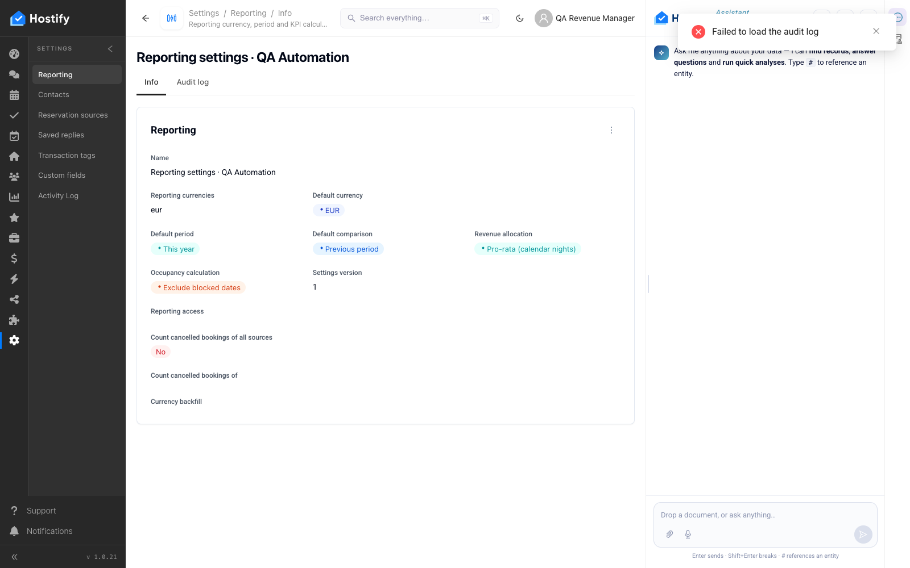
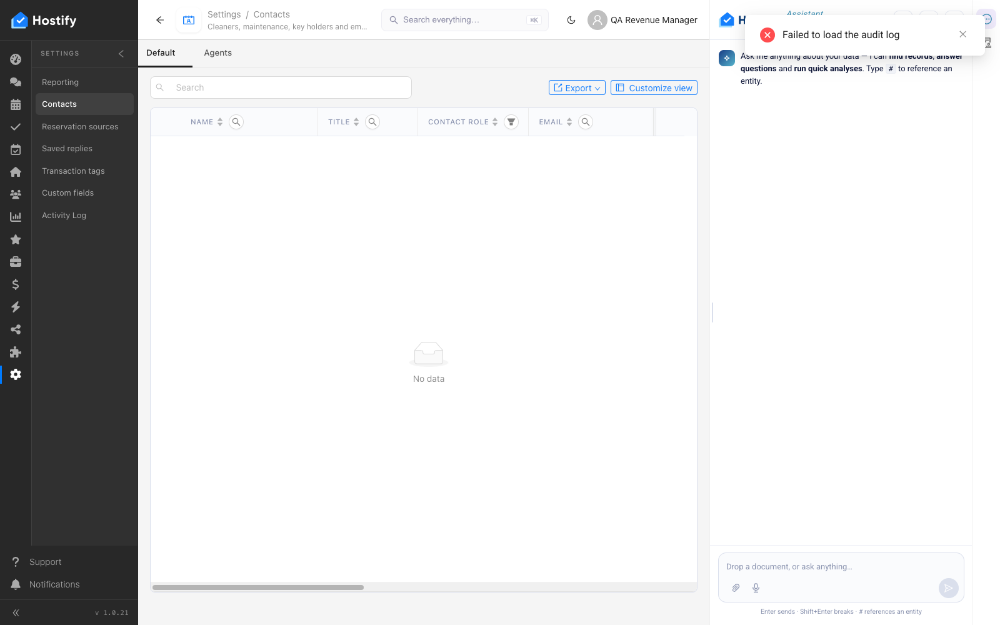
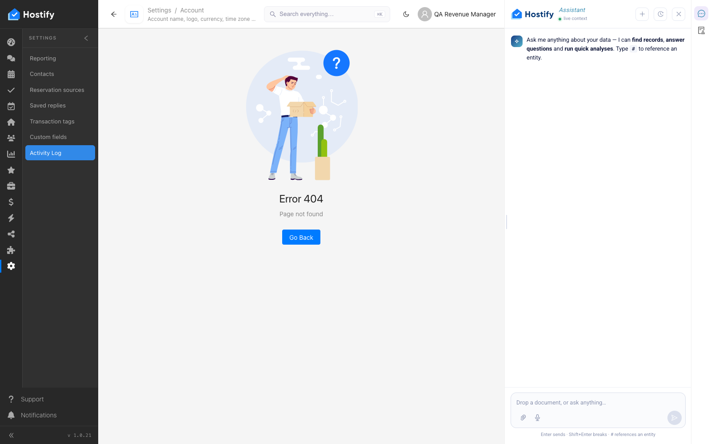


## Казус 3: bookingAgent: the menu holds the role's pages, each opens without a refusal, the administrator's pages are refused

_Нов в този пуск._

**Какво се обърка**

```
Error: bookingAgent: nodes of the live menu the inventory does not give the role

expect(received).toEqual(expected) // deep equality

- Expected  - 1
+ Received  + 4

- Array []
+ Array [
+   "conversationScores",
+   "checkFindings",
+ ]
```
- конзола: Grid read failed for "websiteStats" requestFailed {message: Access denied, error: -1, code: 403} — `/app/static/js/main.52541251.js`
- сървърът отговори: GET 403 — `/api/websiteStats/search?page=1&size=10&lang=en`
- сървърът отговори: GET 403 — `/api/reportingSettings/search?size=2`
- конзола: Grid read failed for "reportingSettings" requestFailed {message: Access denied, error: -1, code: 403} — `/app/static/js/main.52541251.js`
- сървърът отговори: GET 403 — `/api/reportingSettings/search?page=1&size=10&lang=en`
- сървърът отговори: GET 403 — `/api/ownerPortalSettings?id=apiKeys&lang=en`
- на екрана (websiteStatsList): Forbidden -1Access denied
- на екрана (icalBlocks): Forbidden -1Access denied
- на екрана (reportingSettingsList): Forbidden -1Access denied
- на екрана (contacts): Forbidden -1Access denied

**Как да се възпроизведе**

1. Влез в https://hostify.bioseek.eu/app/ като bookingAgent на акаунта (qa.booking.agent@hostify-qa.test).
2. Меню: SETTINGS › Activity Log — https://hostify.bioseek.eu/app/settings/syncActivities
3. Спек `tests/e2e/102-role-access.spec.ts`, проверка „bookingAgent: the menu holds the role's pages, each opens without a refusal, the administrator's pages are refused“ — стъпките:
4. the live menu holds exactly the pages the inventory gives the role
5. dashboards (/app/dashboards)
6. inbox › unifiedInbox (/app/inbox/unifiedInbox)
7. inbox › inboxThreads (/app/inbox/inboxThreads)
8. inbox › inboxAiRuns (/app/inbox/inboxAiRuns)
9. multiCalendar (/app/multiCalendar)
10. operations › tasks (/app/operations/tasks)
11. every column has a header and the actions column is the last one
12. operations › housekeepingBoard (/app/operations/housekeepingBoard)
13. operations › taskIssues (/app/operations/taskIssues)
14. operations › calendar (/app/operations/calendar)
15. operations › taskExpenses (/app/operations/taskExpenses)
16. reservationsMenu › reservations (/app/reservationsMenu/reservations)
17. every column has a header and the actions column is the last one
18. reservationsMenu › reservationAlterations (/app/reservationsMenu/reservationAlterations)
19. listingsMenu › listings (/app/listingsMenu/listings)
20. every column has a header and the actions column is the last one
21. listingsMenu › listingUnits (/app/listingsMenu/listingUnits)
22. guests (/app/guests)
23. every column has a header and the actions column is the last one
24. finance › paymentTransactions (/app/finance/paymentTransactions)
25. automations › automationsHub (/app/automations/automationsHub)
26. automations › autoMessageRules (/app/automations/autoMessageRules)
27. automations › autoPaymentRules (/app/automations/autoPaymentRules)
28. automations › autoTaskRules (/app/automations/autoTaskRules)
29. automations › massMessages (/app/automations/massMessages)
30. automations › automationRuns (/app/automations/automationRuns)
31. channelManager › channelsHub (/app/channelManager/channelsHub)
32. channelManager › channelAccounts (/app/channelManager/channelAccounts)
33. channelManager › channelListings (/app/channelManager/channelListings)
34. channelManager › channelProperties (/app/channelManager/channelProperties)
35. channelManager › channelRatePlans (/app/channelManager/channelRatePlans)
36. channelManager › channelListingPromotions (/app/channelManager/channelListingPromotions)
37. channelManager › airbnbOpportunities (/app/channelManager/airbnbOpportunities)
38. channelManager › channelCommands (/app/channelManager/channelCommands)
39. apps › appCenter (/app/apps/appCenter)
40. apps › paymentProcessorAccounts (/app/apps/paymentProcessorAccounts)
41. apps › checkinFormTemplates (/app/apps/checkinFormTemplates)
42. apps › complianceSubmissions (/app/apps/complianceSubmissions)
43. ourFeatures › ourSettings › brands (/app/ourFeatures/ourSettings/brands)
44. ourFeatures › ourSettings › documents (/app/ourFeatures/ourSettings/documents)
45. ourFeatures › ourSettings › documentCustomFields (/app/ourFeatures/ourSettings/documentCustomFields)
46. ourFeatures › ourSettings › calUpdateLogs (/app/ourFeatures/ourSettings/calUpdateLogs)
47. ourFeatures › ourSettings › calendarService › calWarnings (/app/ourFeatures/ourSettings/calendarService/calWarnings)
48. every column has a header and the actions column is the last one
49. ourFeatures › ourSettings › calendarService › ratePlans (/app/ourFeatures/ourSettings/calendarService/ratePlans)
50. ourFeatures › ourSettings › calendarService › calStretches (/app/ourFeatures/ourSettings/calendarService/calStretches)
51. ourFeatures › ourSettings › calendarService › calReservations (/app/ourFeatures/ourSettings/calendarService/calReservations)
52. ourFeatures › ourSettings › calendarService › dailyViews (/app/ourFeatures/ourSettings/calendarService/dailyViews)
53. ourFeatures › ourSettings › calendarService › monthlyViews (/app/ourFeatures/ourSettings/calendarService/monthlyViews)
54. ourFeatures › ourSettings › calendarService › websiteStatsList (/app/ourFeatures/ourSettings/calendarService/websiteStatsList)
55. ourFeatures › ourSettings › calendarService › icalBlocks (/app/ourFeatures/ourSettings/calendarService/icalBlocks)
56. settings › reportingSettingsList (/app/settings/reportingSettingsList)
57. settings › contacts (/app/settings/contacts)
58. every column has a header and the actions column is the last one
59. settings › reservationSources (/app/settings/reservationSources)
60. settings › savedReplies (/app/settings/savedReplies)
61. settings › transactionTags (/app/settings/transactionTags)
62. settings › customFields (/app/settings/customFields)
63. settings › syncActivities (/app/settings/syncActivities)
64. the administrator's pages, by their address, show "Page not found" and no data
65. Developer tools › Network: заявките по-горе отговарят така.
66. Developer tools › Console показва грешките по-горе.

**Скрийншоти**

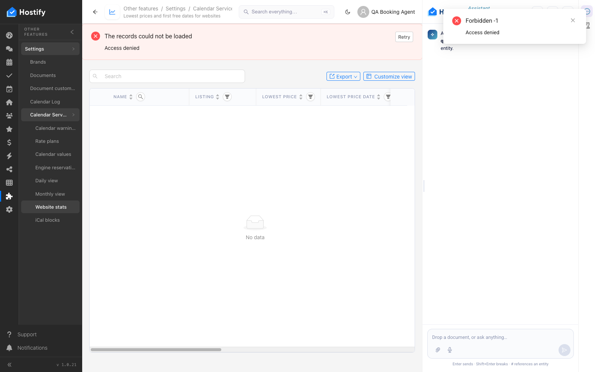
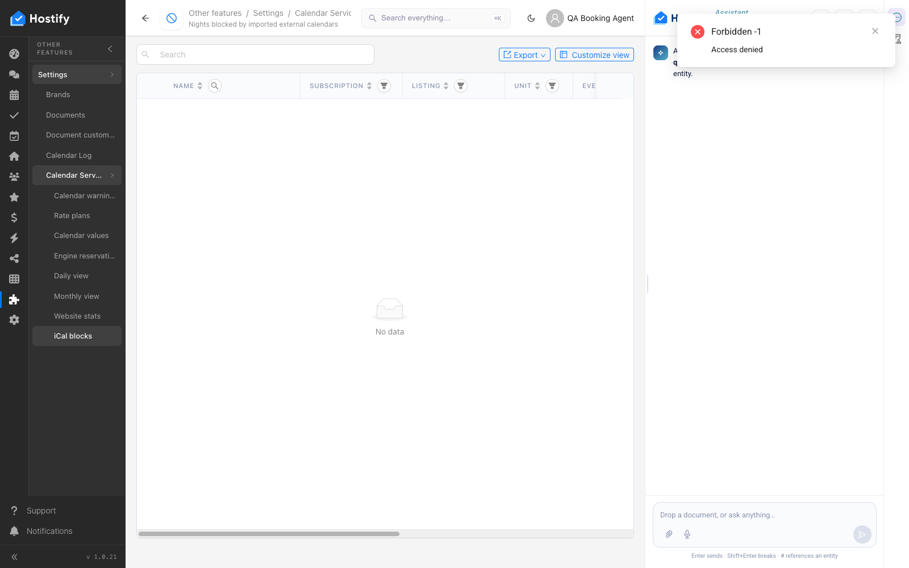
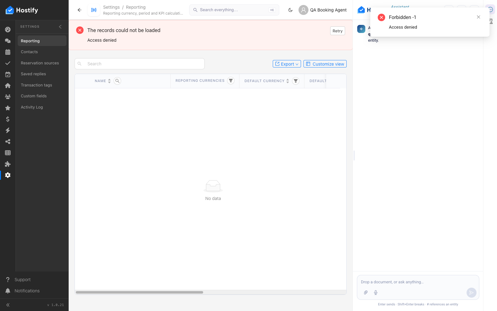
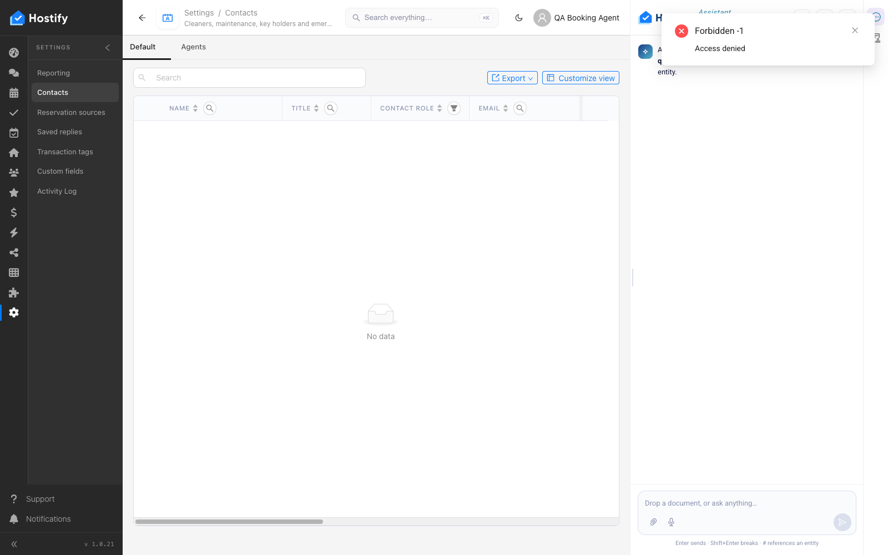


## Казус 4: accountant: the menu holds the role's pages, each opens without a refusal, the administrator's pages are refused

_Нов в този пуск._

**Какво се обърка**

```
Error: accountant: nodes of the live menu the inventory does not give the role

expect(received).toEqual(expected) // deep equality

- Expected  - 1
+ Received  + 5

- Array []
+ Array [
+   "checkFindings",
+   "listingBenchmarks",
+   "aiUsages",
```
- сървърът отговори: GET 403 — `/api/inboxTag/search?size=100`
- сървърът отговори: POST 403 — `/api/inboxThread/inbox`
- сървърът отговори: GET 403 — `/api/syncActivity/search?syncStatus=error&sort=occurredAt&sort=desc&size=100&page=1`
- сървърът отговори: POST 403 — `/api/automationApp/state`
- сървърът отговори: GET 403 — `/api/pivotTenantSetting/search?model=pvm-property-performance&size=5`

**Как да се възпроизведе**

1. Влез в https://hostify.bioseek.eu/app/ като accountant на акаунта (qa.accountant@hostify-qa.test).
2. Меню: SETTINGS › VAT rate settings — https://hostify.bioseek.eu/app/settings/vatRateSettings
3. Спек `tests/e2e/102-role-access.spec.ts`, проверка „accountant: the menu holds the role's pages, each opens without a refusal, the administrator's pages are refused“ — стъпките:
4. the live menu holds exactly the pages the inventory gives the role
5. dashboards (/app/dashboards)
6. inbox › unifiedInbox (/app/inbox/unifiedInbox)
7. multiCalendar (/app/multiCalendar)
8. operations › tasks (/app/operations/tasks)
9. every column has a header and the actions column is the last one
10. operations › housekeepingBoard (/app/operations/housekeepingBoard)
11. operations › calendar (/app/operations/calendar)
12. operations › taskExpenses (/app/operations/taskExpenses)
13. reservationsMenu › reservations (/app/reservationsMenu/reservations)
14. reservationsMenu › reservationAlterations (/app/reservationsMenu/reservationAlterations)
15. listingsMenu › listings (/app/listingsMenu/listings)
16. every column has a header and the actions column is the last one
17. listingsMenu › listingUnits (/app/listingsMenu/listingUnits)
18. guests (/app/guests)
19. every column has a header and the actions column is the last one
20. reporting › reportingOverview (/app/reporting/reportingOverview)
21. reporting › pivotGrid (/app/reporting/pivotGrid)
22. reporting › reportingHousekeeping (/app/reporting/reportingHousekeeping)
23. every column has a header and the actions column is the last one
24. reporting › reportingReviews (/app/reporting/reportingReviews)
25. pricing › pricingBasePrice (/app/pricing/pricingBasePrice)
26. every column has a header and the actions column is the last one
27. pricing › pricingFees (/app/pricing/pricingFees)
28. every column has a header and the actions column is the last one
29. pricing › pricingTaxes (/app/pricing/pricingTaxes)
30. every column has a header and the actions column is the last one
31. pricing › pricingExtras (/app/pricing/pricingExtras)
32. every column has a header and the actions column is the last one
33. pricing › pricingCosts (/app/pricing/pricingCosts)
34. every column has a header and the actions column is the last one
35. pricing › taxRules (/app/pricing/taxRules)
36. ownersMenu › ownerStatements (/app/ownersMenu/ownerStatements)
37. ownersMenu › ownerPayments (/app/ownersMenu/ownerPayments)
38. ownersMenu › owners (/app/ownersMenu/owners)
39. every column has a header and the actions column is the last one
40. ownersMenu › ownerContracts (/app/ownersMenu/ownerContracts)
41. ownersMenu › ownerContractTemplates (/app/ownersMenu/ownerContractTemplates)
42. ownersMenu › ownerPnl (/app/ownersMenu/ownerPnl)
43. ownersMenu › generalLedger (/app/ownersMenu/generalLedger)
44. ownersMenu › ledgerAccounts (/app/ownersMenu/ledgerAccounts)
45. finance › invoices (/app/finance/invoices)
46. finance › expenses (/app/finance/expenses)
47. finance › costCategories (/app/finance/costCategories)
48. finance › paymentTransactions (/app/finance/paymentTransactions)
49. automations › automationsHub (/app/automations/automationsHub)
50. automations › autoPaymentRules (/app/automations/autoPaymentRules)
51. automations › autoInvoiceRules (/app/automations/autoInvoiceRules)
52. automations › automationRuns (/app/automations/automationRuns)
53. ourFeatures › ourReporting › reportsOverview (/app/ourFeatures/ourReporting/reportsOverview)
54. ourFeatures › ourReporting › reportRuns (/app/ourFeatures/ourReporting/reportRuns)
55. ourFeatures › ourReporting › reportDefinitions (/app/ourFeatures/ourReporting/reportDefinitions)
56. ourFeatures › ourOwners › ownerStatementRuns (/app/ourFeatures/ourOwners/ownerStatementRuns)
57. ourFeatures › ourOwners › sepaPayoutBatches (/app/ourFeatures/ourOwners/sepaPayoutBatches)
58. ourFeatures › ourOwners › eInvoiceSubmissions (/app/ourFeatures/ourOwners/eInvoiceSubmissions)
59. ourFeatures › ownersSettings › vendors (/app/ourFeatures/ownersSettings/vendors)
60. every column has a header and the actions column is the last one
61. ourFeatures › ownersSettings › printTemplates (/app/ourFeatures/ownersSettings/printTemplates)
62. ourFeatures › ownersSettings › vendorContracts (/app/ourFeatures/ownersSettings/vendorContracts)
63. ourFeatures › ownersSettings › fiscalSeriesList (/app/ourFeatures/ownersSettings/fiscalSeriesList)
64. ourFeatures › ownersSettings › taxJurisdictions (/app/ourFeatures/ownersSettings/taxJurisdictions)
65. ourFeatures › ownersSettings › costCategorySettings (/app/ourFeatures/ownersSettings/costCategorySettings)
66. ourFeatures › ourFinance › creditCards (/app/ourFeatures/ourFinance/creditCards)
67. ourFeatures › ourSettings › documents (/app/ourFeatures/ourSettings/documents)
68. ourFeatures › ourSettings › documentCustomFields (/app/ourFeatures/ourSettings/documentCustomFields)
69. ourFeatures › ourSettings › histories (/app/ourFeatures/ourSettings/histories)
70. settings › reportingSettingsList (/app/settings/reportingSettingsList)
71. settings › companies (/app/settings/companies)
72. settings › contacts (/app/settings/contacts)
73. every column has a header and the actions column is the last one
74. settings › reservationSources (/app/settings/reservationSources)
75. settings › transactionTags (/app/settings/transactionTags)
76. settings › customFields (/app/settings/customFields)
77. settings › settingsFees (/app/settings/settingsFees)
78. settings › settingsExtras (/app/settings/settingsExtras)
79. every column has a header and the actions column is the last one
80. settings › settingsTaxes (/app/settings/settingsTaxes)
81. settings › vatRates (/app/settings/vatRates)
82. settings › settingsCosts (/app/settings/settingsCosts)
83. every column has a header and the actions column is the last one
84. settings › feeItemSettings (/app/settings/feeItemSettings)
85. settings › vatRateSettings (/app/settings/vatRateSettings)
86. the administrator's pages, by their address, show "Page not found" and no data
87. Developer tools › Network: заявките по-горе отговарят така.

**Скрийншоти**

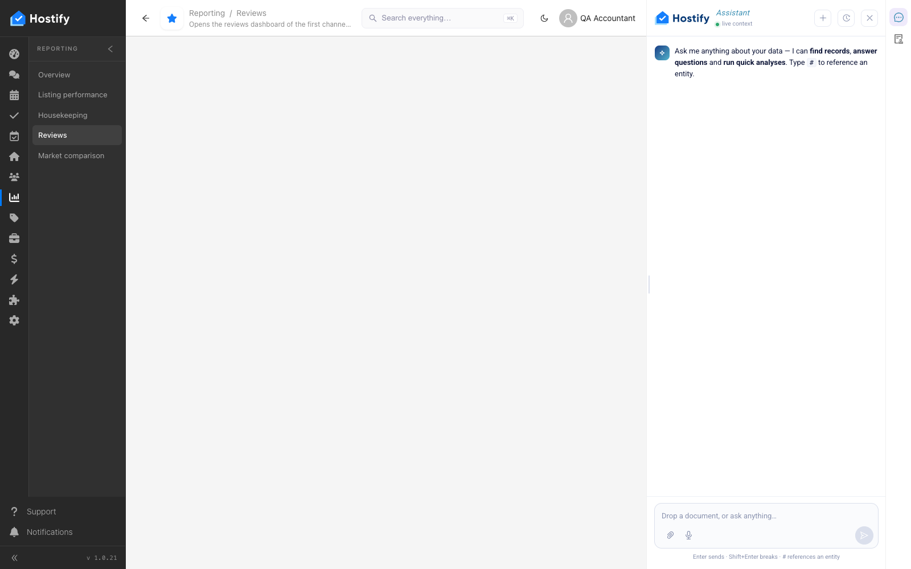
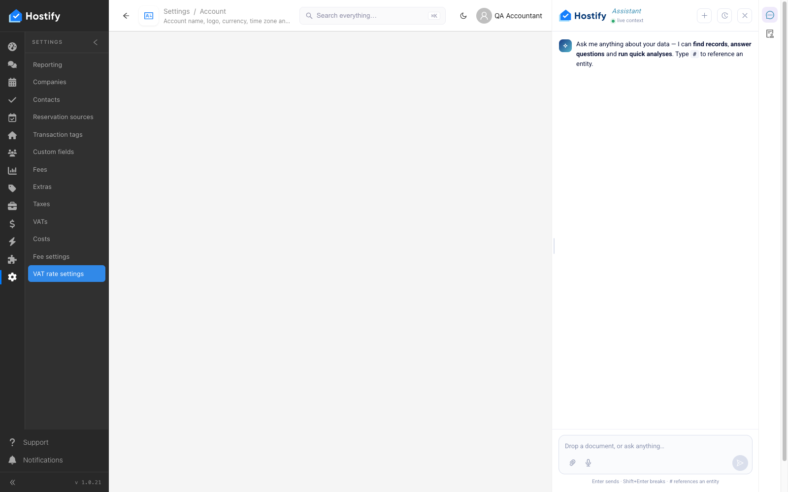


## Казус 5: teamSupervisor: the menu holds the role's pages, each opens without a refusal, the administrator's pages are refused

_Нов в този пуск._

**Какво се обърка**

```
TimeoutError: locator.click: Timeout 20000ms exceeded.
Call log:
  - waiting for locator('.cc-sidebar').locator('[data-test="checkFindings"]')

```
- сървърът отговори: GET 403 — `/api/listingTag/search?size=100&page=1`
- сървърът отговори: GET 403 — `/api/reservationSource/search?size=100&page=1`
- сървърът отговори: GET 403 — `/api/syncActivity/search?syncStatus=error&sort=occurredAt&sort=desc&size=100&page=1`

**Как да се възпроизведе**

1. Страница: https://hostify.bioseek.eu/app/listingsMenu/listings
2. Спек `tests/e2e/102-role-access.spec.ts`, проверка „teamSupervisor: the menu holds the role's pages, each opens without a refusal, the administrator's pages are refused“ — стъпките:
3. the live menu holds exactly the pages the inventory gives the role
4. Developer tools › Network: заявките по-горе отговарят така.

**Скрийншоти**

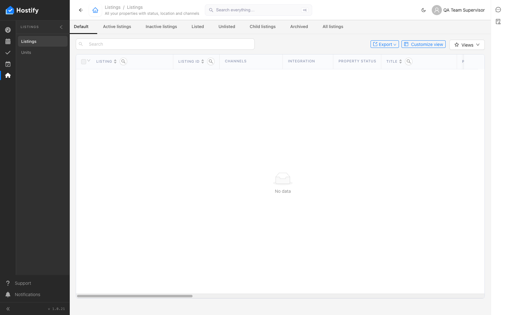


## Казус 6: housekeeper: the menu holds the role's pages, each opens without a refusal, the administrator's pages are refused

_Нов в този пуск._

**Какво се обърка**

```
TimeoutError: locator.click: Timeout 20000ms exceeded.
Call log:
  - waiting for locator('.cc-sidebar').locator('[data-test="tasks"]')

```

**Как да се възпроизведе**

1. Страница: https://hostify.bioseek.eu/app/listingsMenu/listings
2. Спек `tests/e2e/102-role-access.spec.ts`, проверка „housekeeper: the menu holds the role's pages, each opens without a refusal, the administrator's pages are refused“ — стъпките:
3. the live menu holds exactly the pages the inventory gives the role

**Скрийншоти**

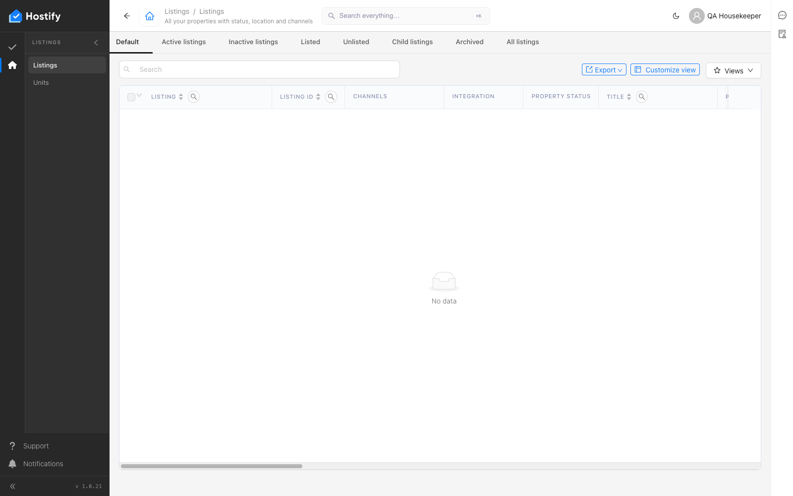


---

Какво проверява спекът: 102 — every role of the QA account sees its own pages, opens them without a refusal, and is refused the others.
