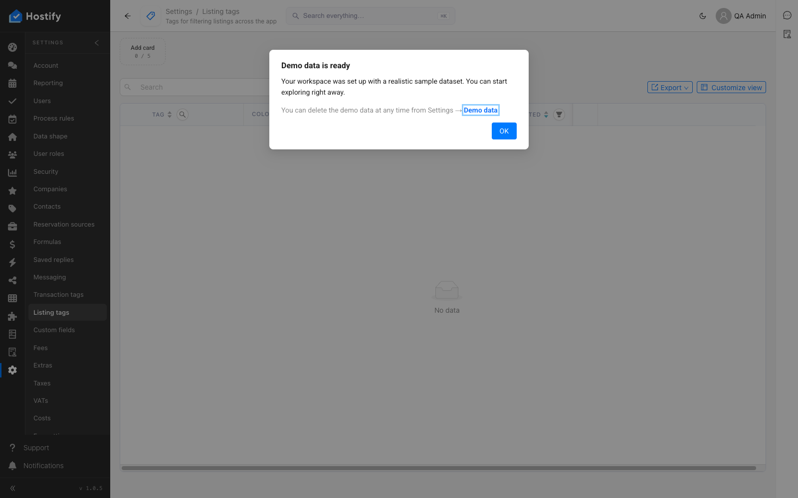

# 110-settings-listing-tags — Settings › Listing tags: форма, записи през формата, сортиране и филтър по колони, табове, броене

- Пуск: 2026-11-06_09-34-06 · Приложение: https://hostify.bioseek.eu · Версия: 1.0.5
- Спек: `tests/e2e/110-settings-listing-tags.spec.ts`
- Казуси: 1 от 5 проверки

## Казус 1: three tags are created through the form and appear in the grid

_Нов в този пуск._

**Какво се обърка**

```
TimeoutError: locator.click: Timeout 20000ms exceeded.
Call log:
  - waiting for locator('[data-test="grid-create"]').or(locator('.cc-grid-toolbar button').filter({ has: locator('.anticon-plus-circle') })).or(getByRole('button', { name: /^Create\b/ })).first()
    - locator resolved to <button type="button" data-test="grid-create" class="ant-btn css-ry7cab css-var-_r_5_ ant-btn-primary ant-btn-color-primary ant-btn-variant-solid">…</button>
  - attempting click action
    2 × waiting for element to be visible, enabled and stable
      - element is visible, enabled and stable
      - scrolling into view if needed
      - done scrolling
      - <div class="ant-typography css-ry7cab hydra">Your workspace was set up with a realistic sample…</div> from <div>…</div> subtree intercepts pointer events
    - retrying click action
    - waiting 20ms
```

**Как да се възпроизведе**

1. Спек `tests/e2e/110-settings-listing-tags.spec.ts`, проверка „three tags are created through the form and appear in the grid“.
2. create "QA Tag Sea view"

**Скрийншоти**




**Предупреждения в конзолата**

- [InboxMenuCount] TypeError: Failed to fetch
- [hydraPartner] navbarExtensionLoader failed TypeError: Failed to fetch
- [ReviewsMenuChannels] TypeError: Failed to fetch
- [hydraPartner] the plugin surfaces were not read TypeError: Failed to fetch

---

Какво проверява спекът: 110 — Settings › Listing tags: the first master-data page, and the TEMPLATE of a page spec.
