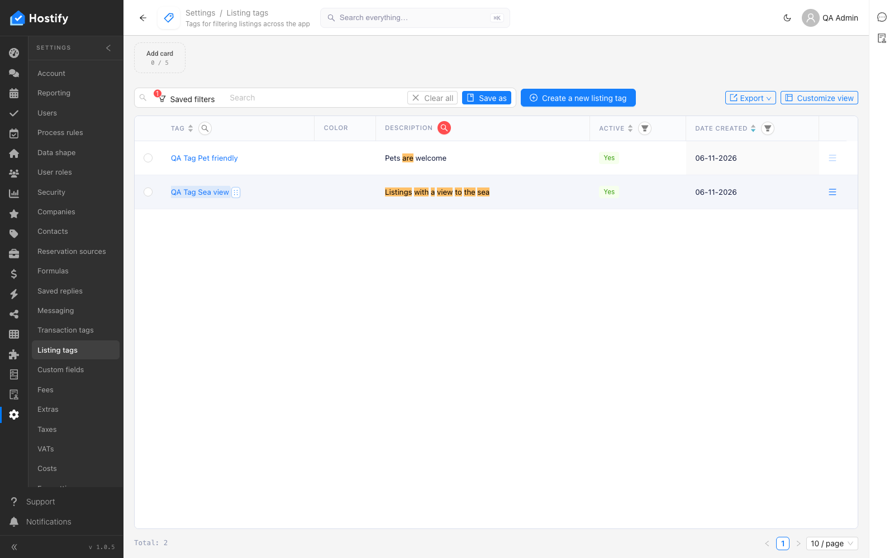
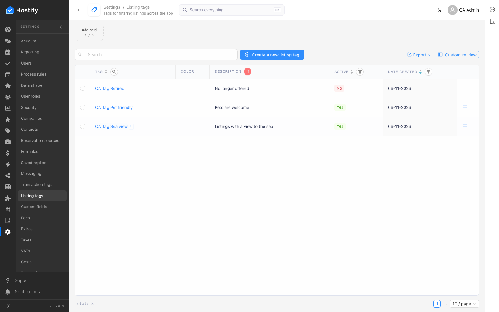

# 110-settings-listing-tags — Settings › Listing tags: форма, записи през формата, сортиране и филтър по колони, табове, броене

- Пуск: 2026-11-06_09-37-54 · Приложение: https://hostify.bioseek.eu · Версия: 1.0.5
- Спек: `tests/e2e/110-settings-listing-tags.spec.ts`
- Казуси: 1 от 5 проверки

## Казус 1: filtering the Description column by the whole description of one tag leaves only that tag

_Нов в този пуск._

**Какво се обърка**

```
Error: a row left after filtering Description by "Listings with a view to the sea"

expect(received).toContain(expected) // indexOf

Expected substring: "Listings with a view to the sea"
Received string:    "Pets are welcome"
```

**Как да се възпроизведе**

1. Спек `tests/e2e/110-settings-listing-tags.spec.ts`, проверка „filtering the Description column by the whole description of one tag leaves only that tag“.
2. filter the column "Description" by the phrase "Listings with a view to the sea" (its filter icon, the text box, Search)

**Скрийншоти**





**Предупреждения в конзолата**

- [hydraPartner] navbarExtensionLoader failed TypeError: Failed to fetch
- [InboxMenuCount] TypeError: Failed to fetch
- [ReviewsMenuChannels] TypeError: Failed to fetch
- [hydraPartner] the plugin surfaces were not read TypeError: Failed to fetch

---

Какво проверява спекът: 110 — Settings › Listing tags: the first master-data page, and the TEMPLATE of a page spec.
