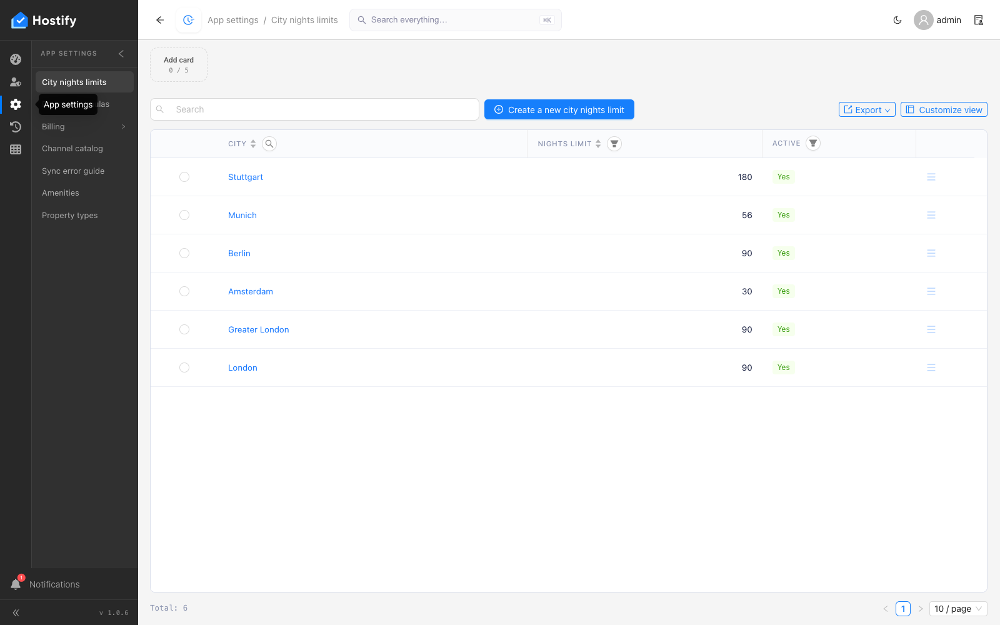

# 005-platform-pages — проверка на навбар менютата на платформената конзола (всяка страница се отваря и се оглежда)

- Пуск: 2026-11-06_13-59-50 · Приложение: https://hostify.bioseek.eu · Версия: 1.0.6
- Спек: `tests/e2e/005-platform-pages.spec.ts`
- Казуси: 2 от 34 проверки

## Казус 1: revenueFormulas opens (/app/platformSettings/revenueFormulas)

_Нов в този пуск._

**Какво се обърка**

```
TimeoutError: locator.click: Timeout 20000ms exceeded.
Call log:
  - waiting for locator('.cc-submenu-slide-panel').locator('[data-test="revenueFormulas"]')
    - locator resolved to <a class="cc-submenu-item" data-test="revenueFormulas" href="/app/platformSettings/revenueFormulas">…</a>
  - attempting click action
    2 × waiting for element to be visible, enabled and stable
      - element is visible, enabled and stable
      - scrolling into view if needed
      - done scrolling
      - <div id="_r_a_" role="tooltip" class="ant-tooltip-container">App settings</div> from <div>…</div> subtree intercepts pointer events
    - retrying click action
    - waiting 20ms
```

**Как да се възпроизведе**

1. Страница: https://hostify.bioseek.eu/app/platformSettings/cityNightsLimits
2. Спек `tests/e2e/005-platform-pages.spec.ts`, проверка „revenueFormulas opens (/app/platformSettings/revenueFormulas)“.

**Скрийншоти**




## Казус 2: activeRuListings opens (/app/platformSettings/platformBilling/activeRuListings)

_Нов в този пуск._

**Какво се обърка**

```
TimeoutError: page.goto: Timeout 60000ms exceeded.
Call log:
  - navigating to "https://hostify.bioseek.eu/app/", waiting until "domcontentloaded"

```

**Как да се възпроизведе**

1. Спек `tests/e2e/005-platform-pages.spec.ts`, проверка „activeRuListings opens (/app/platformSettings/platformBilling/activeRuListings)“.

**Скрийншоти**


---

Какво проверява спекът: 005 — every page of the PLATFORM console opens for the super administrator.
