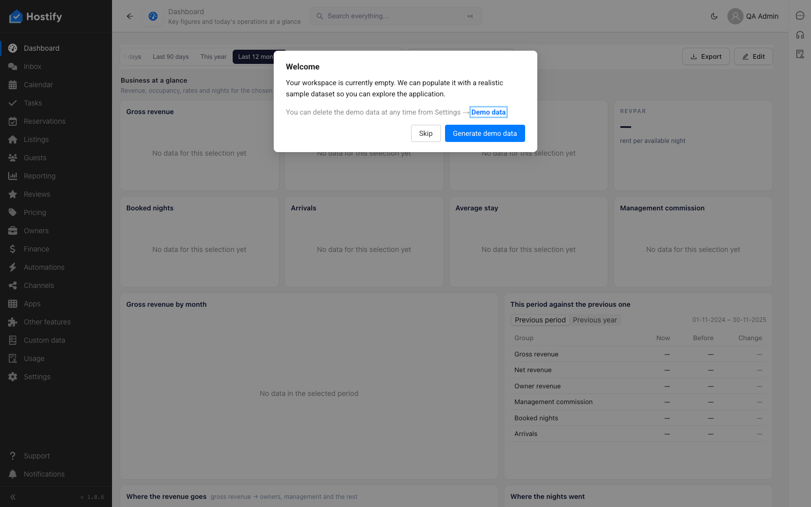

# 110-settings-listing-tags — Settings › Listing tags: форма, записи през формата, сортиране и филтър по колони, табове, броене

- Пуск: 2026-11-06_14-39-08 · Приложение: https://hostify.bioseek.eu · Версия: 1.0.6
- Спек: `tests/e2e/110-settings-listing-tags.spec.ts`
- Казуси: 1 от 5 проверки

## Казус 1: the page opens through the menu and the Create form behaves

_Нов в този пуск._

**Какво се обърка**

```
TimeoutError: locator.click: Timeout 20000ms exceeded.
Call log:
  - waiting for locator('.cc-sidebar').locator('[data-test="settings"]')
    - locator resolved to <div data-test="settings" class="cc-menu-item ">…</div>
  - attempting click action
    2 × waiting for element to be visible, enabled and stable
      - element is visible, enabled and stable
      - scrolling into view if needed
      - done scrolling
      - <div class="ant-modal-wrap">…</div> from <div>…</div> subtree intercepts pointer events
    - retrying click action
    - waiting 20ms
```

**Как да се възпроизведе**

1. Влез в https://hostify.bioseek.eu/app/ като администратор на акаунта (qa.admin@hostify-qa.test).
2. Страница: https://hostify.bioseek.eu/app/dashboards/
3. Спек `tests/e2e/110-settings-listing-tags.spec.ts`, проверка „the page opens through the menu and the Create form behaves“.

**Скрийншоти**




**Предупреждения в конзолата**

- [hydraPartner] navbarExtensionLoader failed TypeError: Failed to fetch
- [InboxMenuCount] TypeError: Failed to fetch
- [ReviewsMenuChannels] TypeError: Failed to fetch
- [demoData] the demo data status could not be read — no welcome modal TypeError: Failed to fetch
- [AlertsMenuCount] TypeError: Failed to fetch
- [hydraPartner] the plugin surfaces were not read TypeError: Failed to fetch

---

Какво проверява спекът: 110 — Settings › Listing tags: the first master-data page, and the TEMPLATE of a page spec.
