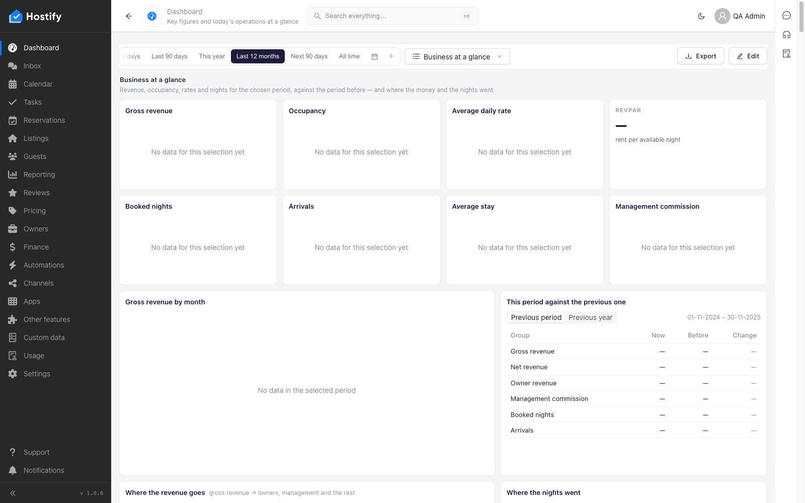

# 110-settings-listing-tags — Settings › Listing tags: форма, записи през формата, сортиране и филтър по колони, табове, броене

- Пуск: 2026-11-06_15-29-28 · Приложение: https://hostify.bioseek.eu · Версия: 1.0.6
- Спек: `tests/e2e/110-settings-listing-tags.spec.ts`
- Казуси: 1 от 5 проверки

## Казус 1: three tags are created through the form and appear in the grid

_Нов в този пуск._

**Какво се обърка**

```
TimeoutError: locator.click: Timeout 20000ms exceeded.
Call log:
  - waiting for locator('.ant-modal').filter({ hasText: /workspace (is currently empty|was set up with a realistic sample)/i }).locator('button').filter({ hasText: /^\s*(Skip|OK)\s*$/ }).first()
    - found locator('.ant-modal').filter({ hasText: /workspace (is currently empty|was set up with a realistic sample)/i }), intercepting action to run the handler
    - locator handler has finished, waiting for locator('.ant-modal').filter({ hasText: /workspace (is currently empty|was set up with a realistic sample)/i }) to be hidden
    - locator resolved to hidden <div role="dialog" tabindex="-1" aria-modal="true" aria-labelledby="_r_27_" class="ant-modal css-ry7cab">…</div>
    - interception handler has finished, continuing
    - locator resolved to <button type="button" class="ant-btn css-ry7cab hydra ant-btn-default ant-btn-color-default ant-btn-variant-outlined">…</button>
  - attempting click action
    2 × waiting for element to be visible, enabled and stable
      - element is not visible
    - retrying click action
```

**Как да се възпроизведе**

1. Влез в https://hostify.bioseek.eu/app/ като администратор на акаунта (qa.admin@hostify-qa.test).
2. Страница: https://hostify.bioseek.eu/app/dashboards/
3. Спек `tests/e2e/110-settings-listing-tags.spec.ts`, проверка „three tags are created through the form and appear in the grid“.

**Скрийншоти**




**Предупреждения в конзолата**

- [ReviewsMenuChannels] TypeError: Failed to fetch
- [hydraPartner] navbarExtensionLoader failed TypeError: Failed to fetch
- [InboxMenuCount] TypeError: Failed to fetch
- [AlertsMenuCount] TypeError: Failed to fetch
- [hydraPartner] the plugin surfaces were not read TypeError: Failed to fetch

---

Какво проверява спекът: 110 — Settings › Listing tags: the first master-data page, and the TEMPLATE of a page spec.
