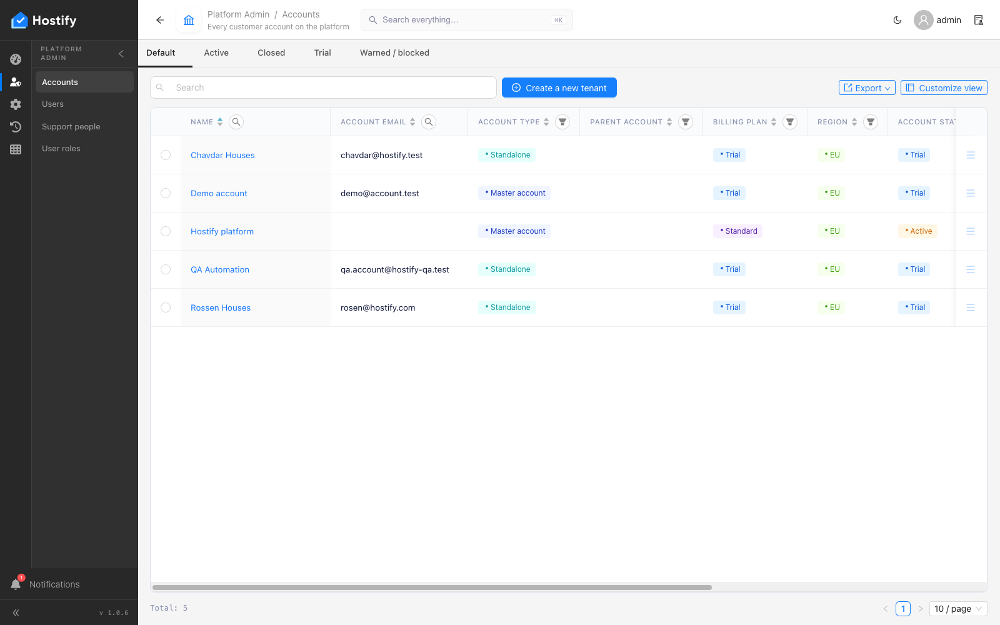
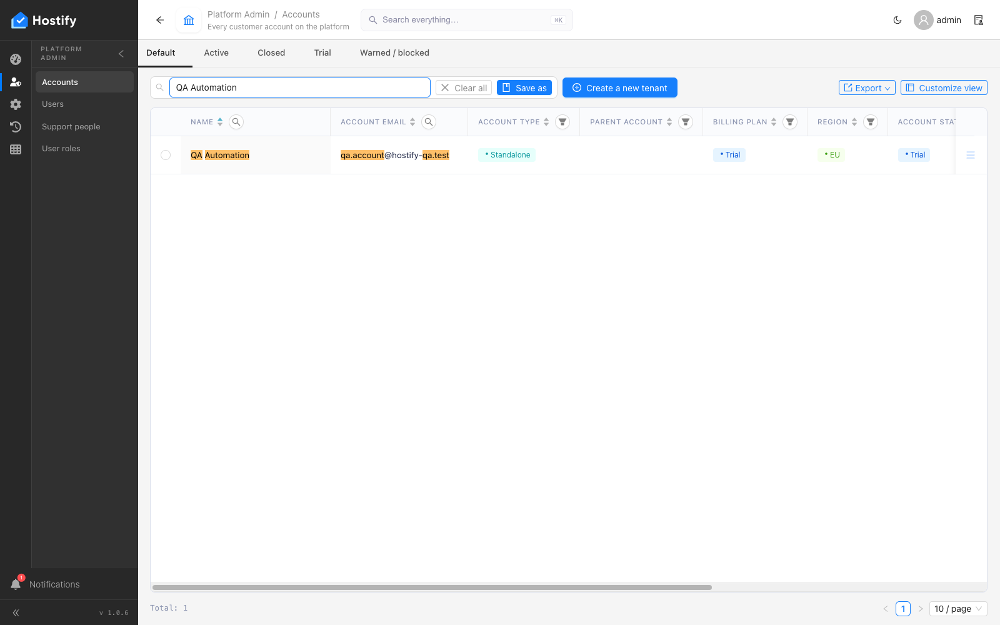

# 002-qa-account — почистване на предишния пуск; акаунт „QA Automation“ и неговият администратор през формите

- Пуск: 2026-11-06_16-46-10 · Приложение: https://hostify.bioseek.eu · Версия: 1.0.6
- Спек: `tests/e2e/002-qa-account.spec.ts`
- Казуси: 1 от 2 проверки

## Казус 1: the QA account exists — created through the Accounts form when missing

_Нов в този пуск._

**Какво се обърка**

```
Error: The page reported 1 error(s) — API answers, failed requests, console errors:
- [console.error] [dashboard] definition load failed TypeError: Failed to fetch @ https://hostify.bioseek.eu/app/static/js/main.40ca681e.js
```
- конзола: [dashboard] definition load failed TypeError: Failed to fetch — `/app/static/js/main.40ca681e.js`

**Как да се възпроизведе**

1. Влез в https://hostify.bioseek.eu/app/ като суперадминистратор (alarm@mail.bg).
2. Страница: https://hostify.bioseek.eu/app/platformAdmin/tenants
3. Спек `tests/e2e/002-qa-account.spec.ts`, проверка „the QA account exists — created through the Accounts form when missing“ — стъпките:
4. the account is in the grid
5. exactly one account carries the name; it is flagged demo and pinned as a survivor
6. the account is marked as the platform's QA account (never suspended, never charged) — a NORMAL account otherwise
7. Developer tools › Console показва грешките по-горе.

**Скрийншоти**





**Предупреждения в конзолата**

- [AlertsMenuCount] TypeError: Failed to fetch

---

Какво проверява спекът: 002 — the QA account and its administrator exist, and the account is empty.
