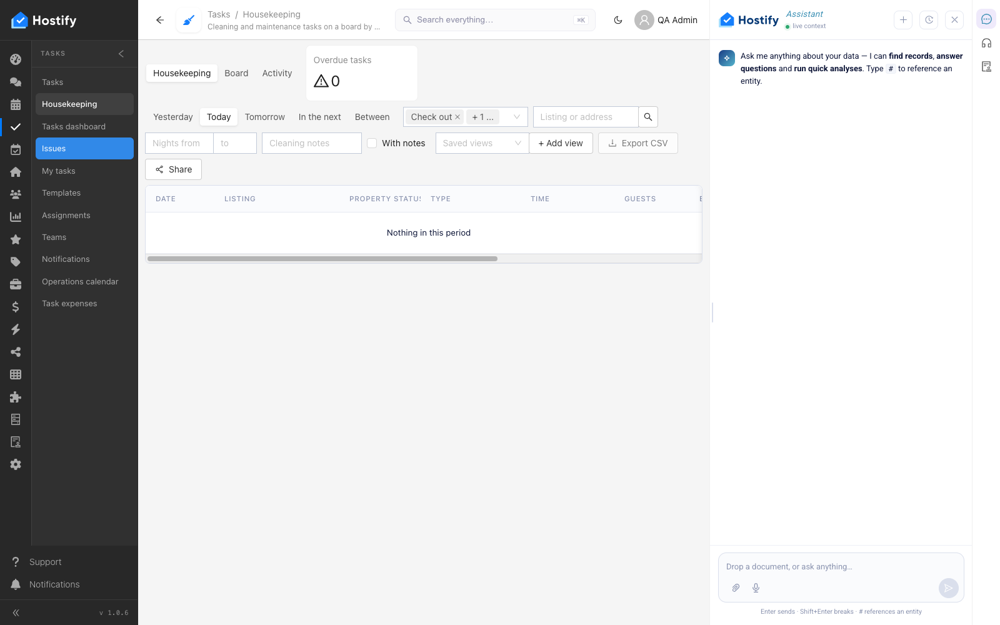
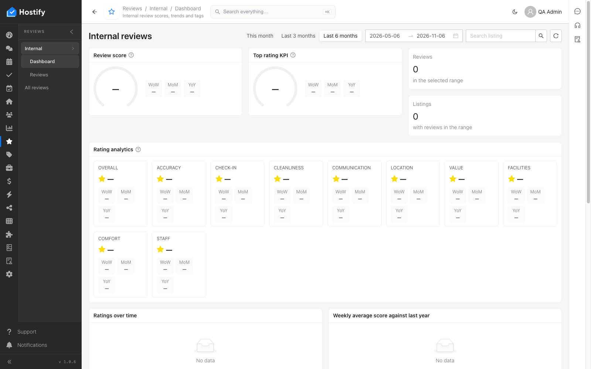
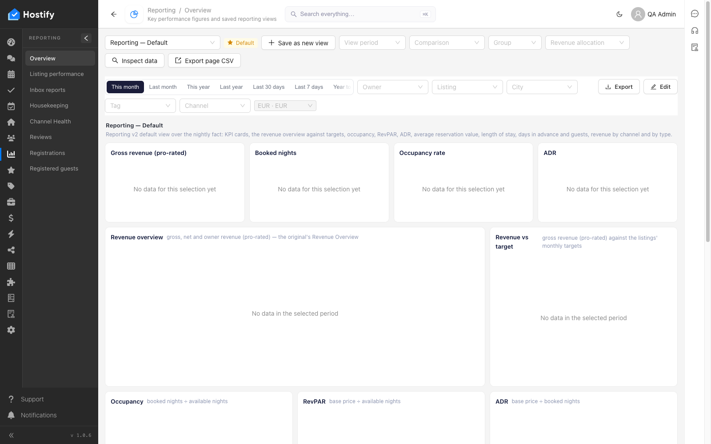
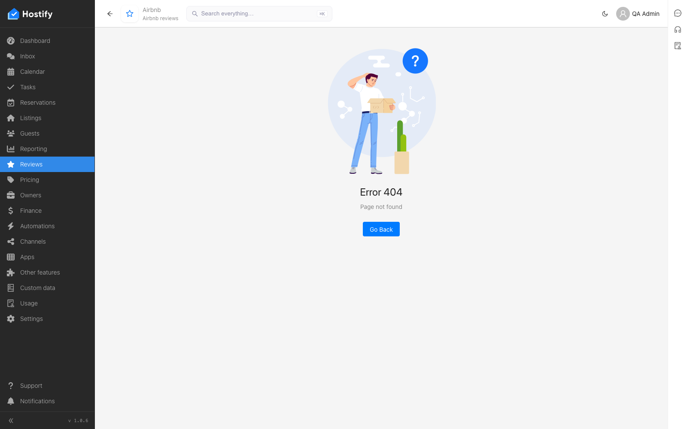
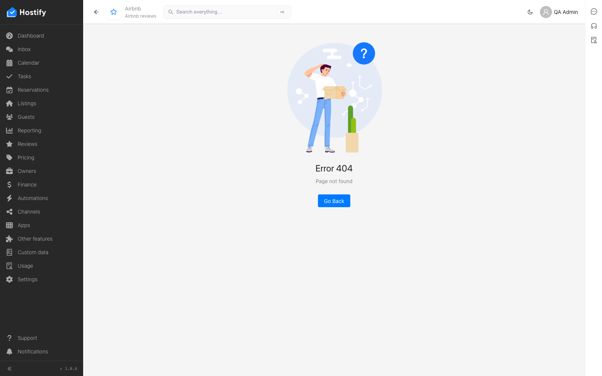
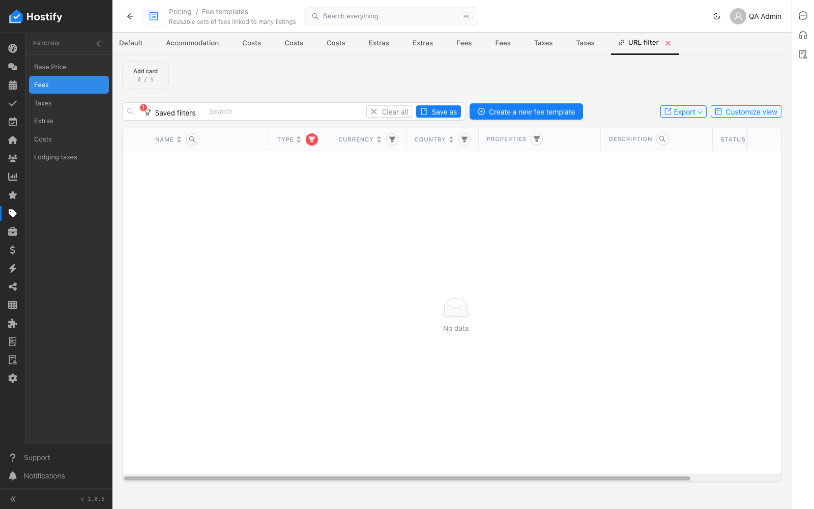
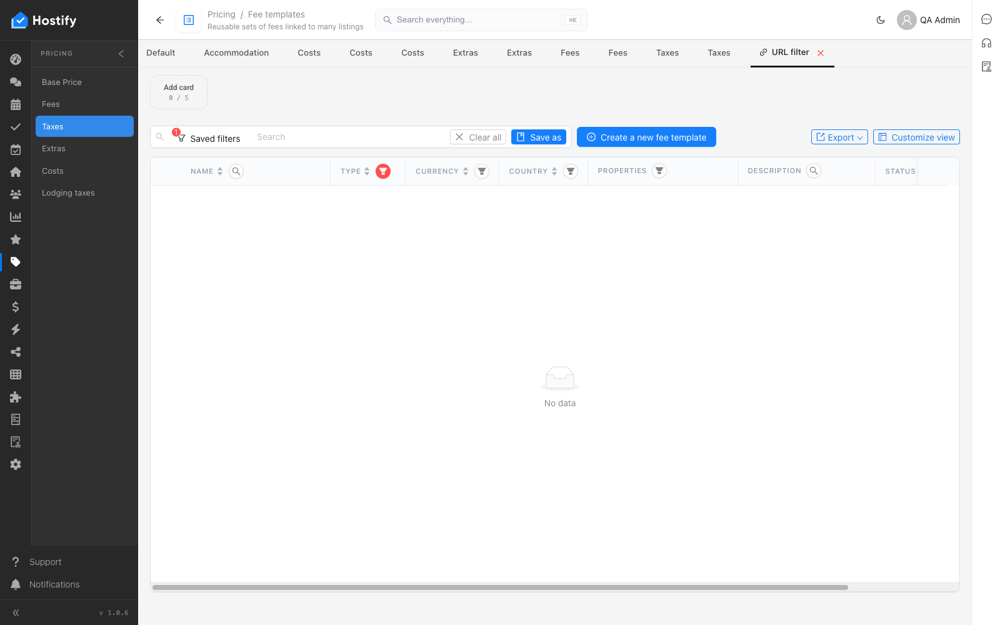
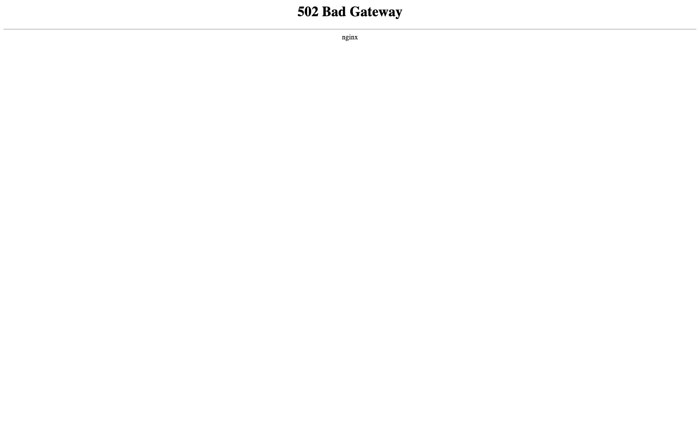

# 010-account-pages — проверка на навбар менютата на акаунта (всяка страница се отваря и се оглежда)

- Пуск: 2026-11-06_17-43-00 · Приложение: https://hostify.bioseek.eu · Версия: 1.0.6
- Спек: `tests/e2e/010-account-pages.spec.ts`
- Казуси: 20 от 177 проверки

## Казус 1: reportingHousekeeping opens (/app/reporting/reportingHousekeeping)

_Известен от пуска 2026-11-06 15:51 (същата версия) — не е отстранен._

**Какво се обърка**

```
Error: the URL of "reportingHousekeeping"

expect(page).toHaveURL(expected) failed

Expected pattern: /\/app\/reporting\/reportingHousekeeping(\/|\?|$)/
Received string:  "https://hostify.bioseek.eu/app/operations/housekeepingBoard"
Timeout: 45000ms

Call log:
  - the URL of "reportingHousekeeping" with timeout 45000ms
    48 × unexpected value "https://hostify.bioseek.eu/app/operations/housekeepingBoard"

```

**Как да се възпроизведе**

1. Влез в https://hostify.bioseek.eu/app/ като администратор на акаунта (qa.admin@hostify-qa.test).
2. Меню: REPORTING › Housekeeping — https://hostify.bioseek.eu/app/reporting/reportingHousekeeping
3. Спек `tests/e2e/010-account-pages.spec.ts`, проверка „reportingHousekeeping opens (/app/reporting/reportingHousekeeping)“.

**Скрийншоти**




## Казус 2: reportingReviews opens (/app/reporting/reportingReviews)

_Известен от пуска 2026-11-06 15:51 (същата версия) — не е отстранен._

**Какво се обърка**

```
Error: the URL of "reportingReviews"

expect(page).toHaveURL(expected) failed

Expected pattern: /\/app\/reporting\/reportingReviews(\/|\?|$)/
Received string:  "https://hostify.bioseek.eu/app/reviewsMenu/internalReviewsMenu/internalReviewsDashboard"
Timeout: 45000ms

Call log:
  - the URL of "reportingReviews" with timeout 45000ms
    48 × unexpected value "https://hostify.bioseek.eu/app/reviewsMenu/internalReviewsMenu/internalReviewsDashboard"

```

**Как да се възпроизведе**

1. Влез в https://hostify.bioseek.eu/app/ като администратор на акаунта (qa.admin@hostify-qa.test).
2. Меню: REPORTING › Reviews — https://hostify.bioseek.eu/app/reporting/reportingReviews
3. Спек `tests/e2e/010-account-pages.spec.ts`, проверка „reportingReviews opens (/app/reporting/reportingReviews)“.

**Скрийншоти**




## Казус 3: bookingOptimizer opens (/app/reporting/bookingOptimizer)

_Известен от пуска 2026-11-06 15:51 (същата версия) — не е отстранен._

**Какво се обърка**

```
Error: submenu node "bookingOptimizer"

expect(locator).toBeVisible() failed

Locator: locator('.cc-submenu-slide-panel').locator('[data-test="bookingOptimizer"]')
Expected: visible
Timeout: 30000ms
Error: element(s) not found

Call log:
  - submenu node "bookingOptimizer" with timeout 30000ms
  - waiting for locator('.cc-submenu-slide-panel').locator('[data-test="bookingOptimizer"]')
```

**Как да се възпроизведе**

1. Страница: https://hostify.bioseek.eu/app/reporting/reportingOverview
2. Спек `tests/e2e/010-account-pages.spec.ts`, проверка „bookingOptimizer opens (/app/reporting/bookingOptimizer)“.

**Скрийншоти**




## Казус 4: airbnbReviewsDashboard opens (/app/reviewsMenu/airbnbReviewsMenu/airbnbReviewsDashboard)

_Известен от пуска 2026-11-06 15:51 (същата версия) — не е отстранен._

**Какво се обърка**

```
Error: submenu node "airbnbReviewsMenu"

expect(locator).toBeVisible() failed

Locator: locator('.cc-submenu-slide-panel').locator('[data-test="airbnbReviewsMenu"]')
Expected: visible
Timeout: 30000ms
Error: element(s) not found

Call log:
  - submenu node "airbnbReviewsMenu" with timeout 30000ms
  - waiting for locator('.cc-submenu-slide-panel').locator('[data-test="airbnbReviewsMenu"]')
```

**Как да се възпроизведе**

1. Страница: https://hostify.bioseek.eu/app/airbnbReviewsMenu
2. Спек `tests/e2e/010-account-pages.spec.ts`, проверка „airbnbReviewsDashboard opens (/app/reviewsMenu/airbnbReviewsMenu/airbnbReviewsDashboard)“.

**Скрийншоти**


## Казус 5: airbnbReviews opens (/app/reviewsMenu/airbnbReviewsMenu/airbnbReviews)

_Известен от пуска 2026-11-06 15:51 (същата версия) — не е отстранен._

**Какво се обърка**

```
Error: submenu node "airbnbReviewsMenu"

expect(locator).toBeVisible() failed

Locator: locator('.cc-submenu-slide-panel').locator('[data-test="airbnbReviewsMenu"]')
Expected: visible
Timeout: 30000ms
Error: element(s) not found

Call log:
  - submenu node "airbnbReviewsMenu" with timeout 30000ms
  - waiting for locator('.cc-submenu-slide-panel').locator('[data-test="airbnbReviewsMenu"]')
```

**Как да се възпроизведе**

1. Страница: https://hostify.bioseek.eu/app/airbnbReviewsMenu
2. Спек `tests/e2e/010-account-pages.spec.ts`, проверка „airbnbReviews opens (/app/reviewsMenu/airbnbReviewsMenu/airbnbReviews)“.

**Скрийншоти**


## Казус 6: airbnbReviewListings opens (/app/reviewsMenu/airbnbReviewsMenu/airbnbReviewListings)

_Известен от пуска 2026-11-06 15:51 (същата версия) — не е отстранен._

**Какво се обърка**

```
Error: submenu node "airbnbReviewsMenu"

expect(locator).toBeVisible() failed

Locator: locator('.cc-submenu-slide-panel').locator('[data-test="airbnbReviewsMenu"]')
Expected: visible
Timeout: 30000ms
Error: element(s) not found

Call log:
  - submenu node "airbnbReviewsMenu" with timeout 30000ms
  - waiting for locator('.cc-submenu-slide-panel').locator('[data-test="airbnbReviewsMenu"]')
```

**Как да се възпроизведе**

1. Страница: https://hostify.bioseek.eu/app/airbnbReviewsMenu
2. Спек `tests/e2e/010-account-pages.spec.ts`, проверка „airbnbReviewListings opens (/app/reviewsMenu/airbnbReviewsMenu/airbnbReviewListings)“.

**Скрийншоти**


## Казус 7: airbnbTripIssues opens (/app/reviewsMenu/airbnbReviewsMenu/airbnbTripIssues)

_Известен от пуска 2026-11-06 15:51 (същата версия) — не е отстранен._

**Какво се обърка**

```
Error: submenu node "airbnbReviewsMenu"

expect(locator).toBeVisible() failed

Locator: locator('.cc-submenu-slide-panel').locator('[data-test="airbnbReviewsMenu"]')
Expected: visible
Timeout: 30000ms
Error: element(s) not found

Call log:
  - submenu node "airbnbReviewsMenu" with timeout 30000ms
  - waiting for locator('.cc-submenu-slide-panel').locator('[data-test="airbnbReviewsMenu"]')
```

**Как да се възпроизведе**

1. Страница: https://hostify.bioseek.eu/app/airbnbReviewsMenu
2. Спек `tests/e2e/010-account-pages.spec.ts`, проверка „airbnbTripIssues opens (/app/reviewsMenu/airbnbReviewsMenu/airbnbTripIssues)“.

**Скрийншоти**


## Казус 8: bookingComReviewsDashboard opens (/app/reviewsMenu/bookingComReviewsMenu/bookingComReviewsDashboard)

_Известен от пуска 2026-11-06 15:51 (същата версия) — не е отстранен._

**Какво се обърка**

```
Error: submenu node "bookingComReviewsMenu"

expect(locator).toBeVisible() failed

Locator: locator('.cc-submenu-slide-panel').locator('[data-test="bookingComReviewsMenu"]')
Expected: visible
Timeout: 30000ms
Error: element(s) not found

Call log:
  - submenu node "bookingComReviewsMenu" with timeout 30000ms
  - waiting for locator('.cc-submenu-slide-panel').locator('[data-test="bookingComReviewsMenu"]')
```

**Как да се възпроизведе**

1. Страница: https://hostify.bioseek.eu/app/airbnbReviewsMenu
2. Спек `tests/e2e/010-account-pages.spec.ts`, проверка „bookingComReviewsDashboard opens (/app/reviewsMenu/bookingComReviewsMenu/bookingComReviewsDashboard)“.

**Скрийншоти**




## Казус 9: bookingComReviews opens (/app/reviewsMenu/bookingComReviewsMenu/bookingComReviews)

_Известен от пуска 2026-11-06 15:51 (същата версия) — не е отстранен._

**Какво се обърка**

```
Error: submenu node "bookingComReviewsMenu"

expect(locator).toBeVisible() failed

Locator: locator('.cc-submenu-slide-panel').locator('[data-test="bookingComReviewsMenu"]')
Expected: visible
Timeout: 30000ms
Error: element(s) not found

Call log:
  - submenu node "bookingComReviewsMenu" with timeout 30000ms
  - waiting for locator('.cc-submenu-slide-panel').locator('[data-test="bookingComReviewsMenu"]')
```

**Как да се възпроизведе**

1. Страница: https://hostify.bioseek.eu/app/airbnbReviewsMenu
2. Спек `tests/e2e/010-account-pages.spec.ts`, проверка „bookingComReviews opens (/app/reviewsMenu/bookingComReviewsMenu/bookingComReviews)“.

**Скрийншоти**


## Казус 10: bookingComReviewListings opens (/app/reviewsMenu/bookingComReviewsMenu/bookingComReviewListings)

_Известен от пуска 2026-11-06 15:51 (същата версия) — не е отстранен._

**Какво се обърка**

```
Error: submenu node "bookingComReviewsMenu"

expect(locator).toBeVisible() failed

Locator: locator('.cc-submenu-slide-panel').locator('[data-test="bookingComReviewsMenu"]')
Expected: visible
Timeout: 30000ms
Error: element(s) not found

Call log:
  - submenu node "bookingComReviewsMenu" with timeout 30000ms
  - waiting for locator('.cc-submenu-slide-panel').locator('[data-test="bookingComReviewsMenu"]')
```

**Как да се възпроизведе**

1. Страница: https://hostify.bioseek.eu/app/airbnbReviewsMenu
2. Спек `tests/e2e/010-account-pages.spec.ts`, проверка „bookingComReviewListings opens (/app/reviewsMenu/bookingComReviewsMenu/bookingComReviewListings)“.

**Скрийншоти**


## Казус 11: vrboReviewsDashboard opens (/app/reviewsMenu/vrboReviewsMenu/vrboReviewsDashboard)

_Известен от пуска 2026-11-06 15:51 (същата версия) — не е отстранен._

**Какво се обърка**

```
Error: submenu node "vrboReviewsMenu"

expect(locator).toBeVisible() failed

Locator: locator('.cc-submenu-slide-panel').locator('[data-test="vrboReviewsMenu"]')
Expected: visible
Timeout: 30000ms
Error: element(s) not found

Call log:
  - submenu node "vrboReviewsMenu" with timeout 30000ms
  - waiting for locator('.cc-submenu-slide-panel').locator('[data-test="vrboReviewsMenu"]')
```

**Как да се възпроизведе**

1. Страница: https://hostify.bioseek.eu/app/airbnbReviewsMenu
2. Спек `tests/e2e/010-account-pages.spec.ts`, проверка „vrboReviewsDashboard opens (/app/reviewsMenu/vrboReviewsMenu/vrboReviewsDashboard)“.

**Скрийншоти**


## Казус 12: vrboReviews opens (/app/reviewsMenu/vrboReviewsMenu/vrboReviews)

_Известен от пуска 2026-11-06 15:51 (същата версия) — не е отстранен._

**Какво се обърка**

```
Error: submenu node "vrboReviewsMenu"

expect(locator).toBeVisible() failed

Locator: locator('.cc-submenu-slide-panel').locator('[data-test="vrboReviewsMenu"]')
Expected: visible
Timeout: 30000ms
Error: element(s) not found

Call log:
  - submenu node "vrboReviewsMenu" with timeout 30000ms
  - waiting for locator('.cc-submenu-slide-panel').locator('[data-test="vrboReviewsMenu"]')
```

**Как да се възпроизведе**

1. Страница: https://hostify.bioseek.eu/app/airbnbReviewsMenu
2. Спек `tests/e2e/010-account-pages.spec.ts`, проверка „vrboReviews opens (/app/reviewsMenu/vrboReviewsMenu/vrboReviews)“.

**Скрийншоти**


## Казус 13: vrboReviewListings opens (/app/reviewsMenu/vrboReviewsMenu/vrboReviewListings)

_Известен от пуска 2026-11-06 15:51 (същата версия) — не е отстранен._

**Какво се обърка**

```
Error: submenu node "vrboReviewsMenu"

expect(locator).toBeVisible() failed

Locator: locator('.cc-submenu-slide-panel').locator('[data-test="vrboReviewsMenu"]')
Expected: visible
Timeout: 30000ms
Error: element(s) not found

Call log:
  - submenu node "vrboReviewsMenu" with timeout 30000ms
  - waiting for locator('.cc-submenu-slide-panel').locator('[data-test="vrboReviewsMenu"]')
```

**Как да се възпроизведе**

1. Страница: https://hostify.bioseek.eu/app/airbnbReviewsMenu
2. Спек `tests/e2e/010-account-pages.spec.ts`, проверка „vrboReviewListings opens (/app/reviewsMenu/vrboReviewsMenu/vrboReviewListings)“.

**Скрийншоти**


## Казус 14: internalReviewsDashboard opens (/app/reviewsMenu/internalReviewsMenu/internalReviewsDashboard)

_Известен от пуска 2026-11-06 15:51 (същата версия) — не е отстранен._

**Какво се обърка**

```
Error: submenu node "internalReviewsMenu"

expect(locator).toBeVisible() failed

Locator: locator('.cc-submenu-slide-panel').locator('[data-test="internalReviewsMenu"]')
Expected: visible
Timeout: 30000ms
Error: element(s) not found

Call log:
  - submenu node "internalReviewsMenu" with timeout 30000ms
  - waiting for locator('.cc-submenu-slide-panel').locator('[data-test="internalReviewsMenu"]')
```

**Как да се възпроизведе**

1. Страница: https://hostify.bioseek.eu/app/airbnbReviewsMenu
2. Спек `tests/e2e/010-account-pages.spec.ts`, проверка „internalReviewsDashboard opens (/app/reviewsMenu/internalReviewsMenu/internalReviewsDashboard)“.

**Скрийншоти**




## Казус 15: internalReviews opens (/app/reviewsMenu/internalReviewsMenu/internalReviews)

_Известен от пуска 2026-11-06 15:51 (същата версия) — не е отстранен._

**Какво се обърка**

```
Error: submenu node "internalReviewsMenu"

expect(locator).toBeVisible() failed

Locator: locator('.cc-submenu-slide-panel').locator('[data-test="internalReviewsMenu"]')
Expected: visible
Timeout: 30000ms
Error: element(s) not found

Call log:
  - submenu node "internalReviewsMenu" with timeout 30000ms
  - waiting for locator('.cc-submenu-slide-panel').locator('[data-test="internalReviewsMenu"]')
```

**Как да се възпроизведе**

1. Страница: https://hostify.bioseek.eu/app/airbnbReviewsMenu
2. Спек `tests/e2e/010-account-pages.spec.ts`, проверка „internalReviews opens (/app/reviewsMenu/internalReviewsMenu/internalReviews)“.

**Скрийншоти**


## Казус 16: reviews opens (/app/reviewsMenu/reviews)

_Известен от пуска 2026-11-06 15:51 (същата версия) — не е отстранен._

**Какво се обърка**

```
Error: submenu node "reviews"

expect(locator).toBeVisible() failed

Locator: locator('.cc-submenu-slide-panel').locator('[data-test="reviews"]')
Expected: visible
Timeout: 30000ms
Error: element(s) not found

Call log:
  - submenu node "reviews" with timeout 30000ms
  - waiting for locator('.cc-submenu-slide-panel').locator('[data-test="reviews"]')
```

**Как да се възпроизведе**

1. Страница: https://hostify.bioseek.eu/app/airbnbReviewsMenu
2. Спек `tests/e2e/010-account-pages.spec.ts`, проверка „reviews opens (/app/reviewsMenu/reviews)“.

**Скрийншоти**


## Казус 17: pricingBasePrice opens (/app/pricing/pricingBasePrice)

_Нов в този пуск._

**Какво се обърка**

```
Error: the URL of "pricingBasePrice"

expect(page).toHaveURL(expected) failed

Expected pattern: /\/app\/pricing\/pricingBasePrice(\/|\?|$)/
Received string:  "https://hostify.bioseek.eu/app/pricing/feeTemplates?feeItemType=_or&feeItemType=accommodation"
Timeout: 45000ms

Call log:
  - the URL of "pricingBasePrice" with timeout 45000ms
    48 × unexpected value "https://hostify.bioseek.eu/app/pricing/feeTemplates?feeItemType=_or&feeItemType=accommodation"

```

**Как да се възпроизведе**

1. Влез в https://hostify.bioseek.eu/app/ като администратор на акаунта (qa.admin@hostify-qa.test).
2. Меню: PRICING › Base Price — https://hostify.bioseek.eu/app/pricing/pricingBasePrice
3. Спек `tests/e2e/010-account-pages.spec.ts`, проверка „pricingBasePrice opens (/app/pricing/pricingBasePrice)“.

**Скрийншоти**


## Казус 18: pricingFees opens (/app/pricing/pricingFees)

_Известен от пуска 2026-11-06 15:51 (същата версия) — не е отстранен._

**Какво се обърка**

```
Error: the URL of "pricingFees"

expect(page).toHaveURL(expected) failed

Expected pattern: /\/app\/pricing\/pricingFees(\/|\?|$)/
Received string:  "https://hostify.bioseek.eu/app/pricing/feeTemplates?feeItemType=_or&feeItemType=fee"
Timeout: 45000ms

Call log:
  - the URL of "pricingFees" with timeout 45000ms
    47 × unexpected value "https://hostify.bioseek.eu/app/pricing/feeTemplates?feeItemType=_or&feeItemType=fee"

```

**Как да се възпроизведе**

1. Влез в https://hostify.bioseek.eu/app/ като администратор на акаунта (qa.admin@hostify-qa.test).
2. Меню: PRICING › Fees — https://hostify.bioseek.eu/app/pricing/pricingFees
3. Спек `tests/e2e/010-account-pages.spec.ts`, проверка „pricingFees opens (/app/pricing/pricingFees)“.

**Скрийншоти**




## Казус 19: pricingTaxes opens (/app/pricing/pricingTaxes)

_Известен от пуска 2026-11-06 15:51 (същата версия) — не е отстранен._

**Какво се обърка**

```
Error: the URL of "pricingTaxes"

expect(page).toHaveURL(expected) failed

Expected pattern: /\/app\/pricing\/pricingTaxes(\/|\?|$)/
Received string:  "https://hostify.bioseek.eu/app/pricing/feeTemplates?feeItemType=_or&feeItemType=tax"
Timeout: 45000ms

Call log:
  - the URL of "pricingTaxes" with timeout 45000ms
    48 × unexpected value "https://hostify.bioseek.eu/app/pricing/feeTemplates?feeItemType=_or&feeItemType=tax"

```

**Как да се възпроизведе**

1. Влез в https://hostify.bioseek.eu/app/ като администратор на акаунта (qa.admin@hostify-qa.test).
2. Меню: PRICING › Taxes — https://hostify.bioseek.eu/app/pricing/pricingTaxes
3. Спек `tests/e2e/010-account-pages.spec.ts`, проверка „pricingTaxes opens (/app/pricing/pricingTaxes)“.

**Скрийншоти**




## Казус 20: pricingExtras opens (/app/pricing/pricingExtras)

_Нов в този пуск._

**Какво се обърка**

```
Error: expect(locator).toBeVisible() failed

Locator: locator('[data-test="login-input-email"]')
Expected: visible
Timeout: 45000ms
Error: element(s) not found

Call log:
  - Expect "toBeVisible" with timeout 45000ms
  - waiting for locator('[data-test="login-input-email"]')

```

**Как да се възпроизведе**

1. Спек `tests/e2e/010-account-pages.spec.ts`, проверка „pricingExtras opens (/app/pricing/pricingExtras)“.

**Скрийншоти**




---

Какво проверява спекът: 010 — every page of the ACCOUNT menu opens for the account administrator of the QA account.
